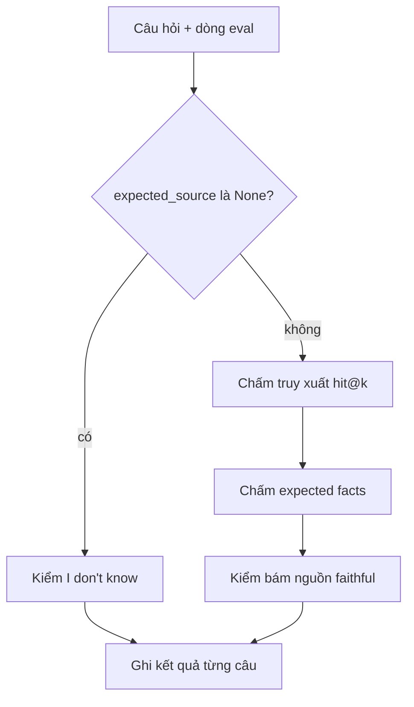

Bạn thử đổi kích thước chunk trong bot RAG, gõ tay ba câu hỏi và thấy câu trả lời "có vẻ mượt hơn". Nhưng "có vẻ" không cho bạn biết bao nhiêu câu thật sự tốt lên, câu nào âm thầm hỏng đi, hay lần sửa prompt ngày mai có làm tụt chất lượng không. **Eval** trả lời bằng con số—cùng tinh thần tập test ở `p5-04-evaluation`, nhưng dành cho hệ thống LLM.

## 1. Eval là gì và vì sao cần

Một bài **eval** (**evaluation**, đánh giá) ghép một tập câu hỏi cố định với kết quả kỳ vọng và các hàm chấm tất định, để bạn chạy lại y hệt phép đo đó sau mỗi lần đổi prompt, kích thước chunk, `k` hay model.

Ở `p5-04-evaluation`, bạn đã học không bao giờ được chỉnh mô hình trên tập test. Bẫy y hệt xảy ra với ứng dụng RAG: nếu bạn cứ chỉnh `k` và prompt cho tới khi tập eval nhỏ đạt 100%, tập eval đó biến thành tập chỉnh tham số (tuning set)—vì vậy hãy giữ riêng một phần tách biệt hoặc bổ sung câu hỏi người dùng mới định kỳ.

```python
def check_eval_case(answer: str, expected_fact: str) -> bool:
    return expected_fact.lower() in answer.lower()


print("q1 pass:", check_eval_case("Refunds take 30 days.", "30 days"))
# q1 pass: True
print("q2 pass:", check_eval_case("Shipping is free.", "5 business days"))
# q2 pass: False
```

Để ý mỗi lần kiểm tra trả về đúng/sai lặp lại được thay vì chỉ liếc mắt đoán. Mỗi kiểu kiểm tra trả lời một câu hỏi khác nhau trong quy trình kỹ sư:

| kiểu kiểm tra | câu hỏi mà nó trả lời | ví dụ |
|---|---|---|
| Unit test (`p3-01-pytest`) | Hàm Python này có chạy đúng giao kèo không? | `chunk_words("a b c", 2, 0) == ["a b", "c"]` |
| Eval | Cả hệ thống LLM có truy xuất và trả lời tốt không? | `hit_rate >= 0.8` trên 30 câu hỏi của shop |
| Đọc thử bằng mắt | Vài câu trả lời cụ thể trông và đọc ra sao? | Đọc thử 3 câu trả lời sau khi vừa sửa prompt |

## 2. Xây eval set nhỏ

Một **eval set** (tập câu hỏi đánh giá) là danh sách các ca kiểm thử lưu câu hỏi kèm **nguồn kỳ vọng** (`expected_source`, tài liệu nào cần được lấy lên) và các ý **golden answer** (đáp án chuẩn, tức những mẩu thông tin ngắn mà câu trả lời đúng phải có). Ba nguyên tắc giúp tập eval nhỏ giữ được giá trị: viết câu hỏi như người dùng thật hỏi chứ không chép nguyên văn tài liệu, chọn các fact ngắn kiểm tra được, và đưa vào cả câu diễn đạt khó lẫn ít nhất một câu không có trong tài liệu (`expected_source=None`, `expected_facts=[]`).

```text
question --> [ retrieve ] --> top-k sources --> [ generate ] --> answer
                  |                                  |
             hit@k (retrieval)              facts / faithful (answer)
```

Chấm tách riêng tầng truy xuất (`hit@k`) và tầng trả lời (`facts` / `faithful`) giúp bạn biết chính xác tầng nào sai khi một câu bị trượt. Hãy dựng kho 7 chunk của cửa hàng cùng tập eval 6 câu:

```python
docs = [
    {"source": "refunds.md", "text": "Refunds are issued within 30 days of purchase. Keep your original receipt and unused item."},
    {"source": "shipping.md", "text": "Standard shipping arrives within 5 business days. Express delivery arrives the next day."},
    {"source": "warranty.md", "text": "Hardware warranty covers factory defects for 12 months. Water damage is not covered."},
    {"source": "hours.md", "text": "Customer support hours are Monday to Friday, 9 AM to 6 PM. Weekend emails get Monday replies."},
    {"source": "pickup.md", "text": "Store pickup is ready 2 hours after order confirmation. Bring photo ID to the front counter."},
    {"source": "payment.md", "text": "We accept Visa, Mastercard, and cash on delivery for orders. Gift cards never convert to cash."},
    {"source": "loyalty.md", "text": "Loyalty points earn 5 points per dollar on every order. Unused points expire after 12 months."},
]

eval_set = [
    {"id": "q1", "question": "How many days after purchase are refunds issued?", "expected_source": "refunds.md", "expected_facts": ["30 days"]},
    {"id": "q2", "question": "How long does standard shipping take?", "expected_source": "shipping.md", "expected_facts": ["5 business days"]},
    {"id": "q3", "question": "How long is hardware warranty for factory defects?", "expected_source": "warranty.md", "expected_facts": ["12 months"]},
    {"id": "q4", "question": "What are customer support hours on weekdays?", "expected_source": "hours.md", "expected_facts": ["Monday to Friday", "9 AM to 6 PM"]},
    {"id": "q5", "question": "Can I get fast money back on my laptop order?", "expected_source": "refunds.md", "expected_facts": ["30 days"]},
    {"id": "q6", "question": "Can I pay with crypto for online orders?", "expected_source": None, "expected_facts": []},
]

print("docs:", len(docs), "questions:", len(eval_set))
# docs: 7 questions: 6
```

Để ý `q5` hỏi bằng cụm `"money back"` thay vì `"refund"`—cách hỏi tự nhiên của khách—còn `q6` hỏi về thanh toán crypto, thông tin hoàn toàn không có trong `docs`.

## 3. Chấm retrieval: hit rate

**Hit rate** (tỉ lệ truy xuất trúng, `hit@k`) đo xem `expected_source` có nằm trong top `k` chunk lấy ra hay không: `số_câu_trúng / số_câu_có_nguồn`. Những câu có `expected_source is None` không có tài liệu đích để tìm nên phải bỏ ra khỏi mẫu số thay vì tính là truy xuất trượt.

Bấm **Visualize** ở khối code này để xem `hits` và `total` tăng dần trong khi câu `expected is None` được bỏ qua.

```python
def hit_rate(results: list[dict], k: int) -> float:
    hits = 0
    total = 0
    for row in results:
        expected = row["expected_source"]
        if expected is None:
            continue
        total += 1
        if expected in row["retrieved"][:k]:
            hits += 1
    return hits / total if total else 0.0


sample = [
    {"expected_source": "refunds.md", "retrieved": ["refunds.md", "shipping.md"]},
    {"expected_source": "shipping.md", "retrieved": ["loyalty.md", "shipping.md"]},
    {"expected_source": "refunds.md", "retrieved": ["hours.md", "payment.md"]},
    {"expected_source": None, "retrieved": ["pickup.md", "payment.md"]},
]
print("hit@2:", round(hit_rate(sample, k=2), 3))
# hit@2: 0.667
```

Để ý `sample` có `4` dòng nhưng `total` chỉ bằng `3` (`2 / 3 = 0.667`) vì dòng `None` đã được bỏ qua. Bây giờ hãy chạy bộ truy xuất bằng embedding của `p7-05-rag` với `FakeLLM(embed_dim=256)` và `k=2` trên toàn bộ tập eval của cửa hàng:

```python
import numpy as np
from pyai_llm import FakeLLM

docs = [
    {"source": "refunds.md", "text": "Refunds are issued within 30 days of purchase. Keep your original receipt and unused item."},
    {"source": "shipping.md", "text": "Standard shipping arrives within 5 business days. Express delivery arrives the next day."},
    {"source": "warranty.md", "text": "Hardware warranty covers factory defects for 12 months. Water damage is not covered."},
    {"source": "hours.md", "text": "Customer support hours are Monday to Friday, 9 AM to 6 PM. Weekend emails get Monday replies."},
    {"source": "pickup.md", "text": "Store pickup is ready 2 hours after order confirmation. Bring photo ID to the front counter."},
    {"source": "payment.md", "text": "We accept Visa, Mastercard, and cash on delivery for orders. Gift cards never convert to cash."},
    {"source": "loyalty.md", "text": "Loyalty points earn 5 points per dollar on every order. Unused points expire after 12 months."},
]

eval_set = [
    {"id": "q1", "question": "How many days after purchase are refunds issued?", "expected_source": "refunds.md", "expected_facts": ["30 days"]},
    {"id": "q2", "question": "How long does standard shipping take?", "expected_source": "shipping.md", "expected_facts": ["5 business days"]},
    {"id": "q3", "question": "How long is hardware warranty for factory defects?", "expected_source": "warranty.md", "expected_facts": ["12 months"]},
    {"id": "q4", "question": "What are customer support hours on weekdays?", "expected_source": "hours.md", "expected_facts": ["Monday to Friday", "9 AM to 6 PM"]},
    {"id": "q5", "question": "Can I get fast money back on my laptop order?", "expected_source": "refunds.md", "expected_facts": ["30 days"]},
    {"id": "q6", "question": "Can I pay with crypto for online orders?", "expected_source": None, "expected_facts": []},
]


def hit_rate(results: list[dict], k: int) -> float:
    hits = 0
    total = 0
    for row in results:
        expected = row["expected_source"]
        if expected is None:
            continue
        total += 1
        if expected in row["retrieved"][:k]:
            hits += 1
    return hits / total if total else 0.0


client = FakeLLM(embed_dim=256)
doc_matrix = np.array(client.embed([d["text"] for d in docs]), dtype=float)

ret_results = []
for row in eval_set:
    q_vec = np.array(client.embed([row["question"]])[0], dtype=float)
    scores = doc_matrix @ q_vec
    order = np.argsort(-scores, kind="stable")[:2]
    top_sources = [docs[int(i)]["source"] for i in order]
    ret_results.append({"expected_source": row["expected_source"], "retrieved": top_sources})
    exp = row["expected_source"]
    hit = "skip" if exp is None else str(exp in top_sources)
    print(f"{row['id']} | {top_sources} | {exp} | {hit}")
# q1 | ['refunds.md', 'shipping.md'] | refunds.md | True
# q2 | ['loyalty.md', 'shipping.md'] | shipping.md | True
# q3 | ['warranty.md', 'refunds.md'] | warranty.md | True
# q4 | ['hours.md', 'refunds.md'] | hours.md | True
# q5 | ['hours.md', 'payment.md'] | refunds.md | False
# q6 | ['pickup.md', 'payment.md'] | None | skip

print("hit@2:", round(hit_rate(ret_results, k=2), 3))
# hit@2: 0.8
```

Theo dõi cả sáu dòng sẽ thấy ngay tầng truy xuất đang làm tốt ở đâu và hụt ở đâu:

| id | top-2 sources | expected | hit |
|---|---|---|---|
| `q1` | `['refunds.md', 'shipping.md']` | `refunds.md` | `True` |
| `q2` | `['loyalty.md', 'shipping.md']` | `shipping.md` | `True` |
| `q3` | `['warranty.md', 'refunds.md']` | `warranty.md` | `True` |
| `q4` | `['hours.md', 'refunds.md']` | `hours.md` | `True` |
| `q5` | `['hours.md', 'payment.md']` | `refunds.md` | `False` |
| `q6` | `['pickup.md', 'payment.md']` | `None` | `skip` |

Truy xuất đạt `4/5 = 0.8`: ngay cả `q2` cũng trúng vì `shipping.md` đứng hạng 2, trong khi `q5` đẩy `refunds.md` xuống hạng 3 sau `hours.md` và `payment.md`.

## 4. Chấm câu trả lời: đúng fact và bám nguồn

Sau khi truy xuất đưa các chunk vào prompt, ta chấm hai mặt của câu trả lời:
1. **`facts` (`fact_score`)**: tỉ lệ `expected_facts` xuất hiện trong câu trả lời khi kiểm tra chuỗi con viết thường (`fact.lower() in answer.lower()`). Khi `expected_facts` rỗng (câu không trả lời được), điểm bằng `1.0` nếu `"i don't know"` có trong `answer.lower()`, ngược lại `0.0`. Cách so khớp chuỗi con này nhanh và tất định nhưng rất **thô**: nó bỏ sót câu diễn đạt khác đi như `"thirty days"` và có thể chấm đậu nhầm nếu `"30 days"` nằm trong một câu sai ngữ cảnh.
2. **`faithful` (**faithfulness** / **groundedness** — độ trung thực bám nguồn)**: câu trả lời có bám sát ngữ cảnh đã truy xuất thay vì tự bịa thêm không. Heuristic tất định của chúng ta xóa các trích dẫn `[n]`, đổi sang chữ thường, tách từ `[a-z0-9]+` dài `>= 4` ký tự và kiểm tra mọi từ đó trong `answer` đều có mặt trong `context` (riêng câu trả lời chứa `"i don't know"` được coi là `faithful=True`).



Hãy chạy `score_answer` trên cả câu trả lời thật từ chế độ RAG của `FakeLLM` lẫn một câu bịa nghe rất hợp lý được mô phỏng bằng `FakeLLM(script=[...])`:

```python
import re
from pyai_llm import FakeLLM


def content_words(text: str) -> list[str]:
    cleaned = re.sub(r"\[\d+\]", "", text.lower())
    return [w for w in re.findall(r"[a-z0-9]+", cleaned) if len(w) >= 4]


def score_answer(answer: str, expected_facts: list[str], context: str) -> dict:
    ans_low = answer.lower()
    if not expected_facts:
        facts = 1.0 if "i don't know" in ans_low else 0.0
    else:
        matched = sum(1 for f in expected_facts if f.lower() in ans_low)
        facts = matched / len(expected_facts)
    if "i don't know" in ans_low:
        return {"facts": facts, "faithful": True, "unsupported": []}
    ctx_words = set(content_words(context))
    unsupported: list[str] = []
    for word in content_words(answer):
        if word not in ctx_words and word not in unsupported:
            unsupported.append(word)
    return {"facts": facts, "faithful": len(unsupported) == 0, "unsupported": unsupported}


ctx = (
    "[1] Refunds are issued within 30 days of purchase. Keep your original receipt and unused item.\n"
    "[2] Standard shipping arrives within 5 business days. Express delivery arrives the next day."
)
question = "How many days after purchase are refunds issued?"

rag_client = FakeLLM(embed_dim=256)
real_ans = rag_client.chat([
    {"role": "system", "content": "Answer using only context.\n\nContext:\n" + ctx},
    {"role": "user", "content": question},
]).content or ""

# Script đóng vai một model trả lời đúng fact nhưng tự bịa thêm chi tiết.
scripted = FakeLLM(script=["Refunds are issued within 30 days with free courier pickup. [1]"])
fake_ans = scripted.chat([
    {"role": "system", "content": "Context:\n" + ctx},
    {"role": "user", "content": question},
]).content or ""

print("real:", score_answer(real_ans, ["30 days"], ctx))
# real: {'facts': 1.0, 'faithful': True, 'unsupported': []}
print("hallucinated:", score_answer(fake_ans, ["30 days"], ctx))
# hallucinated: {'facts': 1.0, 'faithful': False, 'unsupported': ['with', 'free', 'courier', 'pickup']}
```

Để ý câu bịa vẫn đạt `facts: 1.0` vì chứa `"30 days"`, nhưng `faithful` đã bắt được (`False`) và chỉ ra `['with', 'free', 'courier', 'pickup']` không hề có trong `ctx`.

> [!NOTE]
> Heuristic đếm từ chung chỉ là phép xấp xỉ đơn giản, và ở đây `FakeLLM(script=[...])` đang đóng vai một model bịa thông tin ngoài nguồn. Ngoài thực tế người ta thường dùng **LLM-as-judge** (một model khác chấm theo thang điểm/rubric) hoặc người chấm trực tiếp—và bản thân model làm giám khảo đó cũng cần được eval vì nó có thể thiên lệch (ví dụ thích câu trả lời dài hoặc viết khéo).

## 5. So sánh hai cấu hình RAG

Giá trị lớn nhất của eval là đặt hai cấu hình lên bàn cân trên **cùng một tập eval**. Hãy so sánh `k=1` (chỉ gửi 1 chunk đầu) với `k=3` (gửi 3 chunk đầu), in **số đếm** kèm phần trăm rồi soi từng câu đã thay đổi:

```python
import re
import numpy as np
from pyai_llm import FakeLLM

docs = [
    {"source": "refunds.md", "text": "Refunds are issued within 30 days of purchase. Keep your original receipt and unused item."},
    {"source": "shipping.md", "text": "Standard shipping arrives within 5 business days. Express delivery arrives the next day."},
    {"source": "warranty.md", "text": "Hardware warranty covers factory defects for 12 months. Water damage is not covered."},
    {"source": "hours.md", "text": "Customer support hours are Monday to Friday, 9 AM to 6 PM. Weekend emails get Monday replies."},
    {"source": "pickup.md", "text": "Store pickup is ready 2 hours after order confirmation. Bring photo ID to the front counter."},
    {"source": "payment.md", "text": "We accept Visa, Mastercard, and cash on delivery for orders. Gift cards never convert to cash."},
    {"source": "loyalty.md", "text": "Loyalty points earn 5 points per dollar on every order. Unused points expire after 12 months."},
]

eval_set = [
    {"id": "q1", "question": "How many days after purchase are refunds issued?", "expected_source": "refunds.md", "expected_facts": ["30 days"]},
    {"id": "q2", "question": "How long does standard shipping take?", "expected_source": "shipping.md", "expected_facts": ["5 business days"]},
    {"id": "q3", "question": "How long is hardware warranty for factory defects?", "expected_source": "warranty.md", "expected_facts": ["12 months"]},
    {"id": "q4", "question": "What are customer support hours on weekdays?", "expected_source": "hours.md", "expected_facts": ["Monday to Friday", "9 AM to 6 PM"]},
    {"id": "q5", "question": "Can I get fast money back on my laptop order?", "expected_source": "refunds.md", "expected_facts": ["30 days"]},
    {"id": "q6", "question": "Can I pay with crypto for online orders?", "expected_source": None, "expected_facts": []},
]


def content_words(text: str) -> list[str]:
    cleaned = re.sub(r"\[\d+\]", "", text.lower())
    return [w for w in re.findall(r"[a-z0-9]+", cleaned) if len(w) >= 4]


def score_answer(answer: str, expected_facts: list[str], context: str) -> dict:
    ans_low = answer.lower()
    if not expected_facts:
        facts = 1.0 if "i don't know" in ans_low else 0.0
    else:
        matched = sum(1 for f in expected_facts if f.lower() in ans_low)
        facts = matched / len(expected_facts)
    if "i don't know" in ans_low:
        return {"facts": facts, "faithful": True, "unsupported": []}
    ctx_words = set(content_words(context))
    unsupported: list[str] = []
    for word in content_words(answer):
        if word not in ctx_words and word not in unsupported:
            unsupported.append(word)
    return {"facts": facts, "faithful": len(unsupported) == 0, "unsupported": unsupported}


client = FakeLLM(embed_dim=256)
doc_matrix = np.array(client.embed([d["text"] for d in docs]), dtype=float)


def run_eval(k: int) -> tuple[dict, list[dict]]:
    per_q = []
    for row in eval_set:
        q_vec = np.array(client.embed([row["question"]])[0], dtype=float)
        scores = doc_matrix @ q_vec
        order = np.argsort(-scores, kind="stable")[:k]
        hits = [docs[int(i)] for i in order]
        ctx = "\n".join(f"[{n}] {h['text']}" for n, h in enumerate(hits, 1))
        ans = client.chat([
            {"role": "system", "content": "Answer using only context.\n\nContext:\n" + ctx},
            {"role": "user", "content": row["question"]},
        ]).content or ""
        sc = score_answer(ans, row["expected_facts"], ctx)
        exp = row["expected_source"]
        hit = None if exp is None else (exp in [h["source"] for h in hits])
        per_q.append({"id": row["id"], "hit": hit, **sc})
    ans_rows = [r for r in per_q if r["hit"] is not None]
    idk_rows = [r for r in per_q if r["hit"] is None]
    summary = {
        "k": k,
        "hits": sum(1 for r in ans_rows if r["hit"]),
        "n_ans": len(ans_rows),
        "facts_ok": sum(1 for r in ans_rows if r["facts"] == 1.0),
        "faithful": sum(1 for r in per_q if r["faithful"]),
        "n_all": len(per_q),
        "idk_ok": sum(1 for r in idk_rows if r["facts"] == 1.0),
        "n_idk": len(idk_rows),
    }
    return summary, per_q


print(f"{'config':<8} {'hit@k':<11} {'facts':<11} {'faithful':<11} {'idk':<9}")
for k in (1, 3):
    s, _ = run_eval(k)
    h_str = f"{s['hits']}/{s['n_ans']} ({round(s['hits']/s['n_ans']*100)}%)"
    f_str = f"{s['facts_ok']}/{s['n_ans']} ({round(s['facts_ok']/s['n_ans']*100)}%)"
    g_str = f"{s['faithful']}/{s['n_all']} ({round(s['faithful']/s['n_all']*100)}%)"
    i_str = f"{s['idk_ok']}/{s['n_idk']} ({round(s['idk_ok']/s['n_idk']*100)}%)"
    print(f"k={k:<6} {h_str:<11} {f_str:<11} {g_str:<11} {i_str:<9}")
# config   hit@k       facts       faithful    idk
# k=1      3/5 (60%)   3/5 (60%)   6/6 (100%)  1/1 (100%)
# k=3      5/5 (100%)  4/5 (80%)   6/6 (100%)  0/1 (0%)

_, r1 = run_eval(1)
_, r3 = run_eval(3)
for a, b in zip(r1, r3, strict=True):
    if (a["hit"], a["facts"]) != (b["hit"], b["facts"]):
        print(f"diff {a['id']}: k=1(hit={a['hit']}, facts={a['facts']}) -> k=3(hit={b['hit']}, facts={b['facts']})")
# diff q2: k=1(hit=False, facts=0.0) -> k=3(hit=True, facts=1.0)
# diff q5: k=1(hit=False, facts=0.0) -> k=3(hit=True, facts=0.0)
# diff q6: k=1(hit=None, facts=1.0) -> k=3(hit=None, facts=0.0)
```

Hãy đọc kỹ từng câu đổi trạng thái—đây chính là lý do ta không bao giờ chỉ nhìn bảng tổng:
- **`q2` tốt lên**: với `k=1`, `loyalty.md` đứng trên `shipping.md` nên bot trả `"I don't know"`; sang `k=3`, `shipping.md` vào prompt và bot trả đúng `"Standard shipping arrives within 5 business days. [2]"`.
- **`q5` chỉ tốt lên ở retrieval**: sang `k=3`, `refunds.md` vào được hạng 3 (`hit=True`), nhưng `facts` vẫn là `0.0` vì bước `embed` của `FakeLLM` hiểu `"money back"` là `"refund"`, còn `chat()` chỉ đếm từ thô trùng khớp (`>= 3` ký tự) nên vẫn rơi về `"I don't know"`.
- **`q6` tệ đi**: với `k=1`, chỉ có `pickup.md` trong context và không trùng từ nào (`idk=1/1`); sang `k=3`, `payment.md` lọt vào hạng 2 và vô tình trùng hai từ `"for"`, `"orders"` với `"Can I pay with crypto for online orders?"`, khiến model trả lời sang Visa/Mastercard (`idk=0/1`).

> [!WARNING]
> Trên tập eval chỉ có 5–6 câu, một câu đã chiếm tới 17–20% tổng điểm nên chênh lệch 1 câu mang rất nhiều nhiễu. Tập eval thực tế cần vài chục tới vài trăm câu đại diện trước khi kết luận thay đổi nào là thắng.

## 6. Eval như regression test

Cũng như `pytest` ở `p3-01-pytest` bảo vệ hàm Python khỏi bị sửa hỏng, việc đặt ngưỡng cho eval biến bộ eval thành bài kiểm tra **regression** (hồi quy) trước mỗi lần đổi prompt hay cấu hình (`assert hit_rate >= 0.8`).

```python
def check_eval(summary: dict, min_hit: float = 0.8, min_facts: float = 0.8) -> list[str]:
    failures: list[str] = []
    hit_val = summary["hits"] / summary["n_ans"]
    fact_val = summary["facts_ok"] / summary["n_ans"]
    if hit_val < min_hit:
        failures.append(f"hit_rate {round(hit_val, 3)} < {min_hit}")
    if fact_val < min_facts:
        failures.append(f"fact_pass {round(fact_val, 3)} < {min_facts}")
    return failures


s_k1 = {"hits": 3, "n_ans": 5, "facts_ok": 3}
s_k3 = {"hits": 5, "n_ans": 5, "facts_ok": 4}
print("k=1 failures:", check_eval(s_k1))
# k=1 failures: ['hit_rate 0.6 < 0.8', 'fact_pass 0.6 < 0.8']
print("k=3 failures:", check_eval(s_k3))
# k=3 failures: []
```

Hãy lưu lại bảng tóm tắt và điểm từng câu sau mỗi lần chạy (thời gian, cấu hình, `hit_rate`, `facts`, `faithful`) để theo dõi xu hướng theo thời gian—nối tiếp sang phần giám sát (monitoring) ở phase 8.

## 7. Lỗi thường gặp

**1. Chỉ chấm câu trả lời cuối mà không chấm retrieval**

Nếu chỉ nhìn `facts`, bạn không thể biết do tìm sai tài liệu hay do model trả lời hỏng. Ở `q5` với `k=3`, retrieval thực tế đã tìm trúng (`hit=True`) nhưng câu trả lời vẫn trượt:

```python
import numpy as np
from pyai_llm import FakeLLM

docs = [
    {"source": "refunds.md", "text": "Refunds are issued within 30 days of purchase. Keep your original receipt and unused item."},
    {"source": "hours.md", "text": "Customer support hours are Monday to Friday, 9 AM to 6 PM. Weekend emails get Monday replies."},
    {"source": "payment.md", "text": "We accept Visa, Mastercard, and cash on delivery for orders. Gift cards never convert to cash."},
]
q5 = "Can I get fast money back on my laptop order?"

client = FakeLLM(embed_dim=256)
doc_matrix = np.array(client.embed([d["text"] for d in docs]), dtype=float)
q_vec = np.array(client.embed([q5])[0], dtype=float)
order = np.argsort(-(doc_matrix @ q_vec), kind="stable")[:3]
hits = [docs[int(i)] for i in order]
ctx = "\n".join(f"[{n}] {h['text']}" for n, h in enumerate(hits, 1))
ans = client.chat([{"role": "system", "content": "Context:\n" + ctx}, {"role": "user", "content": q5}]).content

print("hit:", "refunds.md" in [h["source"] for h in hits], "| ans:", ans)
# hit: True | ans: I don't know based on the provided context.
```

Cách sửa: luôn ghi nhận `hit@k` song song với điểm câu trả lời để biết cần chỉnh tầng truy xuất (`k`, chunking, embedding) hay chỉnh prompt/model sinh câu trả lời.

**2. Tính cả câu không trả lời được vào mẫu số `hit_rate`**

Đưa các dòng `expected_source=None` vào mẫu số sẽ kéo tụt `hit_rate` một cách giả tạo:

```python
rows = [
    {"expected_source": "refunds.md", "retrieved": ["refunds.md", "shipping.md"]},
    {"expected_source": "shipping.md", "retrieved": ["loyalty.md", "shipping.md"]},
    {"expected_source": "warranty.md", "retrieved": ["warranty.md", "refunds.md"]},
    {"expected_source": "hours.md", "retrieved": ["hours.md", "refunds.md"]},
    {"expected_source": "refunds.md", "retrieved": ["hours.md", "payment.md"]},
    {"expected_source": None, "retrieved": ["pickup.md", "payment.md"]},
]

wrong = sum(1 for r in rows if r["expected_source"] in r["retrieved"]) / len(rows)
right_rows = [r for r in rows if r["expected_source"] is not None]
right = sum(1 for r in right_rows if r["expected_source"] in r["retrieved"]) / len(right_rows)
print("wrong:", round(wrong, 3), "| right:", round(right, 3))
# wrong: 0.667 | right: 0.8
```

Cách sửa: bỏ qua `expected_source is None` khi tính `hit_rate` và chấm riêng nhóm câu không trả lời được bằng kiểm tra từ chối `"I don't know"`.

**3. So khớp fact phân biệt hoa thường hoặc đòi đúng nguyên câu**

So khớp giữ nguyên chữ hoa/thường hoặc bắt khớp nguyên câu dài sẽ đánh trượt những câu trả lời hoàn toàn đúng:

```python
answer = "Refunds are issued within 30 days of purchase. [1]"
print("case-sensitive:", "30 Days" in answer)
# case-sensitive: False
print("lowercase fact:", "30 days".lower() in answer.lower())
# lowercase fact: True
```

Cách sửa: lưu các fact ngắn gọn và chuyển cả `fact` lẫn `answer` về chữ thường trước khi kiểm tra `in`.

**4. Chỉnh tham số tới khi tập eval nhỏ đạt 100%**

Giống như tinh chỉnh siêu tham số trực tiếp trên tập test ở `p5-04-evaluation` gây **overfitting**, việc sửa prompt và `k` liên tục cho vừa khít 6 câu sẽ khiến hệ thống học vẹt đúng 6 câu đó rồi vấp ngã trước câu hỏi thật mới. Hãy giữ một phần eval tách riêng hoặc làm mới tập eval định kỳ từ log người dùng.

## Tóm tắt

- **Eval** biến cảm giác "có vẻ ổn" thành con số lặp lại được nhờ **eval set** cố định, **golden answer** ngắn gọn và hàm chấm tất định.
- Chấm riêng **retrieval** (`hit@k`, bỏ qua câu `expected_source=None`) và **câu trả lời** (`fact_score` và `faithful`) để sửa đúng tầng bị lỗi.
- Heuristic **faithfulness** kiểm tra mọi từ nội dung (`len >= 4`, bỏ trích dẫn `[n]`) đều nằm trong ngữ cảnh; hệ thống thực tế kết hợp thêm **LLM-as-judge** hoặc kiểm tra thủ công.
- Luôn so sánh các cấu hình trên **cùng** tập eval bằng số đếm kèm phần trăm và đọc khác biệt từng câu—tập 5–6 câu rất nhiễu.
- Bọc ngưỡng eval vào hàm kiểm tra **regression** như `check_eval()` và lưu lịch sử mỗi lần chạy trước khi phát hành thay đổi.
