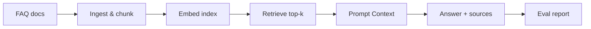

Your manager asks you to build a customer help-desk bot backed by your shop's FAQ pages. It has to answer questions accurately, cite the source page, say `"I don't know"` when the docs lack the answer, and come with numbers proving it works. Almost nothing here is new—this project combines everything from `p7-03-embeddings` through `p7-08-evals` into one complete, honestly evaluated RAG bot.

## 1. The plan

Map the entire workflow from raw FAQ pages to a final evaluation report before writing any code:



Each part of the project connects directly to one earlier lesson:

| part | what you build | from lesson |
|---|---|---|
| Part 1: Ingest & chunk | Split FAQ docs into sentence or word-window chunks with `<source>#<n>` IDs | `p7-05-rag` |
| Part 2: Index & retrieve | Embed all chunks once into a NumPy matrix and rank top-k `(score, chunk)` pairs | `p7-03-embeddings`, `p7-04-vector-db` |
| Part 3: Answer & cite | Send `Context:` with `[n]` chunks to `FakeLLM`, parse valid `sources`, or refuse | `p7-01-llm-api`, `p7-05-rag` |
| Part 4: Dev eval | Score `hit@k`, `facts`, `grounded`, and `idk` on `dev_set` to pick one config | `p7-08-evals` |
| Part 5: Test & report | Run the chosen config on `test_set` once and report all scores and failures | `p5-05-mini-project`, `p7-08-evals` |

Follow the same discipline as `p5-05-mini-project`: tune and compare configurations strictly on `dev_set`, run the locked `test_set` **once** at the end, and name every failure honestly instead of hiding weak spots. Notice the metric names align with `p7-08-evals`: `grounded` here extends `p7-08`'s `faithful` by requiring both supported content and valid `[n]` citations (just like `score_grounded` in `p7-08 ex02`), while `idk` and `refusals` measure the same clean `"I don't know"` rate on unanswerable questions.

## 2. The data: FAQ corpus and eval split

Our knowledge base has 8 short shop FAQ pages (`refunds.md`, `shipping.md`, `warranty.md`, `payment.md`, `accounts.md`, `support.md`, `pickup.md`, `discounts.md`), each with 3 crisp sentences containing concrete numbers or rules. Our 12-question evaluation dataset is fixed into 8 `dev_set` questions (6 answerable including paraphrase `d6`, plus 2 unanswerable `d7` and `d8`) and 4 held-out `test_set` questions (3 answerable including paraphrase `t3`, plus 1 unanswerable `t4`):

```python
docs = [
    {"source": "refunds.md", "text": "Refunds are issued within 30 days of purchase. Keep your original receipt for any return. Opened software is not eligible for a refund."},
    {"source": "shipping.md", "text": "Standard shipping takes 5 business days across the country. Express delivery arrives next day for 12 dollars. Free shipping applies on orders over 50 dollars."},
    {"source": "warranty.md", "text": "Hardware warranty covers factory defects for 12 months. Water damage and dropped screens are not covered. Battery wear after 6 months is excluded."},
    {"source": "payment.md", "text": "Accepted payment methods are Visa, Mastercard, and cash on delivery. Gift cards cannot be redeemed for cash. Invoices are emailed right after checkout."},
    {"source": "accounts.md", "text": "Password resets are sent by email within 5 minutes. Two-factor login can be turned on in security settings. Inactive accounts remain open for 24 months."},
    {"source": "support.md", "text": "Support agents work Monday to Friday from 9 AM to 6 PM. Weekend messages receive replies on Monday morning. Urgent outage tickets get a 2 hour target."},
    {"source": "pickup.md", "text": "Store pickup is ready 2 hours after order confirmation. Unclaimed orders are held at the counter for 7 days. Bring a photo ID at pickup."},
    {"source": "discounts.md", "text": "Student discounts give 15 percent off eligible laptops. Promo codes cannot be combined on one order. Loyalty points expire after 12 months."},
]

dev_set = [
    {"id": "d1", "question": "How many days do refunds take after purchase?", "expected_source": "refunds.md", "expected_facts": ["30 days"]},
    {"id": "d2", "question": "How much does express delivery cost?", "expected_source": "shipping.md", "expected_facts": ["12 dollars"]},
    {"id": "d3", "question": "How long is hardware warranty for factory defects?", "expected_source": "warranty.md", "expected_facts": ["12 months"]},
    {"id": "d4", "question": "What payment methods are accepted at checkout?", "expected_source": "payment.md", "expected_facts": ["Visa", "Mastercard"]},
    {"id": "d5", "question": "How quickly do password resets arrive by email?", "expected_source": "accounts.md", "expected_facts": ["5 minutes"]},
    {"id": "d6", "question": "Can I get money back within a month?", "expected_source": "refunds.md", "expected_facts": ["30 days"]},
    {"id": "d7", "question": "Do you offer cryptocurrency billing?", "expected_source": None, "expected_facts": []},
    {"id": "d8", "question": "Can I pay with crypto for online orders?", "expected_source": None, "expected_facts": []},
]

test_set = [
    {"id": "t1", "question": "When do support agents work on weekdays?", "expected_source": "support.md", "expected_facts": ["Monday to Friday", "9 AM to 6 PM"]},
    {"id": "t2", "question": "How many days are unclaimed pickup orders held?", "expected_source": "pickup.md", "expected_facts": ["7 days"]},
    {"id": "t3", "question": "How much off do students get on notebooks?", "expected_source": "discounts.md", "expected_facts": ["15 percent"]},
    {"id": "t4", "question": "Is international customs insurance included?", "expected_source": None, "expected_facts": []},
]

dev_ans = sum(1 for r in dev_set if r["expected_source"] is not None)
test_ans = sum(1 for r in test_set if r["expected_source"] is not None)
print("docs:", len(docs), "dev:", len(dev_set), "test:", len(test_set))
# docs: 8 dev: 8 test: 4
print("dev answerable:", dev_ans, "unanswerable:", len(dev_set) - dev_ans)
# dev answerable: 6 unanswerable: 2
print("test answerable:", test_ans, "unanswerable:", len(test_set) - test_ans)
# test answerable: 3 unanswerable: 1
```

Keep the two splits strictly separated during every experiment:

```text
12 eval questions
  |-- dev_set  (8: d1..d6 answerable, d7..d8 unanswerable) -> compare configs
  '-- test_set (4: t1..t3 answerable, t4 unanswerable)     -> score once at end
```

Notice that `d6` uses `"money back"` instead of `"refund"` and `t3` uses `"notebooks"` instead of `"laptops"`, letting us test natural user paraphrases on both splits.

## 3. Part 1: ingest and chunk

**Ingestion** reads raw documents and splits them into chunk dicts of the form `{"id": "<source>#<n>", "source": ..., "text": ...}` before any embedding happens. Here `r"(?<=[.!?])\s+"` uses a regex lookbehind to split on whitespace right after `.`, `!`, or `?` while keeping that punctuation attached to each sentence. Press **Visualize** on this short block and watch `idx` and `chunks` build three chunks from one document:

```python
import re

doc = {
    "source": "refunds.md",
    "text": "Refunds take 30 days. Keep your receipt. Opened apps fail.",
}
sentences = [
    s.strip()
    for s in re.split(r"(?<=[.!?])\s+", doc["text"].strip())
    if s.strip()
]
chunks = []
for idx, text in enumerate(sentences):
    chunks.append({"id": f"{doc['source']}#{idx}", "source": doc["source"], "text": text})
for c in chunks:
    print(c["id"], "->", c["text"])
# refunds.md#0 -> Refunds take 30 days.
# refunds.md#1 -> Keep your receipt.
# refunds.md#2 -> Opened apps fail.
```

Now compare two chunking strategies on all 8 FAQ docs: splitting on sentence boundaries (`mode="sentence"`) versus sliding an 8-word window with 2-word overlap (`mode="words"`, as in `p7-05-rag`):

```python
import re

docs = [
    {"source": "refunds.md", "text": "Refunds are issued within 30 days of purchase. Keep your original receipt for any return. Opened software is not eligible for a refund."},
    {"source": "shipping.md", "text": "Standard shipping takes 5 business days across the country. Express delivery arrives next day for 12 dollars. Free shipping applies on orders over 50 dollars."},
    {"source": "warranty.md", "text": "Hardware warranty covers factory defects for 12 months. Water damage and dropped screens are not covered. Battery wear after 6 months is excluded."},
    {"source": "payment.md", "text": "Accepted payment methods are Visa, Mastercard, and cash on delivery. Gift cards cannot be redeemed for cash. Invoices are emailed right after checkout."},
    {"source": "accounts.md", "text": "Password resets are sent by email within 5 minutes. Two-factor login can be turned on in security settings. Inactive accounts remain open for 24 months."},
    {"source": "support.md", "text": "Support agents work Monday to Friday from 9 AM to 6 PM. Weekend messages receive replies on Monday morning. Urgent outage tickets get a 2 hour target."},
    {"source": "pickup.md", "text": "Store pickup is ready 2 hours after order confirmation. Unclaimed orders are held at the counter for 7 days. Bring a photo ID at pickup."},
    {"source": "discounts.md", "text": "Student discounts give 15 percent off eligible laptops. Promo codes cannot be combined on one order. Loyalty points expire after 12 months."},
]


def chunk_sentences(text: str) -> list[str]:
    cleaned = text.strip()
    if not cleaned:
        return []
    return [s.strip() for s in re.split(r"(?<=[.!?])\s+", cleaned) if s.strip()]


def chunk_words(text: str, size: int = 8, overlap: int = 2) -> list[str]:
    if size <= 0 or overlap < 0 or overlap >= size:
        raise ValueError("need size > 0 and 0 <= overlap < size")
    words = text.split()
    if not words:
        return []
    step = size - overlap
    out: list[str] = []
    i = 0
    while i < len(words):
        out.append(" ".join(words[i : i + size]))
        if i + size >= len(words):
            break
        i += step
    return out


def ingest_docs(raw_docs: list[dict], mode: str = "sentence", size: int = 8, overlap: int = 2) -> list[dict]:
    chunks: list[dict] = []
    for doc in raw_docs:
        pieces = chunk_sentences(doc["text"]) if mode == "sentence" else chunk_words(doc["text"], size, overlap)
        for idx, text in enumerate(pieces):
            chunks.append({"id": f"{doc['source']}#{idx}", "source": doc["source"], "text": text})
    return chunks


sent_chunks = ingest_docs(docs, mode="sentence")
word_chunks = ingest_docs(docs, mode="words", size=8, overlap=2)
print("sentence chunks:", len(sent_chunks), "| word chunks:", len(word_chunks))
# sentence chunks: 24 | word chunks: 33
for c in sent_chunks[:4]:
    print(f"{c['id']} | {c['source']} | {c['text'][:35]}")
# refunds.md#0 | refunds.md | Refunds are issued within 30 days o
# refunds.md#1 | refunds.md | Keep your original receipt for any 
# refunds.md#2 | refunds.md | Opened software is not eligible for
# shipping.md#0 | shipping.md | Standard shipping takes 5 business 
```

Tracing the first four sentence chunks shows why sentence chunking is so clean for FAQ pages:

| id | source | text |
|---|---|---|
| `refunds.md#0` | `refunds.md` | `Refunds are issued within 30 days of purchase.` |
| `refunds.md#1` | `refunds.md` | `Keep your original receipt for any return.` |
| `refunds.md#2` | `refunds.md` | `Opened software is not eligible for a refund.` |
| `shipping.md#0` | `shipping.md` | `Standard shipping takes 5 business days across the country.` |

Each chunk begins with a complete fact-bearing sentence—crucial because `FakeLLM` in RAG mode returns only the **first sentence** of the winning chunk.

## 4. Part 2: index and retrieve

Embed all 24 sentence chunks **once** into a NumPy matrix with `FakeLLM(embed_dim=256)`, then write `top_k(index, question, client, k)` to rank chunks with `np.argsort(-scores, kind="stable")` and return `(score, chunk)` pairs:

```python
import re
import numpy as np
from pyai_llm import FakeLLM

docs = [
    {"source": "refunds.md", "text": "Refunds are issued within 30 days of purchase. Keep your original receipt for any return. Opened software is not eligible for a refund."},
    {"source": "shipping.md", "text": "Standard shipping takes 5 business days across the country. Express delivery arrives next day for 12 dollars. Free shipping applies on orders over 50 dollars."},
    {"source": "warranty.md", "text": "Hardware warranty covers factory defects for 12 months. Water damage and dropped screens are not covered. Battery wear after 6 months is excluded."},
    {"source": "payment.md", "text": "Accepted payment methods are Visa, Mastercard, and cash on delivery. Gift cards cannot be redeemed for cash. Invoices are emailed right after checkout."},
    {"source": "accounts.md", "text": "Password resets are sent by email within 5 minutes. Two-factor login can be turned on in security settings. Inactive accounts remain open for 24 months."},
    {"source": "support.md", "text": "Support agents work Monday to Friday from 9 AM to 6 PM. Weekend messages receive replies on Monday morning. Urgent outage tickets get a 2 hour target."},
    {"source": "pickup.md", "text": "Store pickup is ready 2 hours after order confirmation. Unclaimed orders are held at the counter for 7 days. Bring a photo ID at pickup."},
    {"source": "discounts.md", "text": "Student discounts give 15 percent off eligible laptops. Promo codes cannot be combined on one order. Loyalty points expire after 12 months."},
]


def ingest_sentences(raw_docs: list[dict]) -> list[dict]:
    chunks: list[dict] = []
    for doc in raw_docs:
        pieces = [s.strip() for s in re.split(r"(?<=[.!?])\s+", doc["text"].strip()) if s.strip()]
        for idx, text in enumerate(pieces):
            chunks.append({"id": f"{doc['source']}#{idx}", "source": doc["source"], "text": text})
    return chunks


def build_index(chunks: list[dict], client: FakeLLM) -> dict:
    vectors = np.array(client.embed([c["text"] for c in chunks]), dtype=float)
    return {"chunks": chunks, "vectors": vectors}


def top_k(index: dict, question: str, client: FakeLLM, k: int = 2) -> list[tuple[float, dict]]:
    q_vec = np.array(client.embed([question])[0], dtype=float)
    scores = index["vectors"] @ q_vec
    order = np.argsort(-scores, kind="stable")[:k]
    return [(float(scores[int(i)]), index["chunks"][int(i)]) for i in order]


client = FakeLLM(embed_dim=256)
index = build_index(ingest_sentences(docs), client)

for q in [
    "How many days do refunds take after purchase?",
    "Can I pay with crypto for online orders?",
]:
    hits = top_k(index, q, client, k=2)
    print("Q:", q)
    for score, chunk in hits:
        print(f"  {chunk['id']} ({round(score, 3)}): {chunk['text'][:38]}")
# Q: How many days do refunds take after purchase?
#   refunds.md#0 (0.375): Refunds are issued within 30 days of p
#   shipping.md#0 (0.236): Standard shipping takes 5 business day
# Q: Can I pay with crypto for online orders?
#   pickup.md#1 (0.335): Unclaimed orders are held at the count
#   shipping.md#1 (0.25): Express delivery arrives next day for 
```

Notice something subtle on the second question (`"Can I pay with crypto for online orders?"`): even though the store has no crypto policy, `pickup.md#1` (`"Unclaimed orders..."`) still scores `0.335` because it shares the word `"orders"`—a preview of why unanswerable questions can still trick retrieval.

## 5. Part 3: answer with citations

Format the retrieved hits into `Context:\n[1] ...`, call `client.chat(...)`, extract valid `[n]` citations mapped back to `source`, and force `sources` to `[]` whenever no hits clear `min_score` or the reply says `"I don't know"`:

```python
import re
import numpy as np
from pyai_llm import FakeLLM

docs = [
    {"source": "refunds.md", "text": "Refunds are issued within 30 days of purchase. Keep your original receipt for any return. Opened software is not eligible for a refund."},
    {"source": "shipping.md", "text": "Standard shipping takes 5 business days across the country. Express delivery arrives next day for 12 dollars. Free shipping applies on orders over 50 dollars."},
    {"source": "warranty.md", "text": "Hardware warranty covers factory defects for 12 months. Water damage and dropped screens are not covered. Battery wear after 6 months is excluded."},
    {"source": "payment.md", "text": "Accepted payment methods are Visa, Mastercard, and cash on delivery. Gift cards cannot be redeemed for cash. Invoices are emailed right after checkout."},
    {"source": "accounts.md", "text": "Password resets are sent by email within 5 minutes. Two-factor login can be turned on in security settings. Inactive accounts remain open for 24 months."},
    {"source": "support.md", "text": "Support agents work Monday to Friday from 9 AM to 6 PM. Weekend messages receive replies on Monday morning. Urgent outage tickets get a 2 hour target."},
    {"source": "pickup.md", "text": "Store pickup is ready 2 hours after order confirmation. Unclaimed orders are held at the counter for 7 days. Bring a photo ID at pickup."},
    {"source": "discounts.md", "text": "Student discounts give 15 percent off eligible laptops. Promo codes cannot be combined on one order. Loyalty points expire after 12 months."},
]


def build_index(raw_docs: list[dict], client: FakeLLM) -> dict:
    chunks: list[dict] = []
    for doc in raw_docs:
        pieces = [s.strip() for s in re.split(r"(?<=[.!?])\s+", doc["text"].strip()) if s.strip()]
        for idx, text in enumerate(pieces):
            chunks.append({"id": f"{doc['source']}#{idx}", "source": doc["source"], "text": text})
    vectors = np.array(client.embed([c["text"] for c in chunks]), dtype=float)
    return {"chunks": chunks, "vectors": vectors}


def top_k(index: dict, question: str, client: FakeLLM, k: int = 2) -> list[tuple[float, dict]]:
    q_vec = np.array(client.embed([question])[0], dtype=float)
    scores = index["vectors"] @ q_vec
    order = np.argsort(-scores, kind="stable")[:k]
    return [(float(scores[int(i)]), index["chunks"][int(i)]) for i in order]


def answer_with_sources(index: dict, question: str, client: FakeLLM, k: int = 2, min_score: float = 0.2) -> dict:
    hits = [chunk for score, chunk in top_k(index, question, client, k=k) if score >= min_score]
    if not hits:
        return {"answer": "I don't know based on the provided context.", "sources": [], "retrieved": []}
    context = "\n".join(f"[{n}] {h['text']}" for n, h in enumerate(hits, 1))
    messages = [
        {
            "role": "system",
            "content": (
                "Answer using only the provided context. "
                "If missing, say you don't know. Cite sources with [n].\n\n"
                f"Context:\n{context}"
            ),
        },
        {"role": "user", "content": question},
    ]
    answer = client.chat(messages).content or ""
    sources: list[str] = []
    if "i don't know" not in answer.lower():
        for raw in re.findall(r"\[(\d+)\]", answer):
            idx = int(raw) - 1
            if 0 <= idx < len(hits):
                src = hits[idx]["source"]
                if src not in sources:
                    sources.append(src)
    return {"answer": answer, "sources": sources, "retrieved": [h["source"] for h in hits]}


client = FakeLLM(embed_dim=256)
index = build_index(docs, client)

for q in [
    "How much does express delivery cost?",
    "Do you offer cryptocurrency billing?",
]:
    out = answer_with_sources(index, q, client)
    print("Q:", q)
    print("A:", out["answer"])
    print("S:", out["sources"])
# Q: How much does express delivery cost?
# A: Express delivery arrives next day for 12 dollars. [1]
# S: ['shipping.md']
# Q: Do you offer cryptocurrency billing?
# A: I don't know based on the provided context.
# S: []
```

When `"cryptocurrency billing"` has zero cosine overlap (`0.0 < 0.2`), the `min_score` filter leaves `hits` empty so the bot refuses cleanly without even spending a `chat()` call.

## 6. Part 4: eval on dev set and pick a config

Before looking at any numbers, set the selection rule: **maximize `facts` on `dev_set`**, break ties on **`idk`** (correct refusals on unanswerable questions), and then **`hit@2`**. Inside `eval_config`, a one-line comprehension applies the `min_score` threshold (`0.2` vs `0.35`) to the top-`k` chunks before building `Context:`. Now compare three configurations on `dev_set`:
1. `words(8, 2), k=2, min_score=0.2`
2. `sentence, k=2, min_score=0.2`
3. `sentence, k=2, min_score=0.35`

```python
import re
import numpy as np
from pyai_llm import FakeLLM

docs = [
    {"source": "refunds.md", "text": "Refunds are issued within 30 days of purchase. Keep your original receipt for any return. Opened software is not eligible for a refund."},
    {"source": "shipping.md", "text": "Standard shipping takes 5 business days across the country. Express delivery arrives next day for 12 dollars. Free shipping applies on orders over 50 dollars."},
    {"source": "warranty.md", "text": "Hardware warranty covers factory defects for 12 months. Water damage and dropped screens are not covered. Battery wear after 6 months is excluded."},
    {"source": "payment.md", "text": "Accepted payment methods are Visa, Mastercard, and cash on delivery. Gift cards cannot be redeemed for cash. Invoices are emailed right after checkout."},
    {"source": "accounts.md", "text": "Password resets are sent by email within 5 minutes. Two-factor login can be turned on in security settings. Inactive accounts remain open for 24 months."},
    {"source": "support.md", "text": "Support agents work Monday to Friday from 9 AM to 6 PM. Weekend messages receive replies on Monday morning. Urgent outage tickets get a 2 hour target."},
    {"source": "pickup.md", "text": "Store pickup is ready 2 hours after order confirmation. Unclaimed orders are held at the counter for 7 days. Bring a photo ID at pickup."},
    {"source": "discounts.md", "text": "Student discounts give 15 percent off eligible laptops. Promo codes cannot be combined on one order. Loyalty points expire after 12 months."},
]

dev_set = [
    {"id": "d1", "question": "How many days do refunds take after purchase?", "expected_source": "refunds.md", "expected_facts": ["30 days"]},
    {"id": "d2", "question": "How much does express delivery cost?", "expected_source": "shipping.md", "expected_facts": ["12 dollars"]},
    {"id": "d3", "question": "How long is hardware warranty for factory defects?", "expected_source": "warranty.md", "expected_facts": ["12 months"]},
    {"id": "d4", "question": "What payment methods are accepted at checkout?", "expected_source": "payment.md", "expected_facts": ["Visa", "Mastercard"]},
    {"id": "d5", "question": "How quickly do password resets arrive by email?", "expected_source": "accounts.md", "expected_facts": ["5 minutes"]},
    {"id": "d6", "question": "Can I get money back within a month?", "expected_source": "refunds.md", "expected_facts": ["30 days"]},
    {"id": "d7", "question": "Do you offer cryptocurrency billing?", "expected_source": None, "expected_facts": []},
    {"id": "d8", "question": "Can I pay with crypto for online orders?", "expected_source": None, "expected_facts": []},
]


def chunk_text(text: str, mode: str, size: int = 8, overlap: int = 2) -> list[str]:
    if mode == "sentence":
        return [s.strip() for s in re.split(r"(?<=[.!?])\s+", text.strip()) if s.strip()]
    words = text.split()
    step = size - overlap
    out: list[str] = []
    i = 0
    while i < len(words):
        out.append(" ".join(words[i : i + size]))
        if i + size >= len(words):
            break
        i += step
    return out


def content_words(text: str) -> list[str]:
    cleaned = re.sub(r"\[\d+\]", "", text.lower())
    return [w for w in re.findall(r"[a-z0-9]+", cleaned) if len(w) >= 4]


def is_grounded(answer: str, hits: list[dict]) -> bool:
    if "i don't know" in answer.lower():
        return True
    cites = [int(x) for x in re.findall(r"\[(\d+)\]", answer)]
    if not cites or any(not (1 <= n <= len(hits)) for n in cites):
        return False
    ctx_words = set(content_words("\n".join(h["text"] for h in hits)))
    return all(w in ctx_words for w in content_words(answer))


def eval_config(mode: str, k: int, min_score: float) -> tuple[dict, list[tuple[str, str]]]:
    client = FakeLLM(embed_dim=256)
    chunks = [
        {"id": f"{d['source']}#{i}", "source": d["source"], "text": piece}
        for d in docs
        for i, piece in enumerate(chunk_text(d["text"], mode))
    ]
    vecs = np.array(client.embed([c["text"] for c in chunks]), dtype=float)
    hits = n_ans = facts_ok = grounded = idk_ok = n_idk = 0
    failures: list[tuple[str, str]] = []
    for row in dev_set:
        q_vec = np.array(client.embed([row["question"]])[0], dtype=float)
        scores = vecs @ q_vec
        order = np.argsort(-scores, kind="stable")[:k]
        top_hits = [chunks[int(i)] for i in order if float(scores[int(i)]) >= min_score]
        ctx = "\n".join(f"[{n}] {h['text']}" for n, h in enumerate(top_hits, 1))
        if top_hits:
            ans = client.chat([
                {"role": "system", "content": "Context:\n" + ctx},
                {"role": "user", "content": row["question"]},
            ]).content or ""
        else:
            ans = "I don't know based on the provided context."
        grounded += int(is_grounded(ans, top_hits))
        exp = row["expected_source"]
        if exp is None:
            n_idk += 1
            if "i don't know" in ans.lower():
                idk_ok += 1
            else:
                failures.append((row["id"], "no_refusal"))
        else:
            n_ans += 1
            h_ok = exp in [h["source"] for h in top_hits]
            f_ok = all(f.lower() in ans.lower() for f in row["expected_facts"])
            hits += int(h_ok)
            facts_ok += int(f_ok)
            if not h_ok:
                failures.append((row["id"], "retrieval_miss"))
            elif not f_ok:
                failures.append((row["id"], "answer_miss"))
    return {
        "hits": hits, "n_ans": n_ans, "facts_ok": facts_ok,
        "grounded": grounded, "n_all": len(dev_set),
        "idk_ok": idk_ok, "n_idk": n_idk,
    }, failures


def pct(num: int, den: int) -> str:
    return f"{num}/{den} ({round(num / den * 100)}%)"


configs = [
    ("words(8,2) m=0.2", "words", 2, 0.2),
    ("sent k=2 m=0.2", "sentence", 2, 0.2),
    ("sent k=2 m=0.35", "sentence", 2, 0.35),
]
print(f"{'config':<17} {'hit@2':<10} {'facts':<10} {'grounded':<10} {'idk':<9}")
for label, mode, k, ms in configs:
    s, fails = eval_config(mode, k, ms)
    print(
        f"{label:<17} {pct(s['hits'], s['n_ans']):<10} "
        f"{pct(s['facts_ok'], s['n_ans']):<10} "
        f"{pct(s['grounded'], s['n_all']):<10} {pct(s['idk_ok'], s['n_idk']):<9}"
    )
    if label == "sent k=2 m=0.2":
        chosen_fails = fails
print("chosen failures:", chosen_fails)
# config            hit@2      facts      grounded   idk      
# words(8,2) m=0.2  6/6 (100%) 3/6 (50%)  8/8 (100%) 2/2 (100%)
# sent k=2 m=0.2    6/6 (100%) 5/6 (83%)  8/8 (100%) 1/2 (50%)
# sent k=2 m=0.35   4/6 (67%)  4/6 (67%)  8/8 (100%) 2/2 (100%)
# chosen failures: [('d6', 'answer_miss'), ('d8', 'no_refusal')]
```

Compare all three rows side by side:

| config | hit@2 | facts | grounded | idk |
|---|---|---|---|---|
| `words(8,2) m=0.2` | `6/6 (100%)` | `3/6 (50%)` | `8/8 (100%)` | `2/2 (100%)` |
| `sent k=2 m=0.2` | `6/6 (100%)` | `5/6 (83%)` | `8/8 (100%)` | `1/2 (50%)` |
| `sent k=2 m=0.35` | `4/6 (67%)` | `4/6 (67%)` | `8/8 (100%)` | `2/2 (100%)` |

`sent k=2 m=0.2` wins on `facts` (`5/6 = 83%`), while revealing two real weaknesses on `dev_set`: `d6` (`answer_miss`, because `embed` maps `"money back"` to `"refund"` while `chat` checks raw word overlap) and `d8` (`no_refusal`, because `pickup.md#1` shares `"for"` and `"orders"` with `"Can I pay with crypto for online orders?"`).

> [!WARNING]
> An 8-question dev set is tiny and noisy—one flipped question moves `facts` by `17%` or `idk` by `50%`. Lock your chosen configuration now and never come back to tweak thresholds or chunk sizes after looking at `test_set`.

## 7. Part 5: score the test set once and write the report

Run the locked configuration (`mode="sentence"`, `k=2`, `min_score=0.2`) on `test_set` **once** and print a plain-text report listing dev scores, test scores, and every failed case with its reason:

```python
import re
import numpy as np
from pyai_llm import FakeLLM

docs = [
    {"source": "refunds.md", "text": "Refunds are issued within 30 days of purchase. Keep your original receipt for any return. Opened software is not eligible for a refund."},
    {"source": "shipping.md", "text": "Standard shipping takes 5 business days across the country. Express delivery arrives next day for 12 dollars. Free shipping applies on orders over 50 dollars."},
    {"source": "warranty.md", "text": "Hardware warranty covers factory defects for 12 months. Water damage and dropped screens are not covered. Battery wear after 6 months is excluded."},
    {"source": "payment.md", "text": "Accepted payment methods are Visa, Mastercard, and cash on delivery. Gift cards cannot be redeemed for cash. Invoices are emailed right after checkout."},
    {"source": "accounts.md", "text": "Password resets are sent by email within 5 minutes. Two-factor login can be turned on in security settings. Inactive accounts remain open for 24 months."},
    {"source": "support.md", "text": "Support agents work Monday to Friday from 9 AM to 6 PM. Weekend messages receive replies on Monday morning. Urgent outage tickets get a 2 hour target."},
    {"source": "pickup.md", "text": "Store pickup is ready 2 hours after order confirmation. Unclaimed orders are held at the counter for 7 days. Bring a photo ID at pickup."},
    {"source": "discounts.md", "text": "Student discounts give 15 percent off eligible laptops. Promo codes cannot be combined on one order. Loyalty points expire after 12 months."},
]

dev_set = [
    {"id": "d1", "question": "How many days do refunds take after purchase?", "expected_source": "refunds.md", "expected_facts": ["30 days"]},
    {"id": "d2", "question": "How much does express delivery cost?", "expected_source": "shipping.md", "expected_facts": ["12 dollars"]},
    {"id": "d3", "question": "How long is hardware warranty for factory defects?", "expected_source": "warranty.md", "expected_facts": ["12 months"]},
    {"id": "d4", "question": "What payment methods are accepted at checkout?", "expected_source": "payment.md", "expected_facts": ["Visa", "Mastercard"]},
    {"id": "d5", "question": "How quickly do password resets arrive by email?", "expected_source": "accounts.md", "expected_facts": ["5 minutes"]},
    {"id": "d6", "question": "Can I get money back within a month?", "expected_source": "refunds.md", "expected_facts": ["30 days"]},
    {"id": "d7", "question": "Do you offer cryptocurrency billing?", "expected_source": None, "expected_facts": []},
    {"id": "d8", "question": "Can I pay with crypto for online orders?", "expected_source": None, "expected_facts": []},
]

test_set = [
    {"id": "t1", "question": "When do support agents work on weekdays?", "expected_source": "support.md", "expected_facts": ["Monday to Friday", "9 AM to 6 PM"]},
    {"id": "t2", "question": "How many days are unclaimed pickup orders held?", "expected_source": "pickup.md", "expected_facts": ["7 days"]},
    {"id": "t3", "question": "How much off do students get on notebooks?", "expected_source": "discounts.md", "expected_facts": ["15 percent"]},
    {"id": "t4", "question": "Is international customs insurance included?", "expected_source": None, "expected_facts": []},
]

client = FakeLLM(embed_dim=256)
chunks = [
    {"id": f"{d['source']}#{i}", "source": d["source"], "text": s.strip()}
    for d in docs
    for i, s in enumerate(re.split(r"(?<=[.!?])\s+", d["text"].strip()))
    if s.strip()
]
vecs = np.array(client.embed([c["text"] for c in chunks]), dtype=float)


def score_split(split: list[dict]) -> tuple[dict, list[tuple[str, str]]]:
    hits = n_ans = facts_ok = idk_ok = n_idk = 0
    fails: list[tuple[str, str]] = []
    for row in split:
        q_vec = np.array(client.embed([row["question"]])[0], dtype=float)
        scores = vecs @ q_vec
        order = np.argsort(-scores, kind="stable")[:2]
        top_hits = [chunks[int(i)] for i in order if float(scores[int(i)]) >= 0.2]
        ctx = "\n".join(f"[{n}] {h['text']}" for n, h in enumerate(top_hits, 1))
        if top_hits:
            ans = client.chat([
                {"role": "system", "content": "Context:\n" + ctx},
                {"role": "user", "content": row["question"]},
            ]).content or ""
        else:
            ans = "I don't know based on the provided context."
        exp = row["expected_source"]
        if exp is None:
            n_idk += 1
            if "i don't know" in ans.lower():
                idk_ok += 1
            else:
                fails.append((row["id"], "no_refusal"))
        else:
            n_ans += 1
            h_ok = exp in [h["source"] for h in top_hits]
            f_ok = all(f.lower() in ans.lower() for f in row["expected_facts"])
            hits += int(h_ok)
            facts_ok += int(f_ok)
            if not h_ok:
                fails.append((row["id"], "retrieval_miss"))
            elif not f_ok:
                fails.append((row["id"], "answer_miss"))
    return {"hits": hits, "n_ans": n_ans, "facts": facts_ok, "idk": idk_ok, "n_idk": n_idk}, fails


def fmt(num: int, den: int) -> str:
    return f"{num}/{den} ({round(num / den * 100)}%)"


dev_s, dev_f = score_split(dev_set)
test_s, test_f = score_split(test_set)
print("config: mode=sentence, k=2, min_score=0.2")
# config: mode=sentence, k=2, min_score=0.2
print(f"dev : hit@2={fmt(dev_s['hits'], dev_s['n_ans'])} facts={fmt(dev_s['facts'], dev_s['n_ans'])} idk={fmt(dev_s['idk'], dev_s['n_idk'])}")
# dev : hit@2=6/6 (100%) facts=5/6 (83%) idk=1/2 (50%)
print(f"test: hit@2={fmt(test_s['hits'], test_s['n_ans'])} facts={fmt(test_s['facts'], test_s['n_ans'])} idk={fmt(test_s['idk'], test_s['n_idk'])}")
# test: hit@2=3/3 (100%) facts=2/3 (67%) idk=1/1 (100%)
for qid, reason in dev_f:
    print(f"dev  FAIL {qid}: {reason}")
# dev  FAIL d6: answer_miss
# dev  FAIL d8: no_refusal
for qid, reason in test_f:
    print(f"test FAIL {qid}: {reason}")
# test FAIL t3: answer_miss
```

On the held-out `test_set`, `t3` (`"How much off do students get on notebooks?"`) is a real `answer_miss`: `embed` maps `"notebooks"` to `"laptops"` and retrieves `discounts.md` at rank 1 (`hit@2 = 3/3`), yet `FakeLLM.chat()` checks raw word overlap and falls back to `"I don't know based on the provided context."` (`facts = 2/3 = 67%`). Reporting `t3` honestly matters far more than tweaking code until test hits 100%.

> [!TIP]
> When `test` scores lower than `dev` (`67%` vs `83%` facts here), do not panic or tune on `test`. Always check raw counts first: `2/3` vs `5/6` is a single missed paraphrase on a 3-question test slice, and small test sets swing sharply with every single question.

## 8. Common mistakes

**1. Tuning the bot after peeking at `test_set` (data leakage)**

On a minimal 2-question slice of `test_set` (`t1` and `t3`), looking at `t3` failing and hardcoding `"notebooks" -> "laptops"` pushes the score from `1 of 2` to `2 of 2`, leaving zero unseen questions to measure whether your fix generalizes beyond that one word:

```python
import re
import numpy as np
from pyai_llm import FakeLLM

docs = [
    {"source": "discounts.md", "text": "Student discounts give 15 percent off eligible laptops. Promo codes cannot be combined on one order."},
    {"source": "support.md", "text": "Support agents work Monday to Friday from 9 AM to 6 PM."},
]
test_set = [
    {"id": "t1", "question": "When do support agents work on weekdays?", "expected_facts": ["Monday to Friday", "9 AM to 6 PM"]},
    {"id": "t3", "question": "How much off do students get on notebooks?", "expected_facts": ["15 percent"]},
]

client = FakeLLM(embed_dim=256)
chunks = [s.strip() for d in docs for s in re.split(r"(?<=[.!?])\s+", d["text"]) if s.strip()]
vecs = np.array(client.embed(chunks), dtype=float)


def eval_test(rewrite: bool) -> int:
    passed = 0
    for row in test_set:
        q = row["question"].replace("notebooks", "laptops") if rewrite else row["question"]
        scores = vecs @ np.array(client.embed([q])[0], dtype=float)
        top = [chunks[int(i)] for i in np.argsort(-scores, kind="stable")[:2]]
        ctx = "\n".join(f"[{n}] {t}" for n, t in enumerate(top, 1))
        ans = client.chat([{"role": "system", "content": "Context:\n" + ctx}, {"role": "user", "content": q}]).content or ""
        passed += int(all(f.lower() in ans.lower() for f in row["expected_facts"]))
    return passed


print("honest test pass:", eval_test(rewrite=False), "of", len(test_set))
# honest test pass: 1 of 2
# Wrong: peeking at t3 and patching only "notebooks" -> "laptops"
print("peeked test pass:", eval_test(rewrite=True), "of", len(test_set))
# peeked test pass: 2 of 2
```

Fix: keep `test_set` sealed until all tuning on `dev_set` is finished, then score `test_set` once.

**2. Mapping `[n]` citations without checking bounds**

If a model hallucinates `[3]` when only 1 chunk was supplied, indexing `hits[num - 1]` blindly crashes with `IndexError` (or cites the wrong source if unchecked):

```python
import re

hits = [{"source": "refunds.md", "text": "Refunds take 30 days."}]
answer = "Refunds take 30 days. [3]"

# Wrong: blindly indexing hits[num - 1] raises IndexError on [3]
try:
    bad = [hits[int(n) - 1]["source"] for n in re.findall(r"\[(\d+)\]", answer)]
except IndexError as exc:
    print("wrong:", type(exc).__name__)
# wrong: IndexError

# Fix: keep only valid 1..len(hits) citations and flag invalid numbers
valid, invalid = [], []
for raw in re.findall(r"\[(\d+)\]", answer):
    num = int(raw)
    if 1 <= num <= len(hits):
        src = hits[num - 1]["source"]
        if src not in valid:
            valid.append(src)
    else:
        invalid.append(num)
print("fixed valid:", valid, "invalid:", invalid)
# fixed valid: [] invalid: [3]
```

Fix: validate `1 <= num <= len(hits)` before reading `hits[num - 1]["source"]`, and deduplicate valid sources in order.

**3. Slicing mid-sentence with word-window chunks**

Word windows (`size=8, overlap=2`) can slice right before `"Express delivery..."`, so retrieval hits `shipping.md`, yet `FakeLLM` returns only the broken tail `"across the country. [1]"` without `"12 dollars"`:

```python
import numpy as np
from pyai_llm import FakeLLM

text = "Standard shipping takes 5 business days across the country. Express delivery arrives next day for 12 dollars."
question = "How much does express delivery cost?"
words = text.split()
word_chunks = [" ".join(words[i : i + 8]) for i in range(0, len(words), 6)]
sent_chunks = ["Standard shipping takes 5 business days across the country.", "Express delivery arrives next day for 12 dollars."]

client = FakeLLM(embed_dim=256)
for label, chs in [("words", word_chunks), ("sentence", sent_chunks)]:
    vecs = np.array(client.embed(chs), dtype=float)
    q_vec = np.array(client.embed([question])[0], dtype=float)
    top = chs[int(np.argsort(-(vecs @ q_vec), kind="stable")[0])]
    ans = client.chat([{"role": "system", "content": "Context:\n[1] " + top}, {"role": "user", "content": question}]).content
    print(f"{label:<8}: {ans}")
# words   : across the country. [1]
# sentence: Express delivery arrives next day for 12 dollars. [1]
```

Fix: split on sentence boundaries (or tune larger sentence-aligned chunks) so every chunk starts cleanly with a complete fact.

**4. Re-embedding all documents for every user question**

Calling `client.embed(chunks)` inside the query loop embeds all 24 chunks repeatedly—`16` calls (`200` texts) across 8 questions instead of `9` calls (`32` texts) when indexed once:

```python
from pyai_llm import FakeLLM

chunks = [f"FAQ chunk {i} about shipping and refunds." for i in range(24)]
questions = [f"Question {i} about refunds?" for i in range(8)]


class CountingClient:
    def __init__(self, inner: FakeLLM) -> None:
        self.inner = inner
        self.embed_calls = 0
        self.embedded_texts = 0

    def embed(self, texts: list[str]) -> list[list[float]]:
        self.embed_calls += 1
        self.embedded_texts += len(texts)
        return self.inner.embed(texts)


# Wrong: re-embedding all 24 chunks for every question
bad = CountingClient(FakeLLM(embed_dim=64))
for q in questions:
    _ = bad.embed(chunks)
    _ = bad.embed([q])
print("re-embed per query:", bad.embed_calls, "calls,", bad.embedded_texts, "texts")
# re-embed per query: 16 calls, 200 texts

# Fix: index chunks once, then embed only each incoming question
good = CountingClient(FakeLLM(embed_dim=64))
_ = good.embed(chunks)
for q in questions:
    _ = good.embed([q])
print("index once        :", good.embed_calls, "calls,", good.embedded_texts, "texts")
# index once        : 9 calls, 32 texts
```

Fix: embed the corpus once during ingestion and only embed the incoming question at query time.

## Recap

- A complete RAG bot separates **ingestion** (chunking + one-time embedding) from **querying** (retrieve top-k, prompt `Context:`, validate `[n]` citations or refuse).
- Sentence-based chunking avoids cutting key facts across boundaries, which directly improved `dev` facts from `3/6 (50%)` to `5/6 (83%)` over 8-word windows.
- `min_score` trades coverage for refusal safety: `0.2` kept `6/6` retrieval hits (`1/2` dev `idk`), while `0.35` raised dev `idk` to `2/2` at the cost of dropping `hit@2` to `4/6`.
- Select one configuration on `dev_set` using a pre-stated rule, score `test_set` **once**, and list every failure (`retrieval_miss`, `answer_miss`, `no_refusal`) honestly.
- On small eval sets (`8` dev, `4` test), a single missed paraphrase (`t3`) shifts the percentage sharply—never tune on `test_set` to chase 100%.

## Take it further

Once both exercises pass, try extending your RAG bot in real-world directions:

- **Grow the eval set from real logs**: add every failed user question (like `d6`, `d8`, and `t3`) to a fresh eval version so future improvements cover real paraphrases and tricky unanswerable queries.
- **Add a reranker**: retrieve top-5 candidates by embedding cosine similarity, then re-score pairs with a keyword/BM25 or cross-encoder score before keeping the top 2 chunks.
- **Try LLM-as-judge with a real API**: load your API key from `.env` (never print or commit keys) and score groundedness beyond simple 4-character word overlap:

```bash
# Load secrets from .env without printing the key
set -a && source .env && set +a
uv run python -c "import os; print('key loaded:', bool(os.getenv('LLM_API_KEY')))"
```

- **Ship it as a web service**: in Phase 8 (`p8-01-fastapi` through `p8-05-mini-project`), you will wrap this exact RAG pipeline behind a FastAPI endpoint with response caching, latency tracking, and token-cost monitoring.
