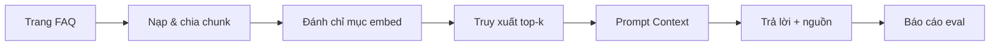

Sếp nhờ bạn xây dựng một bot hỏi đáp chăm sóc khách hàng dựa trên các trang FAQ của cửa hàng. Bot phải trả lời đúng thông tin, trích dẫn trang nguồn, biết nói `"I don't know"` khi tài liệu không có đáp án, và đi kèm con số chứng minh hệ thống đủ tốt. Gần như không có kiến thức mới ở đây—dự án này ghép mọi thứ từ `p7-03-embeddings` đến `p7-08-evals` thành một bot RAG hoàn chỉnh có đánh giá trung thực.

## 1. Kế hoạch

Phác thảo toàn bộ quy trình từ các trang FAQ thô tới báo cáo đánh giá cuối cùng trước khi viết code:



Từng phần của dự án nối trực tiếp tới một bài bạn đã học:

| phần | bạn xây dựng gì | từ bài |
|---|---|---|
| Phần 1: Nạp & chia chunk | Chia trang FAQ theo câu hoặc cửa sổ từ kèm ID `<source>#<n>` | `p7-05-rag` |
| Phần 2: Chỉ mục & truy xuất | Embed mọi chunk một lần thành ma trận NumPy và lấy top-k cặp `(score, chunk)` | `p7-03-embeddings`, `p7-04-vector-db` |
| Phần 3: Trả lời & trích nguồn | Gửi `Context:` kèm `[n]` cho `FakeLLM`, lọc `sources` hợp lệ hoặc từ chối | `p7-01-llm-api`, `p7-05-rag` |
| Phần 4: Eval trên dev | Chấm `hit@k`, `facts`, `grounded` và `idk` trên `dev_set` để chọn cấu hình | `p7-08-evals` |
| Phần 5: Chấm test & báo cáo | Chạy cấu hình đã chọn trên `test_set` một lần và báo cáo đủ lỗi | `p5-05-mini-project`, `p7-08-evals` |

Giữ đúng luật chơi của `p5-05-mini-project`: chỉ so sánh và chọn cấu hình trên **dev set** (tập tinh chỉnh), chạy **held-out test set** (tập test giữ kín) đúng **một lần** ở cuối, và gọi tên mọi câu sai thật thay vì che giấu điểm yếu. Lưu ý tên chỉ số nối tiếp trực tiếp từ `p7-08-evals`: `grounded` ở đây mở rộng `faithful` của `p7-08` bằng cách kiểm tra cả nội dung bám nguồn lẫn trích dẫn `[n]` hợp lệ (giống `score_grounded` trong `p7-08 ex02`), còn `idk` và `refusals` cùng đo tỉ lệ từ chối `"I don't know"` đúng lúc cho câu hỏi ngoài tài liệu.

## 2. Dữ liệu: kho FAQ và tập eval

Kho kiến thức gồm 8 trang FAQ ngắn của cửa hàng (`refunds.md`, `shipping.md`, `warranty.md`, `payment.md`, `accounts.md`, `support.md`, `pickup.md`, `discounts.md`), mỗi trang 3 câu ngắn chứa số liệu hoặc quy định cụ thể. Bộ 12 câu eval được chia cố định thành 8 câu `dev_set` (6 câu trả lời được gồm câu **paraphrase**—diễn đạt khác từ ngữ—`d6`, cộng 2 câu không trả lời được `d7` và `d8`) và 4 câu `test_set` (3 câu trả lời được gồm câu paraphrase `t3`, cộng 1 câu không trả lời được `t4`):

```python
docs = [
    {"source": "refunds.md", "text": "Refunds are issued within 30 days of purchase. Keep your original receipt for any return. Opened software is not eligible for a refund."},
    {"source": "shipping.md", "text": "Standard shipping takes 5 business days across the country. Express delivery arrives next day for 12 dollars. Free shipping applies on orders over 50 dollars."},
    {"source": "warranty.md", "text": "Hardware warranty covers factory defects for 12 months. Water damage and dropped screens are not covered. Battery wear after 6 months is excluded."},
    {"source": "payment.md", "text": "Accepted payment methods are Visa, Mastercard, and cash on delivery. Gift cards cannot be redeemed for cash. Invoices are emailed right after checkout."},
    {"source": "accounts.md", "text": "Password resets are sent by email within 5 minutes. Two-factor login can be turned on in security settings. Inactive accounts remain open for 24 months."},
    {"source": "support.md", "text": "Support agents work Monday to Friday from 9 AM to 6 PM. Weekend messages receive replies on Monday morning. Urgent outage tickets get a 2 hour target."},
    {"source": "pickup.md", "text": "Store pickup is ready 2 hours after order confirmation. Unclaimed orders are held at the counter for 7 days. Bring a photo ID at pickup."},
    {"source": "discounts.md", "text": "Student discounts give 15 percent off eligible laptops. Promo codes cannot be combined on one order. Loyalty points expire after 12 months."},
]

dev_set = [
    {"id": "d1", "question": "How many days do refunds take after purchase?", "expected_source": "refunds.md", "expected_facts": ["30 days"]},
    {"id": "d2", "question": "How much does express delivery cost?", "expected_source": "shipping.md", "expected_facts": ["12 dollars"]},
    {"id": "d3", "question": "How long is hardware warranty for factory defects?", "expected_source": "warranty.md", "expected_facts": ["12 months"]},
    {"id": "d4", "question": "What payment methods are accepted at checkout?", "expected_source": "payment.md", "expected_facts": ["Visa", "Mastercard"]},
    {"id": "d5", "question": "How quickly do password resets arrive by email?", "expected_source": "accounts.md", "expected_facts": ["5 minutes"]},
    {"id": "d6", "question": "Can I get money back within a month?", "expected_source": "refunds.md", "expected_facts": ["30 days"]},
    {"id": "d7", "question": "Do you offer cryptocurrency billing?", "expected_source": None, "expected_facts": []},
    {"id": "d8", "question": "Can I pay with crypto for online orders?", "expected_source": None, "expected_facts": []},
]

test_set = [
    {"id": "t1", "question": "When do support agents work on weekdays?", "expected_source": "support.md", "expected_facts": ["Monday to Friday", "9 AM to 6 PM"]},
    {"id": "t2", "question": "How many days are unclaimed pickup orders held?", "expected_source": "pickup.md", "expected_facts": ["7 days"]},
    {"id": "t3", "question": "How much off do students get on notebooks?", "expected_source": "discounts.md", "expected_facts": ["15 percent"]},
    {"id": "t4", "question": "Is international customs insurance included?", "expected_source": None, "expected_facts": []},
]

dev_ans = sum(1 for r in dev_set if r["expected_source"] is not None)
test_ans = sum(1 for r in test_set if r["expected_source"] is not None)
print("docs:", len(docs), "dev:", len(dev_set), "test:", len(test_set))
# docs: 8 dev: 8 test: 4
print("dev answerable:", dev_ans, "unanswerable:", len(dev_set) - dev_ans)
# dev answerable: 6 unanswerable: 2
print("test answerable:", test_ans, "unanswerable:", len(test_set) - test_ans)
# test answerable: 3 unanswerable: 1
```

Giữ ranh giới thật rõ giữa hai tập trong suốt quá trình thử nghiệm:

```text
12 eval questions
  |-- dev_set  (8: d1..d6 answerable, d7..d8 unanswerable) -> compare configs
  '-- test_set (4: t1..t3 answerable, t4 unanswerable)     -> score once at end
```

Để ý `d6` hỏi `"money back"` thay cho `"refund"` và `t3` hỏi `"notebooks"` thay cho `"laptops"`, giúp kiểm tra khả năng xử lý paraphrase trên cả hai tập.

## 3. Phần 1: nạp tài liệu và chia chunk

Bước **ingestion** (nạp và chuẩn bị dữ liệu) đọc tài liệu thô rồi tách thành các dict dạng `{"id": "<source>#<n>", "source": ..., "text": ...}` trước khi tạo embedding. Ở đây `r"(?<=[.!?])\s+"` dùng regex lookbehind để cắt tại khoảng trắng ngay sau dấu `.`, `!`, `?` mà vẫn giữ nguyên dấu câu ở cuối mỗi câu. Bấm **Visualize** ở khối code ngắn này để xem `idx` và `chunks` tạo ra ba chunk từ một tài liệu:

```python
import re

doc = {
    "source": "refunds.md",
    "text": "Refunds take 30 days. Keep your receipt. Opened apps fail.",
}
sentences = [
    s.strip()
    for s in re.split(r"(?<=[.!?])\s+", doc["text"].strip())
    if s.strip()
]
chunks = []
for idx, text in enumerate(sentences):
    chunks.append({"id": f"{doc['source']}#{idx}", "source": doc["source"], "text": text})
for c in chunks:
    print(c["id"], "->", c["text"])
# refunds.md#0 -> Refunds take 30 days.
# refunds.md#1 -> Keep your receipt.
# refunds.md#2 -> Opened apps fail.
```

Bây giờ hãy so sánh hai chiến lược chia chunk trên cả 8 trang FAQ: tách theo ranh giới câu (`mode="sentence"`) và trượt cửa sổ 8 từ gối nhau 2 từ (`mode="words"`, như ở `p7-05-rag`):

```python
import re

docs = [
    {"source": "refunds.md", "text": "Refunds are issued within 30 days of purchase. Keep your original receipt for any return. Opened software is not eligible for a refund."},
    {"source": "shipping.md", "text": "Standard shipping takes 5 business days across the country. Express delivery arrives next day for 12 dollars. Free shipping applies on orders over 50 dollars."},
    {"source": "warranty.md", "text": "Hardware warranty covers factory defects for 12 months. Water damage and dropped screens are not covered. Battery wear after 6 months is excluded."},
    {"source": "payment.md", "text": "Accepted payment methods are Visa, Mastercard, and cash on delivery. Gift cards cannot be redeemed for cash. Invoices are emailed right after checkout."},
    {"source": "accounts.md", "text": "Password resets are sent by email within 5 minutes. Two-factor login can be turned on in security settings. Inactive accounts remain open for 24 months."},
    {"source": "support.md", "text": "Support agents work Monday to Friday from 9 AM to 6 PM. Weekend messages receive replies on Monday morning. Urgent outage tickets get a 2 hour target."},
    {"source": "pickup.md", "text": "Store pickup is ready 2 hours after order confirmation. Unclaimed orders are held at the counter for 7 days. Bring a photo ID at pickup."},
    {"source": "discounts.md", "text": "Student discounts give 15 percent off eligible laptops. Promo codes cannot be combined on one order. Loyalty points expire after 12 months."},
]


def chunk_sentences(text: str) -> list[str]:
    cleaned = text.strip()
    if not cleaned:
        return []
    return [s.strip() for s in re.split(r"(?<=[.!?])\s+", cleaned) if s.strip()]


def chunk_words(text: str, size: int = 8, overlap: int = 2) -> list[str]:
    if size <= 0 or overlap < 0 or overlap >= size:
        raise ValueError("need size > 0 and 0 <= overlap < size")
    words = text.split()
    if not words:
        return []
    step = size - overlap
    out: list[str] = []
    i = 0
    while i < len(words):
        out.append(" ".join(words[i : i + size]))
        if i + size >= len(words):
            break
        i += step
    return out


def ingest_docs(raw_docs: list[dict], mode: str = "sentence", size: int = 8, overlap: int = 2) -> list[dict]:
    chunks: list[dict] = []
    for doc in raw_docs:
        pieces = chunk_sentences(doc["text"]) if mode == "sentence" else chunk_words(doc["text"], size, overlap)
        for idx, text in enumerate(pieces):
            chunks.append({"id": f"{doc['source']}#{idx}", "source": doc["source"], "text": text})
    return chunks


sent_chunks = ingest_docs(docs, mode="sentence")
word_chunks = ingest_docs(docs, mode="words", size=8, overlap=2)
print("sentence chunks:", len(sent_chunks), "| word chunks:", len(word_chunks))
# sentence chunks: 24 | word chunks: 33
for c in sent_chunks[:4]:
    print(f"{c['id']} | {c['source']} | {c['text'][:35]}")
# refunds.md#0 | refunds.md | Refunds are issued within 30 days o
# refunds.md#1 | refunds.md | Keep your original receipt for any 
# refunds.md#2 | refunds.md | Opened software is not eligible for
# shipping.md#0 | shipping.md | Standard shipping takes 5 business 
```

Nhìn bảng trace 4 chunk theo câu đầu tiên sẽ thấy vì sao cách tách này rất sạch cho trang FAQ:

| id | source | text |
|---|---|---|
| `refunds.md#0` | `refunds.md` | `Refunds are issued within 30 days of purchase.` |
| `refunds.md#1` | `refunds.md` | `Keep your original receipt for any return.` |
| `refunds.md#2` | `refunds.md` | `Opened software is not eligible for a refund.` |
| `shipping.md#0` | `shipping.md` | `Standard shipping takes 5 business days across the country.` |

Mỗi chunk đều mở đầu bằng một câu trọn vẹn chứa đủ sự thật chính—rất quan trọng vì ở chế độ RAG, `FakeLLM` chỉ trả về **câu đầu tiên** của chunk thắng cuộc.

## 4. Phần 2: đánh chỉ mục và truy xuất

Embed toàn bộ 24 chunk theo câu **đúng một lần** thành ma trận NumPy bằng `FakeLLM(embed_dim=256)`, rồi viết `top_k(index, question, client, k)` dùng `np.argsort(-scores, kind="stable")` để trả về danh sách cặp `(score, chunk)`:

```python
import re
import numpy as np
from pyai_llm import FakeLLM

docs = [
    {"source": "refunds.md", "text": "Refunds are issued within 30 days of purchase. Keep your original receipt for any return. Opened software is not eligible for a refund."},
    {"source": "shipping.md", "text": "Standard shipping takes 5 business days across the country. Express delivery arrives next day for 12 dollars. Free shipping applies on orders over 50 dollars."},
    {"source": "warranty.md", "text": "Hardware warranty covers factory defects for 12 months. Water damage and dropped screens are not covered. Battery wear after 6 months is excluded."},
    {"source": "payment.md", "text": "Accepted payment methods are Visa, Mastercard, and cash on delivery. Gift cards cannot be redeemed for cash. Invoices are emailed right after checkout."},
    {"source": "accounts.md", "text": "Password resets are sent by email within 5 minutes. Two-factor login can be turned on in security settings. Inactive accounts remain open for 24 months."},
    {"source": "support.md", "text": "Support agents work Monday to Friday from 9 AM to 6 PM. Weekend messages receive replies on Monday morning. Urgent outage tickets get a 2 hour target."},
    {"source": "pickup.md", "text": "Store pickup is ready 2 hours after order confirmation. Unclaimed orders are held at the counter for 7 days. Bring a photo ID at pickup."},
    {"source": "discounts.md", "text": "Student discounts give 15 percent off eligible laptops. Promo codes cannot be combined on one order. Loyalty points expire after 12 months."},
]


def ingest_sentences(raw_docs: list[dict]) -> list[dict]:
    chunks: list[dict] = []
    for doc in raw_docs:
        pieces = [s.strip() for s in re.split(r"(?<=[.!?])\s+", doc["text"].strip()) if s.strip()]
        for idx, text in enumerate(pieces):
            chunks.append({"id": f"{doc['source']}#{idx}", "source": doc["source"], "text": text})
    return chunks


def build_index(chunks: list[dict], client: FakeLLM) -> dict:
    vectors = np.array(client.embed([c["text"] for c in chunks]), dtype=float)
    return {"chunks": chunks, "vectors": vectors}


def top_k(index: dict, question: str, client: FakeLLM, k: int = 2) -> list[tuple[float, dict]]:
    q_vec = np.array(client.embed([question])[0], dtype=float)
    scores = index["vectors"] @ q_vec
    order = np.argsort(-scores, kind="stable")[:k]
    return [(float(scores[int(i)]), index["chunks"][int(i)]) for i in order]


client = FakeLLM(embed_dim=256)
index = build_index(ingest_sentences(docs), client)

for q in [
    "How many days do refunds take after purchase?",
    "Can I pay with crypto for online orders?",
]:
    hits = top_k(index, q, client, k=2)
    print("Q:", q)
    for score, chunk in hits:
        print(f"  {chunk['id']} ({round(score, 3)}): {chunk['text'][:38]}")
# Q: How many days do refunds take after purchase?
#   refunds.md#0 (0.375): Refunds are issued within 30 days of p
#   shipping.md#0 (0.236): Standard shipping takes 5 business day
# Q: Can I pay with crypto for online orders?
#   pickup.md#1 (0.335): Unclaimed orders are held at the count
#   shipping.md#1 (0.25): Express delivery arrives next day for 
```

Để ý chi tiết thú vị ở câu hỏi thứ hai (`"Can I pay with crypto for online orders?"`): dù cửa hàng không có thông tin về crypto, `pickup.md#1` (`"Unclaimed orders..."`) vẫn đạt điểm `0.335` vì dùng chung từ `"orders"`—dấu hiệu báo trước rằng câu không có đáp án vẫn có thể đánh lừa bước truy xuất.

## 5. Phần 3: trả lời có trích nguồn

Ghép các chunk lấy được thành khối `Context:\n[1] ...`, gọi `client.chat(...)`, đọc các trích dẫn `[n]` hợp lệ để đổi sang danh sách `source` không trùng, và ép `sources` về `[]` mỗi khi không có chunk vượt `min_score` hoặc model đáp `"I don't know"`:

```python
import re
import numpy as np
from pyai_llm import FakeLLM

docs = [
    {"source": "refunds.md", "text": "Refunds are issued within 30 days of purchase. Keep your original receipt for any return. Opened software is not eligible for a refund."},
    {"source": "shipping.md", "text": "Standard shipping takes 5 business days across the country. Express delivery arrives next day for 12 dollars. Free shipping applies on orders over 50 dollars."},
    {"source": "warranty.md", "text": "Hardware warranty covers factory defects for 12 months. Water damage and dropped screens are not covered. Battery wear after 6 months is excluded."},
    {"source": "payment.md", "text": "Accepted payment methods are Visa, Mastercard, and cash on delivery. Gift cards cannot be redeemed for cash. Invoices are emailed right after checkout."},
    {"source": "accounts.md", "text": "Password resets are sent by email within 5 minutes. Two-factor login can be turned on in security settings. Inactive accounts remain open for 24 months."},
    {"source": "support.md", "text": "Support agents work Monday to Friday from 9 AM to 6 PM. Weekend messages receive replies on Monday morning. Urgent outage tickets get a 2 hour target."},
    {"source": "pickup.md", "text": "Store pickup is ready 2 hours after order confirmation. Unclaimed orders are held at the counter for 7 days. Bring a photo ID at pickup."},
    {"source": "discounts.md", "text": "Student discounts give 15 percent off eligible laptops. Promo codes cannot be combined on one order. Loyalty points expire after 12 months."},
]


def build_index(raw_docs: list[dict], client: FakeLLM) -> dict:
    chunks: list[dict] = []
    for doc in raw_docs:
        pieces = [s.strip() for s in re.split(r"(?<=[.!?])\s+", doc["text"].strip()) if s.strip()]
        for idx, text in enumerate(pieces):
            chunks.append({"id": f"{doc['source']}#{idx}", "source": doc["source"], "text": text})
    vectors = np.array(client.embed([c["text"] for c in chunks]), dtype=float)
    return {"chunks": chunks, "vectors": vectors}


def top_k(index: dict, question: str, client: FakeLLM, k: int = 2) -> list[tuple[float, dict]]:
    q_vec = np.array(client.embed([question])[0], dtype=float)
    scores = index["vectors"] @ q_vec
    order = np.argsort(-scores, kind="stable")[:k]
    return [(float(scores[int(i)]), index["chunks"][int(i)]) for i in order]


def answer_with_sources(index: dict, question: str, client: FakeLLM, k: int = 2, min_score: float = 0.2) -> dict:
    hits = [chunk for score, chunk in top_k(index, question, client, k=k) if score >= min_score]
    if not hits:
        return {"answer": "I don't know based on the provided context.", "sources": [], "retrieved": []}
    context = "\n".join(f"[{n}] {h['text']}" for n, h in enumerate(hits, 1))
    messages = [
        {
            "role": "system",
            "content": (
                "Answer using only the provided context. "
                "If missing, say you don't know. Cite sources with [n].\n\n"
                f"Context:\n{context}"
            ),
        },
        {"role": "user", "content": question},
    ]
    answer = client.chat(messages).content or ""
    sources: list[str] = []
    if "i don't know" not in answer.lower():
        for raw in re.findall(r"\[(\d+)\]", answer):
            idx = int(raw) - 1
            if 0 <= idx < len(hits):
                src = hits[idx]["source"]
                if src not in sources:
                    sources.append(src)
    return {"answer": answer, "sources": sources, "retrieved": [h["source"] for h in hits]}


client = FakeLLM(embed_dim=256)
index = build_index(docs, client)

for q in [
    "How much does express delivery cost?",
    "Do you offer cryptocurrency billing?",
]:
    out = answer_with_sources(index, q, client)
    print("Q:", q)
    print("A:", out["answer"])
    print("S:", out["sources"])
# Q: How much does express delivery cost?
# A: Express delivery arrives next day for 12 dollars. [1]
# S: ['shipping.md']
# Q: Do you offer cryptocurrency billing?
# A: I don't know based on the provided context.
# S: []
```

Khi `"cryptocurrency billing"` có độ tương đồng cosine bằng `0.0` (`< 0.2`), bước lọc `min_score` để lại `hits` rỗng nên bot từ chối gọn gàng mà không cần gọi `chat()`.

## 6. Phần 4: chấm dev set và chọn cấu hình

Trước khi nhìn số liệu, hãy chốt tiêu chí chọn cấu hình: **ưu tiên `facts` cao nhất trên `dev_set`**, nếu hòa thì ưu tiên **`idk`** (từ chối đúng các câu không có đáp án), rồi mới tới **`hit@2`**. Trong `eval_config`, một dòng comprehension lọc `top_hits` theo ngưỡng `min_score` (`0.2` so với `0.35`) trước khi dựng `Context:`. Bây giờ so sánh ba cấu hình trên `dev_set`:
1. `words(8, 2), k=2, min_score=0.2`
2. `sentence, k=2, min_score=0.2`
3. `sentence, k=2, min_score=0.35`

```python
import re
import numpy as np
from pyai_llm import FakeLLM

docs = [
    {"source": "refunds.md", "text": "Refunds are issued within 30 days of purchase. Keep your original receipt for any return. Opened software is not eligible for a refund."},
    {"source": "shipping.md", "text": "Standard shipping takes 5 business days across the country. Express delivery arrives next day for 12 dollars. Free shipping applies on orders over 50 dollars."},
    {"source": "warranty.md", "text": "Hardware warranty covers factory defects for 12 months. Water damage and dropped screens are not covered. Battery wear after 6 months is excluded."},
    {"source": "payment.md", "text": "Accepted payment methods are Visa, Mastercard, and cash on delivery. Gift cards cannot be redeemed for cash. Invoices are emailed right after checkout."},
    {"source": "accounts.md", "text": "Password resets are sent by email within 5 minutes. Two-factor login can be turned on in security settings. Inactive accounts remain open for 24 months."},
    {"source": "support.md", "text": "Support agents work Monday to Friday from 9 AM to 6 PM. Weekend messages receive replies on Monday morning. Urgent outage tickets get a 2 hour target."},
    {"source": "pickup.md", "text": "Store pickup is ready 2 hours after order confirmation. Unclaimed orders are held at the counter for 7 days. Bring a photo ID at pickup."},
    {"source": "discounts.md", "text": "Student discounts give 15 percent off eligible laptops. Promo codes cannot be combined on one order. Loyalty points expire after 12 months."},
]

dev_set = [
    {"id": "d1", "question": "How many days do refunds take after purchase?", "expected_source": "refunds.md", "expected_facts": ["30 days"]},
    {"id": "d2", "question": "How much does express delivery cost?", "expected_source": "shipping.md", "expected_facts": ["12 dollars"]},
    {"id": "d3", "question": "How long is hardware warranty for factory defects?", "expected_source": "warranty.md", "expected_facts": ["12 months"]},
    {"id": "d4", "question": "What payment methods are accepted at checkout?", "expected_source": "payment.md", "expected_facts": ["Visa", "Mastercard"]},
    {"id": "d5", "question": "How quickly do password resets arrive by email?", "expected_source": "accounts.md", "expected_facts": ["5 minutes"]},
    {"id": "d6", "question": "Can I get money back within a month?", "expected_source": "refunds.md", "expected_facts": ["30 days"]},
    {"id": "d7", "question": "Do you offer cryptocurrency billing?", "expected_source": None, "expected_facts": []},
    {"id": "d8", "question": "Can I pay with crypto for online orders?", "expected_source": None, "expected_facts": []},
]


def chunk_text(text: str, mode: str, size: int = 8, overlap: int = 2) -> list[str]:
    if mode == "sentence":
        return [s.strip() for s in re.split(r"(?<=[.!?])\s+", text.strip()) if s.strip()]
    words = text.split()
    step = size - overlap
    out: list[str] = []
    i = 0
    while i < len(words):
        out.append(" ".join(words[i : i + size]))
        if i + size >= len(words):
            break
        i += step
    return out


def content_words(text: str) -> list[str]:
    cleaned = re.sub(r"\[\d+\]", "", text.lower())
    return [w for w in re.findall(r"[a-z0-9]+", cleaned) if len(w) >= 4]


def is_grounded(answer: str, hits: list[dict]) -> bool:
    if "i don't know" in answer.lower():
        return True
    cites = [int(x) for x in re.findall(r"\[(\d+)\]", answer)]
    if not cites or any(not (1 <= n <= len(hits)) for n in cites):
        return False
    ctx_words = set(content_words("\n".join(h["text"] for h in hits)))
    return all(w in ctx_words for w in content_words(answer))


def eval_config(mode: str, k: int, min_score: float) -> tuple[dict, list[tuple[str, str]]]:
    client = FakeLLM(embed_dim=256)
    chunks = [
        {"id": f"{d['source']}#{i}", "source": d["source"], "text": piece}
        for d in docs
        for i, piece in enumerate(chunk_text(d["text"], mode))
    ]
    vecs = np.array(client.embed([c["text"] for c in chunks]), dtype=float)
    hits = n_ans = facts_ok = grounded = idk_ok = n_idk = 0
    failures: list[tuple[str, str]] = []
    for row in dev_set:
        q_vec = np.array(client.embed([row["question"]])[0], dtype=float)
        scores = vecs @ q_vec
        order = np.argsort(-scores, kind="stable")[:k]
        top_hits = [chunks[int(i)] for i in order if float(scores[int(i)]) >= min_score]
        ctx = "\n".join(f"[{n}] {h['text']}" for n, h in enumerate(top_hits, 1))
        if top_hits:
            ans = client.chat([
                {"role": "system", "content": "Context:\n" + ctx},
                {"role": "user", "content": row["question"]},
            ]).content or ""
        else:
            ans = "I don't know based on the provided context."
        grounded += int(is_grounded(ans, top_hits))
        exp = row["expected_source"]
        if exp is None:
            n_idk += 1
            if "i don't know" in ans.lower():
                idk_ok += 1
            else:
                failures.append((row["id"], "no_refusal"))
        else:
            n_ans += 1
            h_ok = exp in [h["source"] for h in top_hits]
            f_ok = all(f.lower() in ans.lower() for f in row["expected_facts"])
            hits += int(h_ok)
            facts_ok += int(f_ok)
            if not h_ok:
                failures.append((row["id"], "retrieval_miss"))
            elif not f_ok:
                failures.append((row["id"], "answer_miss"))
    return {
        "hits": hits, "n_ans": n_ans, "facts_ok": facts_ok,
        "grounded": grounded, "n_all": len(dev_set),
        "idk_ok": idk_ok, "n_idk": n_idk,
    }, failures


def pct(num: int, den: int) -> str:
    return f"{num}/{den} ({round(num / den * 100)}%)"


configs = [
    ("words(8,2) m=0.2", "words", 2, 0.2),
    ("sent k=2 m=0.2", "sentence", 2, 0.2),
    ("sent k=2 m=0.35", "sentence", 2, 0.35),
]
print(f"{'config':<17} {'hit@2':<10} {'facts':<10} {'grounded':<10} {'idk':<9}")
for label, mode, k, ms in configs:
    s, fails = eval_config(mode, k, ms)
    print(
        f"{label:<17} {pct(s['hits'], s['n_ans']):<10} "
        f"{pct(s['facts_ok'], s['n_ans']):<10} "
        f"{pct(s['grounded'], s['n_all']):<10} {pct(s['idk_ok'], s['n_idk']):<9}"
    )
    if label == "sent k=2 m=0.2":
        chosen_fails = fails
print("chosen failures:", chosen_fails)
# config            hit@2      facts      grounded   idk      
# words(8,2) m=0.2  6/6 (100%) 3/6 (50%)  8/8 (100%) 2/2 (100%)
# sent k=2 m=0.2    6/6 (100%) 5/6 (83%)  8/8 (100%) 1/2 (50%)
# sent k=2 m=0.35   4/6 (67%)  4/6 (67%)  8/8 (100%) 2/2 (100%)
# chosen failures: [('d6', 'answer_miss'), ('d8', 'no_refusal')]
```

Đặt cả ba cấu hình cạnh nhau để nhìn rõ sự đánh đổi:

| cấu hình | hit@2 | facts | grounded | idk |
|---|---|---|---|---|
| `words(8,2) m=0.2` | `6/6 (100%)` | `3/6 (50%)` | `8/8 (100%)` | `2/2 (100%)` |
| `sent k=2 m=0.2` | `6/6 (100%)` | `5/6 (83%)` | `8/8 (100%)` | `1/2 (50%)` |
| `sent k=2 m=0.35` | `4/6 (67%)` | `4/6 (67%)` | `8/8 (100%)` | `2/2 (100%)` |

`sent k=2 m=0.2` thắng theo tiêu chí `facts` (`5/6 = 83%`), đồng thời bộc lộ hai điểm yếu thật trên `dev_set`: `d6` (`answer_miss`, vì `embed` đổi `"money back"` thành `"refund"` trong khi `chat` chỉ đếm trùng từ thô) và `d8` (`no_refusal`, vì `pickup.md#1` trùng hai từ `"for"` và `"orders"` với `"Can I pay with crypto for online orders?"`).

> [!WARNING]
> Một tập `dev_set` chỉ có 8 câu rất nhỏ và dễ nhiễu—chỉ một câu đổi kết quả là `facts` nhảy `17%` hoặc `idk` nhảy `50%`. Hãy chốt cứng cấu hình ngay lúc này và tuyệt đối không quay lại sửa ngưỡng hay cách chia chunk sau khi đã nhìn `test_set`.

## 7. Phần 5: chấm test set một lần và viết báo cáo

Chạy cấu hình đã chốt (`mode="sentence"`, `k=2`, `min_score=0.2`) trên `test_set` đúng **một lần** rồi in báo cáo dạng dòng gồm điểm dev, điểm test và từng câu sai kèm lý do:

```python
import re
import numpy as np
from pyai_llm import FakeLLM

docs = [
    {"source": "refunds.md", "text": "Refunds are issued within 30 days of purchase. Keep your original receipt for any return. Opened software is not eligible for a refund."},
    {"source": "shipping.md", "text": "Standard shipping takes 5 business days across the country. Express delivery arrives next day for 12 dollars. Free shipping applies on orders over 50 dollars."},
    {"source": "warranty.md", "text": "Hardware warranty covers factory defects for 12 months. Water damage and dropped screens are not covered. Battery wear after 6 months is excluded."},
    {"source": "payment.md", "text": "Accepted payment methods are Visa, Mastercard, and cash on delivery. Gift cards cannot be redeemed for cash. Invoices are emailed right after checkout."},
    {"source": "accounts.md", "text": "Password resets are sent by email within 5 minutes. Two-factor login can be turned on in security settings. Inactive accounts remain open for 24 months."},
    {"source": "support.md", "text": "Support agents work Monday to Friday from 9 AM to 6 PM. Weekend messages receive replies on Monday morning. Urgent outage tickets get a 2 hour target."},
    {"source": "pickup.md", "text": "Store pickup is ready 2 hours after order confirmation. Unclaimed orders are held at the counter for 7 days. Bring a photo ID at pickup."},
    {"source": "discounts.md", "text": "Student discounts give 15 percent off eligible laptops. Promo codes cannot be combined on one order. Loyalty points expire after 12 months."},
]

dev_set = [
    {"id": "d1", "question": "How many days do refunds take after purchase?", "expected_source": "refunds.md", "expected_facts": ["30 days"]},
    {"id": "d2", "question": "How much does express delivery cost?", "expected_source": "shipping.md", "expected_facts": ["12 dollars"]},
    {"id": "d3", "question": "How long is hardware warranty for factory defects?", "expected_source": "warranty.md", "expected_facts": ["12 months"]},
    {"id": "d4", "question": "What payment methods are accepted at checkout?", "expected_source": "payment.md", "expected_facts": ["Visa", "Mastercard"]},
    {"id": "d5", "question": "How quickly do password resets arrive by email?", "expected_source": "accounts.md", "expected_facts": ["5 minutes"]},
    {"id": "d6", "question": "Can I get money back within a month?", "expected_source": "refunds.md", "expected_facts": ["30 days"]},
    {"id": "d7", "question": "Do you offer cryptocurrency billing?", "expected_source": None, "expected_facts": []},
    {"id": "d8", "question": "Can I pay with crypto for online orders?", "expected_source": None, "expected_facts": []},
]

test_set = [
    {"id": "t1", "question": "When do support agents work on weekdays?", "expected_source": "support.md", "expected_facts": ["Monday to Friday", "9 AM to 6 PM"]},
    {"id": "t2", "question": "How many days are unclaimed pickup orders held?", "expected_source": "pickup.md", "expected_facts": ["7 days"]},
    {"id": "t3", "question": "How much off do students get on notebooks?", "expected_source": "discounts.md", "expected_facts": ["15 percent"]},
    {"id": "t4", "question": "Is international customs insurance included?", "expected_source": None, "expected_facts": []},
]

client = FakeLLM(embed_dim=256)
chunks = [
    {"id": f"{d['source']}#{i}", "source": d["source"], "text": s.strip()}
    for d in docs
    for i, s in enumerate(re.split(r"(?<=[.!?])\s+", d["text"].strip()))
    if s.strip()
]
vecs = np.array(client.embed([c["text"] for c in chunks]), dtype=float)


def score_split(split: list[dict]) -> tuple[dict, list[tuple[str, str]]]:
    hits = n_ans = facts_ok = idk_ok = n_idk = 0
    fails: list[tuple[str, str]] = []
    for row in split:
        q_vec = np.array(client.embed([row["question"]])[0], dtype=float)
        scores = vecs @ q_vec
        order = np.argsort(-scores, kind="stable")[:2]
        top_hits = [chunks[int(i)] for i in order if float(scores[int(i)]) >= 0.2]
        ctx = "\n".join(f"[{n}] {h['text']}" for n, h in enumerate(top_hits, 1))
        if top_hits:
            ans = client.chat([
                {"role": "system", "content": "Context:\n" + ctx},
                {"role": "user", "content": row["question"]},
            ]).content or ""
        else:
            ans = "I don't know based on the provided context."
        exp = row["expected_source"]
        if exp is None:
            n_idk += 1
            if "i don't know" in ans.lower():
                idk_ok += 1
            else:
                fails.append((row["id"], "no_refusal"))
        else:
            n_ans += 1
            h_ok = exp in [h["source"] for h in top_hits]
            f_ok = all(f.lower() in ans.lower() for f in row["expected_facts"])
            hits += int(h_ok)
            facts_ok += int(f_ok)
            if not h_ok:
                fails.append((row["id"], "retrieval_miss"))
            elif not f_ok:
                fails.append((row["id"], "answer_miss"))
    return {"hits": hits, "n_ans": n_ans, "facts": facts_ok, "idk": idk_ok, "n_idk": n_idk}, fails


def fmt(num: int, den: int) -> str:
    return f"{num}/{den} ({round(num / den * 100)}%)"


dev_s, dev_f = score_split(dev_set)
test_s, test_f = score_split(test_set)
print("config: mode=sentence, k=2, min_score=0.2")
# config: mode=sentence, k=2, min_score=0.2
print(f"dev : hit@2={fmt(dev_s['hits'], dev_s['n_ans'])} facts={fmt(dev_s['facts'], dev_s['n_ans'])} idk={fmt(dev_s['idk'], dev_s['n_idk'])}")
# dev : hit@2=6/6 (100%) facts=5/6 (83%) idk=1/2 (50%)
print(f"test: hit@2={fmt(test_s['hits'], test_s['n_ans'])} facts={fmt(test_s['facts'], test_s['n_ans'])} idk={fmt(test_s['idk'], test_s['n_idk'])}")
# test: hit@2=3/3 (100%) facts=2/3 (67%) idk=1/1 (100%)
for qid, reason in dev_f:
    print(f"dev  FAIL {qid}: {reason}")
# dev  FAIL d6: answer_miss
# dev  FAIL d8: no_refusal
for qid, reason in test_f:
    print(f"test FAIL {qid}: {reason}")
# test FAIL t3: answer_miss
```

Trên tập `test_set`, câu `t3` (`"How much off do students get on notebooks?"`) là một lỗi `answer_miss` thật: `embed` ánh xạ `"notebooks"` sang `"laptops"` nên truy xuất đúng `discounts.md` ở hạng 1 (`hit@2 = 3/3`), nhưng `FakeLLM.chat()` kiểm tra trùng từ thô nên rơi về `"I don't know based on the provided context."` (`facts = 2/3 = 67%`). Gọi tên `t3` trung thực quan trọng hơn nhiều so với việc sửa code để kéo điểm test lên 100%.

> [!TIP]
> Khi điểm `test` thấp hơn `dev` (`67%` so với `83%` ở đây), đừng hoảng hay vội sửa tham số theo `test`. Hãy đọc số đếm gốc trước: `2/3` so với `5/6` chỉ chênh đúng một câu paraphrase trên 3 câu test, và tập test nhỏ luôn dao động mạnh theo từng câu.

## 8. Lỗi thường gặp

**1. Chỉnh bot dựa trên tập test (data leakage)**

Trên bản rút gọn 2 câu của `test_set` (`t1` và `t3`), nhìn thấy `t3` trượt rồi vá tay `"notebooks" -> "laptops"` đẩy điểm từ `1 of 2` lên `2 of 2`, nhưng lúc này không còn câu nào chưa từng thấy để kiểm tra xem mẹo vá đó có thật sự tổng quát hóa hay không (**data leakage** — rò rỉ dữ liệu kiểu `p5-04-evaluation`):

```python
import re
import numpy as np
from pyai_llm import FakeLLM

docs = [
    {"source": "discounts.md", "text": "Student discounts give 15 percent off eligible laptops. Promo codes cannot be combined on one order."},
    {"source": "support.md", "text": "Support agents work Monday to Friday from 9 AM to 6 PM."},
]
test_set = [
    {"id": "t1", "question": "When do support agents work on weekdays?", "expected_facts": ["Monday to Friday", "9 AM to 6 PM"]},
    {"id": "t3", "question": "How much off do students get on notebooks?", "expected_facts": ["15 percent"]},
]

client = FakeLLM(embed_dim=256)
chunks = [s.strip() for d in docs for s in re.split(r"(?<=[.!?])\s+", d["text"]) if s.strip()]
vecs = np.array(client.embed(chunks), dtype=float)


def eval_test(rewrite: bool) -> int:
    passed = 0
    for row in test_set:
        q = row["question"].replace("notebooks", "laptops") if rewrite else row["question"]
        scores = vecs @ np.array(client.embed([q])[0], dtype=float)
        top = [chunks[int(i)] for i in np.argsort(-scores, kind="stable")[:2]]
        ctx = "\n".join(f"[{n}] {t}" for n, t in enumerate(top, 1))
        ans = client.chat([{"role": "system", "content": "Context:\n" + ctx}, {"role": "user", "content": q}]).content or ""
        passed += int(all(f.lower() in ans.lower() for f in row["expected_facts"]))
    return passed


print("honest test pass:", eval_test(rewrite=False), "of", len(test_set))
# honest test pass: 1 of 2

# Sai: nhìn trộm t3 rồi vá tay đúng chữ "notebooks" -> "laptops"
print("peeked test pass:", eval_test(rewrite=True), "of", len(test_set))
# peeked test pass: 2 of 2
```

Cách sửa: giữ kín `test_set` cho đến khi hoàn tất mọi chỉnh sửa trên `dev_set`, rồi chấm `test_set` đúng một lần.

**2. Ánh xạ trích dẫn `[n]` mà không kiểm tra biên hợp lệ**

Nếu model bịa ra `[3]` trong khi bạn chỉ gửi 1 chunk, việc lấy thẳng `hits[num - 1]` sẽ văng `IndexError` (hoặc quy về sai nguồn nếu không kiểm tra):

```python
import re

hits = [{"source": "refunds.md", "text": "Refunds take 30 days."}]
answer = "Refunds take 30 days. [3]"

# Sai: lấy thẳng hits[num - 1] bị IndexError khi gặp [3]
try:
    bad = [hits[int(n) - 1]["source"] for n in re.findall(r"\[(\d+)\]", answer)]
except IndexError as exc:
    print("wrong:", type(exc).__name__)
# wrong: IndexError

# Đúng: chỉ giữ trích dẫn trong 1..len(hits) và ghi nhận số sai
valid, invalid = [], []
for raw in re.findall(r"\[(\d+)\]", answer):
    num = int(raw)
    if 1 <= num <= len(hits):
        src = hits[num - 1]["source"]
        if src not in valid:
            valid.append(src)
    else:
        invalid.append(num)
print("fixed valid:", valid, "invalid:", invalid)
# fixed valid: [] invalid: [3]
```

Cách sửa: luôn kiểm tra `1 <= num <= len(hits)` trước khi đọc `hits[num - 1]["source"]` và loại trùng `sources` theo đúng thứ tự xuất hiện.

**3. Chia chunk theo cửa sổ từ cắt ngang câu**

Cửa sổ từ (`size=8, overlap=2`) có thể cắt ngay trước cụm `"Express delivery..."`, nên retrieval vẫn tìm đúng `shipping.md`, nhưng `FakeLLM` chỉ trả về mẩu đuôi `"across the country. [1]"` mà thiếu mất `"12 dollars"`:

```python
import numpy as np
from pyai_llm import FakeLLM

text = "Standard shipping takes 5 business days across the country. Express delivery arrives next day for 12 dollars."
question = "How much does express delivery cost?"
words = text.split()
word_chunks = [" ".join(words[i : i + 8]) for i in range(0, len(words), 6)]
sent_chunks = ["Standard shipping takes 5 business days across the country.", "Express delivery arrives next day for 12 dollars."]

client = FakeLLM(embed_dim=256)
for label, chs in [("words", word_chunks), ("sentence", sent_chunks)]:
    vecs = np.array(client.embed(chs), dtype=float)
    q_vec = np.array(client.embed([question])[0], dtype=float)
    top = chs[int(np.argsort(-(vecs @ q_vec), kind="stable")[0])]
    ans = client.chat([{"role": "system", "content": "Context:\n[1] " + top}, {"role": "user", "content": question}]).content
    print(f"{label:<8}: {ans}")
# words   : across the country. [1]
# sentence: Express delivery arrives next day for 12 dollars. [1]
```

Cách sửa: tách chunk theo ranh giới câu (hoặc căn chunk khớp đầu câu) để câu mở đầu mỗi chunk luôn mang trọn sự thật chính.

**4. Embed lại toàn bộ tài liệu cho mỗi câu hỏi**

Đặt `client.embed(chunks)` vào trong vòng lặp câu hỏi khiến 8 câu hỏi tốn tới `16` lần gọi (`200` văn bản), thay vì chỉ `9` lần gọi (`32` văn bản) khi index một lần ở bước ingestion:

```python
from pyai_llm import FakeLLM

chunks = [f"FAQ chunk {i} about shipping and refunds." for i in range(24)]
questions = [f"Question {i} about refunds?" for i in range(8)]


class CountingClient:
    def __init__(self, inner: FakeLLM) -> None:
        self.inner = inner
        self.embed_calls = 0
        self.embedded_texts = 0

    def embed(self, texts: list[str]) -> list[list[float]]:
        self.embed_calls += 1
        self.embedded_texts += len(texts)
        return self.inner.embed(texts)


# Sai: embed lại toàn bộ 24 chunk ở mỗi câu hỏi
bad = CountingClient(FakeLLM(embed_dim=64))
for q in questions:
    _ = bad.embed(chunks)
    _ = bad.embed([q])
print("re-embed per query:", bad.embed_calls, "calls,", bad.embedded_texts, "texts")
# re-embed per query: 16 calls, 200 texts

# Đúng: index mọi chunk một lần, khi hỏi chỉ embed câu hỏi mới
good = CountingClient(FakeLLM(embed_dim=64))
_ = good.embed(chunks)
for q in questions:
    _ = good.embed([q])
print("index once        :", good.embed_calls, "calls,", good.embedded_texts, "texts")
# index once        : 9 calls, 32 texts
```

Cách sửa: embed kho tài liệu một lần trong pha ingestion và chỉ embed từng câu hỏi mới khi truy vấn.

## Tóm tắt

- Một bot RAG hoàn chỉnh tách riêng pha **ingestion** (chia chunk + embed một lần) khỏi pha trả lời (truy xuất top-k, dựng `Context:`, kiểm tra trích dẫn `[n]` hoặc từ chối).
- Chia chunk theo câu tránh cắt ngang sự thật chính, giúp điểm `facts` trên `dev` tăng từ `3/6 (50%)` của cửa sổ 8 từ lên `5/6 (83%)`.
- Ngưỡng `min_score` cân bằng giữa độ phủ và an toàn từ chối: `0.2` giữ đủ `6/6` hit (`1/2` dev `idk`), còn `0.35` nâng `idk` lên `2/2` nhưng làm `hit@2` tụt xuống `4/6`.
- Chọn đúng một cấu hình trên `dev_set` theo tiêu chí định sẵn, chấm `test_set` **một lần**, và ghi nhận trung thực mọi lỗi (`retrieval_miss`, `answer_miss`, `no_refusal`).
- Với tập eval nhỏ (`8` dev, `4` test), một câu paraphrase trượt (`t3`) làm tỉ lệ nhảy rất mạnh—không bao giờ chỉnh tham số theo `test_set` để chạy theo điểm 100%.

## Làm thêm

Khi cả hai bài tập đều pass, bạn có thể mở rộng bot RAG này theo các hướng thực tế:

- **Mở rộng tập eval từ log thật**: thêm các câu khách hỏi bị trượt (như `d6`, `d8` và `t3`) vào phiên bản eval mới để đo thêm paraphrase và câu ngoài phạm vi.
- **Thêm bước reranking**: lấy top-5 ứng viên theo cosine embedding, rồi chấm lại cặp câu hỏi–chunk bằng điểm từ khóa/BM25 hoặc cross-encoder trước khi giữ 2 chunk tốt nhất.
- **Thử LLM-as-judge với API thật**: nạp API key từ file `.env` (tuyệt đối không in hoặc commit key) để chấm độ bám nguồn vượt qua giới hạn so khớp từ dài 4 ký tự:

```bash
# Load secrets from .env without printing the key
set -a && source .env && set +a
uv run python -c "import os; print('key loaded:', bool(os.getenv('LLM_API_KEY')))"
```

- **Đưa bot lên web service**: ở Phase 8 (`p8-01-fastapi` tới `p8-05-mini-project`), bạn sẽ bọc chính pipeline RAG này thành API FastAPI có cache phản hồi, đo độ trễ và theo dõi chi phí token.
