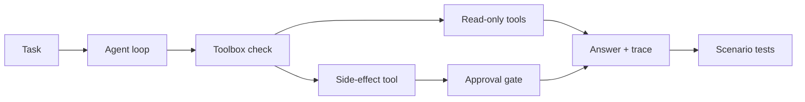

Your manager wants an order-support agent that can answer *"Where is my order, and if it is late, refund me?"*—but with strict guardrails: it must never issue a refund on its own, must never loop forever, and must come with a deterministic test suite proving how it behaves before going to production. Almost every piece comes straight from `p7-06-tool-use` and `p7-07-agents`; this project wires them into one complete, testable agent.

## 1. The plan

Map the full architecture from user task to scenario test suite before writing any code:



Each part of the project builds directly on an earlier lesson:

| part | what you build | from lesson |
|---|---|---|
| Part 1: Safe toolbox | Tool allowlist, required-arg validation, extra-arg filtering, JSON output | `p7-06-tool-use` |
| Part 2: Bounded loop | Observe–think–act loop with `final`, `max_steps`, `repeat`, and `budget` | `p7-07-agents` |
| Part 3: Approval gate | Code-owned `approve(name, args)` callback, `needs_approval`, audit log | `p7-06-tool-use`, `p7-07-agents` |
| Part 4: Scenario suite | Scripted scenarios with golden trajectories catching a real loop bug | `p7-07-agents`, `p7-08-evals` |
| Part 5: Summary report | Pass/fail totals, breakdown by `stopped_reason`, and token count | `p7-08-evals` |

Three rules govern the entire project: every **side effect** requires explicit approval from your code, every loop has hard step and token limits, and behavior is proven by deterministic **scenario tests**—never by running one prompt by hand and assuming it looks fine.

## 2. The data and tools

Our shop database holds 4 orders (`1042`–`1045`) and 4 shipment statuses, paired with a simple refund policy: orders delayed by **3 or more days** qualify for a refund of up to **20%** of the order total. Print the order table and inspect the 4 tools:

```python
ORDERS = {
    "1042": {"status": "delayed", "carrier": "FastShip", "total": 50.0, "days_late": 4},
    "1043": {"status": "shipped", "carrier": "FastShip", "total": 35.0, "days_late": 0},
    "1044": {"status": "delayed", "carrier": "GoPost", "total": 120.0, "days_late": 5},
    "1045": {"status": "delivered", "carrier": "GoPost", "total": 25.0, "days_late": 1},
}
SHIPMENTS = {
    ("FastShip", "1042"): "hub delay (+4d)",
    ("FastShip", "1043"): "in transit (on time)",
    ("GoPost", "1044"): "customs hold (+5d)",
    ("GoPost", "1045"): "delivered at door",
}
REFUNDS = {}

for oid, row in ORDERS.items():
    print(f"{oid} | {row['status']:<9} | {row['carrier']:<8} | ${row['total']:>5.1f} | {row['days_late']}d late")
# 1042 | delayed   | FastShip | $ 50.0 | 4d late
# 1043 | shipped   | FastShip | $ 35.0 | 0d late
# 1044 | delayed   | GoPost   | $120.0 | 5d late
# 1045 | delivered | GoPost   | $ 25.0 | 1d late
```

Notice the sharp split between the three read-only tools and the single state-changing tool:

| tool | reads/writes | needs approval |
|---|---|---|
| `lookup_order` | reads `ORDERS` | no |
| `track_shipment` | reads `SHIPMENTS` | no |
| `check_refund_policy` | reads refund rules | no |
| `issue_refund` | writes `REFUNDS` state | **yes** |

## 3. Part 1: safe toolbox

Wrap all 4 tools in an explicit **allowlist** (`FUNCS`, `SCHEMAS`, `SIDE_EFFECTS`) and route every call through `call_tool(name, args)`. That single choke point rejects unknown tool names, checks required arguments, drops extra unexpected arguments so `fn(**clean)` never crashes with `TypeError`, catches exceptions as `"error: <msg>"`, and serializes `dict` outputs with `json.dumps()`:

```python
import json

ORDERS = {
    "1042": {"status": "delayed", "carrier": "FastShip", "total": 50.0, "days_late": 4},
    "1043": {"status": "shipped", "carrier": "FastShip", "total": 35.0, "days_late": 0},
    "1044": {"status": "delayed", "carrier": "GoPost", "total": 120.0, "days_late": 5},
    "1045": {"status": "delivered", "carrier": "GoPost", "total": 25.0, "days_late": 1},
}
SHIPMENTS = {
    ("FastShip", "1042"): "hub delay (+4d)",
    ("FastShip", "1043"): "in transit (on time)",
    ("GoPost", "1044"): "customs hold (+5d)",
    ("GoPost", "1045"): "delivered at door",
}
REFUNDS = {}


def lookup_order(order_id: str) -> dict:
    if order_id not in ORDERS:
        return {"error": f"order {order_id} not found"}
    o = ORDERS[order_id]
    return {"status": o["status"], "carrier": o["carrier"], "total": o["total"], "late": o["days_late"]}


def track_shipment(carrier: str, order_id: str) -> str:
    return SHIPMENTS.get((carrier, order_id), f"error: no tracking for {carrier} {order_id}")


def check_refund_policy(days_late: int) -> str:
    if days_late < 0:
        raise ValueError("days_late must be >= 0")
    if days_late >= 3:
        return "eligible: max 20% refund"
    return "not eligible: under 3 days late"


def issue_refund(order_id: str, amount: float) -> str:
    if order_id not in ORDERS:
        return f"error: unknown order {order_id}"
    if amount <= 0:
        raise ValueError("amount must be positive")
    REFUNDS[order_id] = amount
    return f"refunded ${amount:.2f} for {order_id}"


TOOL_DEFS = [
    (lookup_order, {
        "name": "lookup_order",
        "description": "lookup order status carrier total",
        "parameters": {"type": "object", "properties": {"order_id": {"type": "string"}}, "required": ["order_id"]},
    }, False),
    (track_shipment, {
        "name": "track_shipment",
        "description": "track shipment carrier status",
        "parameters": {"type": "object", "properties": {"carrier": {"type": "string"}, "order_id": {"type": "string"}}, "required": ["carrier", "order_id"]},
    }, False),
    (check_refund_policy, {
        "name": "check_refund_policy",
        "description": "check refund policy days late",
        "parameters": {"type": "object", "properties": {"days_late": {"type": "integer"}}, "required": ["days_late"]},
    }, False),
    (issue_refund, {
        "name": "issue_refund",
        "description": "issue refund order amount",
        "parameters": {"type": "object", "properties": {"order_id": {"type": "string"}, "amount": {"type": "number"}}, "required": ["order_id", "amount"]},
    }, True),
]

FUNCS = {schema["name"]: fn for fn, schema, _ in TOOL_DEFS}
SCHEMAS = [schema for _, schema, _ in TOOL_DEFS]
SIDE_EFFECTS = {schema["name"]: se for _, schema, se in TOOL_DEFS}


def call_tool(name: str, args: dict) -> str:
    if name not in FUNCS:
        return f"error: unknown tool {name}"
    schema = next(s for s in SCHEMAS if s["name"] == name)
    params = schema["parameters"]
    props = params.get("properties", {})
    for req in params.get("required", []):
        if req not in args or args[req] in (None, ""):
            return f"error: missing {req}"
    clean = {k: v for k, v in args.items() if k in props}
    try:
        out = FUNCS[name](**clean)
    except Exception as err:
        return f"error: {err}"
    return json.dumps(out) if isinstance(out, dict) else str(out)


print("valid  :", call_tool("lookup_order", {"order_id": "1042", "debug": True}))
# valid  : {"status": "delayed", "carrier": "FastShip", "total": 50.0, "late": 4}
print("unknown:", call_tool("drop_table", {"order_id": "1042"}))
# unknown: error: unknown tool drop_table
print("missing:", call_tool("track_shipment", {"carrier": "FastShip"}))
# missing: error: missing order_id
print("raised :", call_tool("check_refund_policy", {"days_late": -1}))
# raised : error: days_late must be >= 0
```

Connecting back to `p7-06-tool-use`, let's run one single-step request **without** `script=` so `FakeLLM()` selects `lookup_order` from its `description`, extracts `"1042"`, runs `call_tool`, and writes the final reply:

```python
import json
from pyai_llm import FakeLLM

ORDERS = {"1042": {"status": "delayed", "carrier": "FastShip", "total": 50.0, "days_late": 4}}
SCHEMAS = [
    {
        "name": "lookup_order",
        "description": "lookup order status carrier total",
        "parameters": {"type": "object", "properties": {"order_id": {"type": "string"}}, "required": ["order_id"]},
    },
    {
        "name": "check_refund_policy",
        "description": "check refund policy days late",
        "parameters": {"type": "object", "properties": {"days_late": {"type": "integer"}}, "required": ["days_late"]},
    },
]


def call_tool(name: str, args: dict) -> str:
    if name != "lookup_order":
        return f"error: unknown tool {name}"
    o = ORDERS[args["order_id"]]
    return json.dumps({"status": o["status"], "carrier": o["carrier"], "total": o["total"], "late": o["days_late"]})


client = FakeLLM()
messages = [{"role": "user", "content": 'Check order status for "1042"'}]
first = client.chat(messages, tools=SCHEMAS)
tc = first.tool_calls[0]
obs = call_tool(tc.name, dict(tc.arguments))
messages.append({"role": "assistant", "content": None, "tool_calls": [{"id": tc.id, "name": tc.name, "arguments": dict(tc.arguments)}]})
messages.append({"role": "tool", "tool_call_id": tc.id, "content": obs})
final = client.chat(messages, tools=SCHEMAS)
print("picked:", tc.name, tc.arguments)
# picked: lookup_order {'order_id': '1042'}
print("reply :", final.content)
# reply : Based on the tool result: {"status": "delayed", "carrier": "FastShip", "total": 50.0, "late": 4}
```

## 4. Part 2: bounded agent loop

Extend that single round into the bounded loop from `p7-07-agents`, checking stop conditions in order on every pass: `budget` (`tokens > token_budget`), `final` (`not resp.tool_calls`), `repeat` (same tool and args as previous step), and `max_steps` (loop cap reached). Run a 3-step scripted scenario (lookup order → check policy → final answer) and print the compact trace:

```python
import json
from pyai_llm import FakeLLM

ORDERS = {"1042": {"status": "delayed", "carrier": "FastShip", "total": 50.0, "days_late": 4}}
SCHEMAS = [
    {
        "name": "lookup_order",
        "description": "lookup order status carrier total",
        "parameters": {"type": "object", "properties": {"order_id": {"type": "string"}}, "required": ["order_id"]},
    },
    {
        "name": "check_refund_policy",
        "description": "check refund policy days late",
        "parameters": {"type": "object", "properties": {"days_late": {"type": "integer"}}, "required": ["days_late"]},
    },
]
FUNCS = {
    "lookup_order": lambda order_id: {
        "status": ORDERS[order_id]["status"],
        "total": ORDERS[order_id]["total"],
        "late": ORDERS[order_id]["days_late"],
    },
    "check_refund_policy": lambda days_late: "eligible: max 20% refund" if days_late >= 3 else "not eligible",
}


def call_tool(name: str, args: dict) -> str:
    if name not in FUNCS:
        return f"error: unknown tool {name}"
    out = FUNCS[name](**args)
    return json.dumps(out) if isinstance(out, dict) else str(out)


def run_bounded(client, task: str, max_steps: int = 6, token_budget: int | None = None) -> dict:
    messages = [{"role": "user", "content": task}]
    trace = []
    tokens = 0
    for step in range(1, max_steps + 1):
        resp = client.chat(messages, tools=SCHEMAS)
        tokens += resp.usage.total_tokens
        if token_budget is not None and tokens > token_budget:
            return {"stopped_reason": "budget", "answer": "", "tokens": tokens, "trace": trace}
        if not resp.tool_calls:
            return {"stopped_reason": "final", "answer": resp.content or "", "tokens": tokens, "trace": trace}
        tc = resp.tool_calls[0]
        args = dict(tc.arguments)
        if trace and trace[-1]["tool"] == tc.name and trace[-1]["args"] == args:
            return {"stopped_reason": "repeat", "answer": "", "tokens": tokens, "trace": trace}
        obs = call_tool(tc.name, args)
        messages.append({"role": "assistant", "content": None, "tool_calls": [{"id": tc.id, "name": tc.name, "arguments": args}]})
        messages.append({"role": "tool", "tool_call_id": tc.id, "content": obs})
        trace.append({"step": step, "tool": tc.name, "args": args, "observation": obs})
    return {"stopped_reason": "max_steps", "answer": "", "tokens": tokens, "trace": trace}


script = [
    {"tool_calls": [{"name": "lookup_order", "arguments": {"order_id": "1042"}}]},
    {"tool_calls": [{"name": "check_refund_policy", "arguments": {"days_late": 4}}]},
    "Order 1042 is 4 days late; eligible for up to 20% ($10.00).",
]
res = run_bounded(FakeLLM(script=script), "Where is order 1042? Can I get a refund?")
print("stopped:", res["stopped_reason"], "| tokens:", res["tokens"])
# stopped: final | tokens: 159
for entry in res["trace"]:
    print(f"s{entry['step']} {entry['tool']} {entry['args']}")
    print(f"  {entry['observation']}")
# s1 lookup_order {'order_id': '1042'}
#   {"status": "delayed", "total": 50.0, "late": 4}
# s2 check_refund_policy {'days_late': 4}
#   eligible: max 20% refund
print("answer :", res["answer"])
# answer : Order 1042 is 4 days late; eligible for up to 20% ($10.00).
```

> [!NOTE]
> By default, `FakeLLM` always stops with `"Based on the tool result: ..."` after any `tool` message, so it cannot chain multiple steps on its own. Passing `FakeLLM(script=...)` lets the script act as the model's "brain" across multi-step scenarios; with a real LLM, those next-step decisions come dynamically from the model, while the loop, stop limits, approval gate, and tests you write stay identical.

Here is the trace table from that 3-step run:

| step | tool | args | observation |
|---|---|---|---|
| 1 | `lookup_order` | `{'order_id': '1042'}` | `{"status": "delayed", "total": 50.0, "late": 4}` |
| 2 | `check_refund_policy` | `{'days_late': 4}` | `eligible: max 20% refund` |

## 5. Part 3: approval gate for side effects

Whenever the model requests a tool marked `side_effect=True` (`issue_refund`), pause and call `approve(name, args) -> bool` supplied by **your application code**. If `approve` returns `True`, record who approved it in `audit`, run the tool, and continue; if `approve` returns `False` or is `None`, stop with `stopped_reason == "needs_approval"`, return `pending = {"tool": ..., "args": ...}`, and **never** run the tool:

```python
import json
from pyai_llm import FakeLLM

ORDERS = {
    "1042": {"status": "delayed", "carrier": "FastShip", "total": 50.0, "days_late": 4},
    "1044": {"status": "delayed", "carrier": "GoPost", "total": 120.0, "days_late": 5},
}
REFUNDS = {}


def lookup_order(order_id: str) -> dict:
    o = ORDERS[order_id]
    return {"status": o["status"], "carrier": o["carrier"], "total": o["total"], "late": o["days_late"]}


def issue_refund(order_id: str, amount: float) -> str:
    REFUNDS[order_id] = amount
    return f"refunded ${amount:.2f} for {order_id}"


FUNCS = {"lookup_order": lookup_order, "issue_refund": issue_refund}
SIDE_EFFECTS = {"lookup_order": False, "issue_refund": True}
SCHEMAS = [
    {"name": "lookup_order", "description": "lookup order", "parameters": {"type": "object", "properties": {"order_id": {"type": "string"}}, "required": ["order_id"]}},
    {"name": "issue_refund", "description": "issue refund", "parameters": {"type": "object", "properties": {"order_id": {"type": "string"}, "amount": {"type": "number"}}, "required": ["order_id", "amount"]}},
]


def call_tool(name: str, args: dict) -> str:
    if name not in FUNCS:
        return f"error: unknown tool {name}"
    out = FUNCS[name](**args)
    return json.dumps(out) if isinstance(out, dict) else str(out)


def run_with_gate(
    client,
    task: str,
    approve=None,
    approver: str = "none",
    max_steps: int = 6,
    token_budget: int | None = None,
) -> dict:
    messages = [{"role": "user", "content": task}]
    trace = []
    audit = []
    tokens = 0
    for step in range(1, max_steps + 1):
        resp = client.chat(messages, tools=SCHEMAS)
        tokens += resp.usage.total_tokens
        if token_budget is not None and tokens > token_budget:
            return {"stopped_reason": "budget", "answer": "", "pending": None, "tokens": tokens, "trace": trace, "audit": audit}
        if not resp.tool_calls:
            return {"stopped_reason": "final", "answer": resp.content or "", "pending": None, "tokens": tokens, "trace": trace, "audit": audit}
        tc = resp.tool_calls[0]
        args = dict(tc.arguments)
        if trace and trace[-1]["tool"] == tc.name and trace[-1]["args"] == args:
            return {"stopped_reason": "repeat", "answer": "", "pending": None, "tokens": tokens, "trace": trace, "audit": audit}
        if SIDE_EFFECTS.get(tc.name, False):
            ok = bool(approve(tc.name, dict(args))) if approve is not None else False
            audit.append({"step": step, "tool": tc.name, "args": args, "approved": ok, "by": approver})
            if not ok:
                return {"stopped_reason": "needs_approval", "answer": "", "pending": {"tool": tc.name, "args": args}, "tokens": tokens, "trace": trace, "audit": audit}
        obs = call_tool(tc.name, args)
        messages.append({"role": "assistant", "content": None, "tool_calls": [{"id": tc.id, "name": tc.name, "arguments": args}]})
        messages.append({"role": "tool", "tool_call_id": tc.id, "content": obs})
        trace.append({"step": step, "tool": tc.name, "args": args, "observation": obs})
    return {"stopped_reason": "max_steps", "answer": "", "pending": None, "tokens": tokens, "trace": trace, "audit": audit}


def policy_approve(name: str, args: dict) -> bool:
    if name != "issue_refund":
        return False
    order = ORDERS.get(args.get("order_id", ""))
    if not order or order["days_late"] < 3:
        return False
    return 0 < args.get("amount", 0) <= round(order["total"] * 0.2, 2)


refund_script = [
    {"tool_calls": [{"name": "lookup_order", "arguments": {"order_id": "1042"}}]},
    {"tool_calls": [{"name": "issue_refund", "arguments": {"order_id": "1042", "amount": 10.0}}]},
    "Refunded $10.00 for order 1042.",
]
REFUNDS.clear()
r_ok = run_with_gate(FakeLLM(script=refund_script), "Refund 1042", approve=lambda n, a: True, approver="human_lead")
e_ok = r_ok["audit"][0]
print("approved:", r_ok["stopped_reason"], "| refunds:", REFUNDS)
# approved: final | refunds: {'1042': 10.0}
print(f"audit   : {e_ok['tool']} ok={e_ok['approved']} by={e_ok['by']}")
# audit   : issue_refund ok=True by=human_lead

REFUNDS.clear()
r_no = run_with_gate(FakeLLM(script=refund_script), "Refund 1042", approve=None)
print("no_gate :", r_no["stopped_reason"], "| pending:", r_no["pending"]["tool"], "| refunds:", REFUNDS)
# no_gate : needs_approval | pending: issue_refund | refunds: {}

over_script = [
    {"tool_calls": [{"name": "lookup_order", "arguments": {"order_id": "1044"}}]},
    {"tool_calls": [{"name": "issue_refund", "arguments": {"order_id": "1044", "amount": 50.0}}]},
    "Refunded $50.00 for order 1044.",
]
REFUNDS.clear()
r_pol = run_with_gate(FakeLLM(script=over_script), "Refund 1044", approve=policy_approve, approver="policy_gate")
e_pol = r_pol["audit"][0]
print("policy  :", r_pol["stopped_reason"], f"| ok={e_pol['approved']} by={e_pol['by']} | refunds:", REFUNDS)
# policy  : needs_approval | ok=False by=policy_gate | refunds: {}
```

Notice the third run: order `1044` totals `$120.00`, so the 20% cap is `$24.00`. When the model proposes `$50.00`, `policy_approve` automatically returns `False`, `audit` logs `ok=False by=policy_gate`, and `REFUNDS` stays empty (`{}`).

> [!WARNING]
> Enforce **least privilege** (register only the tools the agent truly needs), never let the model approve its own actions via prompt arguments, and log every irreversible action (who approved or rejected it, tool name, and arguments).

## 6. Part 4: deterministic scenario tests

A **scenario test** pairs a task, scripted decisions, an `approve` callback, and explicit expectations in one dictionary:

```text
scenario = {
  "name": ...,
  "task": ...,
  "script": [...],
  "approve": callable | None,
  "expect": {"stopped_reason": ..., "tools": [...], "answer_contains": ...}
}
```

Here `expect["tools"]` is the **golden trajectory**—the exact ordered list of tool names the agent must execute. Always create a **fresh** `FakeLLM(script=...)` client inside each scenario so tests stay independent.

Let's run a 7-scenario test suite against two versions of our agent: `run_agent_v1` (which accidentally forgot the `repeat` guard) and our fixed `run_with_gate` (`v2`). Watch the suite catch the missing guard on `v1` (`6/7`), then turn green (`7/7`) on `v2`:

```python
import json
from pyai_llm import FakeLLM

ORDERS = {
    "1042": {"status": "delayed", "carrier": "FastShip", "total": 50.0, "days_late": 4},
    "1043": {"status": "shipped", "carrier": "FastShip", "total": 35.0, "days_late": 0},
    "1044": {"status": "delayed", "carrier": "GoPost", "total": 120.0, "days_late": 5},
}
SHIPMENTS = {("FastShip", "1042"): "hub delay (+4d)"}
REFUNDS = {}


def lookup_order(order_id: str) -> dict:
    if order_id not in ORDERS:
        return {"error": f"order {order_id} not found"}
    o = ORDERS[order_id]
    return {"status": o["status"], "carrier": o["carrier"], "total": o["total"], "late": o["days_late"]}


def track_shipment(carrier: str, order_id: str) -> str:
    return SHIPMENTS.get((carrier, order_id), "error: no tracking")


def check_refund_policy(days_late: int) -> str:
    return "eligible: max 20% refund" if days_late >= 3 else "not eligible"


def issue_refund(order_id: str, amount: float) -> str:
    REFUNDS[order_id] = amount
    return f"refunded ${amount:.2f} for {order_id}"


FUNCS = {
    "lookup_order": lookup_order,
    "track_shipment": track_shipment,
    "check_refund_policy": check_refund_policy,
    "issue_refund": issue_refund,
}
SIDE_EFFECTS = {"lookup_order": False, "track_shipment": False, "check_refund_policy": False, "issue_refund": True}
SCHEMAS = [
    {"name": n, "description": n, "parameters": {"type": "object", "properties": {}, "required": []}}
    for n in FUNCS
]


def call_tool(name: str, args: dict) -> str:
    if name not in FUNCS:
        return f"error: unknown tool {name}"
    out = FUNCS[name](**args)
    return json.dumps(out) if isinstance(out, dict) else str(out)


def policy_approve(name: str, args: dict) -> bool:
    order = ORDERS.get(args.get("order_id", ""))
    return bool(order and order["days_late"] >= 3 and 0 < args.get("amount", 0) <= round(order["total"] * 0.2, 2))


def run_agent_v1(client, task: str, approve=None, max_steps: int = 6, token_budget: int | None = None) -> dict:
    messages = [{"role": "user", "content": task}]
    trace = []
    tokens = 0
    for step in range(1, max_steps + 1):
        resp = client.chat(messages, tools=SCHEMAS)
        tokens += resp.usage.total_tokens
        if token_budget is not None and tokens > token_budget:
            return {"stopped_reason": "budget", "answer": "", "tokens": tokens, "trace": trace}
        if not resp.tool_calls:
            return {"stopped_reason": "final", "answer": resp.content or "", "tokens": tokens, "trace": trace}
        tc = resp.tool_calls[0]
        args = dict(tc.arguments)
        # Bug in v1: missing repeat guard!
        if SIDE_EFFECTS.get(tc.name, False) and not (approve and approve(tc.name, args)):
            return {"stopped_reason": "needs_approval", "answer": "", "tokens": tokens, "trace": trace}
        obs = call_tool(tc.name, args)
        messages.append({"role": "assistant", "content": None, "tool_calls": [{"id": tc.id, "name": tc.name, "arguments": args}]})
        messages.append({"role": "tool", "tool_call_id": tc.id, "content": obs})
        trace.append({"step": step, "tool": tc.name, "args": args, "observation": obs})
    return {"stopped_reason": "max_steps", "answer": "", "tokens": tokens, "trace": trace}


def run_agent_v2(client, task: str, approve=None, max_steps: int = 6, token_budget: int | None = None) -> dict:
    messages = [{"role": "user", "content": task}]
    trace = []
    tokens = 0
    for step in range(1, max_steps + 1):
        resp = client.chat(messages, tools=SCHEMAS)
        tokens += resp.usage.total_tokens
        if token_budget is not None and tokens > token_budget:
            return {"stopped_reason": "budget", "answer": "", "tokens": tokens, "trace": trace}
        if not resp.tool_calls:
            return {"stopped_reason": "final", "answer": resp.content or "", "tokens": tokens, "trace": trace}
        tc = resp.tool_calls[0]
        args = dict(tc.arguments)
        if trace and trace[-1]["tool"] == tc.name and trace[-1]["args"] == args:
            return {"stopped_reason": "repeat", "answer": "", "tokens": tokens, "trace": trace}
        if SIDE_EFFECTS.get(tc.name, False) and not (approve and approve(tc.name, args)):
            return {"stopped_reason": "needs_approval", "answer": "", "tokens": tokens, "trace": trace}
        obs = call_tool(tc.name, args)
        messages.append({"role": "assistant", "content": None, "tool_calls": [{"id": tc.id, "name": tc.name, "arguments": args}]})
        messages.append({"role": "tool", "tool_call_id": tc.id, "content": obs})
        trace.append({"step": step, "tool": tc.name, "args": args, "observation": obs})
    return {"stopped_reason": "max_steps", "answer": "", "tokens": tokens, "trace": trace}


SCENARIOS = [
    {
        "name": "happy_lookup",
        "task": "Check order 1042 and refund policy.",
        "script": [
            {"tool_calls": [{"name": "lookup_order", "arguments": {"order_id": "1042"}}]},
            {"tool_calls": [{"name": "check_refund_policy", "arguments": {"days_late": 4}}]},
            "Order 1042 is delayed 4 days; eligible for 20% refund.",
        ],
        "approve": None,
        "expect": {"stopped_reason": "final", "tools": ["lookup_order", "check_refund_policy"], "answer_contains": "20%"},
    },
    {
        "name": "missing_order",
        "task": "Check order 9999.",
        "script": [
            {"tool_calls": [{"name": "lookup_order", "arguments": {"order_id": "9999"}}]},
            "Sorry, order 9999 was not found.",
        ],
        "approve": None,
        "expect": {"stopped_reason": "final", "tools": ["lookup_order"], "answer_contains": "not found"},
    },
    {
        "name": "repeat_guard",
        "task": "Track order 1042.",
        "max_steps": 3,
        "script": [
            {"tool_calls": [{"name": "lookup_order", "arguments": {"order_id": "1042"}}]},
            {"tool_calls": [{"name": "lookup_order", "arguments": {"order_id": "1042"}}]},
            {"tool_calls": [{"name": "lookup_order", "arguments": {"order_id": "1042"}}]},
        ],
        "approve": None,
        "expect": {"stopped_reason": "repeat", "tools": ["lookup_order"], "answer_contains": ""},
    },
    {
        "name": "max_steps_cap",
        "task": "Check everything on 1042.",
        "max_steps": 2,
        "script": [
            {"tool_calls": [{"name": "lookup_order", "arguments": {"order_id": "1042"}}]},
            {"tool_calls": [{"name": "track_shipment", "arguments": {"carrier": "FastShip", "order_id": "1042"}}]},
            {"tool_calls": [{"name": "check_refund_policy", "arguments": {"days_late": 4}}]},
        ],
        "approve": None,
        "expect": {"stopped_reason": "max_steps", "tools": ["lookup_order", "track_shipment"], "answer_contains": ""},
    },
    {
        "name": "refund_approved",
        "task": "Refund order 1042.",
        "script": [
            {"tool_calls": [{"name": "lookup_order", "arguments": {"order_id": "1042"}}]},
            {"tool_calls": [{"name": "check_refund_policy", "arguments": {"days_late": 4}}]},
            {"tool_calls": [{"name": "issue_refund", "arguments": {"order_id": "1042", "amount": 10.0}}]},
            "Refund of $10.00 issued for order 1042.",
        ],
        "approve": policy_approve,
        "expect": {"stopped_reason": "final", "tools": ["lookup_order", "check_refund_policy", "issue_refund"], "answer_contains": "$10.00"},
    },
    {
        "name": "refund_rejected",
        "task": "Refund $50 for order 1044.",
        "script": [
            {"tool_calls": [{"name": "lookup_order", "arguments": {"order_id": "1044"}}]},
            {"tool_calls": [{"name": "issue_refund", "arguments": {"order_id": "1044", "amount": 50.0}}]},
        ],
        "approve": policy_approve,
        "expect": {"stopped_reason": "needs_approval", "tools": ["lookup_order"], "answer_contains": ""},
    },
    {
        "name": "budget_stop",
        "task": "Check order 1043.",
        "token_budget": 10,
        "script": [
            {"tool_calls": [{"name": "lookup_order", "arguments": {"order_id": "1043"}}]},
            "Order 1043 is shipped.",
        ],
        "approve": None,
        "expect": {"stopped_reason": "budget", "tools": [], "answer_contains": ""},
    },
]


def evaluate_suite(runner, scenarios: list[dict]) -> list[dict]:
    rows = []
    for sc in scenarios:
        res = runner(
            FakeLLM(script=sc["script"]),
            sc["task"],
            approve=sc["approve"],
            max_steps=sc.get("max_steps", 6),
            token_budget=sc.get("token_budget"),
        )
        got_tools = [t["tool"] for t in res["trace"]]
        exp = sc["expect"]
        ok = (
            res["stopped_reason"] == exp["stopped_reason"]
            and got_tools == exp["tools"]
            and exp["answer_contains"].lower() in res["answer"].lower()
        )
        rows.append({
            "name": sc["name"],
            "expected": f"{exp['stopped_reason']}({len(exp['tools'])})",
            "got": f"{res['stopped_reason']}({len(got_tools)})",
            "passed": ok,
        })
    return rows


for label, fn in [("v1 (no repeat guard)", run_agent_v1), ("v2 (fixed)", run_agent_v2)]:
    rows = evaluate_suite(fn, SCENARIOS)
    print(f"-- {label} --")
    for r in rows:
        status = "PASS" if r["passed"] else "FAIL"
        print(f"{r['name']:<16} | {r['expected']:<17} | {r['got']:<17} | {status}")
    print("passed:", sum(r["passed"] for r in rows), "/", len(rows))
# -- v1 (no repeat guard) --
# happy_lookup     | final(2)          | final(2)          | PASS
# missing_order    | final(1)          | final(1)          | PASS
# repeat_guard     | repeat(1)         | max_steps(3)      | FAIL
# max_steps_cap    | max_steps(2)      | max_steps(2)      | PASS
# refund_approved  | final(3)          | final(3)          | PASS
# refund_rejected  | needs_approval(1) | needs_approval(1) | PASS
# budget_stop      | budget(0)         | budget(0)         | PASS
# passed: 6 / 7
# -- v2 (fixed) --
# happy_lookup     | final(2)          | final(2)          | PASS
# missing_order    | final(1)          | final(1)          | PASS
# repeat_guard     | repeat(1)         | repeat(1)         | PASS
# max_steps_cap    | max_steps(2)      | max_steps(2)      | PASS
# refund_approved  | final(3)          | final(3)          | PASS
# refund_rejected  | needs_approval(1) | needs_approval(1) | PASS
# budget_stop      | budget(0)         | budget(0)         | PASS
# passed: 7 / 7
```

In the printed output above, the number in parentheses (for example, `final(2)`) is the number of tools that ran; here are the `v2` results formatted as a summary table:

| scenario | expected | got | pass |
|---|---|---|---|
| `happy_lookup` | `final` `['lookup_order', 'check_refund_policy']` | `final` `['lookup_order', 'check_refund_policy']` | PASS |
| `missing_order` | `final` `['lookup_order']` | `final` `['lookup_order']` | PASS |
| `repeat_guard` | `repeat` `['lookup_order']` | `repeat` `['lookup_order']` | PASS |
| `max_steps_cap` | `max_steps` `['lookup_order', 'track_shipment']` | `max_steps` `['lookup_order', 'track_shipment']` | PASS |
| `refund_approved` | `final` `['lookup_order', 'check_refund_policy', 'issue_refund']` | `final` `['lookup_order', 'check_refund_policy', 'issue_refund']` | PASS |
| `refund_rejected` | `needs_approval` `['lookup_order']` | `needs_approval` `['lookup_order']` | PASS |
| `budget_stop` | `budget` `[]` | `budget` `[]` | PASS |

To watch a scenario suite step through decisions without `FakeLLM` in the call stack, here is a toy scenario suite driven by hand-written decision lists. Press **Visualize** on this block and watch `tools`, `reason`, and `passed` update one scenario at a time:

```python
toy_scenarios = [
    {"name": "happy", "plan": [("tool", "lookup_order"), ("final", "ok")], "expect": ("final", ["lookup_order"])},
    {"name": "repeat", "plan": [("tool", "lookup_order"), ("tool", "lookup_order")], "expect": ("repeat", ["lookup_order"])},
    {"name": "gate", "plan": [("side_effect", "issue_refund")], "expect": ("needs_approval", [])},
]


def run_toy(plan, max_steps=4):
    tools = []
    reason = "max_steps"
    for step in range(1, max_steps + 1):
        kind, val = plan[step - 1]
        if kind == "final":
            reason = "final"
            break
        if kind == "side_effect":
            reason = "needs_approval"
            break
        if tools and tools[-1] == val:
            reason = "repeat"
            break
        tools.append(val)
    return reason, tools


passed = 0
for sc in toy_scenarios:
    got = run_toy(sc["plan"])
    ok = got == sc["expect"]
    if ok:
        passed += 1
    print(sc["name"], "->", got[0], ok)
# happy -> final True
# repeat -> repeat True
# gate -> needs_approval True
print(f"passed: {passed}/{len(toy_scenarios)}")
# passed: 3/3
```

In a real codebase, each dictionary in `SCENARIOS` can be passed straight into `@pytest.mark.parametrize("scenario", SCENARIOS)` so CI executes every golden trajectory on every commit.

## 7. Part 5: report

Aggregate the scenario results into a compact report showing overall pass rate, counts per `stopped_reason`, cumulative tokens, and each failing scenario with its exact failure reasons (`stopped_reason`, `tools`, or `answer`). Below we report the `v1` run results (`v1_results`, using the real token counts from Part 4) so you can see a `FAIL` line in the output, followed by the fixed `v2` summary (`7/7`):

```python
def build_report_rows(results: list[dict]) -> list[str]:
    n_pass = sum(r["passed"] for r in results)
    counts = {}
    total_tokens = 0
    for r in results:
        sr = r["stopped_reason"]
        counts[sr] = counts.get(sr, 0) + 1
        total_tokens += r["tokens"]
    lines = [f"passed: {n_pass}/{len(results)}", f"total_tokens: {total_tokens}"]
    for sr in sorted(counts):
        lines.append(f"  {sr}: {counts[sr]}")
    fails = [r for r in results if not r["passed"]]
    if not fails:
        lines.append("failures: none")
    for r in fails:
        lines.append(f"  FAIL {r['name']}: {', '.join(r['reasons'])}")
    return lines


v1_results = [
    {"name": "happy_lookup", "passed": True, "stopped_reason": "final", "tokens": 156, "reasons": []},
    {"name": "missing_order", "passed": True, "stopped_reason": "final", "tokens": 54, "reasons": []},
    {"name": "repeat_guard", "passed": False, "stopped_reason": "max_steps", "tokens": 171, "reasons": ["stopped_reason", "tools"]},
    {"name": "max_steps_cap", "passed": True, "stopped_reason": "max_steps", "tokens": 85, "reasons": []},
    {"name": "refund_approved", "passed": True, "stopped_reason": "final", "tokens": 239, "reasons": []},
    {"name": "refund_rejected", "passed": True, "stopped_reason": "needs_approval", "tokens": 89, "reasons": []},
    {"name": "budget_stop", "passed": True, "stopped_reason": "budget", "tokens": 18, "reasons": []},
]
for line in build_report_rows(v1_results):
    print(line)
# passed: 6/7
# total_tokens: 812
#   budget: 1
#   final: 3
#   max_steps: 2
#   needs_approval: 1
#   FAIL repeat_guard: stopped_reason, tools

v2_results = [
    {**r, "passed": True, "stopped_reason": "repeat", "tokens": 75, "reasons": []}
    if r["name"] == "repeat_guard" else r
    for r in v1_results
]
v2_rows = build_report_rows(v2_results)
print("v2 ->", v2_rows[0], v2_rows[1], v2_rows[-1])
# v2 -> passed: 7/7 total_tokens: 716 failures: none
```

> [!TIP]
> Scenario tests only verify **your control code** against scripted model decisions. Before shipping with a real LLM, pair this suite with unscripted **evals** across many tasks (`p7-08-evals`), because a live model may choose different tools or arguments than your scripts assumed.

## 8. Common mistakes

**1. Running a side-effect tool before checking approval**

Calling `issue_refund` first and checking `approve` afterward leaves the refund already written to `REFUNDS` even when the gate rejects it.

```python
issued = []


def issue_refund_side_effect(order_id: str, amount: float) -> str:
    issued.append((order_id, amount))
    return f"refunded ${amount:.2f} for {order_id}"


def buggy_step(tc_name, tc_args, approve):
    obs = issue_refund_side_effect(**tc_args)  # Bug: ran before checking approve!
    if not approve(tc_name, tc_args):
        return {"stopped_reason": "needs_approval", "issued": list(issued)}
    return {"stopped_reason": "final", "obs": obs}


print("buggy:", buggy_step("issue_refund", {"order_id": "1042", "amount": 50.0}, lambda n, a: False))
# buggy: {'stopped_reason': 'needs_approval', 'issued': [('1042', 50.0)]}

issued.clear()


def fixed_step(tc_name, tc_args, approve):
    if not approve(tc_name, tc_args):
        return {"stopped_reason": "needs_approval", "issued": list(issued)}
    obs = issue_refund_side_effect(**tc_args)
    return {"stopped_reason": "final", "obs": obs}


print("fixed:", fixed_step("issue_refund", {"order_id": "1042", "amount": 50.0}, lambda n, a: False))
# fixed: {'stopped_reason': 'needs_approval', 'issued': []}
```

Fix: check `approve(tc.name, args)` **before** executing the side-effect function.

**2. Comparing trajectories with a `set` instead of a `list`**

Using `set(got_tools) == set(expected_tools)` ignores call order and duplicate calls, letting a reversed or repeated trajectory pass silently.

```python
expected = ["lookup_order", "check_refund_policy"]
got_wrong_order = ["check_refund_policy", "lookup_order"]

print("buggy set :", set(got_wrong_order) == set(expected))
# buggy set : True
print("fixed list:", got_wrong_order == expected)
# fixed list: False
```

Fix: always compare `got_tools == expected_tools` as ordered lists.

**3. Sharing one `FakeLLM` client across scenarios**

Reusing a single `FakeLLM(script=...)` instance causes the second scenario to hit `IndexError` (or receive shifted `ToolCall.id` values), making tests depend on execution order.

```python
from pyai_llm import FakeLLM

shared_client = FakeLLM(script=[
    {"tool_calls": [{"name": "lookup_order", "arguments": {"order_id": "1042"}}]},
    "Order 1042 delayed.",
])
r1 = shared_client.chat([{"role": "user", "content": "S1"}])
r2 = shared_client.chat([{"role": "user", "content": "S1"}])
print("s1 ok, call id:", r1.tool_calls[0].id)
# s1 ok, call id: call_1
try:
    shared_client.chat([{"role": "user", "content": "S2"}])
except IndexError as err:
    print("s2 crashed:", type(err).__name__, "-", err)
# s2 crashed: IndexError - script exhausted after 2 replies
```

Fix: create a fresh `FakeLLM(script=...)` client inside every scenario run.

**4. Testing only the final answer and ignoring tool calls**

Checking only `answer_contains` marks an agent as passing even when it guessed `"20%"` without ever calling `lookup_order` or `check_refund_policy`.

```python
def eval_answer_only(answer: str, must_contain: str) -> bool:
    return must_contain.lower() in answer.lower()


def eval_with_trajectory(answer: str, must_contain: str, tools: list[str], expected_tools: list[str]) -> bool:
    return must_contain.lower() in answer.lower() and tools == expected_tools


print("answer only:", eval_answer_only("Maybe 20%?", "20%"))
# answer only: True
print("with traj  :", eval_with_trajectory("Maybe 20%?", "20%", [], ["lookup_order", "check_refund_policy"]))
# with traj  : False
```

Fix: require `stopped_reason`, the ordered `tools` trajectory, **and** `answer_contains` to all pass together.

## Recap

- A safe **toolbox** enforces an allowlist, validates required arguments, drops unknown parameters, catches exceptions as `"error: ..."`, and serializes `dict` results with `json.dumps()`.
- A bounded agent loop checks `budget` → `final` → `repeat` → `approval` → `max_steps` on every pass and records a step-by-step `trace`.
- Gate every **side effect** behind a code-owned `approve(name, args)` callback (`needs_approval`), never trusting the model to approve itself, and log every decision.
- Test multi-step behavior deterministically with **scenario tests** comparing `stopped_reason`, the ordered **golden trajectory** (`list`), and `answer_contains` using a fresh client per scenario.
- Summarize results by pass count, `stopped_reason` breakdown, total tokens, and specific failure reasons, and pair scripted tests with live-model evals (`p7-08-evals`).

## Take it further

Once both exercises pass, try extending your support agent in production-minded directions:

- **Add a new tool and failure scenarios**: register a `send_status_email` (`side_effect=True`) or `cancel_order` tool and add scenarios testing approval, rejection, and missing arguments.
- **Test against a real LLM via `.env`**: load `LLM_API_KEY` from `.env` (never print or commit keys) and run the same tasks without `script=` to compare real model trajectories against your golden ones:

```bash
set -a && source .env && set +a
uv run python -c "import os; print('key loaded:', bool(os.getenv('LLM_API_KEY')))"
```

- **Send traces to monitoring**: export `(stopped_reason, steps, total_tokens)` from every run into the metrics and cost dashboards you will build in Phase 8 (`p8-04-monitoring`).
- **Grow an unscripted eval suite**: collect tricky customer requests (`p7-08-evals`) and track task pass rate across prompt or schema edits when a real model makes the tool decisions.
