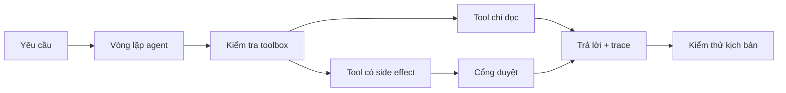

Sếp muốn bạn xây một agent hỗ trợ khách hàng trả lời câu hỏi *"Đơn của tôi đâu, và nếu trễ thì hoàn tiền giúp tôi?"*—nhưng phải kèm chốt chặn an toàn: tuyệt đối không được tự ý hoàn tiền, không được chạy vòng lặp vô hạn, và phải có bộ test chứng minh hành vi đúng trước khi lên production. Gần như mọi mảnh ghép đều lấy trực tiếp từ `p7-06-tool-use` và `p7-07-agents`; dự án này nối chúng thành một agent hoàn chỉnh và kiểm thử được.

## 1. Kế hoạch

Phác thảo kiến trúc tổng thể từ yêu cầu người dùng tới bộ kiểm thử kịch bản trước khi viết code:



Từng phần của dự án nối trực tiếp tới các bài học trước:

| phần | bạn xây dựng gì | từ bài |
|---|---|---|
| Phần 1: Toolbox an toàn | Allowlist tool, kiểm tra tham số bắt buộc, lọc tham số lạ, đầu ra JSON | `p7-06-tool-use` |
| Phần 2: Vòng lặp có giới hạn | Vòng observe–think–act với `final`, `max_steps`, `repeat`, `budget` | `p7-07-agents` |
| Phần 3: Cổng duyệt | Hàm `approve(name, args)` do code giữ, `needs_approval` / `rejected`, nhật ký duyệt | `p7-06-tool-use`, `p7-07-agents` |
| Phần 4: Bộ kiểm thử kịch bản | Kịch bản có quỹ đạo chuẩn bắt được lỗi vòng lặp thật | `p7-07-agents`, `p7-08-evals` |
| Phần 5: Báo cáo tổng kết | Số ca đạt/trượt, phân theo `stopped_reason` và tổng token | `p7-08-evals` |

Luật chơi gồm ba nguyên tắc: mọi hành động có **side effect** (tác dụng phụ làm thay đổi trạng thái thật) phải qua cổng duyệt từ code, mọi vòng lặp đều có trần bước và ngân sách token, và hành vi phải được chứng minh bằng **scenario test** (kiểm thử kịch bản) tất định—không phải "chạy thử một lần thấy ổn".

## 2. Dữ liệu và tool

Cơ sở dữ liệu cửa hàng có 4 đơn hàng (`1042`–`1045`) và 4 trạng thái vận chuyển, kèm chính sách hoàn tiền đơn giản: đơn trễ **từ 3 ngày trở lên** được hoàn tối đa **20%** giá trị đơn. Hãy in bảng đơn hàng và xem 4 tool:

```python
ORDERS = {
    "1042": {"status": "delayed", "carrier": "FastShip", "total": 50.0, "days_late": 4},
    "1043": {"status": "shipped", "carrier": "FastShip", "total": 35.0, "days_late": 0},
    "1044": {"status": "delayed", "carrier": "GoPost", "total": 120.0, "days_late": 5},
    "1045": {"status": "delivered", "carrier": "GoPost", "total": 25.0, "days_late": 1},
}
SHIPMENTS = {
    ("FastShip", "1042"): "hub delay (+4d)",
    ("FastShip", "1043"): "in transit (on time)",
    ("GoPost", "1044"): "customs hold (+5d)",
    ("GoPost", "1045"): "delivered at door",
}
REFUNDS = {}

for oid, row in ORDERS.items():
    print(f"{oid} | {row['status']:<9} | {row['carrier']:<8} | ${row['total']:>5.1f} | {row['days_late']}d late")
# 1042 | delayed   | FastShip | $ 50.0 | 4d late
# 1043 | shipped   | FastShip | $ 35.0 | 0d late
# 1044 | delayed   | GoPost   | $120.0 | 5d late
# 1045 | delivered | GoPost   | $ 25.0 | 1d late
```

Để ý ranh giới rõ ràng giữa ba tool chỉ đọc và một tool làm thay đổi trạng thái:

| tool | đọc/ghi | cần duyệt |
|---|---|---|
| `lookup_order` | đọc `ORDERS` | không |
| `track_shipment` | đọc `SHIPMENTS` | không |
| `check_refund_policy` | đọc quy tắc hoàn tiền | không |
| `issue_refund` | ghi vào `REFUNDS` | **có** |

## 3. Phần 1: toolbox an toàn

Bọc cả 4 tool trong một **allowlist** (danh sách cho phép) rõ ràng gồm `FUNCS`, `SCHEMAS`, `SIDE_EFFECTS` và đi qua một cửa duy nhất `call_tool(name, args)`. Lớp kiểm soát này chặn tên tool lạ, báo thiếu tham số bắt buộc, loại bỏ tham số thừa để `fn(**clean)` không văng `TypeError`, bắt ngoại lệ thành `"error: <msg>"` và chuyển `dict` trả về bằng `json.dumps()`:

```python
import json

ORDERS = {
    "1042": {"status": "delayed", "carrier": "FastShip", "total": 50.0, "days_late": 4},
    "1043": {"status": "shipped", "carrier": "FastShip", "total": 35.0, "days_late": 0},
    "1044": {"status": "delayed", "carrier": "GoPost", "total": 120.0, "days_late": 5},
    "1045": {"status": "delivered", "carrier": "GoPost", "total": 25.0, "days_late": 1},
}
SHIPMENTS = {
    ("FastShip", "1042"): "hub delay (+4d)",
    ("FastShip", "1043"): "in transit (on time)",
    ("GoPost", "1044"): "customs hold (+5d)",
    ("GoPost", "1045"): "delivered at door",
}
REFUNDS = {}


def lookup_order(order_id: str) -> dict:
    if order_id not in ORDERS:
        return {"error": f"order {order_id} not found"}
    o = ORDERS[order_id]
    return {"status": o["status"], "carrier": o["carrier"], "total": o["total"], "late": o["days_late"]}


def track_shipment(carrier: str, order_id: str) -> str:
    return SHIPMENTS.get((carrier, order_id), f"error: no tracking for {carrier} {order_id}")


def check_refund_policy(days_late: int) -> str:
    if days_late < 0:
        raise ValueError("days_late must be >= 0")
    if days_late >= 3:
        return "eligible: max 20% refund"
    return "not eligible: under 3 days late"


def issue_refund(order_id: str, amount: float) -> str:
    if order_id not in ORDERS:
        return f"error: unknown order {order_id}"
    if amount <= 0:
        raise ValueError("amount must be positive")
    REFUNDS[order_id] = amount
    return f"refunded ${amount:.2f} for {order_id}"


TOOL_DEFS = [
    (lookup_order, {
        "name": "lookup_order",
        "description": "lookup order status carrier total",
        "parameters": {"type": "object", "properties": {"order_id": {"type": "string"}}, "required": ["order_id"]},
    }, False),
    (track_shipment, {
        "name": "track_shipment",
        "description": "track shipment carrier status",
        "parameters": {"type": "object", "properties": {"carrier": {"type": "string"}, "order_id": {"type": "string"}}, "required": ["carrier", "order_id"]},
    }, False),
    (check_refund_policy, {
        "name": "check_refund_policy",
        "description": "check refund policy days late",
        "parameters": {"type": "object", "properties": {"days_late": {"type": "integer"}}, "required": ["days_late"]},
    }, False),
    (issue_refund, {
        "name": "issue_refund",
        "description": "issue refund order amount",
        "parameters": {"type": "object", "properties": {"order_id": {"type": "string"}, "amount": {"type": "number"}}, "required": ["order_id", "amount"]},
    }, True),
]

FUNCS = {schema["name"]: fn for fn, schema, _ in TOOL_DEFS}
SCHEMAS = [schema for _, schema, _ in TOOL_DEFS]
SIDE_EFFECTS = {schema["name"]: se for _, schema, se in TOOL_DEFS}


def call_tool(name: str, args: dict) -> str:
    if name not in FUNCS:
        return f"error: unknown tool {name}"
    schema = next(s for s in SCHEMAS if s["name"] == name)
    params = schema["parameters"]
    props = params.get("properties", {})
    for req in params.get("required", []):
        if req not in args or args[req] in (None, ""):
            return f"error: missing {req}"
    clean = {k: v for k, v in args.items() if k in props}
    try:
        out = FUNCS[name](**clean)
    except Exception as err:
        return f"error: {err}"
    return json.dumps(out) if isinstance(out, dict) else str(out)


print("valid  :", call_tool("lookup_order", {"order_id": "1042", "debug": True}))
# valid  : {"status": "delayed", "carrier": "FastShip", "total": 50.0, "late": 4}
print("unknown:", call_tool("drop_table", {"order_id": "1042"}))
# unknown: error: unknown tool drop_table
print("missing:", call_tool("track_shipment", {"carrier": "FastShip"}))
# missing: error: missing order_id
print("raised :", call_tool("check_refund_policy", {"days_late": -1}))
# raised : error: days_late must be >= 0
```

Nối tiếp `p7-06-tool-use`, hãy chạy một ví dụ một bước **không** dùng `script=` để `FakeLLM()` tự chọn `lookup_order` từ `description`, trích `"1042"`, chạy `call_tool` rồi trả câu trả lời cuối:

```python
import json
from pyai_llm import FakeLLM

ORDERS = {"1042": {"status": "delayed", "carrier": "FastShip", "total": 50.0, "days_late": 4}}
SCHEMAS = [
    {
        "name": "lookup_order",
        "description": "lookup order status carrier total",
        "parameters": {"type": "object", "properties": {"order_id": {"type": "string"}}, "required": ["order_id"]},
    },
    {
        "name": "check_refund_policy",
        "description": "check refund policy days late",
        "parameters": {"type": "object", "properties": {"days_late": {"type": "integer"}}, "required": ["days_late"]},
    },
]


def call_tool(name: str, args: dict) -> str:
    if name != "lookup_order":
        return f"error: unknown tool {name}"
    o = ORDERS[args["order_id"]]
    return json.dumps({"status": o["status"], "carrier": o["carrier"], "total": o["total"], "late": o["days_late"]})


client = FakeLLM()
messages = [{"role": "user", "content": 'Check order status for "1042"'}]
first = client.chat(messages, tools=SCHEMAS)
tc = first.tool_calls[0]
obs = call_tool(tc.name, dict(tc.arguments))
messages.append({"role": "assistant", "content": None, "tool_calls": [{"id": tc.id, "name": tc.name, "arguments": dict(tc.arguments)}]})
messages.append({"role": "tool", "tool_call_id": tc.id, "content": obs})
final = client.chat(messages, tools=SCHEMAS)
print("picked:", tc.name, tc.arguments)
# picked: lookup_order {'order_id': '1042'}
print("reply :", final.content)
# reply : Based on the tool result: {"status": "delayed", "carrier": "FastShip", "total": 50.0, "late": 4}
```

Một chi tiết phòng thủ quan trọng khi viết `ToolBox.schemas()` ở Bài tập 1: `[dict(s) for s in schemas]` chỉ tạo **shallow copy** (bản sao nông), nên các cấu trúc lồng bên trong như `s["parameters"]["required"]` vẫn trỏ chung về schema gốc! Trả về `[copy.deepcopy(s) for s in schemas]` sẽ tách biệt hoàn toàn mọi dict và list lồng nhau khỏi thay đổi từ bên ngoài:

```python
import copy

schemas = [{"name": "lookup", "parameters": {"required": ["order_id"]}}]
shallow = [dict(s) for s in schemas]
shallow[0]["parameters"]["required"].clear()
print("shallow mutated orig:", schemas[0]["parameters"]["required"])
# shallow mutated orig: []

schemas = [{"name": "lookup", "parameters": {"required": ["order_id"]}}]
deep = [copy.deepcopy(s) for s in schemas]
deep[0]["parameters"]["required"].clear()
print("deep kept orig      :", schemas[0]["parameters"]["required"])
# deep kept orig      : ['order_id']
```

## 4. Phần 2: vòng agent có giới hạn

Mở rộng vòng một bước thành vòng lặp có giới hạn như ở `p7-07-agents`, kiểm tra điều kiện dừng theo thứ tự mỗi lượt: `budget` (`tokens > token_budget`), `final` (`not resp.tool_calls`), `repeat` (gọi lại đúng tool và tham số như bước trước), và `max_steps` (hết số bước). Ở đây kiểm tra `budget` ngay sau `client.chat(...)` vì lượng token của lượt gọi đó đã tiêu tốn rồi (kiểm tra `final` trước là lựa chọn hợp lệ khác nếu muốn ưu tiên trả về câu trả lời cuối đã trả tiền xong trước khi dừng vì vượt ngân sách). Chạy kịch bản 3 bước bằng `script` (tra đơn → tra chính sách → trả lời cuối) rồi in **trace** (nhật ký từng bước):

```python
import json
from pyai_llm import FakeLLM

ORDERS = {"1042": {"status": "delayed", "carrier": "FastShip", "total": 50.0, "days_late": 4}}
SCHEMAS = [
    {
        "name": "lookup_order",
        "description": "lookup order status carrier total",
        "parameters": {"type": "object", "properties": {"order_id": {"type": "string"}}, "required": ["order_id"]},
    },
    {
        "name": "check_refund_policy",
        "description": "check refund policy days late",
        "parameters": {"type": "object", "properties": {"days_late": {"type": "integer"}}, "required": ["days_late"]},
    },
]
FUNCS = {
    "lookup_order": lambda order_id: {
        "status": ORDERS[order_id]["status"],
        "total": ORDERS[order_id]["total"],
        "late": ORDERS[order_id]["days_late"],
    },
    "check_refund_policy": lambda days_late: "eligible: max 20% refund" if days_late >= 3 else "not eligible",
}


def call_tool(name: str, args: dict) -> str:
    if name not in FUNCS:
        return f"error: unknown tool {name}"
    out = FUNCS[name](**args)
    return json.dumps(out) if isinstance(out, dict) else str(out)


def run_bounded(client, task: str, max_steps: int = 6, token_budget: int | None = None) -> dict:
    messages = [{"role": "user", "content": task}]
    trace = []
    tokens = 0
    for step in range(1, max_steps + 1):
        resp = client.chat(messages, tools=SCHEMAS)
        tokens += resp.usage.total_tokens
        if token_budget is not None and tokens > token_budget:
            return {"stopped_reason": "budget", "answer": "", "tokens": tokens, "trace": trace}
        if not resp.tool_calls:
            return {"stopped_reason": "final", "answer": resp.content or "", "tokens": tokens, "trace": trace}
        tc = resp.tool_calls[0]
        args = dict(tc.arguments)
        if trace and trace[-1]["tool"] == tc.name and trace[-1]["args"] == args:
            return {"stopped_reason": "repeat", "answer": "", "tokens": tokens, "trace": trace}
        obs = call_tool(tc.name, args)
        messages.append({"role": "assistant", "content": None, "tool_calls": [{"id": tc.id, "name": tc.name, "arguments": args}]})
        messages.append({"role": "tool", "tool_call_id": tc.id, "content": obs})
        trace.append({"step": step, "tool": tc.name, "args": args, "observation": obs})
    return {"stopped_reason": "max_steps", "answer": "", "tokens": tokens, "trace": trace}


script = [
    {"tool_calls": [{"name": "lookup_order", "arguments": {"order_id": "1042"}}]},
    {"tool_calls": [{"name": "check_refund_policy", "arguments": {"days_late": 4}}]},
    "Order 1042 is 4 days late; eligible for up to 20% ($10.00).",
]
res = run_bounded(FakeLLM(script=script), "Where is order 1042? Can I get a refund?")
print("stopped:", res["stopped_reason"], "| tokens:", res["tokens"])
# stopped: final | tokens: 159
for entry in res["trace"]:
    print(f"s{entry['step']} {entry['tool']} {entry['args']}")
    print(f"  {entry['observation']}")
# s1 lookup_order {'order_id': '1042'}
#   {"status": "delayed", "total": 50.0, "late": 4}
# s2 check_refund_policy {'days_late': 4}
#   eligible: max 20% refund
print("answer :", res["answer"])
# answer : Order 1042 is 4 days late; eligible for up to 20% ($10.00).
```

> [!NOTE]
> Ở chế độ mặc định, `FakeLLM` luôn dừng ngay với `"Based on the tool result: ..."` sau khi thấy message `tool`, nên nó không tự nối sang tool thứ hai. Vì vậy `FakeLLM(script=...)` đóng vai phần "bộ não" ra quyết định giúp bạn kiểm thử luồng nhiều bước; với model thật, quyết định đến từ model, còn vòng lặp, giới hạn, cổng duyệt và bộ test do code của bạn viết thì giống hệt.

Bảng trace từ lượt chạy 3 bước vừa rồi:

| step | tool | args | observation |
|---|---|---|---|
| 1 | `lookup_order` | `{'order_id': '1042'}` | `{"status": "delayed", "total": 50.0, "late": 4}` |
| 2 | `check_refund_policy` | `{'days_late': 4}` | `eligible: max 20% refund` |

> [!NOTE]
> API LLM thật có thể trả về nhiều `tool_calls` trong cùng một lượt phản hồi. Để code gọn, vòng lặp agent trong dự án này chỉ đọc `resp.tool_calls[0]` ở mỗi bước—khi cần chạy nhiều tool song song trong một lượt, bạn chỉ việc lặp qua toàn bộ `resp.tool_calls` như đã thực hành ở `p7-06` `ex02`.

## 5. Phần 3: cổng duyệt cho side effect

Mỗi khi model gọi tool có `side_effect=True` (`issue_refund`), code của bạn phải chặn lại ở **approval gate** (cổng duyệt) và gọi hàm `approve(name, args) -> bool` được truyền vào. Nếu không truyền `approve` (`approve is None`), dừng ngay với `stopped_reason == "needs_approval"`; nếu có `approve` và trả `True`, ghi rõ người duyệt vào nhật ký `audit`, chạy tool rồi lặp tiếp; nếu `approve` trả `False`, dừng ngay với `stopped_reason == "rejected"`. Trong cả hai trường hợp bị chặn đều trả `pending = {"tool": ..., "args": ...}` và **không** chạy tool:

```python
import json
from pyai_llm import FakeLLM

ORDERS = {
    "1042": {"status": "delayed", "carrier": "FastShip", "total": 50.0, "days_late": 4},
    "1044": {"status": "delayed", "carrier": "GoPost", "total": 120.0, "days_late": 5},
}
REFUNDS = {}


def lookup_order(order_id: str) -> dict:
    o = ORDERS[order_id]
    return {"status": o["status"], "carrier": o["carrier"], "total": o["total"], "late": o["days_late"]}


def issue_refund(order_id: str, amount: float) -> str:
    REFUNDS[order_id] = amount
    return f"refunded ${amount:.2f} for {order_id}"


FUNCS = {"lookup_order": lookup_order, "issue_refund": issue_refund}
SIDE_EFFECTS = {"lookup_order": False, "issue_refund": True}
SCHEMAS = [
    {"name": "lookup_order", "description": "lookup order", "parameters": {"type": "object", "properties": {"order_id": {"type": "string"}}, "required": ["order_id"]}},
    {"name": "issue_refund", "description": "issue refund", "parameters": {"type": "object", "properties": {"order_id": {"type": "string"}, "amount": {"type": "number"}}, "required": ["order_id", "amount"]}},
]


def call_tool(name: str, args: dict) -> str:
    if name not in FUNCS:
        return f"error: unknown tool {name}"
    out = FUNCS[name](**args)
    return json.dumps(out) if isinstance(out, dict) else str(out)


def run_with_gate(
    client,
    task: str,
    approve=None,
    approver: str = "none",
    max_steps: int = 6,
    token_budget: int | None = None,
) -> dict:
    messages = [{"role": "user", "content": task}]
    trace = []
    audit = []
    tokens = 0
    for step in range(1, max_steps + 1):
        resp = client.chat(messages, tools=SCHEMAS)
        tokens += resp.usage.total_tokens
        if token_budget is not None and tokens > token_budget:
            return {"stopped_reason": "budget", "answer": "", "pending": None, "tokens": tokens, "trace": trace, "audit": audit}
        if not resp.tool_calls:
            return {"stopped_reason": "final", "answer": resp.content or "", "pending": None, "tokens": tokens, "trace": trace, "audit": audit}
        tc = resp.tool_calls[0]
        args = dict(tc.arguments)
        if trace and trace[-1]["tool"] == tc.name and trace[-1]["args"] == args:
            return {"stopped_reason": "repeat", "answer": "", "pending": None, "tokens": tokens, "trace": trace, "audit": audit}
        if SIDE_EFFECTS.get(tc.name, False):
            if approve is None:
                audit.append({"step": step, "tool": tc.name, "args": args, "approved": False, "by": approver})
                return {"stopped_reason": "needs_approval", "answer": "", "pending": {"tool": tc.name, "args": args}, "tokens": tokens, "trace": trace, "audit": audit}
            ok = bool(approve(tc.name, dict(args)))
            audit.append({"step": step, "tool": tc.name, "args": args, "approved": ok, "by": approver})
            if not ok:
                return {"stopped_reason": "rejected", "answer": "", "pending": {"tool": tc.name, "args": args}, "tokens": tokens, "trace": trace, "audit": audit}
        obs = call_tool(tc.name, args)
        messages.append({"role": "assistant", "content": None, "tool_calls": [{"id": tc.id, "name": tc.name, "arguments": args}]})
        messages.append({"role": "tool", "tool_call_id": tc.id, "content": obs})
        trace.append({"step": step, "tool": tc.name, "args": args, "observation": obs})
    return {"stopped_reason": "max_steps", "answer": "", "pending": None, "tokens": tokens, "trace": trace, "audit": audit}


def policy_approve(name: str, args: dict) -> bool:
    if name != "issue_refund":
        return False
    order = ORDERS.get(args.get("order_id", ""))
    if not order or order["days_late"] < 3:
        return False
    return 0 < args.get("amount", 0) <= round(order["total"] * 0.2, 2)


refund_script = [
    {"tool_calls": [{"name": "lookup_order", "arguments": {"order_id": "1042"}}]},
    {"tool_calls": [{"name": "issue_refund", "arguments": {"order_id": "1042", "amount": 10.0}}]},
    "Refunded $10.00 for order 1042.",
]
REFUNDS.clear()
r_ok = run_with_gate(FakeLLM(script=refund_script), "Refund 1042", approve=lambda n, a: True, approver="human_lead")
e_ok = r_ok["audit"][0]
print("approved:", r_ok["stopped_reason"], "| refunds:", REFUNDS)
# approved: final | refunds: {'1042': 10.0}
print(f"audit   : {e_ok['tool']} ok={e_ok['approved']} by={e_ok['by']}")
# audit   : issue_refund ok=True by=human_lead

REFUNDS.clear()
r_no = run_with_gate(FakeLLM(script=refund_script), "Refund 1042", approve=None)
print("no_gate :", r_no["stopped_reason"], "| pending:", r_no["pending"]["tool"], "| refunds:", REFUNDS)
# no_gate : needs_approval | pending: issue_refund | refunds: {}

over_script = [
    {"tool_calls": [{"name": "lookup_order", "arguments": {"order_id": "1044"}}]},
    {"tool_calls": [{"name": "issue_refund", "arguments": {"order_id": "1044", "amount": 50.0}}]},
    "Refunded $50.00 for order 1044.",
]
REFUNDS.clear()
r_pol = run_with_gate(FakeLLM(script=over_script), "Refund 1044", approve=policy_approve, approver="policy_gate")
e_pol = r_pol["audit"][0]
print("policy  :", r_pol["stopped_reason"], f"| ok={e_pol['approved']} by={e_pol['by']} | refunds:", REFUNDS)
# policy  : rejected | ok=False by=policy_gate | refunds: {}
```

Hãy nhìn lượt chạy thứ ba: đơn `1044` có tổng `$120.00`, nên mức hoàn tối đa 20% là `$24.00`. Khi model đề nghị `$50.00`, `policy_approve` tự động trả `False`, vòng lặp dừng với `stopped_reason == "rejected"`, nhật ký `audit` ghi `ok=False by=policy_gate`, và `REFUNDS` vẫn trống rỗng (`{}`).

> [!WARNING]
> Luôn giữ nguyên tắc **quyền tối thiểu** (chỉ đăng ký đúng các tool cần thiết), tuyệt đối không bao giờ để model tự duyệt chính mình qua tham số prompt, và phải log mọi hành động không thể đảo ngược được (ai duyệt hoặc từ chối, tên tool, tham số).

## 6. Phần 4: kiểm thử tất định bằng kịch bản

Một **scenario test** (kiểm thử kịch bản) gói yêu cầu, chuỗi quyết định mẫu, hàm duyệt `approve` và kỳ vọng vào một dictionary:

```text
scenario = {
  "name": ...,
  "task": ...,
  "script": [...],
  "approve": callable | None,
  "expect": {"stopped_reason": ..., "tools": [...], "answer_contains": ...}
}
```

Trong đó `expect["tools"]` là **golden trajectory** (quỹ đạo chuẩn)—danh sách tên tool đúng thứ tự mà agent phải gọi. Mỗi kịch bản luôn tạo một client `FakeLLM(script=...)` mới tinh để các bài test hoàn toàn độc lập với nhau.

Hãy chạy bộ 7 kịch bản trên hai phiên bản agent: `run_agent_v1` (bản đầu lỡ quên kiểm tra `repeat`) và `run_with_gate` đã sửa (`v2`). Bộ test bắt trúng lỗi thiếu guard ở `v1` (`6/7`), rồi đạt toàn bộ (`7/7`) sau khi sửa:

```python
import json
from pyai_llm import FakeLLM

ORDERS = {
    "1042": {"status": "delayed", "carrier": "FastShip", "total": 50.0, "days_late": 4},
    "1043": {"status": "shipped", "carrier": "FastShip", "total": 35.0, "days_late": 0},
    "1044": {"status": "delayed", "carrier": "GoPost", "total": 120.0, "days_late": 5},
}
SHIPMENTS = {("FastShip", "1042"): "hub delay (+4d)"}
REFUNDS = {}


def lookup_order(order_id: str) -> dict:
    if order_id not in ORDERS:
        return {"error": f"order {order_id} not found"}
    o = ORDERS[order_id]
    return {"status": o["status"], "carrier": o["carrier"], "total": o["total"], "late": o["days_late"]}


def track_shipment(carrier: str, order_id: str) -> str:
    return SHIPMENTS.get((carrier, order_id), "error: no tracking")


def check_refund_policy(days_late: int) -> str:
    return "eligible: max 20% refund" if days_late >= 3 else "not eligible"


def issue_refund(order_id: str, amount: float) -> str:
    REFUNDS[order_id] = amount
    return f"refunded ${amount:.2f} for {order_id}"


FUNCS = {
    "lookup_order": lookup_order,
    "track_shipment": track_shipment,
    "check_refund_policy": check_refund_policy,
    "issue_refund": issue_refund,
}
SIDE_EFFECTS = {"lookup_order": False, "track_shipment": False, "check_refund_policy": False, "issue_refund": True}
SCHEMAS = [
    {"name": n, "description": n, "parameters": {"type": "object", "properties": {}, "required": []}}
    for n in FUNCS
]


def call_tool(name: str, args: dict) -> str:
    if name not in FUNCS:
        return f"error: unknown tool {name}"
    out = FUNCS[name](**args)
    return json.dumps(out) if isinstance(out, dict) else str(out)


def policy_approve(name: str, args: dict) -> bool:
    order = ORDERS.get(args.get("order_id", ""))
    return bool(order and order["days_late"] >= 3 and 0 < args.get("amount", 0) <= round(order["total"] * 0.2, 2))


def run_agent_v1(client, task: str, approve=None, max_steps: int = 6, token_budget: int | None = None) -> dict:
    messages = [{"role": "user", "content": task}]
    trace = []
    tokens = 0
    for step in range(1, max_steps + 1):
        resp = client.chat(messages, tools=SCHEMAS)
        tokens += resp.usage.total_tokens
        if token_budget is not None and tokens > token_budget:
            return {"stopped_reason": "budget", "answer": "", "tokens": tokens, "trace": trace}
        if not resp.tool_calls:
            return {"stopped_reason": "final", "answer": resp.content or "", "tokens": tokens, "trace": trace}
        tc = resp.tool_calls[0]
        args = dict(tc.arguments)
        # Lỗi ở v1: quên kiểm tra lặp repeat!
        if SIDE_EFFECTS.get(tc.name, False):
            if approve is None:
                return {"stopped_reason": "needs_approval", "answer": "", "tokens": tokens, "trace": trace}
            if not approve(tc.name, dict(args)):
                return {"stopped_reason": "rejected", "answer": "", "tokens": tokens, "trace": trace}
        obs = call_tool(tc.name, args)
        messages.append({"role": "assistant", "content": None, "tool_calls": [{"id": tc.id, "name": tc.name, "arguments": args}]})
        messages.append({"role": "tool", "tool_call_id": tc.id, "content": obs})
        trace.append({"step": step, "tool": tc.name, "args": args, "observation": obs})
    return {"stopped_reason": "max_steps", "answer": "", "tokens": tokens, "trace": trace}


def run_agent_v2(client, task: str, approve=None, max_steps: int = 6, token_budget: int | None = None) -> dict:
    messages = [{"role": "user", "content": task}]
    trace = []
    tokens = 0
    for step in range(1, max_steps + 1):
        resp = client.chat(messages, tools=SCHEMAS)
        tokens += resp.usage.total_tokens
        if token_budget is not None and tokens > token_budget:
            return {"stopped_reason": "budget", "answer": "", "tokens": tokens, "trace": trace}
        if not resp.tool_calls:
            return {"stopped_reason": "final", "answer": resp.content or "", "tokens": tokens, "trace": trace}
        tc = resp.tool_calls[0]
        args = dict(tc.arguments)
        if trace and trace[-1]["tool"] == tc.name and trace[-1]["args"] == args:
            return {"stopped_reason": "repeat", "answer": "", "tokens": tokens, "trace": trace}
        if SIDE_EFFECTS.get(tc.name, False):
            if approve is None:
                return {"stopped_reason": "needs_approval", "answer": "", "tokens": tokens, "trace": trace}
            if not approve(tc.name, dict(args)):
                return {"stopped_reason": "rejected", "answer": "", "tokens": tokens, "trace": trace}
        obs = call_tool(tc.name, args)
        messages.append({"role": "assistant", "content": None, "tool_calls": [{"id": tc.id, "name": tc.name, "arguments": args}]})
        messages.append({"role": "tool", "tool_call_id": tc.id, "content": obs})
        trace.append({"step": step, "tool": tc.name, "args": args, "observation": obs})
    return {"stopped_reason": "max_steps", "answer": "", "tokens": tokens, "trace": trace}


SCENARIOS = [
    {
        "name": "happy_lookup",
        "task": "Check order 1042 and refund policy.",
        "script": [
            {"tool_calls": [{"name": "lookup_order", "arguments": {"order_id": "1042"}}]},
            {"tool_calls": [{"name": "check_refund_policy", "arguments": {"days_late": 4}}]},
            "Order 1042 is delayed 4 days; eligible for 20% refund.",
        ],
        "approve": None,
        "expect": {"stopped_reason": "final", "tools": ["lookup_order", "check_refund_policy"], "answer_contains": "20%"},
    },
    {
        "name": "missing_order",
        "task": "Check order 9999.",
        "script": [
            {"tool_calls": [{"name": "lookup_order", "arguments": {"order_id": "9999"}}]},
            "Sorry, order 9999 was not found.",
        ],
        "approve": None,
        "expect": {"stopped_reason": "final", "tools": ["lookup_order"], "answer_contains": "not found"},
    },
    {
        "name": "repeat_guard",
        "task": "Track order 1042.",
        "max_steps": 3,
        "script": [
            {"tool_calls": [{"name": "lookup_order", "arguments": {"order_id": "1042"}}]},
            {"tool_calls": [{"name": "lookup_order", "arguments": {"order_id": "1042"}}]},
            {"tool_calls": [{"name": "lookup_order", "arguments": {"order_id": "1042"}}]},
        ],
        "approve": None,
        "expect": {"stopped_reason": "repeat", "tools": ["lookup_order"], "answer_contains": ""},
    },
    {
        "name": "max_steps_cap",
        "task": "Check everything on 1042.",
        "max_steps": 2,
        "script": [
            {"tool_calls": [{"name": "lookup_order", "arguments": {"order_id": "1042"}}]},
            {"tool_calls": [{"name": "track_shipment", "arguments": {"carrier": "FastShip", "order_id": "1042"}}]},
            {"tool_calls": [{"name": "check_refund_policy", "arguments": {"days_late": 4}}]},
        ],
        "approve": None,
        "expect": {"stopped_reason": "max_steps", "tools": ["lookup_order", "track_shipment"], "answer_contains": ""},
    },
    {
        "name": "refund_approved",
        "task": "Refund order 1042.",
        "script": [
            {"tool_calls": [{"name": "lookup_order", "arguments": {"order_id": "1042"}}]},
            {"tool_calls": [{"name": "check_refund_policy", "arguments": {"days_late": 4}}]},
            {"tool_calls": [{"name": "issue_refund", "arguments": {"order_id": "1042", "amount": 10.0}}]},
            "Refund of $10.00 issued for order 1042.",
        ],
        "approve": policy_approve,
        "expect": {"stopped_reason": "final", "tools": ["lookup_order", "check_refund_policy", "issue_refund"], "answer_contains": "$10.00"},
    },
    {
        "name": "refund_rejected",
        "task": "Refund $50 for order 1044.",
        "script": [
            {"tool_calls": [{"name": "lookup_order", "arguments": {"order_id": "1044"}}]},
            {"tool_calls": [{"name": "issue_refund", "arguments": {"order_id": "1044", "amount": 50.0}}]},
        ],
        "approve": policy_approve,
        "expect": {"stopped_reason": "rejected", "tools": ["lookup_order"], "answer_contains": ""},
    },
    {
        "name": "budget_stop",
        "task": "Check order 1043.",
        "token_budget": 10,
        "script": [
            {"tool_calls": [{"name": "lookup_order", "arguments": {"order_id": "1043"}}]},
            "Order 1043 is shipped.",
        ],
        "approve": None,
        "expect": {"stopped_reason": "budget", "tools": [], "answer_contains": ""},
    },
]


def evaluate_suite(runner, scenarios: list[dict]) -> list[dict]:
    rows = []
    for sc in scenarios:
        res = runner(
            FakeLLM(script=sc["script"]),
            sc["task"],
            approve=sc["approve"],
            max_steps=sc.get("max_steps", 6),
            token_budget=sc.get("token_budget"),
        )
        got_tools = [t["tool"] for t in res["trace"]]
        exp = sc["expect"]
        ok = (
            res["stopped_reason"] == exp["stopped_reason"]
            and got_tools == exp["tools"]
            and exp["answer_contains"].lower() in res["answer"].lower()
        )
        rows.append({
            "name": sc["name"],
            "expected": f"{exp['stopped_reason']}({len(exp['tools'])})",
            "got": f"{res['stopped_reason']}({len(got_tools)})",
            "passed": ok,
        })
    return rows


for label, fn in [("v1 (no repeat guard)", run_agent_v1), ("v2 (fixed)", run_agent_v2)]:
    rows = evaluate_suite(fn, SCENARIOS)
    print(f"-- {label} --")
    for r in rows:
        status = "PASS" if r["passed"] else "FAIL"
        print(f"{r['name']:<16} | {r['expected']:<17} | {r['got']:<17} | {status}")
    print("passed:", sum(r["passed"] for r in rows), "/", len(rows))
# -- v1 (no repeat guard) --
# happy_lookup     | final(2)          | final(2)          | PASS
# missing_order    | final(1)          | final(1)          | PASS
# repeat_guard     | repeat(1)         | max_steps(3)      | FAIL
# max_steps_cap    | max_steps(2)      | max_steps(2)      | PASS
# refund_approved  | final(3)          | final(3)          | PASS
# refund_rejected  | rejected(1)       | rejected(1)       | PASS
# budget_stop      | budget(0)         | budget(0)         | PASS
# passed: 6 / 7
# -- v2 (fixed) --
# happy_lookup     | final(2)          | final(2)          | PASS
# missing_order    | final(1)          | final(1)          | PASS
# repeat_guard     | repeat(1)         | repeat(1)         | PASS
# max_steps_cap    | max_steps(2)      | max_steps(2)      | PASS
# refund_approved  | final(3)          | final(3)          | PASS
# refund_rejected  | rejected(1)       | rejected(1)       | PASS
# budget_stop      | budget(0)         | budget(0)         | PASS
# passed: 7 / 7
```

Trong kết quả in ở trên, số trong ngoặc (ví dụ `final(2)`) là số tool đã chạy; dưới đây là kết quả bản `v2` dưới dạng bảng đầy đủ:

| scenario | expected | got | pass |
|---|---|---|---|
| `happy_lookup` | `final` `['lookup_order', 'check_refund_policy']` | `final` `['lookup_order', 'check_refund_policy']` | PASS |
| `missing_order` | `final` `['lookup_order']` | `final` `['lookup_order']` | PASS |
| `repeat_guard` | `repeat` `['lookup_order']` | `repeat` `['lookup_order']` | PASS |
| `max_steps_cap` | `max_steps` `['lookup_order', 'track_shipment']` | `max_steps` `['lookup_order', 'track_shipment']` | PASS |
| `refund_approved` | `final` `['lookup_order', 'check_refund_policy', 'issue_refund']` | `final` `['lookup_order', 'check_refund_policy', 'issue_refund']` | PASS |
| `refund_rejected` | `rejected` `['lookup_order']` | `rejected` `['lookup_order']` | PASS |
| `budget_stop` | `budget` `[]` | `budget` `[]` | PASS |

Để theo dõi bộ kịch bản chạy từng bước mà không dính code của `FakeLLM`, bạn dùng một bộ kịch bản đồ chơi với danh sách quyết định viết tay. Bấm **Visualize** ở khối code này để xem `tools`, `reason` và `passed` tăng dần qua từng ca:

```python
toy_scenarios = [
    {"name": "happy", "plan": [("tool", "lookup_order"), ("final", "ok")], "expect": ("final", ["lookup_order"])},
    {"name": "repeat", "plan": [("tool", "lookup_order"), ("tool", "lookup_order")], "expect": ("repeat", ["lookup_order"])},
    {"name": "gate", "plan": [("side_effect", "issue_refund")], "expect": ("needs_approval", [])},
]


def run_toy(plan, max_steps=4):
    tools = []
    reason = "max_steps"
    for step in range(1, max_steps + 1):
        kind, val = plan[step - 1]
        if kind == "final":
            reason = "final"
            break
        if kind == "side_effect":
            reason = "needs_approval"
            break
        if tools and tools[-1] == val:
            reason = "repeat"
            break
        tools.append(val)
    return reason, tools


passed = 0
for sc in toy_scenarios:
    got = run_toy(sc["plan"])
    ok = got == sc["expect"]
    if ok:
        passed += 1
    print(sc["name"], "->", got[0], ok)
# happy -> final True
# repeat -> repeat True
# gate -> needs_approval True
print(f"passed: {passed}/{len(toy_scenarios)}")
# passed: 3/3
```

Trong project thực tế, mỗi phần tử của `SCENARIOS` có thể truyền thẳng vào `@pytest.mark.parametrize("scenario", SCENARIOS)` để pytest chạy toàn bộ quỹ đạo chuẩn mỗi lần sửa code.

## 7. Phần 5: báo cáo

Gom kết quả chạy kịch bản thành báo cáo gọn gồm tỉ lệ đạt, thống kê theo `stopped_reason`, tổng token và từng ca trượt kèm lý do (`stopped_reason`, `tools` hay `answer`). Khối dưới đây báo cáo kết quả chạy bản `v1` (`v1_results`, dùng số token thật đo ở Phần 4) để thấy một dòng `FAIL`, kèm dòng tổng hợp cho bản `v2` đã sửa (`7/7`):

```python
def build_report_rows(results: list[dict]) -> list[str]:
    n_pass = sum(r["passed"] for r in results)
    counts = {}
    total_tokens = 0
    for r in results:
        sr = r["stopped_reason"]
        counts[sr] = counts.get(sr, 0) + 1
        total_tokens += r["tokens"]
    lines = [f"passed: {n_pass}/{len(results)}", f"total_tokens: {total_tokens}"]
    for sr in sorted(counts):
        lines.append(f"  {sr}: {counts[sr]}")
    fails = [r for r in results if not r["passed"]]
    if not fails:
        lines.append("failures: none")
    for r in fails:
        lines.append(f"  FAIL {r['name']}: {', '.join(r['reasons'])}")
    return lines


v1_results = [
    {"name": "happy_lookup", "passed": True, "stopped_reason": "final", "tokens": 156, "reasons": []},
    {"name": "missing_order", "passed": True, "stopped_reason": "final", "tokens": 54, "reasons": []},
    {"name": "repeat_guard", "passed": False, "stopped_reason": "max_steps", "tokens": 171, "reasons": ["stopped_reason", "tools"]},
    {"name": "max_steps_cap", "passed": True, "stopped_reason": "max_steps", "tokens": 85, "reasons": []},
    {"name": "refund_approved", "passed": True, "stopped_reason": "final", "tokens": 239, "reasons": []},
    {"name": "refund_rejected", "passed": True, "stopped_reason": "rejected", "tokens": 89, "reasons": []},
    {"name": "budget_stop", "passed": True, "stopped_reason": "budget", "tokens": 18, "reasons": []},
]
for line in build_report_rows(v1_results):
    print(line)
# passed: 6/7
# total_tokens: 812
#   budget: 1
#   final: 3
#   max_steps: 2
#   rejected: 1
#   FAIL repeat_guard: stopped_reason, tools

v2_results = [
    {**r, "passed": True, "stopped_reason": "repeat", "tokens": 75, "reasons": []}
    if r["name"] == "repeat_guard" else r
    for r in v1_results
]
v2_rows = build_report_rows(v2_results)
print("v2 ->", v2_rows[0], v2_rows[1], v2_rows[-1])
# v2 -> passed: 7/7 total_tokens: 716 failures: none
```

> [!TIP]
> Kiểm thử kịch bản chỉ kiểm tra **code điều khiển của bạn** dựa trên các quyết định đã viết sẵn. Khi chạy với LLM thật, bạn cần làm thêm bước **eval** trên nhiều tác vụ khác nhau (`p7-08-evals`), vì model thật có thể chọn tool hoặc tham số khác với kịch bản mẫu.

## 8. Lỗi thường gặp

**1. Chạy tool có side effect trước khi hỏi duyệt**

Nếu gọi `issue_refund` trước rồi mới kiểm tra `approve`, tiền đã được hoàn xong dù cổng duyệt trả `False`.

```python
issued = []


def issue_refund_side_effect(order_id: str, amount: float) -> str:
    issued.append((order_id, amount))
    return f"refunded ${amount:.2f} for {order_id}"


def buggy_step(tc_name, tc_args, approve):
    obs = issue_refund_side_effect(**tc_args)  # Lỗi: chạy trước khi kiểm tra approve!
    if not approve(tc_name, tc_args):
        return {"stopped_reason": "rejected", "issued": list(issued)}
    return {"stopped_reason": "final", "obs": obs}


print("buggy:", buggy_step("issue_refund", {"order_id": "1042", "amount": 50.0}, lambda n, a: False))
# buggy: {'stopped_reason': 'rejected', 'issued': [('1042', 50.0)]}

issued.clear()


def fixed_step(tc_name, tc_args, approve):
    if not approve(tc_name, tc_args):
        return {"stopped_reason": "rejected", "issued": list(issued)}
    obs = issue_refund_side_effect(**tc_args)
    return {"stopped_reason": "final", "obs": obs}


print("fixed:", fixed_step("issue_refund", {"order_id": "1042", "amount": 50.0}, lambda n, a: False))
# fixed: {'stopped_reason': 'rejected', 'issued': []}
```

Cách sửa: luôn gọi `approve(tc.name, args)` **trước** khi thực thi hàm có side effect.

**2. So sánh trajectory bằng `set` thay vì `list`**

Dùng `set(got_tools) == set(expected_tools)` sẽ bỏ sót lỗi đảo thứ tự hoặc gọi trùng lặp, làm một quỹ đạo sai vẫn lọt test.

```python
expected = ["lookup_order", "check_refund_policy"]
got_wrong_order = ["check_refund_policy", "lookup_order"]

print("buggy set :", set(got_wrong_order) == set(expected))
# buggy set : True
print("fixed list:", got_wrong_order == expected)
# fixed list: False
```

Cách sửa: luôn so sánh `got_tools == expected_tools` bằng `list` có thứ tự.

**3. Dùng chung một client `FakeLLM` cho nhiều kịch bản**

Dùng chung một đối tượng `FakeLLM(script=...)` khiến kịch bản sau bị cạn script (văng `IndexError`) hoặc lệch `ToolCall.id`, làm kết quả test phụ thuộc vào thứ tự chạy.

```python
from pyai_llm import FakeLLM

shared_client = FakeLLM(script=[
    {"tool_calls": [{"name": "lookup_order", "arguments": {"order_id": "1042"}}]},
    "Order 1042 delayed.",
])
r1 = shared_client.chat([{"role": "user", "content": "S1"}])
r2 = shared_client.chat([{"role": "user", "content": "S1"}])
print("s1 ok, call id:", r1.tool_calls[0].id)
# s1 ok, call id: call_1
try:
    shared_client.chat([{"role": "user", "content": "S2"}])
except IndexError as err:
    print("s2 crashed:", type(err).__name__, "-", err)
# s2 crashed: IndexError - script exhausted after 2 replies
```

Cách sửa: tạo mới `FakeLLM(script=...)` riêng cho từng kịch bản.

**4. Test chỉ kiểm tra câu trả lời cuối, bỏ qua danh sách tool đã gọi**

Nếu chỉ kiểm `answer_contains`, một agent đoán bừa `"20%"` mà chưa từng tra đơn hay tra chính sách vẫn bị coi là đạt—"đúng nhờ may".

```python
def eval_answer_only(answer: str, must_contain: str) -> bool:
    return must_contain.lower() in answer.lower()


def eval_with_trajectory(answer: str, must_contain: str, tools: list[str], expected_tools: list[str]) -> bool:
    return must_contain.lower() in answer.lower() and tools == expected_tools


print("answer only:", eval_answer_only("Maybe 20%?", "20%"))
# answer only: True
print("with traj  :", eval_with_trajectory("Maybe 20%?", "20%", [], ["lookup_order", "check_refund_policy"]))
# with traj  : False
```

Cách sửa: kiểm đồng thời `stopped_reason`, `tools` (theo thứ tự) **và** `answer_contains`.

## Tóm tắt

- Một **toolbox** an toàn giữ allowlist, kiểm tra tham số bắt buộc, bỏ tham số thừa, bắt ngoại lệ thành `"error: ..."` và chuyển `dict` bằng `json.dumps()`.
- Vòng lặp agent có giới hạn kiểm tra theo thứ tự `budget` → `final` → `repeat` → `approval` → `max_steps` và luôn ghi `trace`.
- Chặn mọi **side effect** bằng hàm `approve(name, args)` do code kiểm soát (`needs_approval` nếu không truyền hàm duyệt, `rejected` nếu hàm trả `False`), không bao giờ để model tự duyệt và luôn ghi log quyết định.
- Dùng **scenario test** tất định để kiểm đồng thời `stopped_reason`, **golden trajectory** (`list` có thứ tự) và `answer_contains`, với client mới cho từng kịch bản.
- Tổng hợp báo cáo theo số ca đạt/tổng, thống kê `stopped_reason`, tổng token và lý do lỗi, đồng thời kết hợp thêm eval với model thật (`p7-08-evals`).

## Làm thêm

Sau khi hoàn thành hai bài tập, bạn có thể mở rộng agent theo các hướng thực tế sau:

- **Thêm tool và kịch bản lỗi mới**: bổ sung tool `send_status_email` (`side_effect=True`) hoặc `cancel_order`, rồi viết thêm kịch bản kiểm tra nhánh duyệt, từ chối và thiếu tham số.
- **Thử với LLM thật đọc key từ `.env`**: nạp `LLM_API_KEY` từ file `.env` (không bao giờ in hay commit key) và chạy lại cùng các tác vụ không dùng `script=` để đối chiếu quỹ đạo thật với quỹ đạo chuẩn:

```bash
set -a && source .env && set +a
uv run python -c "import os; print('key loaded:', bool(os.getenv('LLM_API_KEY')))"
```

- **Gửi trace vào hệ thống monitoring**: xuất `(stopped_reason, steps, total_tokens)` của mỗi lần chạy vào bảng theo dõi chi phí và độ trễ ở Phase 8 (`p8-04-monitoring`).
- **Đo tỉ lệ thành công trên tập eval lớn hơn**: gom các câu hỏi khó của khách hàng (`p7-08-evals`) để đo tỉ lệ hoàn thành mỗi khi chỉnh prompt hoặc mô tả tool với model thật.
