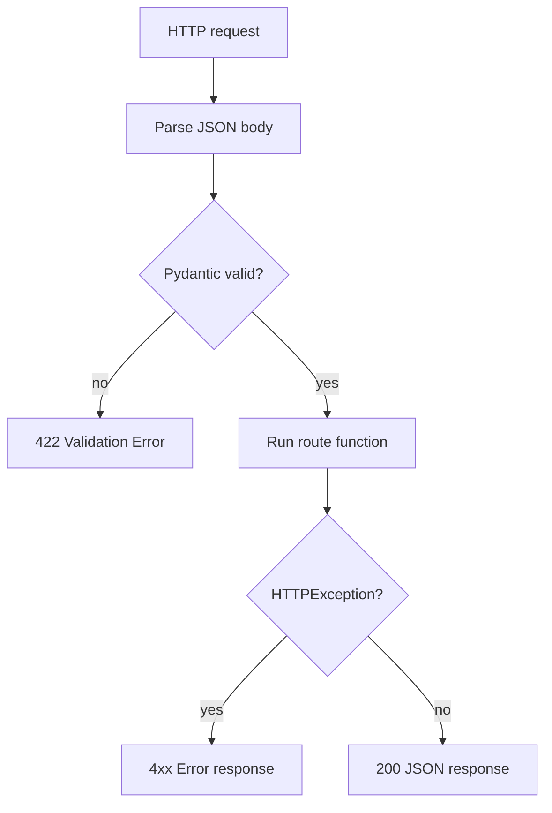

Your RAG pipeline from `p7-09-mini-project-rag` currently runs only inside a single Python script. To let a web app, a chat interface, or a teammate call it, you place it behind an HTTP **endpoint**. **FastAPI** turns Python functions with type hints into endpoints, validates incoming data automatically with **Pydantic**, and returns clear errors when a client sends bad input.

## 1. HTTP in 5 minutes

Programs talk to web services by exchanging **requests** and **responses** over HTTP. Every request carries an **HTTP method** (`GET` to read data, `POST` to send data or run an action), a path (such as `/ask`), optional **query parameters** after `?`, and an optional JSON **request body**. Every response returns a 3-digit **status code** (such as `200`) and a JSON body.

```text
Client                                   FastAPI Server
  |                                            |
  |  POST /ask                                 |
  |  {"question": "What is RAG?", "top_k": 2}  |
  | -----------------------------------------> |
  |                                            |  validate & run
  |  200 OK                                    |
  |  {"answer": "...", "sources": [1, 3]}      |
  | <----------------------------------------- |
```

Think of an endpoint like a service counter at a bank: the path is the counter number, the HTTP method is the type of slip you hand over, and the status code is the stamp the clerk puts on the receipt (`200` for done, `404` for not found, `422` for a form filled out wrong).

## 2. Your first app: `GET /health`

Create a `FastAPI()` instance, attach a Python function with the `@app.get("/health")` decorator to register a **route**, and test it with `TestClient(app)`. Just like the decorators you wrote in `p2-07-decorators`, `@app.get(...)` registers the function on `app` and leaves the function itself unchanged—so you can still call `health()` directly in Python.

```python
from fastapi import FastAPI
from fastapi.testclient import TestClient

app = FastAPI()


@app.get("/health")
def health() -> dict[str, str]:
    return {"status": "ok"}


# A decorated route is still a normal Python function
print("direct:", health())
# direct: {'status': 'ok'}

# TestClient calls the app in-process without opening a port
client = TestClient(app)
r = client.get("/health")
print("http:", r.status_code, r.json())
# http: 200 {'status': 'ok'}
```

Notice that `r.status_code` is `200` and `r.json()` parses the response body back into a Python `dict`. Inside this lesson, `TestClient` sends requests directly in the same Python process without opening a network port.

When running it for real on your machine (outside the app), you start a local server with `uvicorn` and call it with `curl` from another terminal:

```bash
uv run uvicorn main:app --reload
curl http://127.0.0.1:8000/health
```

Once `uvicorn` is running on your computer, opening `http://127.0.0.1:8000/docs` in a browser displays an interactive `/docs` page that FastAPI generates automatically from your routes and type hints.

## 3. Path and query parameters

A variable inside `{...}` in the route path is a **path parameter**, while any extra parameter on the function is a **query parameter** (sent after `?`, with a default value if optional). Because `doc_id: int` and `limit: int = 3` have `int` type hints, FastAPI converts `"1"` from the URL into `1` automatically and rejects `"abc"` with `422`.

If the requested `doc_id` does not exist in our in-memory `DOCS` dictionary, `raise HTTPException(status_code=404, detail="doc not found")` stops the handler and sends a clean `404` JSON response.

```python
from fastapi import FastAPI, HTTPException
from fastapi.testclient import TestClient

app = FastAPI()
DOCS = {
    1: "RAG retrieves chunks before answering.",
    2: "FastAPI validates types from hints.",
}


@app.get("/docs/{doc_id}")
def read_doc(doc_id: int, limit: int = 3) -> dict[str, object]:
    if doc_id not in DOCS:
        raise HTTPException(status_code=404, detail="doc not found")
    words = DOCS[doc_id].split()[:limit]
    return {"doc_id": doc_id, "limit": limit, "preview": " ".join(words)}


client = TestClient(app)
for url in ["/docs/1", "/docs/2?limit=2", "/docs/99", "/docs/abc"]:
    r = client.get(url)
    if r.status_code == 422:
        errs = [(e["loc"], e["type"]) for e in r.json()["detail"]]
        print(url, r.status_code, errs)
    else:
        print(url, r.status_code, r.json())
# /docs/1 200 {'doc_id': 1, 'limit': 3, 'preview': 'RAG retrieves chunks'}
# /docs/2?limit=2 200 {'doc_id': 2, 'limit': 2, 'preview': 'FastAPI validates'}
# /docs/99 404 {'detail': 'doc not found'}
# /docs/abc 422 [(['path', 'doc_id'], 'int_parsing')]
```

Here is how FastAPI resolved each request in the trace above:

| request | doc_id | limit | status |
|---|---|---|---|
| `GET /docs/1` | `1` | `3` | `200` |
| `GET /docs/2?limit=2` | `2` | `2` | `200` |
| `GET /docs/99` | `99` | `3` | `404` |
| `GET /docs/abc` | `"abc"` (invalid int) | `3` | `422` |

Notice how `"2"` in `/docs/2?limit=2` became integer `2`, and `/docs/abc` failed before `read_doc` even started.

## 4. POST with Pydantic: automatic input validation

For `POST` endpoints that accept JSON payloads, subclass `pydantic.BaseModel` and attach `Field(...)` constraints such as `min_length`, `max_length`, `ge` (greater or equal), and `le` (less or equal). In `p7-02-structured-output`, you wrote a manual `validate(data, schema)` function by hand; **Pydantic** builds that validation for you directly from your class type hints.

```python
from fastapi import FastAPI
from fastapi.testclient import TestClient
from pydantic import BaseModel, Field

app = FastAPI()


class AskRequest(BaseModel):
    question: str = Field(min_length=1, max_length=200)
    top_k: int = Field(default=3, ge=1, le=5)


@app.post("/ask")
def ask(body: AskRequest) -> dict[str, object]:
    return {"question": body.question, "top_k": body.top_k}


client = TestClient(app)
payloads = [
    {"question": "What is RAG?"},
    {"question": ""},
    {"top_k": 2},
    {"question": "Hi", "top_k": "many"},
    {"question": "Hi", "top_k": 9},
]
for idx, payload in enumerate(payloads, 1):
    r = client.post("/ask", json=payload)
    if r.status_code == 200:
        print(f"case {idx}:", r.status_code, r.json())
    else:
        errs = [(e["loc"], e["type"]) for e in r.json()["detail"]]
        print(f"case {idx}:", r.status_code, errs)
# case 1: 200 {'question': 'What is RAG?', 'top_k': 3}
# case 2: 422 [(['body', 'question'], 'string_too_short')]
# case 3: 422 [(['body', 'question'], 'missing')]
# case 4: 422 [(['body', 'top_k'], 'int_parsing')]
# case 5: 422 [(['body', 'top_k'], 'less_than_equal')]
```

Every `422` error lists the exact failing location `loc` (for example `['body', 'question']`) and machine-readable error `type` (such as `'string_too_short'` or `'less_than_equal'`).



> [!NOTE]
> A `422` error means the client sent invalid input—Pydantic rejected the request at the door, so your route function never ran.

## 5. Choosing status codes on purpose

FastAPI defaults to `200`, which means "OK", but good APIs pick specific status codes so callers know what happened without guessing. Set `status_code=201` on `@app.post(...)` when creating a new resource, raise `404` when an ID is missing, and raise `400` when the JSON passes Pydantic's types yet breaks a business rule (like whitespace-only text).

```python
from fastapi import FastAPI, HTTPException
from fastapi.testclient import TestClient
from pydantic import BaseModel, Field

app = FastAPI()
notes: dict[int, str] = {}


class NoteIn(BaseModel):
    text: str = Field(min_length=1, max_length=100)


@app.post("/notes", status_code=201)
def create_note(body: NoteIn) -> dict[str, object]:
    clean = body.text.strip()
    if not clean:
        raise HTTPException(status_code=400, detail="note text is blank")
    note_id = len(notes) + 1
    notes[note_id] = clean
    return {"id": note_id, "text": clean}


@app.get("/notes/{note_id}")
def get_note(note_id: int) -> dict[str, object]:
    if note_id not in notes:
        raise HTTPException(status_code=404, detail="note not found")
    return {"id": note_id, "text": notes[note_id]}


client = TestClient(app)
r1 = client.post("/notes", json={"text": "pin deps"})
print("create:", r1.status_code, r1.json())
# create: 201 {'id': 1, 'text': 'pin deps'}
r2 = client.post("/notes", json={"text": "   "})
print("blank:", r2.status_code, r2.json())
# blank: 400 {'detail': 'note text is blank'}
r3 = client.get("/notes/99")
print("missing:", r3.status_code, r3.json())
# missing: 404 {'detail': 'note not found'}
```

Use this table as your quick reference when choosing a status code:

| code | meaning | when you use it |
|---|---|---|
| `200` | OK | `GET` or `POST` read/compute requests that succeed |
| `201` | Created | `POST` route that creates a new record (`status_code=201`) |
| `400` | Bad Request | Valid JSON types, but fails a business rule in your handler |
| `404` | Not Found | The requested ID or resource does not exist |
| `422` | Unprocessable Entity | FastAPI/Pydantic automatic failure on path, query, or JSON body |
| `500` | Internal Server Error | Unhandled crash or bug on the server side |

> [!WARNING]
> Never return `{"error": "not found"}` with status `200`. Clients and monitoring dashboards (`p8-04-monitoring`) check the status code first and will count a `200` error payload as a successful request.

## 6. Testing with `TestClient` and `pytest`

Testing an endpoint works just like testing a regular function from `p3-01-pytest`: arrange your request, call `client.get(...)` or `client.post(...)`, and assert on `r.status_code` and `r.json()`. Use a `client` fixture that clears in-memory state (`notes.clear()`) before each test so tests never depend on run order.

Press **Visualize** on this block and watch `notes` grow during `test_create_note_ok` and reset inside `make_client` before the next test runs.

```python
import pytest
from fastapi import FastAPI, HTTPException
from fastapi.testclient import TestClient
from pydantic import BaseModel, Field

app = FastAPI()
notes: dict[int, str] = {}


class NoteIn(BaseModel):
    text: str = Field(min_length=1, max_length=100)


@app.post("/notes", status_code=201)
def create_note(body: NoteIn) -> dict[str, object]:
    note_id = len(notes) + 1
    notes[note_id] = body.text
    return {"id": note_id, "text": body.text}


@app.get("/notes/{note_id}")
def get_note(note_id: int) -> dict[str, object]:
    if note_id not in notes:
        raise HTTPException(status_code=404, detail="note not found")
    return {"id": note_id, "text": notes[note_id]}


def make_client() -> TestClient:
    notes.clear()
    return TestClient(app)


@pytest.fixture
def client() -> TestClient:
    return make_client()


def test_create_note_ok(client: TestClient) -> None:
    r = client.post("/notes", json={"text": "ship v1"})
    assert r.status_code == 201
    assert r.json() == {"id": 1, "text": "ship v1"}


def test_empty_text_returns_422(client: TestClient) -> None:
    r = client.post("/notes", json={"text": ""})
    assert r.status_code == 422


def test_missing_note_returns_404(client: TestClient) -> None:
    r = client.get("/notes/99")
    assert r.status_code == 404


# Run the three tests directly when executed as a standalone script
test_create_note_ok(make_client())
test_empty_text_returns_422(make_client())
test_missing_note_returns_404(make_client())
print("all tests passed")
# all tests passed
```

In a real `test_*.py` file, you omit the bottom calls and run `pytest`, which injects the `@pytest.fixture def client()` parameter into every test automatically.

## 7. Putting an LLM behind an endpoint

Here is how you wrap `FakeLLM` behind a `POST /chat` endpoint with a Pydantic `ChatRequest`. Create the `llm` client once at module level rather than inside `chat()` on every request, and return `"tokens"` alongside `"answer"` so your monitoring layer in `p8-04-monitoring` can track cost per request.

```python
from fastapi import FastAPI
from fastapi.testclient import TestClient
from pyai_llm import FakeLLM
from pydantic import BaseModel, Field

app = FastAPI()
# Create the LLM client once at module level, not per request
llm = FakeLLM(seed=0)


class ChatRequest(BaseModel):
    message: str = Field(min_length=1, max_length=500)
    temperature: float = Field(default=0.0, ge=0.0, le=1.0)


@app.post("/chat")
def chat(body: ChatRequest) -> dict[str, object]:
    reply = llm.chat(
        [{"role": "user", "content": body.message}],
        temperature=body.temperature,
    )
    return {"answer": reply.content, "tokens": reply.usage.total_tokens}


client = TestClient(app)
r = client.post("/chat", json={"message": "What is RAG?"})
print("status:", r.status_code)
# status: 200
print("tokens:", r.json()["tokens"])
# tokens: 29
print("answer:", r.json()["answer"][:60] + "...")
# answer: RAG (Retrieval-Augmented Generation) retrieves relevant docu...
```

In `p8-05-mini-project`, you will wrap your full RAG pipeline behind a FastAPI endpoint using this exact pattern.

## 8. Common mistakes

**1. Sending `data=` instead of `json=` in `TestClient.post`**

Passing `data=...` sends form-encoded fields rather than a JSON request body, so Pydantic rejects the request with `422` (`model_attributes_type`).

```python
from fastapi import FastAPI
from fastapi.testclient import TestClient
from pydantic import BaseModel, Field

app = FastAPI()


class AskRequest(BaseModel):
    question: str = Field(min_length=1)


@app.post("/ask")
def ask(body: AskRequest) -> dict[str, str]:
    return {"q": body.question}


client = TestClient(app)
# Bug: data= sends form data instead of JSON
r = client.post("/ask", data={"question": "What is RAG?"})
errs = [(e["loc"], e["type"]) for e in r.json()["detail"]]
print("with data=:", r.status_code, errs)
# with data=: 422 [(['body'], 'model_attributes_type')]

# Fix: pass json= so TestClient sends a JSON body
r_ok = client.post("/ask", json={"question": "What is RAG?"})
print("with json=:", r_ok.status_code, r_ok.json())
# with json=: 200 {'q': 'What is RAG?'}
```

Fix: always use `client.post(..., json=...)` when calling a JSON endpoint.

**2. Typing the request body as `dict` instead of a Pydantic model**

Writing `body: dict` disables field validation completely—an empty `"question"` or wrong keys slip straight through with status `200`, only to crash with `KeyError` or corrupt downstream logic.

```python
from fastapi import FastAPI
from fastapi.testclient import TestClient
from pydantic import BaseModel, Field

app = FastAPI()


class AskRequest(BaseModel):
    question: str = Field(min_length=1)


@app.post("/ask-dict")
def ask_dict(body: dict) -> dict[str, object]:
    return {"received": body}


@app.post("/ask-model")
def ask_model(body: AskRequest) -> dict[str, str]:
    return {"question": body.question}


client = TestClient(app)
bad = {"question": "", "extra": 99}
r_dict = client.post("/ask-dict", json=bad)
print("dict body:", r_dict.status_code, r_dict.json())
# dict body: 200 {'received': {'question': '', 'extra': 99}}

r_model = client.post("/ask-model", json=bad)
errs = [(e["loc"], e["type"]) for e in r_model.json()["detail"]]
print("model body:", r_model.status_code, errs)
# model body: 422 [(['body', 'question'], 'string_too_short')]
```

Fix: define a `BaseModel` subclass with `Field(...)` rules for every JSON request body.

**3. Returning an error `dict` with status `200` instead of `HTTPException`**

Returning `{"error": ...}` tells HTTP clients and metrics collectors that the request succeeded (`200`).

```python
from fastapi import FastAPI, HTTPException
from fastapi.testclient import TestClient

app = FastAPI()


@app.get("/bad-notes/{note_id}")
def bad_note(note_id: int) -> dict[str, str]:
    return {"error": "note not found"}


@app.get("/notes/{note_id}")
def good_note(note_id: int) -> dict[str, str]:
    raise HTTPException(status_code=404, detail="note not found")


client = TestClient(app)
r_bad = client.get("/bad-notes/99")
print("wrong:", r_bad.status_code, r_bad.json())
# wrong: 200 {'error': 'note not found'}

r_good = client.get("/notes/99")
print("fixed:", r_good.status_code, r_good.json())
# fixed: 404 {'detail': 'note not found'}
```

Fix: `raise HTTPException(status_code=404, detail=...)` (or `400`) whenever an error occurs.

**4. Forgetting `status_code=201` on resource creation**

Without `status_code=201` on `@app.post(...)`, FastAPI returns `200`, so a test checking `assert r.status_code == 201` will fail.

```python
from fastapi import FastAPI
from fastapi.testclient import TestClient
from pydantic import BaseModel

app = FastAPI()


class NoteIn(BaseModel):
    text: str


@app.post("/notes-default")
def create_default(body: NoteIn) -> dict[str, object]:
    return {"id": 1, "text": body.text}


@app.post("/notes", status_code=201)
def create_201(body: NoteIn) -> dict[str, object]:
    return {"id": 1, "text": body.text}


client = TestClient(app)
r1 = client.post("/notes-default", json={"text": "test"})
print("default:", r1.status_code, "expected 201 ->", r1.status_code == 201)
# default: 200 expected 201 -> False

r2 = client.post("/notes", json={"text": "test"})
print("with 201:", r2.status_code, "expected 201 ->", r2.status_code == 201)
# with 201: 201 expected 201 -> True
```

Fix: add `status_code=201` inside `@app.post("/notes", status_code=201)` when creating a new item.

## Recap

- FastAPI maps Python functions to HTTP **endpoints** via `@app.get(...)` and `@app.post(...)` decorators, and leaves the underlying function directly callable.
- **Path parameters** (`/docs/{doc_id}`) and **query parameters** (`limit: int = 3`) are parsed and checked from your function's type hints.
- Subclass `pydantic.BaseModel` with `Field(...)` rules (`min_length`, `max_length`, `ge`, `le`) to reject malformed JSON bodies automatically with `422`.
- Pick status codes intentionally (`201` for creation, `400` for business-rule errors, `404` for missing items via `HTTPException`)—never return error dicts with `200`.
- Test routes in-process without opening ports using `TestClient(app)` and `pytest` fixtures that reset shared state between tests.
