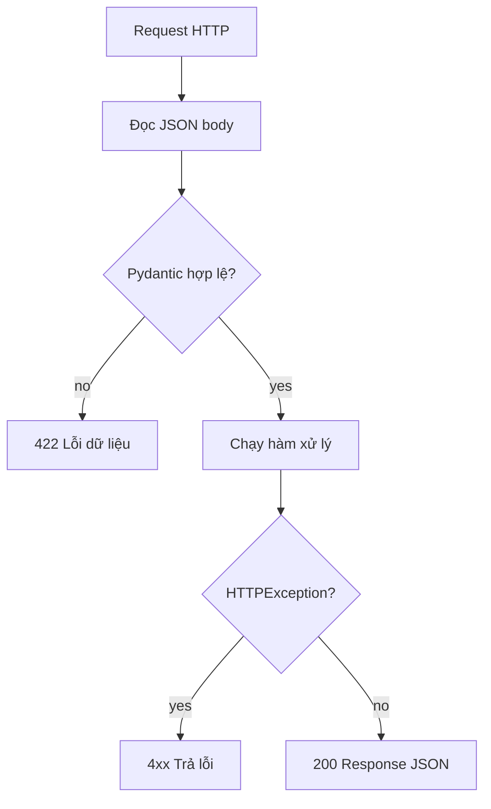

Pipeline RAG ở bài `p7-09-mini-project-rag` mới chỉ chạy trong một script Python đơn lẻ. Muốn app web, giao diện chat hay đồng đội gọi được nó, bạn đặt pipeline đó phía sau một **endpoint** (điểm nhận request) HTTP. **FastAPI** biến các hàm Python có type hint thành endpoint, tự kiểm dữ liệu đầu vào bằng **Pydantic** và trả về mã lỗi rõ ràng khi client gửi sai.

## 1. HTTP trong 5 phút

Các chương trình giao tiếp với dịch vụ web qua cặp **request** (yêu cầu) và **response** (phản hồi) theo giao thức HTTP. Một request gồm **HTTP method** (phương thức HTTP: `GET` để đọc, `POST` để gửi dữ liệu hoặc chạy xử lý), đường dẫn (như `/ask`), có thể kèm **query parameter** (tham số truy vấn sau dấu `?`) và JSON **request body** (phần thân request). Response trả về gồm **status code** (mã trạng thái 3 chữ số, như `200`) và dữ liệu JSON.

```text
Client                                   FastAPI Server
  |                                            |
  |  POST /ask                                 |
  |  {"question": "What is RAG?", "top_k": 2}  |
  | -----------------------------------------> |
  |                                            |  validate & run
  |  200 OK                                    |
  |  {"answer": "...", "sources": [1, 3]}      |
  | <----------------------------------------- |
```

Hãy hình dung endpoint giống một quầy giao dịch: đường dẫn là số quầy, HTTP method là loại phiếu yêu cầu bạn đưa vào, còn status code là con dấu kết quả đóng trên biên nhận (`200` là xong, `404` là không tìm thấy, `422` là điền sai mẫu).

## 2. App đầu tiên: `GET /health`

Bạn tạo một đối tượng `FastAPI()`, gắn decorator `@app.get("/health")` để đăng ký **route** (đường dẫn API) cho hàm Python, rồi thử gửi request bằng `TestClient(app)`. Giống như decorator bạn đã học ở `p2-07-decorators`, `@app.get(...)` đăng ký hàm lên `app` nhưng giữ nguyên hàm gốc—nên bạn vẫn gọi `health()` trực tiếp như hàm Python bình thường được.

```python
from fastapi import FastAPI
from fastapi.testclient import TestClient

app = FastAPI()


@app.get("/health")
def health() -> dict[str, str]:
    return {"status": "ok"}


# Hàm gắn decorator vẫn là hàm Python bình thường
print("direct:", health())
# direct: {'status': 'ok'}

# TestClient gọi thẳng app trong cùng process, không mở port
client = TestClient(app)
r = client.get("/health")
print("http:", r.status_code, r.json())
# http: 200 {'status': 'ok'}
```

Hãy để ý `r.status_code` là `200` và `r.json()` chuyển phản hồi JSON thành `dict` Python. Trong bài này, `TestClient` gửi request ngay trong cùng process Python mà không mở port mạng nào.

Khi chạy thật trên máy bạn (ngoài ứng dụng học), bạn bật server cục bộ bằng `uvicorn` và gọi thử bằng `curl` ở một terminal khác:

```bash
uv run uvicorn main:app --reload
curl http://127.0.0.1:8000/health
```

Khi `uvicorn` đã chạy trên máy, mở `http://127.0.0.1:8000/docs` trên trình duyệt sẽ hiện trang `/docs` tương tác do FastAPI tự sinh từ các route và type hint của bạn.

## 3. Path và query parameter

Biến nằm trong `{...}` của đường dẫn là **path parameter** (tham số trong đường dẫn), còn tham số phụ trên hàm là **query parameter** (gửi sau dấu `?`, có giá trị mặc định nếu không bắt buộc). Nhờ type hint `doc_id: int` và `limit: int = 3`, FastAPI tự đổi chuỗi `"1"` trên URL thành số nguyên `1`, và từ chối `"abc"` bằng mã `422`.

Nếu `doc_id` không có trong dict `DOCS` trong bộ nhớ, `raise HTTPException(status_code=404, detail="doc not found")` sẽ ngắt hàm và trả về response `404` gọn gàng.

```python
from fastapi import FastAPI, HTTPException
from fastapi.testclient import TestClient

app = FastAPI()
DOCS = {
    1: "RAG retrieves chunks before answering.",
    2: "FastAPI validates types from hints.",
}


@app.get("/documents/{doc_id}")
def read_doc(doc_id: int, limit: int = 3) -> dict[str, object]:
    if doc_id not in DOCS:
        raise HTTPException(status_code=404, detail="doc not found")
    words = DOCS[doc_id].split()[:limit]
    return {"doc_id": doc_id, "limit": limit, "preview": " ".join(words)}


client = TestClient(app)
for url in ["/documents/1", "/documents/2?limit=2", "/documents/99", "/documents/abc"]:
    r = client.get(url)
    if r.status_code == 422:
        errs = [(e["loc"], e["type"]) for e in r.json()["detail"]]
        print(url, r.status_code, errs)
    else:
        print(url, r.status_code, r.json())
# /documents/1 200 {'doc_id': 1, 'limit': 3, 'preview': 'RAG retrieves chunks'}
# /documents/2?limit=2 200 {'doc_id': 2, 'limit': 2, 'preview': 'FastAPI validates'}
# /documents/99 404 {'detail': 'doc not found'}
# /documents/abc 422 [(['path', 'doc_id'], 'int_parsing')]
```

Bảng theo dõi dưới đây cho thấy FastAPI xử lý từng request ở trên như thế nào:

| request | doc_id | limit | status |
|---|---|---|---|
| `GET /documents/1` | `1` | `3` | `200` |
| `GET /documents/2?limit=2` | `2` | `2` | `200` |
| `GET /documents/99` | `99` | `3` | `404` |
| `GET /documents/abc` | `"abc"` (sai kiểu int) | `3` | `422` |

Bạn thấy `"2"` trong `/documents/2?limit=2` tự thành số nguyên `2`, còn `/documents/abc` bị chặn trước khi `read_doc` kịp chạy.

## 4. POST với Pydantic: tự kiểm dữ liệu vào

Với endpoint `POST` nhận JSON, bạn tạo lớp con của `pydantic.BaseModel` và gắn ràng buộc `Field(...)` như `min_length`, `max_length`, `ge` (lớn hơn hoặc bằng) và `le` (nhỏ hơn hoặc bằng). Ở bài `p7-02-structured-output`, bạn từng phải tự viết hàm `validate(data, schema)` bằng tay; giờ **Pydantic** tự sinh bước kiểm tra đó từ type hint của class.

```python
from fastapi import FastAPI
from fastapi.testclient import TestClient
from pydantic import BaseModel, Field

app = FastAPI()


class AskRequest(BaseModel):
    question: str = Field(min_length=1, max_length=200)
    top_k: int = Field(default=3, ge=1, le=5)


@app.post("/ask")
def ask(body: AskRequest) -> dict[str, object]:
    return {"question": body.question, "top_k": body.top_k}


client = TestClient(app)
payloads = [
    {"question": "What is RAG?"},
    {"question": ""},
    {"top_k": 2},
    {"question": "Hi", "top_k": "many"},
    {"question": "Hi", "top_k": 9},
]
for idx, payload in enumerate(payloads, 1):
    r = client.post("/ask", json=payload)
    if r.status_code == 200:
        print(f"case {idx}:", r.status_code, r.json())
    else:
        errs = [(e["loc"], e["type"]) for e in r.json()["detail"]]
        print(f"case {idx}:", r.status_code, errs)
# case 1: 200 {'question': 'What is RAG?', 'top_k': 3}
# case 2: 422 [(['body', 'question'], 'string_too_short')]
# case 3: 422 [(['body', 'question'], 'missing')]
# case 4: 422 [(['body', 'top_k'], 'int_parsing')]
# case 5: 422 [(['body', 'top_k'], 'less_than_equal')]
```

Mỗi lỗi `422` đều chỉ rõ vị trí sai `loc` (ví dụ `['body', 'question']`) và loại lỗi `type` (như `'string_too_short'` hay `'less_than_equal'`).



> [!NOTE]
> Mã `422` nghĩa là client gửi dữ liệu sai—Pydantic đã chặn request ngay ở cửa, nên code trong hàm xử lý của bạn chưa hề chạy.

## 5. Chọn status code có chủ ý

FastAPI mặc định trả `200`, nhưng một API tốt cần chọn đúng status code để phía gọi biết kết quả mà không phải đoán. Hãy đặt `status_code=201` trên `@app.post(...)` khi tạo mới tài nguyên, raise `404` khi không tìm thấy ID, và raise `400` khi dữ liệu đúng kiểu (qua được Pydantic) nhưng sai quy tắc nghiệp vụ (ví dụ chuỗi toàn khoảng trắng).

```python
from fastapi import FastAPI, HTTPException
from fastapi.testclient import TestClient
from pydantic import BaseModel, Field

app = FastAPI()
notes: dict[int, str] = {}


class NoteIn(BaseModel):
    text: str = Field(min_length=1, max_length=100)


@app.post("/notes", status_code=201)
def create_note(body: NoteIn) -> dict[str, object]:
    clean = body.text.strip()
    if not clean:
        raise HTTPException(status_code=400, detail="note text is blank")
    note_id = len(notes) + 1
    notes[note_id] = clean
    return {"id": note_id, "text": clean}


@app.get("/notes/{note_id}")
def get_note(note_id: int) -> dict[str, object]:
    if note_id not in notes:
        raise HTTPException(status_code=404, detail="note not found")
    return {"id": note_id, "text": notes[note_id]}


client = TestClient(app)
r1 = client.post("/notes", json={"text": "pin deps"})
print("create:", r1.status_code, r1.json())
# create: 201 {'id': 1, 'text': 'pin deps'}
r2 = client.post("/notes", json={"text": "   "})
print("blank:", r2.status_code, r2.json())
# blank: 400 {'detail': 'note text is blank'}
r3 = client.get("/notes/99")
print("missing:", r3.status_code, r3.json())
# missing: 404 {'detail': 'note not found'}
```

Dùng bảng sau để tra nhanh khi chọn status code:

| mã | ý nghĩa | khi nào dùng |
|---|---|---|
| `200` | OK | Request `GET` hoặc `POST` đọc/xử lý thành công |
| `201` | Created | Route `POST` tạo mới bản ghi (`status_code=201`) |
| `400` | Bad Request | Đúng kiểu JSON nhưng vi phạm quy tắc nghiệp vụ trong hàm |
| `404` | Not Found | ID hoặc tài nguyên được hỏi không tồn tại |
| `422` | Unprocessable Entity | FastAPI/Pydantic tự báo sai path, query hoặc JSON body |
| `500` | Internal Server Error | Lỗi bất ngờ chưa được bắt ở phía server |

> [!WARNING]
> Đừng trả `{"error": "not found"}` kèm status `200`. Client và hệ thống monitoring (`p8-04-monitoring`) đọc status code trước, nên sẽ tưởng đó là một request thành công.

## 6. Kiểm thử bằng `TestClient` và `pytest`

Kiểm thử endpoint giống hệt kiểm thử hàm thường ở bài `p3-01-pytest`: chuẩn bị đầu vào, gửi request qua `TestClient`, rồi `assert` trên `r.status_code` và `r.json()`. Hãy dùng fixture `client` dọn sạch trạng thái chung (`notes.clear()`) trước mỗi test để các test chạy đúng theo mọi thứ tự.

Bấm **Visualize** ở khối code này để xem `notes` tăng lên khi `test_create_note_ok` chạy rồi được dọn sạch trong `make_client` trước test kế tiếp.

```python
import pytest
from fastapi import FastAPI, HTTPException
from fastapi.testclient import TestClient
from pydantic import BaseModel, Field

app = FastAPI()
notes: dict[int, str] = {}


class NoteIn(BaseModel):
    text: str = Field(min_length=1, max_length=100)


@app.post("/notes", status_code=201)
def create_note(body: NoteIn) -> dict[str, object]:
    note_id = len(notes) + 1
    notes[note_id] = body.text
    return {"id": note_id, "text": body.text}


@app.get("/notes/{note_id}")
def get_note(note_id: int) -> dict[str, object]:
    if note_id not in notes:
        raise HTTPException(status_code=404, detail="note not found")
    return {"id": note_id, "text": notes[note_id]}


def make_client() -> TestClient:
    notes.clear()
    return TestClient(app)


@pytest.fixture
def client() -> TestClient:
    return make_client()


def test_create_note_ok(client: TestClient) -> None:
    r = client.post("/notes", json={"text": "ship v1"})
    assert r.status_code == 201
    assert r.json() == {"id": 1, "text": "ship v1"}


def test_empty_text_returns_422(client: TestClient) -> None:
    r = client.post("/notes", json={"text": ""})
    assert r.status_code == 422


def test_missing_note_returns_404(client: TestClient) -> None:
    r = client.get("/notes/99")
    assert r.status_code == 404


# Gọi trực tiếp ba hàm test khi chạy khối code như script độc lập
test_create_note_ok(make_client())
test_empty_text_returns_422(make_client())
test_missing_note_returns_404(make_client())
print("all tests passed")
# all tests passed
```

Trong file `test_*.py` thật, bạn bỏ phần gọi ở cuối đi và chạy `pytest`; pytest sẽ tự gọi `@pytest.fixture def client()` để cấp `client` sạch cho từng hàm test.

## 7. Đặt LLM sau một endpoint

Dưới đây là cách bọc `FakeLLM` sau endpoint `POST /chat` với schema Pydantic `ChatRequest`. Hãy tạo client `llm` một lần ở mức module thay vì tạo mới trong mỗi request, và trả kèm `"tokens"` cùng `"answer"` để phần monitoring ở bài `p8-04-monitoring` đo được chi phí.

```python
from fastapi import FastAPI
from fastapi.testclient import TestClient
from pyai_llm import FakeLLM
from pydantic import BaseModel, Field

app = FastAPI()
# Tạo LLM client một lần ở mức module, không tạo lại mỗi request
llm = FakeLLM(seed=0)


class ChatRequest(BaseModel):
    message: str = Field(min_length=1, max_length=500)
    temperature: float = Field(default=0.0, ge=0.0, le=1.0)


@app.post("/chat")
def chat(body: ChatRequest) -> dict[str, object]:
    reply = llm.chat(
        [{"role": "user", "content": body.message}],
        temperature=body.temperature,
    )
    return {"answer": reply.content, "tokens": reply.usage.total_tokens}


client = TestClient(app)
r = client.post("/chat", json={"message": "What is RAG?"})
print("status:", r.status_code)
# status: 200
print("tokens:", r.json()["tokens"])
# tokens: 29
print("answer:", r.json()["answer"][:60] + "...")
# answer: RAG (Retrieval-Augmented Generation) retrieves relevant docu...
```

Sang bài mini-project `p8-05-mini-project`, bạn sẽ gói toàn bộ pipeline RAG sau một endpoint theo đúng mẫu này.

## 8. Lỗi thường gặp

**1. Truyền `data=` thay cho `json=` trong `TestClient.post`**

Truyền `data=...` gửi dữ liệu dạng form thay vì JSON request body, khiến Pydantic trả về `422` (`model_attributes_type`).

```python
from fastapi import FastAPI
from fastapi.testclient import TestClient
from pydantic import BaseModel, Field

app = FastAPI()


class AskRequest(BaseModel):
    question: str = Field(min_length=1)


@app.post("/ask")
def ask(body: AskRequest) -> dict[str, str]:
    return {"q": body.question}


client = TestClient(app)
# Lỗi: data= gửi form data thay vì JSON
r = client.post("/ask", data={"question": "What is RAG?"})
errs = [(e["loc"], e["type"]) for e in r.json()["detail"]]
print("with data=:", r.status_code, errs)
# with data=: 422 [(['body'], 'model_attributes_type')]

# Sửa: dùng json= để TestClient gửi JSON body
r_ok = client.post("/ask", json={"question": "What is RAG?"})
print("with json=:", r_ok.status_code, r_ok.json())
# with json=: 200 {'q': 'What is RAG?'}
```

Cách sửa: luôn truyền `client.post(..., json=...)` khi gọi endpoint nhận JSON.

**2. Khai báo body là `dict` thay cho model Pydantic**

Viết `body: dict` tắt hoàn toàn bước kiểm dữ liệu—chuỗi `"question"` rỗng hay key sai vẫn lọt qua với mã `200`, dễ gây `KeyError` hoặc sai dữ liệu về sau.

```python
from fastapi import FastAPI
from fastapi.testclient import TestClient
from pydantic import BaseModel, Field

app = FastAPI()


class AskRequest(BaseModel):
    question: str = Field(min_length=1)


@app.post("/ask-dict")
def ask_dict(body: dict) -> dict[str, object]:
    return {"received": body}


@app.post("/ask-model")
def ask_model(body: AskRequest) -> dict[str, str]:
    return {"question": body.question}


client = TestClient(app)
bad = {"question": "", "extra": 99}
r_dict = client.post("/ask-dict", json=bad)
print("dict body:", r_dict.status_code, r_dict.json())
# dict body: 200 {'received': {'question': '', 'extra': 99}}

r_model = client.post("/ask-model", json=bad)
errs = [(e["loc"], e["type"]) for e in r_model.json()["detail"]]
print("model body:", r_model.status_code, errs)
# model body: 422 [(['body', 'question'], 'string_too_short')]
```

Cách sửa: luôn tạo một lớp con của `BaseModel` kèm `Field(...)` cho mọi JSON request body.

**3. Trả về `dict` lỗi kèm status `200` thay cho `HTTPException`**

Trả `{"error": ...}` khiến client và hệ thống đo đạc tưởng request đã thành công (`200`).

```python
from fastapi import FastAPI, HTTPException
from fastapi.testclient import TestClient

app = FastAPI()


@app.get("/bad-notes/{note_id}")
def bad_note(note_id: int) -> dict[str, str]:
    return {"error": "note not found"}


@app.get("/notes/{note_id}")
def good_note(note_id: int) -> dict[str, str]:
    raise HTTPException(status_code=404, detail="note not found")


client = TestClient(app)
r_bad = client.get("/bad-notes/99")
print("wrong:", r_bad.status_code, r_bad.json())
# wrong: 200 {'error': 'note not found'}

r_good = client.get("/notes/99")
print("fixed:", r_good.status_code, r_good.json())
# fixed: 404 {'detail': 'note not found'}
```

Cách sửa: dùng `raise HTTPException(status_code=404, detail=...)` (hoặc `400`) khi gặp lỗi.

**4. Quên `status_code=201` khi tạo mới**

Nếu thiếu `status_code=201` ở `@app.post(...)`, FastAPI mặc định trả `200`, nên bài test kỳ vọng `201` sẽ fail.

```python
from fastapi import FastAPI
from fastapi.testclient import TestClient
from pydantic import BaseModel

app = FastAPI()


class NoteIn(BaseModel):
    text: str


@app.post("/notes-default")
def create_default(body: NoteIn) -> dict[str, object]:
    return {"id": 1, "text": body.text}


@app.post("/notes", status_code=201)
def create_201(body: NoteIn) -> dict[str, object]:
    return {"id": 1, "text": body.text}


client = TestClient(app)
r1 = client.post("/notes-default", json={"text": "test"})
print("default:", r1.status_code, "expected 201 ->", r1.status_code == 201)
# default: 200 expected 201 -> False

r2 = client.post("/notes", json={"text": "test"})
print("with 201:", r2.status_code, "expected 201 ->", r2.status_code == 201)
# with 201: 201 expected 201 -> True
```

Cách sửa: thêm `status_code=201` vào `@app.post("/notes", status_code=201)` khi route tạo tài nguyên mới.

## Tóm tắt

- FastAPI gắn hàm Python vào **endpoint** HTTP qua decorator `@app.get(...)` và `@app.post(...)`, mà vẫn giữ hàm đó gọi trực tiếp được.
- **Path parameter** (`/documents/{doc_id}`) và **query parameter** (`limit: int = 3`) được parse và kiểm tra tự động từ type hint.
- Dùng lớp con `pydantic.BaseModel` với `Field(...)` (`min_length`, `max_length`, `ge`, `le`) để tự động trả `422` khi payload JSON không hợp lệ.
- Chọn status code có chủ ý (`201` khi tạo mới, `400` khi sai quy tắc nghiệp vụ, `404` qua `HTTPException` khi thiếu tài nguyên)—không bao giờ trả lỗi kèm `200`.
- Kiểm thử route ngay trong process bằng `TestClient(app)` và fixture `pytest` dọn sạch trạng thái chung giữa các test.
