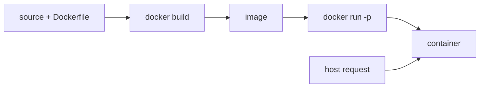

Your FastAPI service from `p8-01-fastapi` (`main.py` served by `uvicorn main:app`) runs cleanly on your laptop, yet "it works on my machine" breaks the moment a teammate or cloud server has a different Python version, missing packages, or the wrong startup flags. **Docker** packages your code, Python runtime, and dependencies into one **image**, so your laptop, your teammate's machine, and the production server run the exact same environment.

## 1. Images and containers

Think back to classes and objects from phase 2: a Docker **image** is like a `class` (a read-only blueprint with your code, Python, and libraries), while a **container** is an instance running from that blueprint. You build an image once and can launch one or many containers from it.

```text
Dockerfile  --build-->  image (read-only)  --run-->  container(s)
```

Unlike a full virtual machine that boots its own guest operating system, a container shares the host machine's OS kernel, so it starts much faster and uses far less memory (see Further Reading for details).

## 2. Reading a Dockerfile

A **Dockerfile** is a plain text recipe that lists the steps to build your image from top to bottom. Here is a clean Dockerfile for the FastAPI service from `p8-01-fastapi`:

```dockerfile
FROM python:3.13-slim
WORKDIR /app
COPY requirements.txt .
RUN pip install --no-cache-dir -r requirements.txt
COPY . .
EXPOSE 8000
CMD ["uvicorn", "main:app", "--host", "0.0.0.0", "--port", "8000"]
```

- `FROM python:3.13-slim` chooses the starting **base image** (a minimal Debian Linux image with Python 3.13 pre-installed).
- `WORKDIR /app` sets `/app` as the working folder inside the image for all commands that follow.
- `COPY requirements.txt .` copies your dependency list from your project folder into `/app`.
- `RUN pip install --no-cache-dir -r requirements.txt` executes a shell command while building the image to install your packages.
- `COPY . .` copies the rest of your application source code into `/app`.
- `EXPOSE 8000` documents that the service listens on port `8000` (it does not publish the port by itself).
- `CMD [...]` sets the default command to execute when a container starts (`uvicorn main:app --host 0.0.0.0 --port 8000`).
- You will also often see `ENV` (for example `ENV PYTHONUNBUFFERED=1`) to set non-secret environment variables inside the image.

> [!TIP]
> This course repository uses `uv` for local projects, and you can also use `uv` inside Dockerfiles. We use `pip` with `requirements.txt` in this lesson to keep the syntax short and easy to read—see **uv Docs: Using uv in Docker** in Further Reading when you are ready to switch.

The table below contrasts when each instruction runs—notice the key split between `RUN` (build time) and `CMD` (container startup):

| instruction | what it does | runs when |
|---|---|---|
| `FROM` | Selects the starting base image | Image build |
| `WORKDIR` | Sets the active directory inside the image | Image build |
| `COPY` | Copies files from your project into the image | Image build |
| `ENV` | Sets default environment variables | Image build (persists at run) |
| `RUN` | Executes a command and saves the result in a layer | Image build |
| `EXPOSE` | Documents the port the app listens on | Metadata only |
| `CMD` | Defines the default process to start | Container start (`docker run`) |

Because a Dockerfile is structured text, you can parse it in Python into `(instruction, args)` pairs while ignoring blank lines and `#` comments:

```python
SAMPLE = """
# FastAPI RAG service
FROM python:3.13-slim

WORKDIR /app
COPY requirements.txt .
RUN pip install --no-cache-dir -r requirements.txt
COPY . .
EXPOSE 8000
CMD ["uvicorn", "main:app", "--host", "0.0.0.0", "--port", "8000"]
"""


def parse_dockerfile(text: str) -> list[tuple[str, str]]:
    instructions: list[tuple[str, str]] = []
    for raw in text.splitlines():
        line = raw.strip()
        if not line or line.startswith("#"):
            continue
        inst, args = line.split(None, 1)
        instructions.append((inst.upper(), args.strip()))
    return instructions


rows = parse_dockerfile(SAMPLE)
print("count:", len(rows))
# count: 7
for inst, args in rows[:4]:
    print(f"{inst}: {args}")
# FROM: python:3.13-slim
# WORKDIR: /app
# COPY: requirements.txt .
# RUN: pip install --no-cache-dir -r requirements.txt
```

Notice that `rows` has 7 entries because the `#` comment and blank line were skipped.

## 3. Build and run

In a terminal on a machine with Docker installed (you do not need Docker installed to finish this lesson), you build the image once, start a container with **port mapping**, and send a request with `curl`:

```bash
docker build -t rag-api .
docker run -p 8000:8000 rag-api
curl http://127.0.0.1:8000/health
```

The `-p 8000:8000` flag sets up `-p host:container` **port mapping**: traffic arriving at port `8000` on your host laptop is forwarded into port `8000` inside the container. If port `8000` is already busy on your laptop, `-p 9000:8000` exposes the same container on `http://127.0.0.1:9000`.

Why does `CMD` pass `--host 0.0.0.0` instead of `127.0.0.1` as in `p8-01-fastapi`? Inside a container, `127.0.0.1` means only the container's own loopback interface, so traffic forwarded from your host machine through `-p 8000:8000` would be refused—binding `0.0.0.0` tells `uvicorn` to listen on all interfaces inside the container.



## 4. Layers and build cache: order matters

Every instruction in a Dockerfile builds a **layer** stacked on top of the previous one, and Docker saves each layer in its **build cache**. When you edit files and rebuild, Docker reuses cached layers from the top down—but the moment one layer changes, that layer and **every layer after it** must rebuild.

That is why you copy `requirements.txt` and run `pip install` **before** running `COPY . .`. When you only edit `main.py`, `requirements.txt` has not changed, so Docker reuses the slow `pip install` layer from cache and only rebuilds the fast `COPY . .` step; if you put `COPY . .` first, every one-line edit to `main.py` invalidates `COPY . .` and forces `pip install` to re-download everything.

Here is a trace comparing both orders when **only `main.py` changed**:

| step | good order | cached? | bad order | cached? |
|---|---|---|---|---|
| 1 | `FROM python:3.13-slim` | Yes | `FROM python:3.13-slim` | Yes |
| 2 | `WORKDIR /app` | Yes | `WORKDIR /app` | Yes |
| 3 | `COPY requirements.txt .` | Yes (`requirements.txt` unchanged) | `COPY . .` | No (`main.py` changed) |
| 4 | `RUN pip install --no-cache-dir -r requirements.txt` | Yes (cache hit) | `RUN pip install --no-cache-dir -r requirements.txt` | No (invalidated by step 3) |
| 5 | `COPY . .` | No (`main.py` changed) | `CMD ["uvicorn", "main:app", "--host", "0.0.0.0", "--port", "8000"]` | No (invalidated by step 3) |
| 6 | `CMD ["uvicorn", "main:app", "--host", "0.0.0.0", "--port", "8000"]` | No (after rebuilt `COPY . .`) | — | — |

Note that the table numbers steps starting from 1, whereas the Python list below indexes layers starting from 0 (so step 5 is index `4` and step 3 is index `2`).

Press **Visualize** on this block and watch `rebuild_from` change inside the loop as it finds the first invalidated layer for each order.

```python
def first_rebuild_layer(
    layers: list[tuple[str, set[str]]],
    changed_files: set[str],
) -> int:
    rebuild_from = len(layers)
    for idx, (_inst, watched) in enumerate(layers):
        if watched & changed_files:
            rebuild_from = idx
            break
    return rebuild_from


good_layers = [
    ("FROM python:3.13-slim", set()),
    ("WORKDIR /app", set()),
    ("COPY requirements.txt .", {"requirements.txt"}),
    ("RUN pip install --no-cache-dir -r requirements.txt", set()),
    ("COPY . .", {"main.py", "requirements.txt"}),
    ('CMD ["uvicorn", "main:app", "--host", "0.0.0.0", "--port", "8000"]', set()),
]
bad_layers = [
    ("FROM python:3.13-slim", set()),
    ("WORKDIR /app", set()),
    ("COPY . .", {"main.py", "requirements.txt"}),
    ("RUN pip install --no-cache-dir -r requirements.txt", set()),
    ('CMD ["uvicorn", "main:app", "--host", "0.0.0.0", "--port", "8000"]', set()),
]

changed = {"main.py"}
good_idx = first_rebuild_layer(good_layers, changed)
bad_idx = first_rebuild_layer(bad_layers, changed)
print("good order rebuilds from layer:", good_idx, "->", len(good_layers) - good_idx, "layers")
# good order rebuilds from layer: 4 -> 2 layers
print("bad order rebuilds from layer:", bad_idx, "->", len(bad_layers) - bad_idx, "layers")
# bad order rebuilds from layer: 2 -> 3 layers
```

Notice that `good_layers` rebuilds 2 layers from index `4` (`COPY . .` and `CMD`), keeping `pip install` cached, whereas `bad_layers` rebuilds 3 layers from index `2` (invalidating `pip install` at index `3` as well).

## 5. `.dockerignore`: keeping unwanted files out

Before `COPY . .` runs, Docker sends your project directory (the build context) to the builder, unless a **`.dockerignore`** file tells it what to skip. Always exclude `.venv/`, `.git/`, `__pycache__/`, `*.pyc`, `.env`, and large raw datasets like `data/raw/` so your image stays small, builds stay fast, and secrets never enter the image.

The Python snippet below simulates `.dockerignore` filtering on a list of paths using `fnmatch` and `PurePosixPath` (note that this is a simplified model: real Docker `.dockerignore` files also support recursive `**` wildcards and `!` exception rules):

```python
from fnmatch import fnmatch
from pathlib import PurePosixPath

files = [
    "main.py",
    "requirements.txt",
    ".env",
    ".venv/bin/python",
    "__pycache__/main.pyc",
    "data/raw/docs.pdf",
]
patterns = [".venv/", "__pycache__/", "*.pyc", ".env", "data/raw/"]


def is_ignored(rel_path: str, rules: list[str]) -> bool:
    parts = PurePosixPath(rel_path).parts
    for pat in rules:
        if pat.endswith("/"):
            folder = pat.rstrip("/")
            if rel_path.startswith(folder + "/") or folder in parts[:-1]:
                return True
        elif fnmatch(rel_path, pat) or fnmatch(parts[-1], pat):
            return True
    return False


kept = [f for f in files if not is_ignored(f, patterns)]
ignored = [f for f in files if is_ignored(f, patterns)]
print("kept:", kept)
# kept: ['main.py', 'requirements.txt']
print("ignored:", ignored)
# ignored: ['.env', '.venv/bin/python', '__pycache__/main.pyc', 'data/raw/docs.pdf']
```

Notice how only `main.py` and `requirements.txt` remain for `COPY . .` once `.dockerignore` strips out virtual environments, caches, raw data, and `.env`.

> [!WARNING]
> If `.env` enters your image, anyone who pulls or inspects that image can read your API keys from its layers. Never put `ENV API_KEY=...` or `COPY .env .` in a Dockerfile—pass secrets at container startup instead:

```bash
docker run --env-file .env -p 8000:8000 rag-api
```

## 6. Smaller, reproducible images

Three small habits keep Python images lean and ensure every build installs the exact same software:

- **Pin the base image tag:** write `FROM python:3.13-slim`, never `FROM python:latest` or bare `FROM python`, so a surprise upstream release cannot break your service.
- **Skip the pip download cache:** pass `--no-cache-dir` to `pip install` so downloaded `.whl` archives are not stored inside the image layer.
- **Pin package versions:** list exact versions (such as `fastapi==0.162.7`) in `requirements.txt` so every build installs the exact same packages; when you use `uv`, it handles this automatically with a `uv.lock` lock file.

| choice | smaller/faster | why |
|---|---|---|
| `python:3.13-slim` vs `python:3.13` | Smaller image | Drops heavy compiler/system tools not needed to run FastAPI |
| `python:3.13-slim` vs `python:latest` | Reproducible | Locks the exact Python minor version across machines and dates |
| `pip install --no-cache-dir` | Smaller image | Avoids baking temporary `.whl` cache files into the layer |
| Pinned `requirements.txt` | Reproducible | Guarantees identical package versions at every build |
| `COPY requirements.txt` before `COPY . .` | Faster rebuild | Reuses the `pip install` cache when only Python code changes |

## 7. Common mistakes

**1. Putting `COPY . .` before `RUN pip install`**

Every time you edit a single line in `main.py`, the `COPY . .` layer misses the cache and forces `pip install` to re-run from scratch, making rebuilds painfully slow. Fix: copy `requirements.txt` and run `pip install` first, then run `COPY . .` afterward.

```dockerfile
# wrong
COPY . .
RUN pip install --no-cache-dir -r requirements.txt

# fixed
COPY requirements.txt .
RUN pip install --no-cache-dir -r requirements.txt
COPY . .
```

**2. Using `FROM python:latest` or `FROM python` with no tag**

Your image silently picks up a new Python release on a future build, causing hard-to-trace library bugs between environments. Fix: pin an explicit version and slim variant, such as `FROM python:3.13-slim`.

```dockerfile
# wrong
FROM python:latest

# fixed
FROM python:3.13-slim
```

**3. Binding `--host 127.0.0.1` inside `CMD`**

Even with `-p 8000:8000`, requests from your host browser or `curl` fail to reach the container because `uvicorn` only listens on the container's internal loopback address. Fix: pass `--host 0.0.0.0` in `CMD`.

```dockerfile
# wrong
CMD ["uvicorn", "main:app", "--host", "127.0.0.1", "--port", "8000"]

# fixed
CMD ["uvicorn", "main:app", "--host", "0.0.0.0", "--port", "8000"]
```

**4. Copying `.env` or hardcoding `ENV OPENAI_API_KEY=...`**

Your secret key gets baked permanently into the image layers, exposing it to anyone who receives the image. Fix: exclude `.env` in `.dockerignore` and pass secrets at runtime with `docker run --env-file .env`.

```dockerfile
# wrong
COPY .env .
ENV OPENAI_API_KEY=sk-demo

# fixed: keep non-secret config only; pass secrets via docker run --env-file .env
ENV PYTHONUNBUFFERED=1
```

**5. Writing shell form `CMD uvicorn main:app ...` instead of exec form**

Shell form wraps your command in `/bin/sh -c`, which can swallow stop signals when Docker shuts down a container. Fix: use JSON exec form `CMD ["uvicorn", "main:app", "--host", "0.0.0.0", "--port", "8000"]`.

```dockerfile
# wrong
CMD uvicorn main:app --host 0.0.0.0 --port 8000

# fixed
CMD ["uvicorn", "main:app", "--host", "0.0.0.0", "--port", "8000"]
```

You can check Dockerfile text automatically before running `docker build`. Using `parse_dockerfile` from §2, the Python snippet below catches the two formatting issues (`pip-cache` and `shell-cmd`):

```python
BUGGY = """
FROM python:3.13-slim
WORKDIR /app
COPY requirements.txt .
RUN pip install -r requirements.txt
COPY . .
CMD uvicorn main:app --host 0.0.0.0 --port 8000
"""


def parse_dockerfile(text: str) -> list[tuple[str, str]]:
    instructions: list[tuple[str, str]] = []
    for raw in text.splitlines():
        line = raw.strip()
        if not line or line.startswith("#"):
            continue
        inst, args = line.split(None, 1)
        instructions.append((inst.upper(), args.strip()))
    return instructions


def check_style(text: str) -> list[str]:
    warnings: list[str] = []
    for inst, args in parse_dockerfile(text):
        if inst == "RUN" and "pip install" in args and "--no-cache-dir" not in args:
            warnings.append("pip-cache: add --no-cache-dir to pip install")
        if inst == "CMD" and not args.startswith("["):
            warnings.append("shell-cmd: prefer JSON exec form for CMD")
    return warnings


for w in check_style(BUGGY):
    print("WARN:", w)
# WARN: pip-cache: add --no-cache-dir to pip install
# WARN: shell-cmd: prefer JSON exec form for CMD
```

You will write detection rules for the other four mistakes (`unpinned-base`, `copy-before-install`, `secret-in-image`, and `localhost-cmd`) yourself in exercise `ex02`.

## Recap

- A Docker **image** is a read-only blueprint (like a `class`) built from a **Dockerfile**, and a **container** is a running instance of that image.
- `FROM`, `WORKDIR`, `COPY`, and `RUN` execute during `docker build`, whereas `CMD` runs when `docker run` starts a container.
- Bind `--host 0.0.0.0` inside the container and publish ports with `-p host:container` (such as `-p 8000:8000`) so requests from your host machine can reach FastAPI.
- Put `COPY requirements.txt .` and `RUN pip install --no-cache-dir -r requirements.txt` before `COPY . .` so code edits reuse the dependency build cache.
- Use `.dockerignore` to exclude `.venv/`, `.git/`, `__pycache__/`, `data/raw/`, and `.env`, and always pass secrets at runtime with `--env-file .env`.
