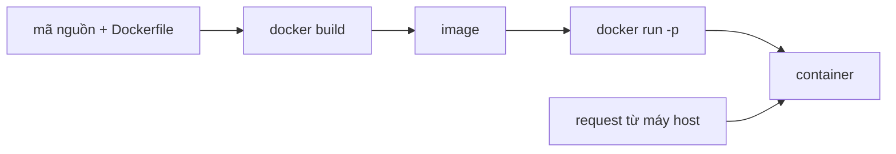

Dịch vụ FastAPI ở bài `p8-01-fastapi` (`main.py` chạy bằng `uvicorn main:app`) chạy mượt trên laptop của bạn, nhưng câu nói kinh điển "chạy được trên máy tôi" lập tức sụp đổ khi máy đồng đội hay server khác phiên bản Python, thiếu thư viện hoặc gõ sai lệnh khởi động. **Docker** đóng gói code, Python và toàn bộ thư viện vào một **image** (bản đóng gói), giúp máy bạn, máy đồng đội và server chạy giống hệt nhau.

## 1. Image và container

Hãy nhớ lại ví von về class và object ở phase 2: một Docker **image** giống như `class` (bản thiết kế chỉ đọc chứa code, Python và các thư viện), còn **container** (phiên bản đang chạy của image) giống như một instance tạo ra từ bản thiết kế đó. Bạn build image một lần và có thể khởi chạy một hoặc nhiều container từ cùng image ấy.

```text
Dockerfile  --build-->  image (read-only)  --run-->  container(s)
```

Khác với máy ảo phải khởi động cả một hệ điều hành riêng, container dùng chung nhân (kernel) của hệ điều hành máy chủ nên nhẹ hơn và khởi động nhanh hơn nhiều (chi tiết xem thêm ở phần Đọc thêm).

## 2. Đọc một Dockerfile

**Dockerfile** là file văn bản thuần liệt kê từng bước dựng image từ trên xuống dưới. Đây là Dockerfile mẫu chuẩn cho dịch vụ FastAPI từ bài `p8-01-fastapi`:

```dockerfile
FROM python:3.13-slim
WORKDIR /app
COPY requirements.txt .
RUN pip install --no-cache-dir -r requirements.txt
COPY . .
EXPOSE 8000
CMD ["uvicorn", "main:app", "--host", "0.0.0.0", "--port", "8000"]
```

- `FROM python:3.13-slim` chọn **base image** (image nền) ban đầu—ở đây là bản Debian Linux gọn nhẹ đã cài sẵn Python 3.13.
- `WORKDIR /app` đặt `/app` làm thư mục làm việc bên trong image cho mọi lệnh tiếp theo.
- `COPY requirements.txt .` chép danh sách thư viện từ thư mục dự án vào `/app`.
- `RUN pip install --no-cache-dir -r requirements.txt` chạy lệnh cài gói ngay trong lúc build image.
- `COPY . .` chép phần code ứng dụng còn lại vào `/app`.
- `EXPOSE 8000` ghi chú rằng dịch vụ lắng nghe ở cổng `8000` (tự nó chưa mở cổng ra ngoài).
- `CMD [...]` đặt lệnh mặc định chạy khi container khởi động (`uvicorn main:app --host 0.0.0.0 --port 8000`).
- Bạn cũng thường gặp `ENV` (ví dụ `ENV PYTHONUNBUFFERED=1`) để đặt các biến môi trường không nhạy cảm bên trong image.

> [!TIP]
> Repo của khóa học dùng `uv` cho dự án cục bộ, và bạn hoàn toàn có thể dùng `uv` trong Docker. Bài này dùng `pip` với `requirements.txt` cho ngắn gọn, dễ đọc—khi muốn dùng `uv` khi build image, hãy xem tài liệu **uv Docs: Using uv in Docker** ở cuối bài.

Bảng dưới đây đối chiếu thời điểm chạy của từng lệnh—hãy chú ý ranh giới quan trọng giữa `RUN` (lúc build) và `CMD` (lúc khởi động container):

| lệnh | công dụng | chạy lúc nào |
|---|---|---|
| `FROM` | Chọn image nền ban đầu | Lúc build image |
| `WORKDIR` | Đặt thư mục làm việc trong image | Lúc build image |
| `COPY` | Chép file từ dự án vào image | Lúc build image |
| `ENV` | Đặt biến môi trường mặc định | Lúc build (giữ khi chạy) |
| `RUN` | Chạy lệnh và lưu kết quả thành một layer | Lúc build image |
| `EXPOSE` | Ghi chú cổng mà ứng dụng lắng nghe | Chỉ là thông tin mô tả |
| `CMD` | Đặt tiến trình mặc định khi bật container | Lúc khởi động (`docker run`) |

Vì Dockerfile là văn bản có cấu trúc, bạn có thể tách nó bằng Python thành danh sách cặp `(instruction, args)` và bỏ qua dòng trống lẫn comment `#`:

```python
SAMPLE = """
# FastAPI RAG service
FROM python:3.13-slim

WORKDIR /app
COPY requirements.txt .
RUN pip install --no-cache-dir -r requirements.txt
COPY . .
EXPOSE 8000
CMD ["uvicorn", "main:app", "--host", "0.0.0.0", "--port", "8000"]
"""


def parse_dockerfile(text: str) -> list[tuple[str, str]]:
    instructions: list[tuple[str, str]] = []
    for raw in text.splitlines():
        line = raw.strip()
        if not line or line.startswith("#"):
            continue
        inst, args = line.split(None, 1)
        instructions.append((inst.upper(), args.strip()))
    return instructions


rows = parse_dockerfile(SAMPLE)
print("count:", len(rows))
# count: 7
for inst, args in rows[:4]:
    print(f"{inst}: {args}")
# FROM: python:3.13-slim
# WORKDIR: /app
# COPY: requirements.txt .
# RUN: pip install --no-cache-dir -r requirements.txt
```

Hãy để ý `rows` có đúng 7 phần tử vì dòng comment `#` và dòng trống đã được bỏ qua, còn `line.split(None, 1)` tách theo bất kỳ chuỗi khoảng trắng nào tối đa một lần để thu được `[instruction, rest_of_line]`.

## 3. Build và run

Trên terminal của máy đã cài Docker (bạn không cần cài Docker vẫn hoàn thành được bài này), bạn build image một lần, bật container kèm **port mapping** (ánh xạ cổng), rồi gọi thử bằng `curl`:

```bash
docker build -t rag-api .
docker run -p 8000:8000 rag-api
curl http://127.0.0.1:8000/health
```

Cờ `-p 8000:8000` thiết lập **port mapping** dạng `-p host:container`: mọi request gửi vào cổng `8000` trên máy host của bạn sẽ được chuyển tiếp vào cổng `8000` bên trong container. Nếu cổng `8000` trên máy bạn đang bận, đổi sang `-p 9000:8000` sẽ mở cùng container đó tại `http://127.0.0.1:9000`.

Vì sao `CMD` phải dùng `--host 0.0.0.0` thay vì `127.0.0.1` như ở bài `p8-01-fastapi`? Bên trong container, `127.0.0.1` chỉ là chính container đó, nên request từ máy host đi qua `-p 8000:8000` sẽ không tới được nếu server chỉ nghe `127.0.0.1`—dùng `0.0.0.0` giúp `uvicorn` nhận kết nối từ mọi giao diện mạng trong container.



## 4. Layer và build cache: thứ tự quan trọng

Chỉ `RUN`, `COPY` và `ADD` mới tạo **layer** (lớp) hệ thống file (các lệnh như `FROM`, `WORKDIR`, `ENV`, `EXPOSE`, `CMD` chỉ ghi metadata cho image), và Docker lưu từng bước vào **build cache** (bộ nhớ đệm khi build). Khi bạn sửa file rồi build lại, Docker dùng lại cache từ trên xuống—nhưng hễ một bước thay đổi, chính bước đó và **mọi bước đứng sau nó** đều phải build lại.

Vì thế bạn phải `COPY requirements.txt .` và `RUN pip install` **trước** khi `COPY . .`. Khi bạn chỉ sửa `main.py`, file `requirements.txt` không đổi nên Docker dùng lại layer `pip install` rất nặng từ cache và chỉ chạy lại bước `COPY . .` rất nhanh; ngược lại, nếu đặt `COPY . .` lên trước, mỗi lần sửa một dòng ở `main.py` là `COPY . .` mất cache và kéo theo `pip install` phải cài lại từ đầu.

Bảng theo dõi dưới đây so sánh hai thứ tự trong tình huống **chỉ sửa `main.py`**:

| bước | thứ tự tốt | dùng cache? | thứ tự xấu | dùng cache? |
|---|---|---|---|---|
| 1 | `FROM python:3.13-slim` | Có | `FROM python:3.13-slim` | Có |
| 2 | `WORKDIR /app` | Có | `WORKDIR /app` | Có |
| 3 | `COPY requirements.txt .` | Có (`requirements.txt` không đổi) | `COPY . .` | Không (`main.py` đã đổi) |
| 4 | `RUN pip install --no-cache-dir -r requirements.txt` | Có (trúng cache) | `RUN pip install --no-cache-dir -r requirements.txt` | Không (bị bước 3 làm hỏng cache) |
| 5 | `COPY . .` | Không (`main.py` đã đổi) | `CMD ["uvicorn", "main:app", "--host", "0.0.0.0", "--port", "8000"]` | Không (bị bước 3 làm hỏng cache) |
| 6 | `CMD ["uvicorn", "main:app", "--host", "0.0.0.0", "--port", "8000"]` | Không (sau bước `COPY . .` build lại) | — | — |

Lưu ý rằng bảng trên đánh số bước từ 1, còn danh sách Python bên dưới đếm chỉ số layer từ 0 (nên bước 5 ứng với chỉ số `4` và bước 3 ứng với chỉ số `2`).

Bấm **Visualize** ở khối code này để xem biến `rebuild_from` thay đổi trong vòng lặp khi tìm layer đầu tiên phải build lại cho từng thứ tự.

```python
def first_rebuild_layer(
    layers: list[tuple[str, set[str]]],
    changed_files: set[str],
) -> int:
    rebuild_from = len(layers)
    for idx, (_inst, watched) in enumerate(layers):
        if watched & changed_files:
            rebuild_from = idx
            break
    return rebuild_from


good_layers = [
    ("FROM python:3.13-slim", set()),
    ("WORKDIR /app", set()),
    ("COPY requirements.txt .", {"requirements.txt"}),
    ("RUN pip install --no-cache-dir -r requirements.txt", set()),
    ("COPY . .", {"main.py", "requirements.txt"}),
    ('CMD ["uvicorn", "main:app", "--host", "0.0.0.0", "--port", "8000"]', set()),
]
bad_layers = [
    ("FROM python:3.13-slim", set()),
    ("WORKDIR /app", set()),
    ("COPY . .", {"main.py", "requirements.txt"}),
    ("RUN pip install --no-cache-dir -r requirements.txt", set()),
    ('CMD ["uvicorn", "main:app", "--host", "0.0.0.0", "--port", "8000"]', set()),
]

changed = {"main.py"}
good_idx = first_rebuild_layer(good_layers, changed)
bad_idx = first_rebuild_layer(bad_layers, changed)
print("good order rebuilds from layer:", good_idx, "->", len(good_layers) - good_idx, "layers")
# good order rebuilds from layer: 4 -> 2 layers
print("bad order rebuilds from layer:", bad_idx, "->", len(bad_layers) - bad_idx, "layers")
# bad order rebuilds from layer: 2 -> 3 layers
```

Bạn thấy `good_layers` build lại 2 layer từ chỉ số `4` (`COPY . .` và `CMD`) và giữ nguyên cache cho `pip install`, trong khi `bad_layers` build lại 3 layer từ chỉ số `2` (làm `pip install` ở chỉ số `3` cũng phải chạy lại).

## 5. `.dockerignore`: những gì không được vào image

Ngay khi `docker build` bắt đầu, Docker gửi toàn bộ thư mục dự án (build context) cho bộ dựng image, trừ các mục được liệt kê trong file **`.dockerignore`**. Khác với `.gitignore` (nơi pattern không chứa `/` khớp ở mọi cấp thư mục), Docker so các pattern `.dockerignore` **từ gốc build context**: viết `__pycache__/` hay `*.pyc` chỉ khớp ở thư mục gốc chứ không chặn được `rag/__pycache__/retriever.cpython-313.pyc`. Bạn luôn nên loại bỏ `.venv/`, `.git/`, `**/__pycache__`, `**/*.pyc`, `.env` và `data/raw/` để image nhỏ hơn, build nhanh hơn và **không lộ secret**.

Đoạn Python sau mô phỏng lọc `.dockerignore` tính từ gốc bằng `split("/")` (tách đường dẫn thành từng đoạn để `*` không vượt qua `/`) và `fnmatchcase` (hàm so một chuỗi với pattern chứa `*`, `?` và có phân biệt chữ hoa/thường). Lưu ý mô phỏng này bỏ qua luật `!` (ngoại lệ):

```python
from fnmatch import fnmatchcase

files = [
    "main.py",
    "requirements.txt",
    ".env",
    ".venv/bin/python",
    "rag/__pycache__/retriever.cpython-313.pyc",
    "data/raw/docs.pdf",
]
old_patterns = [".venv/", ".git/", "__pycache__/", "*.pyc", ".env", "data/raw/"]
good_patterns = [".venv/", ".git/", "**/__pycache__", "**/*.pyc", ".env", "data/raw/"]


def _match_from(pat_parts: list[str], path_parts: list[str]) -> bool:
    if len(pat_parts) > len(path_parts):
        return False
    return all(fnmatchcase(s, p) for p, s in zip(pat_parts, path_parts))


def is_ignored(rel_path: str, patterns: list[str]) -> bool:
    parts = rel_path.split("/")
    for raw in patterns:
        pat = raw.strip().strip("/")
        if not pat or pat.startswith("#"):
            continue
        pat_parts = pat.split("/")
        if pat_parts[0] == "**":
            rest = pat_parts[1:]
            if any(_match_from(rest, parts[i:]) for i in range(len(parts))):
                return True
        elif _match_from(pat_parts, parts):
            return True
    return False


old_kept = [f for f in files if not is_ignored(f, old_patterns)]
kept = [f for f in files if not is_ignored(f, good_patterns)]
ignored = [f for f in files if is_ignored(f, good_patterns)]
print("old kept:", old_kept)
# old kept: ['main.py', 'requirements.txt', 'rag/__pycache__/retriever.cpython-313.pyc']
print("kept:", kept)
# kept: ['main.py', 'requirements.txt']
print("ignored:", ignored)
# ignored: ['.env', '.venv/bin/python', 'rag/__pycache__/retriever.cpython-313.pyc', 'data/raw/docs.pdf']
```

Hãy để ý `old_patterns` để lọt `rag/__pycache__/retriever.cpython-313.pyc` vào build context, còn `**/__pycache__` và `**/*.pyc` đã chặn sạch cả các thư mục cache nằm sâu bên trong để chỉ còn `main.py` và `requirements.txt`.

> [!WARNING]
> File `.env` mà lọt vào image thì bất kỳ ai có image đó đều đọc được API key của bạn. Đừng bao giờ viết `ENV API_KEY=...` hay `COPY .env .` trong Dockerfile—hãy truyền biến môi trường lúc chạy container bằng lệnh sau:

```bash
docker run --env-file .env -p 8000:8000 rag-api
```

## 6. Image gọn và lặp lại được

Ba thói quen nhỏ sau giúp image Python gọn nhẹ và build ra kết quả giống hệt nhau mỗi lần:

- **Ghim tag của base image:** luôn viết `FROM python:3.13-slim`, không dùng `FROM python:latest` hay `FROM python` để tránh bản Python tự nhảy ngầm giữa các lần build. Ngay cả tag phiên bản vẫn có thể được đẩy đè bản vá mới, nên khi cần bất biến tuyệt đối bạn hãy ghim thêm digest dạng `@sha256:...`.
- **Tắt cache tải gói của pip:** thêm `--no-cache-dir` vào `pip install` để các file `.whl` tạm không nằm lại trong layer của image.
- **Ghim phiên bản trong `requirements.txt`:** ghi rõ từng phiên bản (như `fastapi==0.162.7`) để mọi lần build đều cài đúng cùng thư viện; khi dùng `uv`, công cụ này làm việc đó tự động bằng file khóa `uv.lock`.

| lựa chọn | gọn / nhanh hơn | vì sao |
|---|---|---|
| `python:3.13-slim` thay vì `python:3.13` | Image nhỏ hơn | Bỏ các công cụ biên dịch nặng không cần thiết khi chạy FastAPI |
| `python:3.13-slim` thay vì `python:latest` | Lặp lại được | Khóa cố định phiên bản Python qua mọi máy và thời điểm |
| `pip install --no-cache-dir` | Image nhỏ hơn | Không giữ lại file cache `.whl` trong layer |
| `requirements.txt` ghim phiên bản | Lặp lại được | Đảm bảo mỗi lần build đều cài đúng cùng phiên bản thư viện |
| `COPY requirements.txt` trước `COPY . .` | Build lại nhanh hơn | Tận dụng cache của `pip install` khi chỉ sửa code Python |

## 7. Lỗi thường gặp

**1. Đặt `COPY . .` trước `RUN pip install`**

Mỗi lần bạn sửa chỉ một dòng trong `main.py`, layer `COPY . .` bị trượt cache và kéo theo `pip install` phải chạy lại từ đầu, làm tốc độ build lại rất chậm. Cách sửa: chép `requirements.txt` và chạy `pip install` trước, rồi mới `COPY . .`.

```dockerfile
# wrong
COPY . .
RUN pip install --no-cache-dir -r requirements.txt

# fixed
COPY requirements.txt .
RUN pip install --no-cache-dir -r requirements.txt
COPY . .
```

**2. Dùng `FROM python:latest` hoặc `FROM python` không có tag**

Image có thể âm thầm kéo bản Python mới hơn ở lần build sau, làm code hoạt động khác đi hoặc gãy thư viện ngoài ý muốn. Cách sửa: ghi rõ phiên bản và biến thể gọn nhẹ, ví dụ `FROM python:3.13-slim`.

```dockerfile
# wrong
FROM python:latest

# fixed
FROM python:3.13-slim
```

**3. Bind `--host 127.0.0.1` trong `CMD`**

Dù bạn đã gắn `-p 8000:8000`, trình duyệt hay `curl` từ máy host vẫn không truy cập được vào app vì `uvicorn` chỉ nghe kết nối nội bộ bên trong container. Cách sửa: đổi sang `--host 0.0.0.0` trong `CMD`.

```dockerfile
# wrong
CMD ["uvicorn", "main:app", "--host", "127.0.0.1", "--port", "8000"]

# fixed
CMD ["uvicorn", "main:app", "--host", "0.0.0.0", "--port", "8000"]
```

**4. Chép `.env` vào image hoặc viết `ENV OPENAI_API_KEY=...`**

Secret bị đóng cứng vĩnh viễn vào các layer của image, khiến bất kỳ ai nhận image đều đọc được key. Cách sửa: chặn `.env` trong `.dockerignore` và truyền lúc chạy bằng `docker run --env-file .env`.

```dockerfile
# wrong
COPY .env .
ENV OPENAI_API_KEY=sk-demo

# fixed: keep non-secret config only; pass secrets via docker run --env-file .env
ENV PYTHONUNBUFFERED=1
```

**5. Dùng shell form `CMD uvicorn main:app ...` thay cho exec form**

Dạng shell form bọc lệnh qua `/bin/sh -c`, dễ làm tín hiệu dừng container không truyền thẳng tới tiến trình Python. Cách sửa: dùng exec form dạng mảng JSON `CMD ["uvicorn", "main:app", "--host", "0.0.0.0", "--port", "8000"]`.

```dockerfile
# wrong
CMD uvicorn main:app --host 0.0.0.0 --port 8000

# fixed
CMD ["uvicorn", "main:app", "--host", "0.0.0.0", "--port", "8000"]
```

Bạn có thể kiểm tra văn bản Dockerfile tự động trước khi chạy `docker build`. Dùng lại `parse_dockerfile` ở §2, đoạn Python dưới đây bắt hai lỗi về cờ và cú pháp (`pip-cache` và `shell-cmd`):

```python
BUGGY = """
FROM python:3.13-slim
WORKDIR /app
COPY requirements.txt .
RUN pip install -r requirements.txt
COPY . .
CMD uvicorn main:app --host 0.0.0.0 --port 8000
"""


def parse_dockerfile(text: str) -> list[tuple[str, str]]:
    instructions: list[tuple[str, str]] = []
    for raw in text.splitlines():
        line = raw.strip()
        if not line or line.startswith("#"):
            continue
        inst, args = line.split(None, 1)
        instructions.append((inst.upper(), args.strip()))
    return instructions


def check_style(text: str) -> list[str]:
    warnings: list[str] = []
    for inst, args in parse_dockerfile(text):
        if inst == "RUN" and "pip install" in args and "--no-cache-dir" not in args:
            warnings.append("pip-cache: add --no-cache-dir to pip install")
        if inst == "CMD" and not args.startswith("["):
            warnings.append("shell-cmd: prefer JSON exec form for CMD")
    return warnings


for w in check_style(BUGGY):
    print("WARN:", w)
# WARN: pip-cache: add --no-cache-dir to pip install
# WARN: shell-cmd: prefer JSON exec form for CMD
```

Bốn lỗi còn lại (`unpinned-base`, `copy-before-install`, `secret-in-image` và `localhost-cmd`) bạn sẽ tự viết luật phát hiện trong bài tập `ex02`.

## Tóm tắt

- Docker **image** là bản đóng gói chỉ đọc (giống `class`) build từ **Dockerfile**, còn **container** là một bản đang chạy từ image đó.
- `FROM`, `WORKDIR`, `COPY` và `RUN` chạy lúc `docker build`, còn `CMD` chạy khi `docker run` khởi động container.
- Bind `--host 0.0.0.0` bên trong container và mở cổng qua `-p host:container` (như `-p 8000:8000`) để máy host gọi được vào FastAPI.
- Đặt `COPY requirements.txt .` và `RUN pip install --no-cache-dir -r requirements.txt` trước `COPY . .` để các lần sửa code tận dụng lại build cache.
- Dùng `.dockerignore` để loại `.venv/`, `.git/`, `__pycache__/`, `data/raw/` và `.env`, và luôn nạp secret lúc chạy bằng `--env-file .env`.
