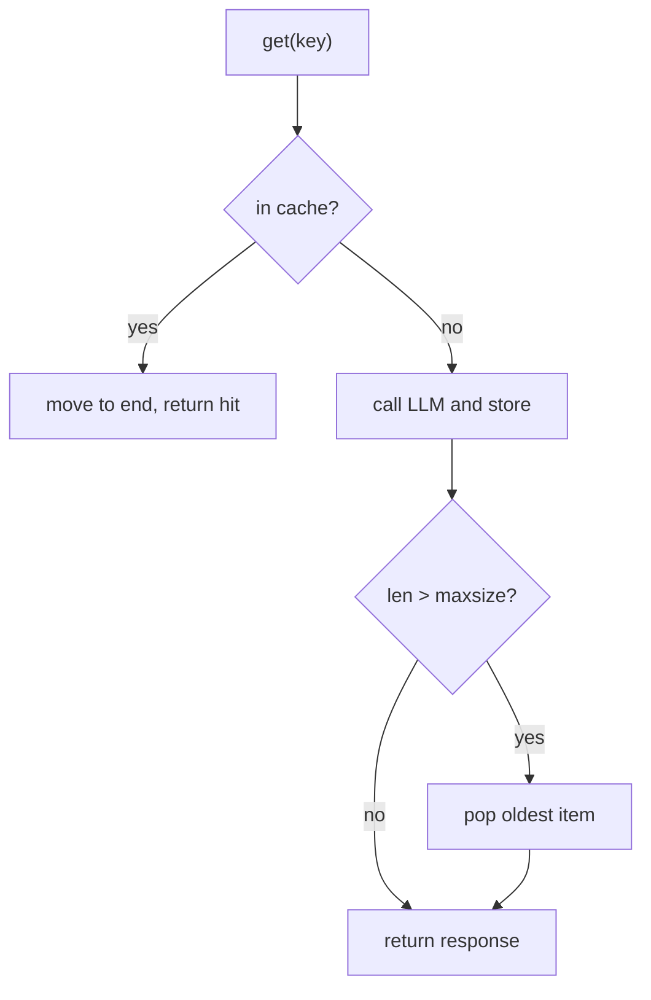

A customer support bot receives `"How do I reset my password?"` hundreds of times every day. Calling an LLM from scratch each time wastes token budget and forces every user to wait. A **cache** stores the answer from an earlier call so identical requests return immediately—and the two hardest parts are picking the right **cache key** and knowing when a stored entry has gone stale.

## 1. What is a cache: hit, miss, and hit rate

Think of a cache as a sticky note taped beside your desk: if the answer is already written on the note, you reuse it instead of walking across the room to look it up in the big manual. Every lookup ends in either a **cache hit** (found in the cache) or a **cache miss** (not found, so you pay for the real call and save the result), and the **hit rate** is `hits / (hits + misses)`.

Press **Visualize** on this block and watch `cache` grow and `hits` increment step by step.

```python
real_calls = 0


def slow_answer(question: str) -> str:
    global real_calls
    real_calls += 1
    return f"Answer for: {question}"


cache: dict[str, str] = {}
hits = 0
misses = 0

questions = [
    "How do I reset my password?",
    "What are your support hours?",
    "How do I reset my password?",
    "Where is my invoice?",
    "How do I reset my password?",
    "What are your support hours?",
]

for q in questions:
    if q in cache:
        hits += 1
        ans = cache[q]
    else:
        misses += 1
        ans = slow_answer(q)
        cache[q] = ans

hit_rate = hits / (hits + misses)
print("hits:", hits, "misses:", misses)
# hits: 3 misses: 3
print("hit_rate:", round(hit_rate, 3))
# hit_rate: 0.5
print("real_calls:", real_calls, "cache_size:", len(cache))
# real_calls: 3 cache_size: 3
```

Notice how 6 incoming questions required only 3 calls to `slow_answer`, giving a `0.5` (`50%`) hit rate. The trace table below shows every step in order:

| call | question | hit? | real calls | cache size |
|---|---|---|---|---|
| 1 | `"How do I reset my password?"` | No (miss) | 1 | 1 |
| 2 | `"What are your support hours?"` | No (miss) | 2 | 2 |
| 3 | `"How do I reset my password?"` | Yes (hit) | 2 | 2 |
| 4 | `"Where is my invoice?"` | No (miss) | 3 | 3 |
| 5 | `"How do I reset my password?"` | Yes (hit) | 3 | 3 |
| 6 | `"What are your support hours?"` | Yes (hit) | 3 | 3 |

## 2. `functools.lru_cache`: built-in cache for pure functions

Back in `p2-07-decorators`, we saw `@cache` in the decorator summary table. Python's standard library includes `@lru_cache(maxsize=...)` in `functools`, which automatically memoizes any pure function whose arguments never change meaning over time:

```python
from functools import lru_cache


@lru_cache(maxsize=3)
def count_words(text: str) -> int:
    return len(text.split())


samples = [
    "reset password",
    "billing invoice",
    "reset password",
    "refund policy",
    "reset password",
]
for s in samples:
    count_words(s)

print(count_words.cache_info())
# CacheInfo(hits=2, misses=3, maxsize=3, currsize=3)
```

Notice that `cache_info()` reports `hits=2, misses=3, maxsize=3, currsize=3` without you writing any dictionary logic. However, `lru_cache` has three important limits for AI applications: it only accepts **hashable** arguments (passing a `list` of chat messages or a `dict` raises `TypeError`), it has **no TTL** (entries never expire by age), and you must never put it on functions with side effects or results that change over time.

> [!NOTE]
> Use `@lru_cache` for pure helper functions like normalizing text or parsing schemas. For LLM chat calls and RAG pipelines—where inputs are lists of message dicts, `temperature` matters, and answers can go stale—build an explicit cache with controlled keys and expiration.

## 3. Cache keys for prompts: what changes the answer?

An LLM reply depends on more than the user's latest string: changing the `model`, the `system` prompt, earlier `messages`, `temperature`, or `max_tokens` can produce a completely different response. Your **cache key** must include every input that affects the output, serialized deterministically with `json.dumps(..., sort_keys=True)` and hashed with `hashlib.sha256`.

Light whitespace normalization—stripping outer spaces and collapsing internal runs—lets `"Reset password?"` and `"  Reset   password?  "` hit the same entry. Do **not** automatically lowercase text or strip punctuation, because changing `"US"` to `"us"` or `"Help!"` to `"Help?"` can alter meaning.

```python
import hashlib
import json


def normalize_text(text: str) -> str:
    return " ".join(text.strip().split())


def make_prompt_key(
    model: str,
    messages: list[dict],
    temperature: float = 0.0,
    max_tokens: int = 128,
) -> str:
    clean_msgs = [
        {"role": m["role"], "content": normalize_text(m["content"])}
        for m in messages
    ]
    payload = {
        "model": model,
        "messages": clean_msgs,
        "temperature": temperature,
        "max_tokens": max_tokens,
    }
    raw = json.dumps(payload, sort_keys=True)
    return hashlib.sha256(raw.encode("utf-8")).hexdigest()


m1 = [{"role": "user", "content": "Reset password?"}]
m2 = [{"role": "user", "content": "  Reset   password?  "}]
k1 = make_prompt_key("fake-mini", m1)
k2 = make_prompt_key("fake-mini", m2)
k3 = make_prompt_key("fake-large", m1)
print("same after whitespace norm:", k1 == k2, k1[:12])
# same after whitespace norm: True 2386b4654e4c
print("different model:", k1 == k3, k3[:12])
# different model: False 6aee8f9900a6
```

Only cache LLM responses when `temperature == 0`: when `temperature > 0`, the caller wants creative variation on every call rather than a frozen replay.

```text
[model | system | messages | temperature | max_tokens]
     │
     ▼  json.dumps(..., sort_keys=True)
'{"max_tokens":128,"messages":[...],"model":"fake-mini","temperature":0.0}'
     │
     ▼  sha256(...).hexdigest()
"3f2a9c..." (cache key)
```

The table below summarizes what belongs in your prompt cache key and why:

| include in key | why |
|---|---|
| `model` | Different models produce different answers and tokenizers |
| `system` + `messages` | A changed system prompt or chat history alters the reply |
| `temperature` (cache only at `0`) | Non-zero temperature expects fresh variation, not a replay |
| `max_tokens` / `response_format` | Truncation limits and JSON schemas change the output shape |
| `prompt_version` / `index_version` | Bumping a version cleanly invalidates old cached replies |
| `user_id` (when personalized) | Prevents leaking one user's private answer to another user |

## 4. Caching embeddings

In a RAG pipeline (`p7-03-embeddings` and `p7-05-rag`), re-embedding your entire document folder whenever one paragraph changes wastes API calls. Because an embedding depends only on `(model, text)`, you can check the cache per text, send **only the missing texts** in a single `embed()` batch, and reassemble the final vector list in the original order:

```python
from pyai_llm import FakeLLM

client = FakeLLM(embed_dim=8)
embed_cache: dict[tuple[str, str], list[float]] = {}
embed_calls = 0


def embed_with_cache(model: str, texts: list[str]) -> tuple[list[list[float]], int]:
    global embed_calls
    missing = [t for t in texts if (model, t) not in embed_cache]
    if missing:
        embed_calls += 1
        vectors = client.embed(missing)
        for text, vec in zip(missing, vectors):
            embed_cache[(model, text)] = vec
    ordered = [embed_cache[(model, t)] for t in texts]
    return ordered, len(missing)


docs_v1 = [
    "Reset your password from Settings.",
    "Invoices arrive on the first of the month.",
    "Support is open Monday to Friday.",
    "Refunds take five business days.",
    "Two-factor auth adds account security.",
]
vecs_1, sent_1 = embed_with_cache("embed-v1", docs_v1)
print("run 1 sent:", sent_1, "total vectors:", len(vecs_1))
# run 1 sent: 5 total vectors: 5

docs_v2 = list(docs_v1)
docs_v2[2] = "Support is open seven days a week."
vecs_2, sent_2 = embed_with_cache("embed-v1", docs_v2)
print("run 2 sent:", sent_2, "total vectors:", len(vecs_2))
# run 2 sent: 1 total vectors: 5
print("unchanged doc vector reused:", vecs_2[0] == vecs_1[0])
# unchanged doc vector reused: True
```

Notice that on the second run, only `1` text was sent to `client.embed(...)` while all `5` vectors came back in exact document order. Remember from `p7-03-embeddings`: if you switch to a different embedding model, you must discard the old model's cached vectors completely because vectors from two models are incompatible.

## 5. LRU: bounding cache memory

An unbounded dictionary grows forever until your service runs out of RAM. **LRU** (Least Recently Used) caps the cache at `maxsize` items and performs **eviction**—dropping the item that has gone unused the longest—whenever a new entry pushes the cache over capacity.



Python's `collections.OrderedDict` makes LRU concise: `move_to_end(key)` marks a key as most recently used, and `popitem(last=False)` evicts the oldest key at the front.

```python
from collections import OrderedDict


class LRUCache:
    def __init__(self, maxsize: int) -> None:
        self.maxsize = maxsize
        self.data: OrderedDict[str, str] = OrderedDict()

    def get(self, key: str) -> str | None:
        if key not in self.data:
            return None
        self.data.move_to_end(key)
        return self.data[key]

    def put(self, key: str, value: str) -> None:
        if key in self.data:
            self.data.move_to_end(key)
        self.data[key] = value
        if len(self.data) > self.maxsize:
            self.data.popitem(last=False)


lru = LRUCache(maxsize=3)
ops = [
    ("put", "a", "A"),
    ("put", "b", "B"),
    ("put", "c", "C"),
    ("get", "a", None),
    ("put", "d", "D"),
    ("put", "e", "E"),
]
for op, k, v in ops:
    if op == "put":
        lru.put(k, v)
    else:
        lru.get(k)
    print(f"{op} {k} -> order: {list(lru.data.keys())}")
# put a -> order: ['a']
# put b -> order: ['a', 'b']
# put c -> order: ['a', 'b', 'c']
# get a -> order: ['b', 'c', 'a']
# put d -> order: ['c', 'a', 'd']
# put e -> order: ['a', 'd', 'e']
```

Notice how `get("a")` moved `"a"` to the right-hand (most recent) end, so `"b"`—not `"a"`—was evicted when `"d"` arrived.

## 6. TTL: expiring stale data

Even with bounded memory, answers grow stale when policies or documents change. A **TTL** (Time To Live) attaches an expiration timestamp `expires_at = now + ttl` to each entry; when `get` sees `now >= expires_at`, it deletes the stale entry and counts a miss.

To keep tests deterministic and instant, the code below injects a `FakeClock` instead of reading real wall time; in production, you pass `time.monotonic` as the clock function. Always use a monotonic clock rather than system clock time, because system time can jump backward during clock syncs and break expiration checks.

```python
class FakeClock:
    def __init__(self, start: float = 0.0) -> None:
        self.now = start

    def advance(self, seconds: float) -> None:
        self.now += seconds


class TTLCache:
    def __init__(self, ttl: float, clock: FakeClock) -> None:
        self.ttl = ttl
        self.clock = clock
        self.store: dict[str, tuple[str, float]] = {}

    def set(self, key: str, value: str) -> None:
        self.store[key] = (value, self.clock.now + self.ttl)

    def get(self, key: str) -> str | None:
        item = self.store.get(key)
        if item is None:
            return None
        value, expires_at = item
        if self.clock.now >= expires_at:
            del self.store[key]
            return None
        return value


clock = FakeClock(start=0.0)
ttl_cache = TTLCache(ttl=60.0, clock=clock)
ttl_cache.set("faq:pw", "Open Settings > Security.")
print("t=0 set faq:pw")
# t=0 set faq:pw
clock.advance(30.0)
print("t=30 get:", ttl_cache.get("faq:pw"))
# t=30 get: Open Settings > Security.
clock.advance(31.0)
print("t=61 get:", ttl_cache.get("faq:pw"))
# t=61 get: None
```

Managing when cached entries stop being valid is called **invalidation**, and two practical rules help you handle it cleanly:
- **Tune TTL as a trade-off:** a short TTL keeps data fresher at the cost of a lower hit rate, while a long TTL boosts hit rate at the risk of serving outdated answers.
- **Version your keys:** when your RAG index or system prompt changes, include `index_version` or `prompt_version` inside the cache key and bump that version instead of scanning and deleting old entries one by one.

> [!WARNING]
> Never store answers containing private user data (such as account balances, order history, or personal emails) under a shared cache key. Either include `user_id` in the key or skip caching personalized responses altogether.

## 7. Measuring cache impact

To verify that caching actually pays off, wrap `FakeLLM` with your own call counter and track hit rate, tokens saved, and estimated cost under an explicit price assumption (such as `PRICE_PER_1K = 0.002` per 1,000 tokens):

```python
import hashlib
import json
from pyai_llm import FakeLLM

PRICE_PER_1K = 0.002
client = FakeLLM()
cache: dict[str, tuple[str, int]] = {}
real_calls = 0
hits = 0
tokens_used = 0
tokens_without_cache = 0


def cached_chat(question: str) -> str:
    global real_calls, hits, tokens_used, tokens_without_cache
    clean = " ".join(question.strip().split())
    payload = json.dumps({"model": "fake-mini", "q": clean, "temperature": 0.0}, sort_keys=True)
    key = hashlib.sha256(payload.encode("utf-8")).hexdigest()

    if key in cache:
        hits += 1
        reply, saved_toks = cache[key]
        tokens_without_cache += saved_toks
        return reply

    real_calls += 1
    resp = client.chat([{"role": "user", "content": clean}], temperature=0.0)
    toks = resp.usage.total_tokens
    tokens_used += toks
    tokens_without_cache += toks
    cache[key] = (resp.content or "", toks)
    return resp.content or ""


requests = [
    "What is RAG?",
    "What is a token?",
    "What is RAG?",
    "  What is  RAG? ",
    "What is cosine similarity?",
    "What is temperature?",
    "What is RAG?",
    "What is a token?",
    "What is hallucination?",
    "What is temperature?",
] * 2

for q in requests:
    cached_chat(q)

saved_tokens = tokens_without_cache - tokens_used
cost_without = (tokens_without_cache / 1000) * PRICE_PER_1K
cost_with = (tokens_used / 1000) * PRICE_PER_1K
print("requests:", len(requests), "real_calls:", real_calls)
# requests: 20 real_calls: 5
print("hit_rate:", round(hits / len(requests), 3))
# hit_rate: 0.75
print("tokens_saved:", saved_tokens)
# tokens_saved: 415
print("cost_without:", round(cost_without, 5), "cost_with:", round(cost_with, 5))
# cost_without: 0.0011 cost_with: 0.00027
```

Across 20 requests, caching cut real LLM calls from 20 to 5 (`hit_rate = 0.75`), saved 415 tokens, and dropped estimated cost by 75%. In `p8-04-monitoring`, you will track `hit_rate` alongside latency and token cost as a core production metric.

## 8. Common mistakes

**1. Omitting `model` or `system` prompt from the cache key**

If you hash only the user's question, two different system prompts or models collide on the same key and return the wrong persona or rules. Fix: include `model` and the full `messages` list (including `system`).

```python
import hashlib
import json
from pyai_llm import FakeLLM

client = FakeLLM()


# wrong: hashes only the user text
def bad_key(user_text: str) -> str:
    return hashlib.sha256(user_text.encode("utf-8")).hexdigest()[:12]


# fixed: includes model and full messages
def good_key(model: str, messages: list[dict]) -> str:
    raw = json.dumps({"model": model, "messages": messages}, sort_keys=True)
    return hashlib.sha256(raw.encode("utf-8")).hexdigest()[:12]


bad_cache: dict[str, str] = {}
pirate_msgs = [{"role": "system", "content": "Be a pirate."}, {"role": "user", "content": "What is RAG?"}]
formal_msgs = [{"role": "system", "content": "Be concise."}, {"role": "user", "content": "What is RAG?"}]

k_pirate = bad_key("What is RAG?")
bad_cache[k_pirate] = client.chat(pirate_msgs).content or ""
k_formal = bad_key("What is RAG?")
print("bad keys equal:", k_pirate == k_formal, k_pirate)
# bad keys equal: True 59179138f99e
print("bad reply for formal:", bad_cache[k_formal])
# bad reply for formal: Arr! RAG (Retrieval-Augmented Generation) retrieves relevant documents and adds them to the prompt before generating an answer.

gk_pirate = good_key("fake-mini", pirate_msgs)
gk_formal = good_key("fake-mini", formal_msgs)
print("good keys equal:", gk_pirate == gk_formal, gk_pirate, gk_formal)
# good keys equal: False 9de68504e1c1 8a2cc24226c0
```

**2. Caching responses when `temperature > 0`**

Caching a non-deterministic call freezes the first random sample and returns identical text every time. Fix: bypass the cache whenever `temperature > 0`.

```python
from pyai_llm import FakeLLM

client = FakeLLM(seed=0)
bad_cache: dict[str, str] = {}


# wrong: caches even when temperature > 0
def ask_bad(prompt: str, temperature: float) -> str:
    if prompt not in bad_cache:
        bad_cache[prompt] = client.chat([{"role": "user", "content": prompt}], temperature=temperature).content or ""
    return bad_cache[prompt]


# fixed: skip cache when temperature > 0
def ask_good(prompt: str, temperature: float) -> str:
    if temperature > 0:
        return client.chat([{"role": "user", "content": prompt}], temperature=temperature).content or ""
    if prompt not in bad_cache:
        bad_cache[prompt] = client.chat([{"role": "user", "content": prompt}], temperature=0.0).content or ""
    return bad_cache[prompt]


print("bad temp=0.8 #1:", ask_bad("hello", 0.8))
# bad temp=0.8 #1: Sure. (fake model) I received: hello
print("bad temp=0.8 #2:", ask_bad("hello", 0.8))
# bad temp=0.8 #2: Sure. (fake model) I received: hello
print("good temp=0.8 #1:", ask_good("hello", 0.8))
# good temp=0.8 #1: (fake model) I received: hello
print("good temp=0.8 #2:", ask_good("hello", 0.8))
# good temp=0.8 #2: Here is what I know: (fake model) I received: hello
```

**3. Using `str(dict)` as a cache key**

Python dicts preserve insertion order, so two dicts with the exact same fields in a different order produce different `str(dict)` strings and cause unnecessary cache misses. Fix: serialize with `json.dumps(payload, sort_keys=True)`.

```python
import json

a = {"model": "mini", "temperature": 0.0}
b = {"temperature": 0.0, "model": "mini"}

# wrong: str(dict) depends on key insertion order
print("str(dict) equal:", str(a) == str(b))
# str(dict) equal: False

# fixed: sort_keys=True guarantees canonical order
print("sorted json equal:", json.dumps(a, sort_keys=True) == json.dumps(b, sort_keys=True))
# sorted json equal: True
```

**4. Using an unbounded dict with no `maxsize` or TTL**

Without eviction or expiration, stale data stays forever and memory grows linearly with every new query. Fix: cap entries with `LRUCache(maxsize)` and expire old entries with TTL.

```python
from collections import OrderedDict

unbounded: dict[str, str] = {}
bounded: OrderedDict[str, str] = OrderedDict()
maxsize = 3

for i in range(10):
    k = f"q:{i}"
    unbounded[k] = f"ans:{i}"
    bounded[k] = f"ans:{i}"
    if len(bounded) > maxsize:
        bounded.popitem(last=False)

print("unbounded len:", len(unbounded))
# unbounded len: 10
print("bounded len:", len(bounded), list(bounded.keys()))
# bounded len: 3 ['q:7', 'q:8', 'q:9']
```

## Recap

- A **cache** serves repeated queries immediately as a **cache hit**, avoiding a slow or expensive **cache miss**, and its efficiency is measured by **hit rate** (`hits / (hits + misses)`).
- `functools.lru_cache` works well for pure functions with hashable inputs, but LLM calls need custom keys, `temperature == 0` checks, and expiration.
- Build prompt cache keys from `model`, full `messages` (including `system`), `temperature`, and generation parameters using `json.dumps(..., sort_keys=True)` and `sha256`—and never cache private user data under a shared key.
- Cache embeddings by `(model, text)`, batch only missing texts to `embed()`, reassemble results in order, and drop the cache if you change embedding models.
- Combine **LRU** (`OrderedDict` with `move_to_end` and `popitem(last=False)`) to bound memory with **TTL** (monotonic clock in production, injected clock in tests) and versioned keys for clean invalidation.
