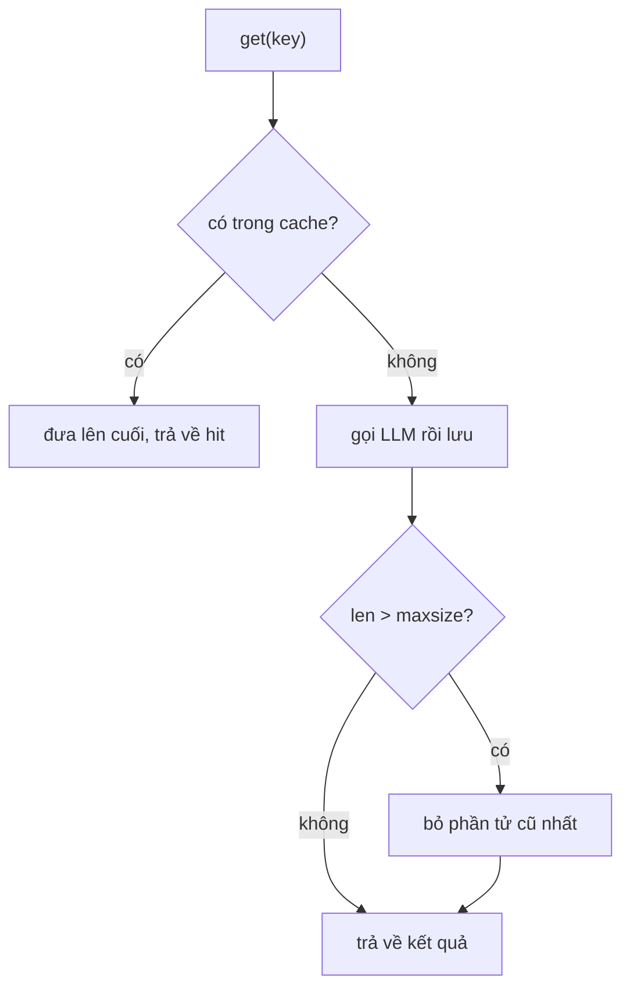

Một bot hỗ trợ khách hàng nhận câu hỏi `"How do I reset my password?"` hàng trăm lần mỗi ngày. Lần nào cũng gọi LLM lại từ đầu thì vừa tốn tiền token, vừa bắt người dùng chờ. **Cache** (bộ nhớ đệm) ghi nhớ câu trả lời của lần trước để các câu hỏi lặp lại được trả ngay lập tức—và hai phần khó nhất là chọn **cache key** (khóa cache) cho đúng và biết khi nào dữ liệu đã lưu bị cũ.

## 1. Cache là gì: hit, miss và hit rate

Hãy hình dung cache như mảnh giấy ghi chú dán ngay cạnh bàn làm việc: nếu câu trả lời đã ghi sẵn trên giấy, bạn dùng luôn khỏi phải đứng dậy đi tra quyển sổ lớn. Mỗi lần tra cứu đều rơi vào **cache hit** (trúng cache — tìm thấy sẵn) hoặc **cache miss** (trượt cache — chưa có nên phải gọi hàm thật rồi lưu lại), và **hit rate** (tỉ lệ trúng cache) bằng `hits / (hits + misses)`.

Bấm **Visualize** ở khối code này để xem `cache` lớn dần và `hits` tăng lên qua từng lượt.

```python
real_calls = 0


def slow_answer(question: str) -> str:
    global real_calls
    real_calls += 1
    return f"Answer for: {question}"


cache: dict[str, str] = {}
hits = 0
misses = 0

questions = [
    "How do I reset my password?",
    "What are your support hours?",
    "How do I reset my password?",
    "Where is my invoice?",
    "How do I reset my password?",
    "What are your support hours?",
]

for q in questions:
    if q in cache:
        hits += 1
        ans = cache[q]
    else:
        misses += 1
        ans = slow_answer(q)
        cache[q] = ans

hit_rate = hits / (hits + misses)
print("hits:", hits, "misses:", misses)
# hits: 3 misses: 3
print("hit_rate:", round(hit_rate, 3))
# hit_rate: 0.5
print("real_calls:", real_calls, "cache_size:", len(cache))
# real_calls: 3 cache_size: 3
```

Bạn thấy 6 câu hỏi gửi tới nhưng chỉ cần gọi `slow_answer` đúng 3 lần, đạt hit rate `0.5` (`50%`). Bảng theo dõi dưới đây cho thấy trạng thái qua từng lượt gọi:

| call | question | hit? | real calls | cache size |
|---|---|---|---|---|
| 1 | `"How do I reset my password?"` | Không (miss) | 1 | 1 |
| 2 | `"What are your support hours?"` | Không (miss) | 2 | 2 |
| 3 | `"How do I reset my password?"` | Có (hit) | 2 | 2 |
| 4 | `"Where is my invoice?"` | Không (miss) | 3 | 3 |
| 5 | `"How do I reset my password?"` | Có (hit) | 3 | 3 |
| 6 | `"What are your support hours?"` | Có (hit) | 3 | 3 |

## 2. `functools.lru_cache`: cache có sẵn cho hàm thuần

Ở bài `p2-07-decorators`, bạn đã từng tự viết decorator `@cache_results` bằng một dict trong closure. Thư viện chuẩn Python cũng có sẵn `@lru_cache(maxsize=...)` trong module `functools`, giúp tự động ghi nhớ kết quả cho những **hàm thuần (pure function)**—những hàm có đầu ra chỉ phụ thuộc vào đầu vào và không đổi theo thời gian:

```python
from functools import lru_cache


@lru_cache(maxsize=3)
def count_words(text: str) -> int:
    return len(text.split())


samples = [
    "reset password",
    "billing invoice",
    "reset password",
    "refund policy",
    "reset password",
]
for s in samples:
    count_words(s)

print(count_words.cache_info())
# CacheInfo(hits=2, misses=3, maxsize=3, currsize=3)
```

Hãy để ý `cache_info()` tự báo `hits=2, misses=3, maxsize=3, currsize=3` mà bạn không phải tự viết dictionary. Tuy nhiên, `lru_cache` có ba giới hạn lớn với ứng dụng AI: chỉ nhận đối số **hashable** (truyền `list` các message chat hoặc `dict` sẽ báo `TypeError`), **không có TTL** (dữ liệu không tự hết hạn theo thời gian), và không được dùng cho hàm có tác dụng phụ (side effect) hay kết quả thay đổi theo thời gian.

> [!NOTE]
> Hãy dùng `@lru_cache` cho các hàm phụ trợ thuần túy như chuẩn hóa văn bản hay tách cấu trúc. Còn với lời gọi LLM và pipeline RAG—nơi đầu vào là danh sách dict, `temperature` đóng vai trò quan trọng và câu trả lời có thể cũ đi—hãy tự dựng cache có kiểm soát key và thời hạn.

## 3. Cache key cho prompt: cái gì làm câu trả lời khác đi?

Câu trả lời của LLM phụ thuộc vào nhiều thứ hơn chuỗi câu hỏi cuối cùng của người dùng: chỉ cần đổi `model`, `system` prompt, lịch sử `messages`, `temperature` hay `max_tokens` là kết quả có thể khác hẳn. **Cache key** của bạn phải chứa **tất cả** những yếu tố làm thay đổi câu trả lời, chuyển thành chuỗi ổn định bằng `json.dumps(..., sort_keys=True)` rồi băm bằng `hashlib.sha256`. Hàm `sha256` biến một chuỗi bất kỳ thành mã hex có độ dài cố định 64 ký tự: cùng một đầu vào luôn cho ra đúng cùng một mã, còn chỉ cần đổi một ký tự là mã đổi hoàn toàn.

Chuẩn hóa nhẹ khoảng trắng—cắt khoảng trắng thừa hai đầu và gộp nhiều dấu cách liên tiếp—giúp `"Reset password?"` và `"  Reset   password?  "` trúng cùng một key. Đừng tự ý viết thường toàn bộ hay xóa dấu câu, vì đổi `"US"` thành `"us"` hoặc `"Help!"` thành `"Help?"` có thể làm sai nghĩa câu hỏi.

```python
import hashlib
import json


def normalize_text(text: str) -> str:
    return " ".join(text.strip().split())


def make_prompt_key(
    model: str,
    messages: list[dict],
    temperature: float = 0.0,
    max_tokens: int = 128,
) -> str:
    clean_msgs = [
        {"role": m["role"], "content": normalize_text(m["content"])}
        for m in messages
    ]
    payload = {
        "model": model,
        "messages": clean_msgs,
        "temperature": temperature,
        "max_tokens": max_tokens,
    }
    raw = json.dumps(payload, sort_keys=True)
    return hashlib.sha256(raw.encode("utf-8")).hexdigest()


m1 = [{"role": "user", "content": "Reset password?"}]
m2 = [{"role": "user", "content": "  Reset   password?  "}]
k1 = make_prompt_key("fake-mini", m1)
k2 = make_prompt_key("fake-mini", m2)
k3 = make_prompt_key("fake-large", m1)
print("same after whitespace norm:", k1 == k2, k1[:12])
# same after whitespace norm: True 2386b4654e4c
print("different model:", k1 == k3, k3[:12])
# different model: False 6aee8f9900a6
```

Chỉ cache câu trả lời LLM khi `temperature == 0`: khi `temperature > 0`, người dùng mong mỗi lần gọi nhận được một câu trả lời mới mẻ khác nhau chứ không phải phát lại câu cũ.

```text
[model | system | messages | temperature | max_tokens]
     │
     ▼  json.dumps(..., sort_keys=True)
'{"max_tokens": 128, "messages": [...], "model": "fake-mini", "temperature": 0.0}'
     │
     ▼  sha256(...).hexdigest()
"3f2a9c..." (cache key)
```

Bảng sau tóm tắt những thành phần cần đưa vào cache key cho prompt và lý do:

| đưa vào key | vì sao |
|---|---|
| `model` | Mỗi model sinh câu trả lời và dùng bộ tokenizer khác nhau |
| `system` + `messages` | Đổi system prompt hoặc lịch sử hội thoại sẽ làm câu trả lời đổi theo |
| `temperature` (chỉ cache khi `0`) | Khi khác `0`, hệ thống cần độ đa dạng giữa các lần gọi |
| `max_tokens` / `response_format` | Giới hạn cắt độ dài và schema JSON làm thay đổi hình dạng đầu ra |
| `prompt_version` / `index_version` | Tăng số phiên bản giúp bỏ sạch các câu trả lời cũ một cách gọn gàng |
| `user_id` (khi có dữ liệu riêng) | Tránh rò rỉ câu trả lời riêng của người dùng này sang người dùng khác |

## 4. Cache embedding

Trong pipeline RAG (`p7-03-embeddings` và `p7-05-rag`), nếu sửa một đoạn văn mà phải embed lại cả kho tài liệu thì rất lãng phí. Vì mỗi embedding chỉ phụ thuộc vào cặp `(model, text)`, bạn có thể kiểm tra cache cho từng đoạn, gom **những đoạn chưa có trong cache** thành một batch duy nhất gửi tới `embed()`, rồi ghép toàn bộ vector lại theo **đúng thứ tự** ban đầu:

```python
from pyai_llm import FakeLLM

client = FakeLLM(embed_dim=8)
embed_cache: dict[tuple[str, str], list[float]] = {}
embed_calls = 0


def embed_with_cache(model: str, texts: list[str]) -> tuple[list[list[float]], int]:
    global embed_calls
    missing = [t for t in texts if (model, t) not in embed_cache]
    if missing:
        embed_calls += 1
        vectors = client.embed(missing)
        for text, vec in zip(missing, vectors):
            embed_cache[(model, text)] = vec
    ordered = [embed_cache[(model, t)] for t in texts]
    return ordered, len(missing)


docs_v1 = [
    "Reset your password from Settings.",
    "Invoices arrive on the first of the month.",
    "Support is open Monday to Friday.",
    "Refunds take five business days.",
    "Two-factor auth adds account security.",
]
vecs_1, sent_1 = embed_with_cache("embed-v1", docs_v1)
print("run 1 sent:", sent_1, "total vectors:", len(vecs_1))
# run 1 sent: 5 total vectors: 5

docs_v2 = list(docs_v1)
docs_v2[2] = "Support is open seven days a week."
vecs_2, sent_2 = embed_with_cache("embed-v1", docs_v2)
print("run 2 sent:", sent_2, "total vectors:", len(vecs_2))
# run 2 sent: 1 total vectors: 5
print("unchanged doc vector reused:", vecs_2[0] == vecs_1[0])
# unchanged doc vector reused: True
```

Bạn thấy ở lần chạy thứ hai, chỉ có `1` tài liệu thật sự được gửi tới `client.embed(...)`, trong khi danh sách trả về vẫn đủ `5` vector đúng thứ tự. Vì key đã chứa `model` rồi nên cache của model cũ sẽ không trùng với model mới—tuy vậy, khi chuyển hẳn sang model embedding khác (nhớ lại bài `p7-03-embeddings` rằng vector giữa hai model không so sánh được với nhau), hãy xóa cache của model cũ để giải phóng RAM và embed lại bằng model mới.

## 5. LRU: giới hạn bộ nhớ

Một dictionary không giới hạn sẽ phình mãi cho đến khi dịch vụ ăn hết RAM. **LRU** (Least Recently Used — ít được dùng gần đây nhất) giữ cache tối đa `maxsize` phần tử và thực hiện **eviction** (loại bỏ khỏi cache)—xóa phần tử lâu chưa được dùng nhất—mỗi khi thêm mục mới làm vượt ngưỡng.



Lớp `collections.OrderedDict` của Python giúp viết LRU rất gọn: `move_to_end(key)` đẩy key vừa dùng về cuối (mới nhất), còn `popitem(last=False)` bỏ đi key lâu chưa dùng nhất nằm ở đầu.

```python
from collections import OrderedDict


class LRUCache:
    def __init__(self, maxsize: int) -> None:
        self.maxsize = maxsize
        self.data: OrderedDict[str, str] = OrderedDict()

    def get(self, key: str) -> str | None:
        if key not in self.data:
            return None
        self.data.move_to_end(key)
        return self.data[key]

    def put(self, key: str, value: str) -> None:
        if key in self.data:
            self.data.move_to_end(key)
        self.data[key] = value
        if len(self.data) > self.maxsize:
            self.data.popitem(last=False)


lru = LRUCache(maxsize=3)
ops = [
    ("put", "a", "A"),
    ("put", "b", "B"),
    ("put", "c", "C"),
    ("get", "a", None),
    ("put", "d", "D"),
    ("put", "e", "E"),
]
for op, k, v in ops:
    if op == "put":
        lru.put(k, v)
    else:
        lru.get(k)
    print(f"{op} {k} -> order: {list(lru.data.keys())}")
# put a -> order: ['a']
# put b -> order: ['a', 'b']
# put c -> order: ['a', 'b', 'c']
# get a -> order: ['b', 'c', 'a']
# put d -> order: ['c', 'a', 'd']
# put e -> order: ['a', 'd', 'e']
```

Hãy để ý lệnh `get("a")` đã đẩy `"a"` sang phía bên phải (mới nhất), nên khi `"d"` vào thì `"b"` mới là phần tử bị loại bỏ chứ không phải `"a"`.

## 6. TTL: dữ liệu cũ thì bỏ

Dù bộ nhớ đã có giới hạn, câu trả lời vẫn có thể lỗi thời khi tài liệu hay chính sách thay đổi. **TTL** (Time To Live — thời gian sống) gắn mốc hết hạn `expires_at = now + ttl` cho mỗi entry; khi `get` thấy `now >= expires_at`, nó xóa entry đã hết hạn và tính là một lần miss.

Để output tất định và test chạy tức thì, code dưới đây truyền vào (inject) một `FakeClock` thay cho đồng hồ thật; ở production, bạn truyền `time.monotonic` (không có ngoặc) vào làm hàm lấy giờ. Luôn dùng `monotonic` chứ không dùng giờ hệ thống, vì giờ hệ thống có thể nhảy lùi khi đồng bộ giờ và làm sai lệch thời điểm hết hạn.

Khi định nghĩa `__call__` trên một class, object tạo ra có thể được gọi như một hàm: gọi `clock()` sẽ chạy `clock.__call__()`. Nhờ `FakeClock` cài đặt `__call__() -> float`, bài test có thể truyền `FakeClock()` còn production truyền `time.monotonic`, và `TTLCache` chỉ cần gọi `self.clock()` mà không cần biết bên trong là cái nào.

```python
class FakeClock:
    def __init__(self, start: float = 0.0) -> None:
        self.t = start

    def __call__(self) -> float:
        return self.t

    def advance(self, seconds: float) -> None:
        self.t += seconds


class TTLCache:
    def __init__(self, ttl: float, clock) -> None:
        self.ttl = ttl
        self.clock = clock
        self.store: dict[str, tuple[str, float]] = {}

    def set(self, key: str, value: str) -> None:
        self.store[key] = (value, self.clock() + self.ttl)

    def get(self, key: str) -> str | None:
        item = self.store.get(key)
        if item is None:
            return None
        value, expires_at = item
        if self.clock() >= expires_at:
            del self.store[key]
            return None
        return value


clock = FakeClock(start=0.0)
ttl_cache = TTLCache(ttl=60.0, clock=clock)
ttl_cache.set("faq:pw", "Open Settings > Security.")
print("t=0 set faq:pw")
# t=0 set faq:pw
clock.advance(30.0)
print("t=30 get:", ttl_cache.get("faq:pw"))
# t=30 get: Open Settings > Security.
clock.advance(31.0)
print("t=61 get:", ttl_cache.get("faq:pw"))
# t=61 get: None
```

Quản lý thời điểm dữ liệu cache hết hiệu lực gọi là **invalidation** (hủy hiệu lực bản lưu cũ), và có hai nguyên tắc thực tế bạn cần nhớ:
- **Chọn TTL là sự đánh đổi:** TTL ngắn giúp dữ liệu tươi hơn nhưng hit rate thấp hơn, còn TTL dài tăng hit rate nhưng dễ trả về thông tin cũ.
- **Đưa phiên bản vào key:** khi tài liệu nguồn của RAG hoặc system prompt thay đổi, hãy đưa `index_version` hoặc `prompt_version` vào cache key rồi tăng số phiên bản lên thay vì đi dò xóa từng entry cũ.

> [!WARNING]
> Không bao giờ cache câu trả lời chứa dữ liệu riêng của người dùng (như số dư tài khoản, lịch sử đơn hàng hay email cá nhân) dưới một key dùng chung. Hãy thêm `user_id` vào key, hoặc bỏ qua cache với các câu trả lời cá nhân hóa.

## 7. Đo hiệu quả cache

Để kiểm chứng cache giúp tiết kiệm bao nhiêu, hãy bọc `FakeLLM` bằng biến đếm riêng rồi theo dõi hit rate, số token tiết kiệm được và chi phí ước tính theo mức giá giả định (ví dụ `PRICE_PER_1K = 0.002` cho mỗi 1.000 token):

```python
import hashlib
import json
from pyai_llm import FakeLLM

PRICE_PER_1K = 0.002
client = FakeLLM()
cache: dict[str, tuple[str, int]] = {}
real_calls = 0
hits = 0
tokens_used = 0
tokens_without_cache = 0


def cached_chat(question: str) -> str:
    global real_calls, hits, tokens_used, tokens_without_cache
    clean = " ".join(question.strip().split())
    payload = json.dumps({"model": "fake-mini", "q": clean, "temperature": 0.0}, sort_keys=True)
    key = hashlib.sha256(payload.encode("utf-8")).hexdigest()

    if key in cache:
        hits += 1
        reply, saved_toks = cache[key]
        tokens_without_cache += saved_toks
        return reply

    real_calls += 1
    resp = client.chat([{"role": "user", "content": clean}], temperature=0.0)
    toks = resp.usage.total_tokens
    tokens_used += toks
    tokens_without_cache += toks
    cache[key] = (resp.content or "", toks)
    return resp.content or ""


requests = [
    "What is RAG?",
    "What is a token?",
    "What is RAG?",
    "  What is  RAG? ",
    "What is cosine similarity?",
    "What is temperature?",
    "What is RAG?",
    "What is a token?",
    "What is hallucination?",
    "What is temperature?",
] * 2

for q in requests:
    cached_chat(q)

saved_tokens = tokens_without_cache - tokens_used
cost_without = (tokens_without_cache / 1000) * PRICE_PER_1K
cost_with = (tokens_used / 1000) * PRICE_PER_1K
print("requests:", len(requests), "real_calls:", real_calls)
# requests: 20 real_calls: 5
print("hit_rate:", round(hits / len(requests), 3))
# hit_rate: 0.75
print("tokens_saved:", saved_tokens)
# tokens_saved: 415
print("cost_without:", round(cost_without, 5), "cost_with:", round(cost_with, 5))
# cost_without: 0.0011 cost_with: 0.00027
```

Qua 20 request giả lập, cache đã giảm số lần gọi LLM thật từ 20 xuống còn 5 (`hit_rate = 0.75`), tiết kiệm 415 token và giảm 75% chi phí ước tính. Sang bài `p8-04-monitoring`, `hit_rate` sẽ là một trong những metric quan trọng bạn theo dõi cùng độ trễ và chi phí token.

## 8. Lỗi thường gặp

**1. Thiếu `model` hoặc `system` prompt trong cache key**

Nếu chỉ băm câu hỏi của người dùng, hai system prompt hoặc hai model khác nhau sẽ dùng chung một key và trả nhầm câu trả lời của cấu hình kia. Cách sửa: đưa cả `model` lẫn toàn bộ `messages` (gồm cả `system`) vào key.

```python
import hashlib
import json
from pyai_llm import FakeLLM

client = FakeLLM()


# sai: chỉ băm nội dung câu hỏi của user
def bad_key(user_text: str) -> str:
    return hashlib.sha256(user_text.encode("utf-8")).hexdigest()[:12]


# đã sửa: đưa cả model và toàn bộ messages vào key
def good_key(model: str, messages: list[dict]) -> str:
    raw = json.dumps({"model": model, "messages": messages}, sort_keys=True)
    return hashlib.sha256(raw.encode("utf-8")).hexdigest()[:12]


bad_cache: dict[str, str] = {}
pirate_msgs = [{"role": "system", "content": "Be a pirate."}, {"role": "user", "content": "What is RAG?"}]
formal_msgs = [{"role": "system", "content": "Be concise."}, {"role": "user", "content": "What is RAG?"}]

k_pirate = bad_key("What is RAG?")
bad_cache[k_pirate] = client.chat(pirate_msgs).content or ""
k_formal = bad_key("What is RAG?")
print("bad keys equal:", k_pirate == k_formal, k_pirate)
# bad keys equal: True 59179138f99e
print("bad reply for formal:", bad_cache[k_formal])
# bad reply for formal: Arr! RAG (Retrieval-Augmented Generation) retrieves relevant documents and adds them to the prompt before generating an answer.

gk_pirate = good_key("fake-mini", pirate_msgs)
gk_formal = good_key("fake-mini", formal_msgs)
print("good keys equal:", gk_pirate == gk_formal, gk_pirate, gk_formal)
# good keys equal: False 9de68504e1c1 8a2cc24226c0
```

**2. Cache cả khi `temperature > 0`**

Cache một lời gọi có tính ngẫu nhiên sẽ giữ cứng câu trả lời ngẫu nhiên đầu tiên và bỏ qua việc gọi model ở mọi lượt lặp lại. Cách sửa: bỏ qua cache mỗi khi `temperature > 0` để mỗi request đều gọi model lấy câu trả lời mới.

```python
from pyai_llm import FakeLLM

client = FakeLLM(seed=0)
bad_cache: dict[str, str] = {}
good_cache: dict[str, str] = {}
bad_calls = 0
good_calls = 0


def call_model(prompt: str, temperature: float) -> str:
    return client.chat([{"role": "user", "content": prompt}], temperature=temperature).content or ""


# sai: cache cả khi temperature > 0
def ask_bad(prompt: str, temperature: float) -> str:
    global bad_calls
    if prompt not in bad_cache:
        bad_calls += 1
        bad_cache[prompt] = call_model(prompt, temperature)
    return bad_cache[prompt]


# đã sửa: chỉ cache khi temperature == 0
def ask_good(prompt: str, temperature: float) -> str:
    global good_calls
    if temperature > 0:
        good_calls += 1
        return call_model(prompt, temperature)
    if prompt not in good_cache:
        good_calls += 1
        good_cache[prompt] = call_model(prompt, 0.0)
    return good_cache[prompt]


b1 = ask_bad("hello", 0.8)
b2 = ask_bad("hello", 0.8)
print("bad calls:", bad_calls, "same reply:", b1 == b2)
# bad calls: 1 same reply: True

g1 = ask_good("hello", 0.8)
g2 = ask_good("hello", 0.8)
print("good calls:", good_calls)
# good calls: 2
```

Hãy để ý `ask_bad("hello", 0.8)` chỉ gọi model đúng 1 lần (`bad_calls == 1`) và giữ cứng câu trả lời ngẫu nhiên đầu tiên cho lần sau, còn `ask_good("hello", 0.8)` gọi model thật ở cả hai lần (`good_calls == 2`).

**3. Dùng `str(dict)` làm key**

Dictionary trong Python giữ thứ tự chèn, nên hai dict giống hệt dữ liệu nhưng khác thứ tự khóa sẽ cho `str(dict)` khác nhau và gây trượt cache oan. Cách sửa: chuyển sang chuỗi bằng `json.dumps(payload, sort_keys=True)`.

```python
import json

a = {"model": "mini", "temperature": 0.0}
b = {"temperature": 0.0, "model": "mini"}

# sai: str(dict) phụ thuộc thứ tự các khóa
print("str(dict) equal:", str(a) == str(b))
# str(dict) equal: False

# đã sửa: sort_keys=True luôn sắp xếp khóa theo thứ tự chuẩn
print("sorted json equal:", json.dumps(a, sort_keys=True) == json.dumps(b, sort_keys=True))
# sorted json equal: True
```

**4. Dùng dict không giới hạn kích thước và không có TTL**

Nếu không có eviction hay hạn sử dụng, dữ liệu cũ không bao giờ biến mất còn bộ nhớ RAM tăng mãi theo từng câu hỏi mới. Cách sửa: giới hạn số phần tử bằng `LRUCache(maxsize)` và đặt TTL để hết hạn dữ liệu cũ.

```python
from collections import OrderedDict

unbounded: dict[str, str] = {}
bounded: OrderedDict[str, str] = OrderedDict()
maxsize = 3

for i in range(10):
    k = f"q:{i}"
    unbounded[k] = f"ans:{i}"
    bounded[k] = f"ans:{i}"
    if len(bounded) > maxsize:
        bounded.popitem(last=False)

print("unbounded len:", len(unbounded))
# unbounded len: 10
print("bounded len:", len(bounded), list(bounded.keys()))
# bounded len: 3 ['q:7', 'q:8', 'q:9']
```

## Tóm tắt

- **Cache** trả ngay kết quả cho câu hỏi lặp lại (**cache hit**), tránh gọi thật tốn kém (**cache miss**), và hiệu quả được đo bằng **hit rate** (`hits / (hits + misses)`).
- `functools.lru_cache` phù hợp cho hàm thuần có đối số hashable, nhưng lời gọi LLM cần cache key riêng, kiểm tra `temperature == 0` và cơ chế hết hạn.
- Tạo cache key cho prompt từ `model`, toàn bộ `messages` (gồm `system`), `temperature` và các tham số sinh văn bản bằng `json.dumps(..., sort_keys=True)` cùng `sha256`—và không cache dữ liệu riêng dưới key dùng chung.
- Cache embedding theo `(model, text)`, chỉ gửi một batch gồm các text chưa có trong cache tới `embed()`, ghép lại đúng thứ tự và bỏ cache nếu đổi model embedding.
- Kết hợp **LRU** (`OrderedDict` với `move_to_end` và `popitem(last=False)`) để giới hạn RAM cùng **TTL** (dùng `time.monotonic` ở production, đồng hồ truyền vào (inject) khi test) và gắn phiên bản vào key để làm sạch dữ liệu cũ an toàn.
