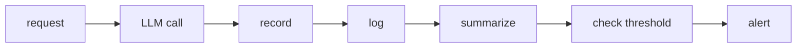

Your RAG bot ran smoothly during week one. By week three, the API bill has tripled and users complain that replies feel sluggish, yet nobody knows when the slowdown started or which endpoint caused it. **Monitoring** means recording enough structured numbers per request so you can answer those questions in five minutes instead of guessing.

## 1. What to record per request: structured metrics

Think of per-request metrics like an airplane's black box: every flight records the same compact measurements so investigators can trace an issue afterward. For an LLM service, each request emits one flat record with `request_id`, `route`, `model`, `latency_ms`, `prompt_tokens`, `completion_tokens`, `cost_usd`, `cache_hit`, and `status` (`"ok"` or `"error"`).

In production, you pass `time.perf_counter` or `time.monotonic` as `clock` right before and right after the model call—neither clock ever steps backward (`perf_counter` has finer resolution for latency, while `monotonic` is plenty for cache TTL), and both can be passed in just like `clock`. In this lesson, we inject `FakeClock` from `p8-03-caching` (calling `clock()` works because it defines `__call__`) so every example runs instantly and gives repeatable numbers.

```python
import json
from pyai_llm import FakeLLM, RateLimitError


class FakeClock:
    def __init__(self, start: float = 0.0) -> None:
        self.t = start

    def __call__(self) -> float:
        return self.t

    def advance(self, seconds: float) -> None:
        self.t += seconds


PRICE_IN_PER_1K = 0.002
PRICE_OUT_PER_1K = 0.006
client = FakeLLM()
clock = FakeClock()


def tracked_chat(
    request_id: str,
    route: str,
    model: str,
    messages: list[dict],
    clock,
    cache_hit: bool = False,
    cached_reply: str = "",
) -> tuple[str, dict]:
    start = clock()
    if cache_hit:
        clock.advance(0.002)
        reply = cached_reply
        prompt_tokens, completion_tokens, status = 0, 0, "ok"
    else:
        status, reply, prompt_tokens, completion_tokens = "error", "", 0, 0
        try:
            resp = client.chat(messages, temperature=0.0)
            clock.advance(0.2 + 0.003 * resp.usage.completion_tokens)
            reply = resp.content or ""
            prompt_tokens = resp.usage.prompt_tokens
            completion_tokens = resp.usage.completion_tokens
            status = "ok"
        except RateLimitError:
            clock.advance(0.15)

    cost = (prompt_tokens / 1000) * PRICE_IN_PER_1K + (completion_tokens / 1000) * PRICE_OUT_PER_1K
    record = {
        "request_id": request_id,
        "route": route,
        "model": model,
        "latency_ms": round((clock() - start) * 1000, 1),
        "prompt_tokens": prompt_tokens,
        "completion_tokens": completion_tokens,
        "cost_usd": round(cost, 6),
        "cache_hit": cache_hit,
        "status": status,
    }
    return reply, record


reply1, rec1 = tracked_chat("req-01", "/ask", "fake-mini", [{"role": "user", "content": "What is RAG?"}], clock)
_, rec2 = tracked_chat("req-02", "/ask", "fake-mini", [{"role": "user", "content": "What is RAG?"}], clock, cache_hit=True, cached_reply=reply1)
print(json.dumps(rec1, sort_keys=True))
# {"cache_hit": false, "completion_tokens": 21, "cost_usd": 0.000142, "latency_ms": 263.0, "model": "fake-mini", "prompt_tokens": 8, "request_id": "req-01", "route": "/ask", "status": "ok"}
print(json.dumps(rec2, sort_keys=True))
# {"cache_hit": true, "completion_tokens": 0, "cost_usd": 0.0, "latency_ms": 2.0, "model": "fake-mini", "prompt_tokens": 0, "request_id": "req-02", "route": "/ask", "status": "ok"}
```

Notice that both a cache miss and a cache hit produce the exact same keys, serialized deterministically with `json.dumps(..., sort_keys=True)`. Unlike free-text strings, structured JSON lines stay easy to filter and sum in code:

| Free-text log | Structured log (JSON) |
|---|---|
| Hard to search reliably (`"took 263ms"` vs `"0.26s"`) | Every field has one fixed name and unit (`latency_ms`) |
| Needs fragile regex to sum costs or tokens | Parsed cleanly with `json.loads(line)` |
| Easy to omit fields silently | Missing or extra keys stand out immediately |
| Friendly to read one line at a time | Machine-readable for dashboards, queries, and alerts |

> [!WARNING]
> Never write raw user prompts, model replies, API keys, or personal data into metric logs. Logs are copied to central dashboards and retained for months—record `len(prompt)` or a short hash instead if you need to correlate requests.

## 2. Logging with `logging`, not `print`

Back in `p3-03-logging`, you learned to route program diagnostics through Python's `logging` module instead of bare `print`. Here we configure a dedicated logger named `"app.metrics"` writing JSON lines to `sys.stdout` with `format="%(message)s"` so every emitted line is valid JSON on its own.

```python
import json
import logging
import sys

logging.basicConfig(
    stream=sys.stdout,
    level=logging.INFO,
    format="%(message)s",
    force=True,
)
logger = logging.getLogger("app.metrics")

records = [
    {"request_id": "req-03", "route": "/ask", "latency_ms": 263.0, "cost_usd": 0.0004, "cache_hit": False, "status": "ok"},
    {"request_id": "req-04", "route": "/ask", "latency_ms": 2.0, "cost_usd": 0.0, "cache_hit": True, "status": "ok"},
]

collected = []
for rec in records:
    logger.info(json.dumps(rec, sort_keys=True))
    collected.append(rec)
# {"cache_hit": false, "cost_usd": 0.0004, "latency_ms": 263.0, "request_id": "req-03", "route": "/ask", "status": "ok"}
# {"cache_hit": true, "cost_usd": 0.0, "latency_ms": 2.0, "request_id": "req-04", "route": "/ask", "status": "ok"}
print("collected:", len(collected))
# collected: 2
```

In production, a log collector ships those stdout lines to a cloud logging service where you can filter and chart them; in this lesson, we also keep the records in a Python list so we can aggregate them directly.

## 3. Latency: why averages lie

Suppose 9 requests finish around 200 ms and 1 request stalls for 3,000 ms. The arithmetic **mean** gets dragged up to 488 ms—which describes neither the 9 fast requests nor the 1 painfully slow request.

Instead, engineers track **percentiles**: **p50** (the median, showing what a typical user experiences) and **p95** (the 95th percentile, showing what the slowest 1 in 20 users experiences).

```text
sorted (n=10): [180, 190, 200, 205, 210, 215, 220, 225, 235, 3000]
index:           0    1    2    3    4    5    6    7    8    9
                                     ^                        ^
                               p50 (rank 5)             p95 (rank 10)
```

To compute a percentile without guesswork, we use the **nearest-rank** method: sort the values, calculate `rank = math.ceil(p / 100 * n)`, and take `ordered[rank - 1]`. We choose nearest-rank because it is simple and always returns an actual observed latency from the list (whereas `statistics.quantiles` interpolates between neighbors and can return values that never occurred).

Press **Visualize** on this block and watch `ordered` get sorted and `rank` get computed for `p=50` and `p=95`.

```python
import math
import statistics


def percentile(values: list[float], p: float) -> float:
    ordered = sorted(values)
    n = len(ordered)
    rank = math.ceil(p / 100 * n)
    return ordered[rank - 1]


latencies = [220, 180, 3000, 205, 190, 235, 200, 215, 225, 210]
print("mean:", round(statistics.mean(latencies), 1))
# mean: 488
print("p50:", percentile(latencies, 50))
# p50: 210
print("p95:", percentile(latencies, 95))
# p95: 3000
```

The trace table shows the exact nearest-rank steps for `n = 10`:

| p | n | p/100 × n | rank (ceil) | index | value |
|---|---|---|---|---|---|
| 50 | 10 | 5.0 | 5 | 4 | 210 |
| 95 | 10 | 9.5 | 10 | 9 | 3000 |

Notice how `p50` stays at `210` ms (typical user) while `p95` catches the `3000` ms tail spike right away.

## 4. Cost: turning tokens into dollars

LLM providers bill input (`prompt_tokens`) and output (`completion_tokens`) at different rates—output tokens are typically several times more expensive because the model generates them sequentially one token at a time. Using explicit assumed prices (`PRICE_IN_PER_1K = 0.0005`, `PRICE_OUT_PER_1K = 0.0015`), you compute per-request cost, sum it by `route`, and project monthly spend from daily traffic.

```python
from collections import defaultdict

PRICE_IN_PER_1K = 0.0005
PRICE_OUT_PER_1K = 0.0015


def compute_cost(prompt_tokens: int, completion_tokens: int) -> float:
    return (
        (prompt_tokens / 1000) * PRICE_IN_PER_1K
        + (completion_tokens / 1000) * PRICE_OUT_PER_1K
    )


logs = [
    {"route": "/ask", "prompt_tokens": 400, "completion_tokens": 120},
    {"route": "/ask", "prompt_tokens": 350, "completion_tokens": 80},
    {"route": "/summarize", "prompt_tokens": 1800, "completion_tokens": 420},
    {"route": "/summarize", "prompt_tokens": 1500, "completion_tokens": 360},
]

by_route: dict[str, float] = defaultdict(float)
total_cost = 0.0
for rec in logs:
    c = compute_cost(rec["prompt_tokens"], rec["completion_tokens"])
    total_cost += c
    by_route[rec["route"]] += c

avg_cost = total_cost / len(logs)
assumed_requests_per_day = 2000
monthly_est = avg_cost * assumed_requests_per_day * 30

print(f"total=${total_cost:.4f} avg=${avg_cost:.4f}")
# total=$0.0035 avg=$0.0009
for route in sorted(by_route):
    print(f"  {route}: ${by_route[route]:.4f}")
#   /ask: $0.0007
#   /summarize: $0.0028
print(f"monthly_est (2000/day x 30d): ${monthly_est:.2f}")
# monthly_est (2000/day x 30d): $52.43
```

Notice that `/summarize` accounts for `$0.0028` out of `$0.0035` (80% of the bill) even though it handled half the requests—grouping cost by `route` shows where optimization pays off first.

## 5. Building a summary from logs

Once every request emits a structured record, a single `summarize(records)` function turns a slice of logs into a health snapshot: request `count`, `error_rate`, `p50_ms`, `p95_ms`, `total_cost`, and `cache_hit_rate`.



Connecting back to `p8-03-caching`: a sudden drop in `cache_hit_rate` is an early warning that a cache key started changing unexpectedly (for example, un-sorted JSON or a timestamp sneaking into the prompt) or that your TTL is too short.

```python
import json
import math


def percentile(values: list[float], p: float) -> float:
    ordered = sorted(values)
    rank = math.ceil(p / 100 * len(ordered))
    return ordered[rank - 1]


def summarize(records: list[dict]) -> dict:
    count = len(records)
    if count == 0:
        return {"count": 0, "error_rate": 0.0, "p50_ms": 0.0, "p95_ms": 0.0, "total_cost": 0.0, "cache_hit_rate": 0.0}
    latencies = [r["latency_ms"] for r in records]
    errors = sum(1 for r in records if r["status"] != "ok")
    hits = sum(1 for r in records if r["cache_hit"])
    total_cost = sum(r["cost_usd"] for r in records)
    return {
        "count": count,
        "error_rate": round(errors / count, 4),
        "p50_ms": percentile(latencies, 50),
        "p95_ms": percentile(latencies, 95),
        "total_cost": round(total_cost, 4),
        "cache_hit_rate": round(hits / count, 4),
    }


sample_records = [
    {"latency_ms": 190, "cost_usd": 0.0005, "cache_hit": False, "status": "ok"},
    {"latency_ms": 2, "cost_usd": 0.0, "cache_hit": True, "status": "ok"},
    {"latency_ms": 220, "cost_usd": 0.0006, "cache_hit": False, "status": "ok"},
    {"latency_ms": 150, "cost_usd": 0.0, "cache_hit": False, "status": "error"},
    {"latency_ms": 950, "cost_usd": 0.0012, "cache_hit": False, "status": "ok"},
]
print(json.dumps(summarize(sample_records), sort_keys=True))
# {"cache_hit_rate": 0.2, "count": 5, "error_rate": 0.2, "p50_ms": 190, "p95_ms": 950, "total_cost": 0.0023}
```

Notice that `count=5` includes the failed request (`status="error"`) and the cache hit (`cache_hit=True`), giving `error_rate=0.2` and `cache_hit_rate=0.2` in one compact dictionary.

## 6. Alerts: budget and latency thresholds

Metrics only help if someone acts when they go wrong. A `check_alerts(summary, max_p95_ms, max_cost, max_error_rate)` function compares the summary against numeric **thresholds** and returns a list of alert messages (empty `[]` means healthy).

```python
def check_alerts(
    summary: dict,
    max_p95_ms: float,
    max_cost: float,
    max_error_rate: float,
) -> list[str]:
    alerts: list[str] = []
    if summary["p95_ms"] > max_p95_ms:
        alerts.append(f"p95 latency {summary['p95_ms']}ms > {max_p95_ms}ms")
    if summary["total_cost"] > max_cost:
        alerts.append(f"daily cost ${summary['total_cost']:.4f} > ${max_cost:.4f}")
    elif summary["total_cost"] >= 0.8 * max_cost:
        alerts.append(f"budget warning: ${summary['total_cost']:.4f} >= 80% of ${max_cost:.4f}")
    if summary["error_rate"] > max_error_rate:
        alerts.append(f"error rate {summary['error_rate']:.2f} > {max_error_rate:.2f}")
    return alerts


normal_day = {"count": 100, "p95_ms": 420, "total_cost": 18.5, "error_rate": 0.01}
bad_day = {"count": 100, "p95_ms": 1850, "total_cost": 62.4, "error_rate": 0.02}

print("normal:", check_alerts(normal_day, max_p95_ms=1000, max_cost=50.0, max_error_rate=0.05))
# normal: []
print("bad:", check_alerts(bad_day, max_p95_ms=1000, max_cost=50.0, max_error_rate=0.05))
# bad: ['p95 latency 1850ms > 1000ms', 'daily cost $62.4000 > $50.0000']
```

Three practical rules keep alerts useful instead of noisy:
- **Alert on p95, not mean:** tail latency hurts users long before the average crosses a threshold.
- **Avoid alert fatigue:** if thresholds are too tight, false alarms fire every hour and teammates start muting the channel.
- **Warn before hitting 100% of budget:** an early warning at 80% of your daily budget gives you time to fix a broken retry loop or cache miss spike before hitting the hard spending cap.

> [!TIP]
> Start with just three alerts—p95 latency, daily cost, and error rate—and add more only after a real incident proves you need another signal.

## 7. Common mistakes

**1. Tracking only average latency and missing slow requests**

A single 3,500 ms stall among 14 fast requests keeps the mean near 415 ms while 1 in 15 users waits over three seconds. Fix: compute `p95` alongside `p50`.

```python
import math
import statistics


def percentile(values: list[float], p: float) -> float:
    ordered = sorted(values)
    return ordered[math.ceil(p / 100 * len(ordered)) - 1]


latencies = [160, 170, 175, 180, 185, 190, 190, 195, 200, 205, 210, 215, 220, 225, 3500]
# wrong: checking only mean makes the service look fast
print("mean only:", round(statistics.mean(latencies), 1))
# mean only: 414.7

# fixed: check p50 and p95 to spot the slow tail
print("p50:", percentile(latencies, 50), "p95:", percentile(latencies, 95))
# p50: 195 p95: 3500
```

**2. Computing a percentile on an unsorted list**

Nearest-rank assumes ascending order; indexing into the raw arrival list returns whatever request happened to arrive at that position. Fix: always call `sorted(values)` first.

```python
import math

latencies = [3000, 210, 190, 200, 220, 180, 205, 215, 225, 235]
rank = math.ceil(95 / 100 * len(latencies))

# wrong: indexing unsorted list picks the last arrival (235), not the 95th percentile
print("unsorted p95:", latencies[rank - 1])
# unsorted p95: 235

# fixed: sort first
print("sorted p95:", sorted(latencies)[rank - 1])
# sorted p95: 3000
```

**3. Using one flat token price or forgetting to divide by 1,000**

Treating output tokens at the cheaper input rate underestimates generation cost, and forgetting `/ 1000` inflates the bill by 1,000×. Fix: multiply `prompt_tokens / 1000` and `completion_tokens / 1000` by their separate rates.

```python
PRICE_IN_PER_1K = 0.0005
PRICE_OUT_PER_1K = 0.0015
prompt_tokens = 1000
completion_tokens = 2000

# wrong: flat input rate and missing / 1000
wrong_cost = (prompt_tokens + completion_tokens) * PRICE_IN_PER_1K
print("wrong_cost:", round(wrong_cost, 4))
# wrong_cost: 1.5

# fixed: separate rates and divide each count by 1000
fixed_cost = (prompt_tokens / 1000) * PRICE_IN_PER_1K + (completion_tokens / 1000) * PRICE_OUT_PER_1K
print("fixed_cost:", round(fixed_cost, 4))
# fixed_cost: 0.0035
```

**4. Skipping failed requests in the metric log**

If you only build and log the metric record after `client.chat(...)` succeeds, crashes and rate-limit errors disappear from the logs and `error_rate` stays `0.0` forever. Worse, initializing `status = "ok"` before `try` would record an unexpected `ValueError` as `"ok"` too. Fix: initialize `status = "error"` before `try`, set `status = "ok"` only after `chat()` succeeds, and write the record in `finally`.

```python
from pyai_llm import FakeLLM, RateLimitError


def bad_run() -> list[dict]:
    client = FakeLLM(fail_times=1)
    records = []
    for i in range(3):
        try:
            resp = client.chat([{"role": "user", "content": "hi"}])
            # wrong: only logs when chat() succeeds
            records.append({"id": i, "tokens": resp.usage.total_tokens, "status": "ok"})
        except RateLimitError:
            pass
    return records


def good_run() -> list[dict]:
    client = FakeLLM(fail_times=1)
    records = []
    payloads = [
        [{"role": "user", "content": "hi"}],
        [{"role": "invalid", "content": "hi"}],
        [{"role": "user", "content": "ping"}],
    ]
    for i, msgs in enumerate(payloads):
        status, tokens = "error", 0
        try:
            try:
                resp = client.chat(msgs)
                tokens = resp.usage.total_tokens
                status = "ok"
            except RateLimitError:
                pass
            finally:
                records.append({"id": i, "tokens": tokens, "status": status})
        except ValueError:
            pass
    return records


bad = bad_run()
good = good_run()
print("bad error_rate:", sum(r["status"] != "ok" for r in bad) / len(bad))
# bad error_rate: 0.0
print("good statuses:", [r["status"] for r in good])
# good statuses: ['error', 'error', 'ok']
print("good error_rate:", round(sum(r["status"] != "ok" for r in good) / len(good), 2))
# good error_rate: 0.67
```

## Recap

- Emit **one structured JSON record per request** (`request_id`, `route`, `model`, `latency_ms`, `prompt_tokens`, `completion_tokens`, `cost_usd`, `cache_hit`, `status`) via `logging` to `sys.stdout`—and never log raw prompts, replies, API keys, or personal data.
- Track **p50** (typical user) and **p95** (1 in 20 slowest users) instead of mean latency alone; nearest-rank sorts values, computes `math.ceil(p / 100 * n)`, and picks an actual observed value.
- Compute cost separately for **prompt** and **completion** tokens (since output tokens usually cost more), then group by `route` to spot expensive endpoints.
- Summarize logs into `count`, `error_rate`, `p50_ms`, `p95_ms`, `total_cost`, and `cache_hit_rate`—always recording failed requests inside `try/except/finally`.
- Start with three high-signal **alerts** (p95 latency, daily cost with an early warning before 100%, and error rate) and tune thresholds to avoid false-alarm fatigue.
