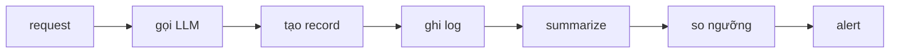

Bot RAG của bạn chạy êm ru suốt tuần đầu tiên. Sang tuần thứ ba, hóa đơn API bất ngờ tăng gấp ba và người dùng than phản hồi chậm, nhưng không ai biết chuyện đó bắt đầu từ lúc nào hay do endpoint nào gây ra. **Monitoring** (giám sát hệ thống) là ghi lại đủ số liệu có cấu trúc cho từng request để bạn trả lời câu hỏi đó trong năm phút thay vì đoán mò.

## 1. Ghi gì cho mỗi request: metric có cấu trúc

Hãy hình dung mỗi dòng **metric** (chỉ số đo lường) giống như hộp đen trên máy bay: chuyến bay nào cũng ghi đều đặn những con số gọn nhẹ để khi có sự cố là tra lại được ngay. Với dịch vụ LLM, mỗi request xuất ra một bản ghi phẳng gồm `request_id`, `route`, `model`, `latency_ms`, `prompt_tokens`, `completion_tokens`, `cost_usd`, `cache_hit` và `status` (`"ok"` hoặc `"error"`).

Ở production, bạn truyền `time.perf_counter` hoặc `time.monotonic` làm `clock` ngay trước và sau lời gọi model—cả hai đồng hồ này đều không chạy lùi (`perf_counter` mịn hơn nên hợp đo độ trễ, còn `monotonic` đủ dùng cho TTL của cache), và cả hai đều truyền vào được như một hàm không tham số `clock`. Trong bài học này, bạn tiêm `FakeClock` từ bài `p8-03-caching` (gọi `clock()` được là nhờ `__call__`) để mọi ví dụ chạy tức thì và luôn ra cùng một kết quả.

```python
import json
from pyai_llm import FakeLLM, RateLimitError


class FakeClock:
    def __init__(self, start: float = 0.0) -> None:
        self.t = start

    def __call__(self) -> float:
        return self.t

    def advance(self, seconds: float) -> None:
        self.t += seconds


PRICE_IN_PER_1K = 0.002
PRICE_OUT_PER_1K = 0.006
client = FakeLLM()
clock = FakeClock()


def tracked_chat(
    request_id: str,
    route: str,
    model: str,
    messages: list[dict],
    clock,
    cache_hit: bool = False,
    cached_reply: str = "",
) -> tuple[str, dict]:
    start = clock()
    if cache_hit:
        clock.advance(0.002)
        reply = cached_reply
        prompt_tokens, completion_tokens, status = 0, 0, "ok"
    else:
        status, reply, prompt_tokens, completion_tokens = "error", "", 0, 0
        try:
            resp = client.chat(messages, temperature=0.0)
            clock.advance(0.2 + 0.003 * resp.usage.completion_tokens)
            reply = resp.content or ""
            prompt_tokens = resp.usage.prompt_tokens
            completion_tokens = resp.usage.completion_tokens
            status = "ok"
        except RateLimitError:
            clock.advance(0.15)

    cost = (prompt_tokens / 1000) * PRICE_IN_PER_1K + (completion_tokens / 1000) * PRICE_OUT_PER_1K
    record = {
        "request_id": request_id,
        "route": route,
        "model": model,
        "latency_ms": round((clock() - start) * 1000, 1),
        "prompt_tokens": prompt_tokens,
        "completion_tokens": completion_tokens,
        "cost_usd": round(cost, 6),
        "cache_hit": cache_hit,
        "status": status,
    }
    return reply, record


reply1, rec1 = tracked_chat("req-01", "/ask", "fake-mini", [{"role": "user", "content": "What is RAG?"}], clock)
_, rec2 = tracked_chat("req-02", "/ask", "fake-mini", [{"role": "user", "content": "What is RAG?"}], clock, cache_hit=True, cached_reply=reply1)
print(json.dumps(rec1, sort_keys=True))
# {"cache_hit": false, "completion_tokens": 21, "cost_usd": 0.000142, "latency_ms": 263.0, "model": "fake-mini", "prompt_tokens": 8, "request_id": "req-01", "route": "/ask", "status": "ok"}
print(json.dumps(rec2, sort_keys=True))
# {"cache_hit": true, "completion_tokens": 0, "cost_usd": 0.0, "latency_ms": 2.0, "model": "fake-mini", "prompt_tokens": 0, "request_id": "req-02", "route": "/ask", "status": "ok"}
```

Hãy để ý cả lần trượt cache lẫn lần trúng cache đều xuất ra đúng bộ khóa giống hệt nhau, tuần tự hóa ổn định bằng `json.dumps(..., sort_keys=True)`. So với log chữ tự do, **structured logging** (ghi log có cấu trúc dạng JSON) dễ lọc và cộng dồn bằng code hơn hẳn:

| Log chữ tự do | Log có cấu trúc (JSON) |
|---|---|
| Khó tìm kiếm ổn định (`"took 263ms"` hay `"0.26s"`) | Mọi trường có tên và đơn vị cố định (`latency_ms`) |
| Phải dùng regex dễ gãy để cộng chi phí hay token | Đọc lại gọn gàng bằng `json.loads(line)` |
| Dễ vô tình bỏ sót trường | Thiếu hoặc thừa trường lộ ra ngay |
| Dễ đọc bằng mắt từng dòng | Máy đọc được để vẽ biểu đồ, truy vấn và cảnh báo |

> [!WARNING]
> Tuyệt đối không ghi nguyên prompt của người dùng, câu trả lời của model, API key hay dữ liệu cá nhân vào log metric. Log thường được sao chép sang hệ thống tập trung và lưu nhiều tháng—nếu cần đối chiếu request, hãy chỉ ghi `len(prompt)` hoặc một mã băm ngắn.

## 2. Ghi log bằng `logging`, không phải `print`

Ở bài `p3-03-logging`, bạn đã học cách dùng module `logging` của Python thay cho `print`. Ở đây bạn cấu hình logger riêng tên `"app.metrics"` ghi các dòng JSON ra `sys.stdout` với `format="%(message)s"` để mỗi dòng xuất ra đều là JSON hợp lệ.

```python
import json
import logging
import sys

logging.basicConfig(
    stream=sys.stdout,
    level=logging.INFO,
    format="%(message)s",
    force=True,
)
logger = logging.getLogger("app.metrics")

records = [
    {"request_id": "req-03", "route": "/ask", "latency_ms": 263.0, "cost_usd": 0.0004, "cache_hit": False, "status": "ok"},
    {"request_id": "req-04", "route": "/ask", "latency_ms": 2.0, "cost_usd": 0.0, "cache_hit": True, "status": "ok"},
]

collected = []
for rec in records:
    logger.info(json.dumps(rec, sort_keys=True))
    collected.append(rec)
# {"cache_hit": false, "cost_usd": 0.0004, "latency_ms": 263.0, "request_id": "req-03", "route": "/ask", "status": "ok"}
# {"cache_hit": true, "cost_usd": 0.0, "latency_ms": 2.0, "request_id": "req-04", "route": "/ask", "status": "ok"}
print("collected:", len(collected))
# collected: 2
```

Ở production, các dòng log trên stdout này được gom về một nơi (ví dụ hệ thống log của cloud) để tìm kiếm và vẽ biểu đồ; trong bài này bạn giữ thêm bản ghi trong một list để tính toán tổng hợp trực tiếp.

## 3. Latency: vì sao trung bình đánh lừa bạn

Giả sử 9 request chạy hết khoảng 200 ms và 1 request bị nghẽn tới 3.000 ms. Số **trung bình** (mean) bị kéo vọt lên 488 ms—con số này chẳng phản ánh đúng 9 request nhanh, cũng không nói lên mức độ tệ của request chậm kia.

Thay vào đó, kỹ sư theo dõi các **percentile** (phân vị): **p50** (trung vị — cho thấy người dùng bình thường gặp độ trễ nào) và **p95** (phân vị 95 — cho thấy người dùng xui nhất trong 20 người phải chờ bao lâu).

```text
sorted (n=10): [180, 190, 200, 205, 210, 215, 220, 225, 235, 3000]
index:           0    1    2    3    4    5    6    7    8    9
                                     ^                        ^
                               p50 (rank 5)             p95 (rank 10)
```

Để tính percentile một cách rõ ràng, bài này dùng phương pháp **nearest-rank** (hạng gần nhất): sắp xếp dãy tăng dần, tính `rank = math.ceil(p / 100 * n)` rồi lấy phần tử `ordered[rank - 1]`. Phương pháp nearest-rank được chọn vì công thức đơn giản và luôn trả về một giá trị có thật từng xảy ra trong list (trong khi `statistics.quantiles` dùng nội suy nên có thể cho ra con số nằm giữa hai giá trị, hơi khác một chút).

Bấm **Visualize** ở khối code này để xem `ordered` được sắp xếp và `rank` được tính cho `p=50` và `p=95`.

```python
import math
import statistics


def percentile(values: list[float], p: float) -> float:
    ordered = sorted(values)
    n = len(ordered)
    rank = math.ceil(p / 100 * n)
    return ordered[rank - 1]


latencies = [220, 180, 3000, 205, 190, 235, 200, 215, 225, 210]
print("mean:", round(statistics.mean(latencies), 1))
# mean: 488
print("p50:", percentile(latencies, 50))
# p50: 210
print("p95:", percentile(latencies, 95))
# p95: 3000
```

Bảng theo dõi dưới đây minh họa từng bước tính nearest-rank với `n = 10`:

| p | n | p/100 × n | rank (ceil) | index | value |
|---|---|---|---|---|---|
| 50 | 10 | 5.0 | 5 | 4 | 210 |
| 95 | 10 | 9.5 | 10 | 9 | 3000 |

Bạn thấy `p50` vẫn ở mức `210` ms (người dùng thông thường) trong khi `p95` bắt trọn cú vọt `3000` ms ở phần đuôi ngay lập tức.

## 4. Chi phí: từ token ra tiền

Các nhà cung cấp LLM tính giá token đầu vào (`prompt_tokens`) và token đầu ra (`completion_tokens`) khác nhau—token đầu ra thường đắt hơn vài lần vì model phải sinh tuần tự từng token một. Với đơn giá giả định ghi rõ trong code (`PRICE_IN_PER_1K = 0.0005`, `PRICE_OUT_PER_1K = 0.0015`), bạn tính chi phí từng request, cộng theo từng `route` và ước lượng ngân sách tháng theo lưu lượng ngày.

```python
from collections import defaultdict

PRICE_IN_PER_1K = 0.0005
PRICE_OUT_PER_1K = 0.0015


def compute_cost(prompt_tokens: int, completion_tokens: int) -> float:
    return (
        (prompt_tokens / 1000) * PRICE_IN_PER_1K
        + (completion_tokens / 1000) * PRICE_OUT_PER_1K
    )


logs = [
    {"route": "/ask", "prompt_tokens": 400, "completion_tokens": 120},
    {"route": "/ask", "prompt_tokens": 350, "completion_tokens": 80},
    {"route": "/summarize", "prompt_tokens": 1800, "completion_tokens": 420},
    {"route": "/summarize", "prompt_tokens": 1500, "completion_tokens": 360},
]

by_route: dict[str, float] = defaultdict(float)
total_cost = 0.0
for rec in logs:
    c = compute_cost(rec["prompt_tokens"], rec["completion_tokens"])
    total_cost += c
    by_route[rec["route"]] += c

avg_cost = total_cost / len(logs)
assumed_requests_per_day = 2000
monthly_est = avg_cost * assumed_requests_per_day * 30

print(f"total=${total_cost:.4f} avg=${avg_cost:.4f}")
# total=$0.0035 avg=$0.0009
for route in sorted(by_route):
    print(f"  {route}: ${by_route[route]:.4f}")
#   /ask: $0.0007
#   /summarize: $0.0028
print(f"monthly_est (2000/day x 30d): ${monthly_est:.2f}")
# monthly_est (2000/day x 30d): $52.43
```

Để ý `/summarize` chiếm tới `$0.0028` trên tổng `$0.0035` (tức 80% hóa đơn) dù chỉ nhận một nửa số request—tách chi phí theo `route` giúp bạn biết nên tối ưu chỗ nào trước.

## 5. Bảng tổng kết từ log

Khi mọi request đều ghi ra bản ghi có cấu trúc, một hàm `summarize(records)` duy nhất sẽ biến danh sách log thành bảng tóm tắt sức khỏe hệ thống gồm `count`, `error_rate`, `p50_ms`, `p95_ms`, `total_cost` và `cache_hit_rate`.



Nối lại với bài `p8-03-caching`: `cache_hit_rate` đột ngột tụt giảm là dấu hiệu sớm cho thấy cache key bị hỏng (ví dụ JSON chưa sắp xếp khóa hoặc lọt timestamp vào prompt) hoặc TTL đặt quá ngắn.

```python
import json
import math


def percentile(values: list[float], p: float) -> float:
    ordered = sorted(values)
    rank = math.ceil(p / 100 * len(ordered))
    return ordered[rank - 1]


def summarize(records: list[dict]) -> dict:
    count = len(records)
    if count == 0:
        return {"count": 0, "error_rate": 0.0, "p50_ms": 0.0, "p95_ms": 0.0, "total_cost": 0.0, "cache_hit_rate": 0.0}
    latencies = [r["latency_ms"] for r in records]
    errors = sum(1 for r in records if r["status"] != "ok")
    hits = sum(1 for r in records if r["cache_hit"])
    total_cost = sum(r["cost_usd"] for r in records)
    return {
        "count": count,
        "error_rate": round(errors / count, 4),
        "p50_ms": percentile(latencies, 50),
        "p95_ms": percentile(latencies, 95),
        "total_cost": round(total_cost, 4),
        "cache_hit_rate": round(hits / count, 4),
    }


sample_records = [
    {"latency_ms": 190, "cost_usd": 0.0005, "cache_hit": False, "status": "ok"},
    {"latency_ms": 2, "cost_usd": 0.0, "cache_hit": True, "status": "ok"},
    {"latency_ms": 220, "cost_usd": 0.0006, "cache_hit": False, "status": "ok"},
    {"latency_ms": 150, "cost_usd": 0.0, "cache_hit": False, "status": "error"},
    {"latency_ms": 950, "cost_usd": 0.0012, "cache_hit": False, "status": "ok"},
]
print(json.dumps(summarize(sample_records), sort_keys=True))
# {"cache_hit_rate": 0.2, "count": 5, "error_rate": 0.2, "p50_ms": 190, "p95_ms": 950, "total_cost": 0.0023}
```

Bạn thấy `count=5` tính cả request lỗi (`status="error"`) lẫn lượt trúng cache (`cache_hit=True`), cho ngay `error_rate=0.2` và `cache_hit_rate=0.2` trong một dictionary gọn nhẹ.

## 6. Cảnh báo: ngưỡng ngân sách và độ trễ

Số liệu chỉ có ích khi có người xử lý lúc chỉ số xấu đi. Hàm `check_alerts(summary, max_p95_ms, max_cost, max_error_rate)` đối chiếu bảng tổng kết với các **threshold** (ngưỡng) và trả về danh sách chuỗi **alert** (cảnh báo) theo thứ tự cố định—list rỗng `[]` nghĩa là hệ thống đang ổn.

```python
def check_alerts(
    summary: dict,
    max_p95_ms: float,
    max_cost: float,
    max_error_rate: float,
) -> list[str]:
    alerts: list[str] = []
    if summary["p95_ms"] > max_p95_ms:
        alerts.append(f"p95 latency {summary['p95_ms']}ms > {max_p95_ms}ms")
    if summary["total_cost"] > max_cost:
        alerts.append(f"daily cost ${summary['total_cost']:.4f} > ${max_cost:.4f}")
    elif summary["total_cost"] >= 0.8 * max_cost:
        alerts.append(f"budget warning: ${summary['total_cost']:.4f} >= 80% of ${max_cost:.4f}")
    if summary["error_rate"] > max_error_rate:
        alerts.append(f"error rate {summary['error_rate']:.2f} > {max_error_rate:.2f}")
    return alerts


normal_day = {"count": 100, "p95_ms": 420, "total_cost": 18.5, "error_rate": 0.01}
bad_day = {"count": 100, "p95_ms": 1850, "total_cost": 62.4, "error_rate": 0.02}

print("normal:", check_alerts(normal_day, max_p95_ms=1000, max_cost=50.0, max_error_rate=0.05))
# normal: []
print("bad:", check_alerts(bad_day, max_p95_ms=1000, max_cost=50.0, max_error_rate=0.05))
# bad: ['p95 latency 1850ms > 1000ms', 'daily cost $62.4000 > $50.0000']
```

Ba nguyên tắc giúp chọn ngưỡng thực tế mà không gây nhiễu:
- **Đặt theo p95, đừng đặt theo mean:** độ trễ ở nhóm chậm nhất làm người dùng khó chịu rất lâu trước khi số trung bình vượt ngưỡng.
- **Tránh báo động giả liên tục:** ngưỡng quá chặt khiến cảnh báo kêu suốt ngày và cả nhóm sẽ quen tay tắt hoặc phớt lờ thông báo.
- **Cảnh báo ngân sách trước khi chạm trần:** báo sớm ở mốc 80% **budget** (ngân sách) giúp bạn kịp sửa vòng lặp retry lỗi hay sự cố tụt cache trước khi hết sạch hạn mức.

> [!TIP]
> Hãy bắt đầu chỉ với 3 cảnh báo cốt lõi—độ trễ p95, chi phí ngày và tỉ lệ lỗi—rồi mới thêm dần khi có sự cố thật cho thấy bạn cần thêm tín hiệu khác.

## 7. Lỗi thường gặp

**1. Chỉ theo dõi độ trễ trung bình, bỏ sót request chậm**

Một request bị nghẽn 3.500 ms giữa 14 request nhanh vẫn giữ mean quanh 415 ms trong khi 1 trên 15 người dùng phải chờ hơn ba giây. Cách sửa: luôn theo dõi `p95` song song với `p50`.

```python
import math
import statistics


def percentile(values: list[float], p: float) -> float:
    ordered = sorted(values)
    return ordered[math.ceil(p / 100 * len(ordered)) - 1]


latencies = [160, 170, 175, 180, 185, 190, 190, 195, 200, 205, 210, 215, 220, 225, 3500]
# sai: chỉ nhìn mean khiến dịch vụ trông vẫn nhanh
print("mean only:", round(statistics.mean(latencies), 1))
# mean only: 414.7

# đã sửa: kiểm tra p50 và p95 để bắt phần đuôi chậm
print("p50:", percentile(latencies, 50), "p95:", percentile(latencies, 95))
# p50: 195 p95: 3500
```

**2. Tính percentile trên list chưa sắp xếp**

Công thức nearest-rank đòi hỏi dữ liệu tăng dần; lấy trực tiếp theo chỉ số trên list gốc sẽ bốc nhầm một request tình cờ đến ở vị trí đó. Cách sửa: luôn gọi `sorted(values)` trước.

```python
import math

latencies = [3000, 210, 190, 200, 220, 180, 205, 215, 225, 235]
rank = math.ceil(95 / 100 * len(latencies))

# sai: lấy trên list chưa sắp xếp ra phần tử đến cuối (235), không phải p95
print("unsorted p95:", latencies[rank - 1])
# unsorted p95: 235

# đã sửa: sắp xếp trước khi lấy hạng
print("sorted p95:", sorted(latencies)[rank - 1])
# sorted p95: 3000
```

**3. Tính cùng một giá cho token vào/ra hoặc quên chia 1.000**

Áp giá token đầu vào rẻ hơn cho cả token đầu ra sẽ ước lượng thiếu chi phí sinh văn bản, còn quên chia `1000` làm hóa đơn vọt lên gấp 1.000 lần. Cách sửa: chia riêng từng loại token cho `1000` rồi nhân đúng đơn giá của nó.

```python
PRICE_IN_PER_1K = 0.0005
PRICE_OUT_PER_1K = 0.0015
prompt_tokens = 1000
completion_tokens = 2000

# sai: gộp chung đơn giá đầu vào và quên chia 1000
wrong_cost = (prompt_tokens + completion_tokens) * PRICE_IN_PER_1K
print("wrong_cost:", round(wrong_cost, 4))
# wrong_cost: 1.5

# đã sửa: tách đơn giá vào/ra và chia mỗi loại cho 1000
fixed_cost = (prompt_tokens / 1000) * PRICE_IN_PER_1K + (completion_tokens / 1000) * PRICE_OUT_PER_1K
print("fixed_cost:", round(fixed_cost, 4))
# fixed_cost: 0.0035
```

**4. Không ghi record khi request bị lỗi**

Nếu chỉ tạo và ghi log sau khi `client.chat(...)` thành công, mọi lỗi rate-limit hay timeout đều biến mất khỏi log và `error_rate` mãi bằng `0.0`. Tệ hơn, nếu gán sẵn `status = "ok"` trước `try`, một lỗi lạ như `ValueError` cũng bị ghi nhầm thành `"ok"`. Cách sửa: khởi tạo `status = "error"` trước `try`, chỉ gán `status = "ok"` sau khi `chat()` thành công, và ghi bản ghi trong `finally`.

```python
from pyai_llm import FakeLLM, RateLimitError


def bad_run() -> list[dict]:
    client = FakeLLM(fail_times=1)
    records = []
    for i in range(3):
        try:
            resp = client.chat([{"role": "user", "content": "hi"}])
            # sai: chỉ ghi log ở nhánh thành công
            records.append({"id": i, "tokens": resp.usage.total_tokens, "status": "ok"})
        except RateLimitError:
            pass
    return records


def good_run() -> list[dict]:
    client = FakeLLM(fail_times=1)
    records = []
    payloads = [
        [{"role": "user", "content": "hi"}],
        [{"role": "invalid", "content": "hi"}],
        [{"role": "user", "content": "ping"}],
    ]
    for i, msgs in enumerate(payloads):
        status, tokens = "error", 0
        try:
            try:
                resp = client.chat(msgs)
                tokens = resp.usage.total_tokens
                status = "ok"
            except RateLimitError:
                pass
            finally:
                records.append({"id": i, "tokens": tokens, "status": status})
        except ValueError:
            pass
    return records


bad = bad_run()
good = good_run()
print("bad error_rate:", sum(r["status"] != "ok" for r in bad) / len(bad))
# bad error_rate: 0.0
print("good statuses:", [r["status"] for r in good])
# good statuses: ['error', 'error', 'ok']
print("good error_rate:", round(sum(r["status"] != "ok" for r in good) / len(good), 2))
# good error_rate: 0.67
```

## Tóm tắt

- Ghi **một bản ghi JSON có cấu trúc cho mỗi request** (`request_id`, `route`, `model`, `latency_ms`, `prompt_tokens`, `completion_tokens`, `cost_usd`, `cache_hit`, `status`) qua `logging` ra `sys.stdout`—và không bao giờ ghi prompt thô, câu trả lời, API key hay dữ liệu cá nhân.
- Theo dõi **p50** (người dùng bình thường) và **p95** (1 trong 20 người dùng chậm nhất) thay vì chỉ nhìn mean; phương pháp nearest-rank sắp xếp dữ liệu, tính `math.ceil(p / 100 * n)` và trả về giá trị có thật.
- Tính chi phí tách riêng cho **prompt** và **completion** token (vì token đầu ra thường đắt hơn), rồi cộng theo `route` để tìm endpoint tốn tiền nhất.
- Tổng hợp log thành `count`, `error_rate`, `p50_ms`, `p95_ms`, `total_cost` và `cache_hit_rate`—luôn ghi nhận cả request lỗi trong `try/except/finally`.
- Bắt đầu với ba **cảnh báo** rõ ràng (độ trễ p95, chi phí ngày có cảnh báo sớm trước 100%, và tỉ lệ lỗi) rồi điều chỉnh ngưỡng để tránh báo động giả.
