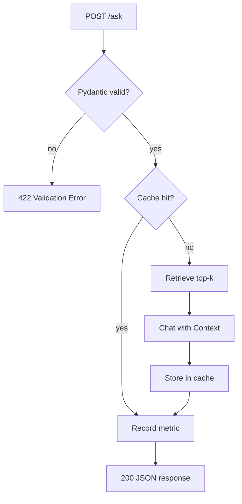

In `p7-09-mini-project-rag`, your RAG bot ran only inside a single Python script. Across Phase 8, you learned how to place Python functions behind FastAPI endpoints (`p8-01`), package services with Docker (`p8-02`), cut repeat LLM calls with caching (`p8-03`), and track latency, cost, and alerts (`p8-04`). Now you will combine all of those pieces into one testable RAG service that teammates can call, that saves money with a cache, and that warns you when it gets slow or expensive.

## 1. The plan

Every `POST /ask` request follows one clear pipeline from validation to metrics:



Each part of this mini-project builds on an earlier lesson:

| part | builds | from lesson |
|---|---|---|
| Part 1: App factory & index | `create_app(docs, client, clock)` with one-time doc embeddings and `GET /health` | new here (app factory), `p7-09-mini-project-rag` |
| Part 2: Citations & refusals | `POST /ask` with `AskRequest`, `min_score` filtering, `[n]` context, and no-LLM refusal | `p7-09-mini-project-rag`, `p8-01-fastapi` |
| Part 3: Response caching | In-memory TTL cache keyed by normalized question and `top_k` using `clock()` | `p8-03-caching` |
| Part 4: Metrics & alerts | Per-request latency/cost tracking, `GET /metrics` (`p50_ms`, `p95_ms`), and alerts | `p8-04-monitoring` |
| Part 5: Service tests | Deterministic `pytest`-style tests with `TestClient`, `FakeClock`, and `SpyClient` | `p8-01-fastapi`, `p8-03-caching` |
| Part 6: Packaging & running | Minimal `main.py` wiring, `uvicorn`, `curl`, and a production `Dockerfile` | `p8-01-fastapi`, `p8-02-docker` |

The finished service in this walkthrough exposes three endpoints:
- `GET /health` → `{"status": "ok", "docs": <int>}`
- `POST /ask` → `{"answer": str, "sources": [id, ...], "usage": {...}, "cached": bool}`
- `GET /metrics` → `{"requests": int, "cache_hit_rate": float, "p50_ms": float, "p95_ms": float, "total_cost": float, "alerts": [...]}`

> [!NOTE]
> `p50_ms` and `alerts` belong to the lesson's walkthrough version of `GET /metrics`. The two exercises extend `/ask` and use a slightly different `/metrics` schema (`error_rate` and `?last=N`).

## 2. Part 1: app factory and index

A module-level `app = FastAPI()` mixes shared state across every test that imports it. Instead, write an **app factory** `create_app(docs, client, clock)` that builds a brand-new `FastAPI()` instance each time it is called, keeping its document vectors, cache, and metric records inside the factory closure. Passing `client` and `clock` as parameters is **dependency injection** in its simplest form: tests pass `FakeLLM` and `FakeClock`, while production passes a real API client and `time.monotonic` (passed as a function object, without calling it).

Embed all documents **once** when `create_app` runs (just like ingestion in `p7-09-mini-project-rag`), rather than on every incoming request. We also reuse `FakeClock` from `p8-03-caching`, where `__call__` lets the service call `clock()` just like `time.monotonic`:

```python
from fastapi import FastAPI
from fastapi.testclient import TestClient
from pyai_llm import FakeLLM

DOCS = [
    {"id": "refunds", "text": "Refunds take 5 business days after approval. Keep your receipt."},
    {"id": "shipping", "text": "Express shipping costs 12 dollars and arrives next day. Free shipping starts at 50 dollars."},
    {"id": "warranty", "text": "Hardware warranty covers factory defects for 12 months. Water damage is excluded."},
    {"id": "support", "text": "Support agents work Monday to Friday from 9 AM to 6 PM. Urgent tickets get priority."},
    {"id": "security", "text": "Two-factor login protects your account. Password resets arrive by email."},
    {"id": "billing", "text": "Invoices are emailed right after checkout. Accepted cards include Visa."},
]


class FakeClock:
    def __init__(self, start: float = 0.0) -> None:
        self.t = start

    def __call__(self) -> float:
        return self.t

    def advance(self, seconds: float) -> None:
        self.t += seconds


class SpyClient:
    def __init__(self, inner: FakeLLM) -> None:
        self.inner = inner
        self.embed_calls = 0

    def embed(self, texts: list[str]) -> list[list[float]]:
        self.embed_calls += 1
        return self.inner.embed(texts)


def create_app(docs: list[dict], client: SpyClient, clock: FakeClock) -> FastAPI:
    app = FastAPI()
    doc_vecs = client.embed([d["text"] for d in docs])

    @app.get("/health")
    def health() -> dict[str, object]:
        return {"status": "ok", "docs": len(doc_vecs)}

    return app


spy = SpyClient(FakeLLM(embed_dim=256))
clock = FakeClock()
http = TestClient(create_app(DOCS, spy, clock))
for _ in range(3):
    r = http.get("/health")
print("health:", r.status_code, r.json())
# health: 200 {'status': 'ok', 'docs': 6}
print("embed_calls after 3 requests:", spy.embed_calls)
# embed_calls after 3 requests: 1

other = TestClient(create_app(DOCS[:2], SpyClient(FakeLLM(embed_dim=256)), FakeClock(10.0)))
print("other app:", other.get("/health").json())
# other app: {'status': 'ok', 'docs': 2}
```

Notice that `embed_calls` stays `1` after 3 requests, and `other` runs with its own `docs=2` completely isolated from `http`.

Inside retrieval, the service ranks those pre-embedded vectors against the query vector using cosine similarity. Press **Visualize** on this short block (with pure-Python vectors and no FastAPI) to watch `scored` build up before sorting the top 2 matches:

```python
import math


def dot_cosine(a: list[float], b: list[float]) -> float:
    na = math.sqrt(sum(x * x for x in a))
    nb = math.sqrt(sum(y * y for y in b))
    return round(sum(x * y for x, y in zip(a, b)) / (na * nb), 3)


docs = [
    ("refunds", [0.9, 0.2, 0.0]),
    ("shipping", [0.5, 0.8, 0.1]),
    ("warranty", [0.1, 0.2, 0.9]),
    ("billing", [0.7, 0.1, 0.2]),
]
query = [0.85, 0.25, 0.0]

scored: list[tuple[float, str]] = []
for doc_id, vec in docs:
    score = dot_cosine(query, vec)
    scored.append((score, doc_id))

ranked = sorted(scored, key=lambda item: -item[0])[:2]
for rank, (score, doc_id) in enumerate(ranked, 1):
    print(f"rank {rank}: {doc_id} -> {score}")
# rank 1: refunds -> 0.998
# rank 2: billing -> 0.952
```

Here is the full ranking trace across all 4 documents before slicing `[:2]`:

| doc | score | rank |
|---|---|---|
| `refunds` | `0.998` | `1` |
| `billing` | `0.952` | `2` |
| `shipping` | `0.744` | `3` |
| `warranty` | `0.164` | `4` |

## 3. Part 2: `POST /ask` with citations and refusals

Now add `POST /ask` validated by `AskRequest(question: 1..300 chars, top_k: 1..5 default 2)`. The handler embeds `body.question`, sorts documents by descending `cosine` (breaking ties by original index), slices `[:body.top_k]`, and drops any document with `score < min_score`.

If no hits remain, return `"I don't know based on the provided context."` with `sources: []` and zero token usage **without calling `client.chat`**. Otherwise, format `Context:\n[1] <text>...`, call `client.chat(...)`, and return `answer`, `sources` (document IDs in retrieval order), and `usage`:

```python
from fastapi import FastAPI
from fastapi.testclient import TestClient
from pyai_llm import FakeLLM, cosine
from pydantic import BaseModel, Field

DOCS = [
    {"id": "refunds", "text": "Refunds take 5 business days after approval. Keep your receipt."},
    {"id": "shipping", "text": "Express shipping costs 12 dollars and arrives next day. Free shipping starts at 50 dollars."},
    {"id": "warranty", "text": "Hardware warranty covers factory defects for 12 months. Water damage is excluded."},
    {"id": "support", "text": "Support agents work Monday to Friday from 9 AM to 6 PM. Urgent tickets get priority."},
    {"id": "security", "text": "Two-factor login protects your account. Password resets arrive by email."},
    {"id": "billing", "text": "Invoices are emailed right after checkout. Accepted cards include Visa."},
]


class SpyClient:
    def __init__(self, inner: FakeLLM) -> None:
        self.inner = inner
        self.chat_calls = 0

    def embed(self, texts: list[str]) -> list[list[float]]:
        return self.inner.embed(texts)

    def chat(self, messages: list[dict]) -> object:
        self.chat_calls += 1
        return self.inner.chat(messages)


class AskRequest(BaseModel):
    question: str = Field(min_length=1, max_length=300)
    top_k: int = Field(default=2, ge=1, le=5)


def create_app(docs: list[dict], client: SpyClient, min_score: float = 0.2) -> FastAPI:
    app = FastAPI()
    doc_vecs = client.embed([d["text"] for d in docs])

    @app.post("/ask")
    def ask(body: AskRequest) -> dict[str, object]:
        q_vec = client.embed([body.question])[0]
        scored = sorted(
            [(cosine(q_vec, dv), idx, d) for idx, (d, dv) in enumerate(zip(docs, doc_vecs, strict=True))],
            key=lambda item: (-item[0], item[1]),
        )
        hits = [d for score, _, d in scored[: body.top_k] if score >= min_score]
        if not hits:
            return {
                "answer": "I don't know based on the provided context.",
                "sources": [],
                "usage": {"prompt_tokens": 0, "completion_tokens": 0},
            }
        ctx = "\n".join(f"[{n}] {d['text']}" for n, d in enumerate(hits, 1))
        resp = client.chat([
            {"role": "system", "content": "Answer from context only.\n\nContext:\n" + ctx},
            {"role": "user", "content": body.question},
        ])
        return {
            "answer": resp.content or "",
            "sources": [d["id"] for d in hits],
            "usage": {"prompt_tokens": resp.usage.prompt_tokens, "completion_tokens": resp.usage.completion_tokens},
        }

    return app


spy = SpyClient(FakeLLM(embed_dim=256))
http = TestClient(create_app(DOCS, spy))

r1 = http.post("/ask", json={"question": "How many days do refunds take?"})
print("ok :", r1.status_code, r1.json()["sources"])
# ok : 200 ['refunds']
print("ans:", r1.json()["answer"])
# ans: Refunds take 5 business days after approval. [1]
r2 = http.post("/ask", json={"question": "Can I pay with crypto?"})
print("ref:", r2.status_code, r2.json()["sources"], "chat_calls=", spy.chat_calls)
# ref: 200 [] chat_calls= 1
r3 = http.post("/ask", json={"question": ""})
errs = [(e["loc"], e["type"]) for e in r3.json()["detail"]]
print("422:", r3.status_code, errs)
# 422: 422 [(['body', 'question'], 'string_too_short')]
```

Notice that `r2` returned `sources: []` while `chat_calls` stayed at `1`—the `min_score` gate saved an unnecessary LLM call—and `r3` failed at Pydantic validation with `422`. Passing `strict=True` to `zip(...)` ensures Python raises `ValueError` right away if `docs` and `doc_vecs` ever have mismatched lengths.

## 4. Part 3: response caching

Next, add an in-memory **TTL cache** inside `create_app` (connecting back to `p8-03-caching`). Normalize the question by stripping outer spaces and collapsing internal whitespace (`" ".join(q.strip().split())`), then build the cache key as the SHA-256 hex digest of `json.dumps({"question": clean, "top_k": body.top_k}, sort_keys=True)`. The key only needs `question` and `top_k` because the model, prompt template, and `min_score` stay fixed inside a single app instance; if you change any of those, add it to the key or bump an `index_version` field to invalidate older cached entries.

A lookup hits when `now < expires_at`, returning `cached: True` with zero token usage; once `now >= expires_at`, the entry expires and triggers a fresh retrieval:

```text
ttl = 300s
t=0   ask("How many days do refunds take?", top_k=2) -> MISS (store, exp=300)
t=10  ask("  How many days   do refunds take? ", top_k=2) -> HIT (10 < 300)
t=400 ask("How many days do refunds take?", top_k=2) -> MISS (expired, 400 >= 300)
```

In production you pass `time.monotonic` as `clock` (it never steps backward and is ideal for TTL checks); here we pass `FakeClock` so we can jump forward 380 seconds in zero real time:

```python
import hashlib
import json
from fastapi import FastAPI
from fastapi.testclient import TestClient
from pyai_llm import FakeLLM, cosine
from pydantic import BaseModel, Field

DOCS = [
    {"id": "refunds", "text": "Refunds take 5 business days after approval. Keep your receipt."},
    {"id": "shipping", "text": "Express shipping costs 12 dollars and arrives next day. Free shipping starts at 50 dollars."},
    {"id": "warranty", "text": "Hardware warranty covers factory defects for 12 months. Water damage is excluded."},
    {"id": "support", "text": "Support agents work Monday to Friday from 9 AM to 6 PM. Urgent tickets get priority."},
    {"id": "security", "text": "Two-factor login protects your account. Password resets arrive by email."},
    {"id": "billing", "text": "Invoices are emailed right after checkout. Accepted cards include Visa."},
]


class FakeClock:
    def __init__(self, start: float = 0.0) -> None:
        self.t = start

    def __call__(self) -> float:
        return self.t

    def advance(self, seconds: float) -> None:
        self.t += seconds


class SpyClient:
    def __init__(self, inner: FakeLLM) -> None:
        self.inner = inner
        self.chat_calls = 0

    def embed(self, texts: list[str]) -> list[list[float]]:
        return self.inner.embed(texts)

    def chat(self, messages: list[dict]) -> object:
        self.chat_calls += 1
        return self.inner.chat(messages)


class AskRequest(BaseModel):
    question: str = Field(min_length=1, max_length=300)
    top_k: int = Field(default=2, ge=1, le=5)


def make_key(question: str, top_k: int) -> str:
    clean = " ".join(question.strip().split())
    raw = json.dumps({"question": clean, "top_k": top_k}, sort_keys=True)
    return hashlib.sha256(raw.encode("utf-8")).hexdigest()


def create_app(docs: list[dict], client: SpyClient, clock: FakeClock, ttl: float = 300.0) -> FastAPI:
    app = FastAPI()
    doc_vecs = client.embed([d["text"] for d in docs])
    cache: dict[str, tuple[dict, float]] = {}

    @app.post("/ask")
    def ask(body: AskRequest) -> dict[str, object]:
        now = clock()
        key = make_key(body.question, body.top_k)
        entry = cache.get(key)
        if entry is not None and now < entry[1]:
            return {**entry[0], "usage": {"prompt_tokens": 0, "completion_tokens": 0}, "cached": True}

        q_vec = client.embed([body.question])[0]
        scored = sorted(
            [(cosine(q_vec, dv), idx, d) for idx, (d, dv) in enumerate(zip(docs, doc_vecs, strict=True))],
            key=lambda item: (-item[0], item[1]),
        )
        hits = [d for score, _, d in scored[: body.top_k] if score >= 0.2]
        if not hits:
            payload = {"answer": "I don't know based on the provided context.", "sources": []}
            usage = {"prompt_tokens": 0, "completion_tokens": 0}
        else:
            ctx = "\n".join(f"[{n}] {d['text']}" for n, d in enumerate(hits, 1))
            resp = client.chat([
                {"role": "system", "content": "Answer from context only.\n\nContext:\n" + ctx},
                {"role": "user", "content": body.question},
            ])
            payload = {"answer": resp.content or "", "sources": [d["id"] for d in hits]}
            usage = {"prompt_tokens": resp.usage.prompt_tokens, "completion_tokens": resp.usage.completion_tokens}
        cache[key] = (payload, clock() + ttl)
        return {**payload, "usage": usage, "cached": False}

    return app


clock = FakeClock()
spy = SpyClient(FakeLLM(embed_dim=256))
http = TestClient(create_app(DOCS, spy, clock, ttl=300.0))

for t, q, k in [
    (0, "How many days do refunds take?", 2),
    (10, "  How many days   do refunds take? ", 2),
    (20, "How many days do refunds take?", 1),
    (400, "How many days do refunds take?", 2),
]:
    clock.advance(t - clock())
    res = http.post("/ask", json={"question": q, "top_k": k}).json()
    print(f"t={int(clock()):<3} top_k={k} cached={str(res['cached']):<5} chat_calls={spy.chat_calls}")
# t=0   top_k=2 cached=False chat_calls=1
# t=10  top_k=2 cached=True  chat_calls=1
# t=20  top_k=1 cached=False chat_calls=2
# t=400 top_k=2 cached=False chat_calls=3
```

Notice how `top_k=1` at `t=20` produced a miss (`chat_calls=2`) because `top_k` is part of the cache key, and jumping to `t=400` expired the `t=0` entry (`400 >= 300`).

## 5. Part 4: metrics and `GET /metrics`

Now wrap every accepted `/ask` call with `t0 = clock()` before and `clock()` after, storing a flat metric record with `latency_ms`, `cost`, and `cached`. Note that requests failing Pydantic validation (`422`) are rejected before `/ask` executes, so they do not enter `records`. This lesson walkthrough assumes `client.chat` succeeds and does not handle model errors yet; in Exercise 2, you will add a `RateLimitError` → `503` branch that records `status="error"`. To model LLM delay deterministically without sleeping, `SlowClient.chat` advances `clock` by `0.2 + 0.002 * completion_tokens` seconds, while cache hits skip `chat()` and finish in `0.0` ms at `$0.0000` cost.

`GET /metrics` computes `requests`, `cache_hit_rate`, nearest-rank `p50_ms` and `p95_ms` (`p8-04-monitoring`), `total_cost`, and threshold `alerts`:

```python
import hashlib
import json
import math
from fastapi import FastAPI
from fastapi.testclient import TestClient
from pyai_llm import FakeLLM, cosine
from pydantic import BaseModel, Field

DOCS = [
    {"id": "refunds", "text": "Refunds take 5 business days after approval. Keep your receipt."},
    {"id": "shipping", "text": "Express shipping costs 12 dollars and arrives next day. Free shipping starts at 50 dollars."},
    {"id": "warranty", "text": "Hardware warranty covers factory defects for 12 months. Water damage is excluded."},
    {"id": "support", "text": "Support agents work Monday to Friday from 9 AM to 6 PM. Urgent tickets get priority."},
    {"id": "security", "text": "Two-factor login protects your account. Password resets arrive by email."},
    {"id": "billing", "text": "Invoices are emailed right after checkout. Accepted cards include Visa."},
]


class FakeClock:
    def __init__(self, start: float = 0.0) -> None:
        self.t = start

    def __call__(self) -> float:
        return self.t

    def advance(self, seconds: float) -> None:
        self.t += seconds


class SlowClient:
    def __init__(self, inner: FakeLLM, clock: FakeClock) -> None:
        self.inner = inner
        self.clock = clock

    def embed(self, texts: list[str]) -> list[list[float]]:
        return self.inner.embed(texts)

    def chat(self, messages: list[dict]) -> object:
        resp = self.inner.chat(messages)
        # Fixed latency formula: 0.2s base + 0.002s per completion token
        self.clock.advance(0.2 + 0.002 * resp.usage.completion_tokens)
        return resp


class AskRequest(BaseModel):
    question: str = Field(min_length=1, max_length=300)
    top_k: int = Field(default=2, ge=1, le=5)


def percentile(values: list[float], p: float) -> float:
    ordered = sorted(values)
    return ordered[math.ceil(p / 100 * len(ordered)) - 1]


def create_app(docs: list[dict], client: SlowClient, clock: FakeClock, ttl: float = 300.0) -> FastAPI:
    app = FastAPI()
    doc_vecs = client.embed([d["text"] for d in docs])
    cache: dict[str, tuple[dict, float]] = {}
    records: list[dict] = []

    @app.post("/ask")
    def ask(body: AskRequest) -> dict[str, object]:
        t0 = clock()
        clean = " ".join(body.question.strip().split())
        key = hashlib.sha256(json.dumps({"question": clean, "top_k": body.top_k}, sort_keys=True).encode("utf-8")).hexdigest()
        entry = cache.get(key)
        if entry is not None and t0 < entry[1]:
            payload, cached, p_tok, c_tok = entry[0], True, 0, 0
        else:
            cached = False
            q_vec = client.embed([body.question])[0]
            scored = sorted(
                [(cosine(q_vec, dv), idx, d) for idx, (d, dv) in enumerate(zip(docs, doc_vecs, strict=True))],
                key=lambda item: (-item[0], item[1]),
            )
            hits = [d for score, _, d in scored[: body.top_k] if score >= 0.2]
            if not hits:
                payload = {"answer": "I don't know based on the provided context.", "sources": []}
                p_tok, c_tok = 0, 0
            else:
                ctx = "\n".join(f"[{n}] {d['text']}" for n, d in enumerate(hits, 1))
                resp = client.chat([
                    {"role": "system", "content": "Answer from context only.\n\nContext:\n" + ctx},
                    {"role": "user", "content": body.question},
                ])
                payload = {"answer": resp.content or "", "sources": [d["id"] for d in hits]}
                p_tok, c_tok = resp.usage.prompt_tokens, resp.usage.completion_tokens
            cache[key] = (payload, clock() + ttl)

        latency_ms = round((clock() - t0) * 1000.0, 2)
        cost = (p_tok / 1000.0) * 0.0005 + (c_tok / 1000.0) * 0.0015
        records.append({"latency_ms": latency_ms, "cost": cost, "cached": cached})
        return {**payload, "usage": {"prompt_tokens": p_tok, "completion_tokens": c_tok}, "cached": cached}

    @app.get("/metrics")
    def metrics() -> dict[str, object]:
        total = len(records)
        if total == 0:
            return {"requests": 0, "cache_hit_rate": 0.0, "p50_ms": 0.0, "p95_ms": 0.0, "total_cost": 0.0, "alerts": []}
        lats = [r["latency_ms"] for r in records]
        hits = sum(1 for r in records if r["cached"])
        p50 = round(percentile(lats, 50), 2)
        p95 = round(percentile(lats, 95), 2)
        cost = round(sum(r["cost"] for r in records), 6)
        alerts: list[str] = []
        if p95 > 200.0:
            alerts.append(f"p95 latency {p95}ms > 200.0ms")
        if cost > 0.0001:
            alerts.append(f"daily cost ${cost:.6f} > $0.000100")
        return {"requests": total, "cache_hit_rate": round(hits / total, 4), "p50_ms": p50, "p95_ms": p95, "total_cost": cost, "alerts": alerts}

    return app


clock = FakeClock()
http = TestClient(create_app(DOCS, SlowClient(FakeLLM(embed_dim=256), clock), clock))
questions = [
    "How many days do refunds take?",
    "How much does express shipping cost?",
    "How many days do refunds take?",
    "How long is hardware warranty?",
    "How many days do refunds take?",
    "When do support agents work?",
    "How much does express shipping cost?",
    "How are invoices emailed?",
    "Can I pay with crypto?",
    "How long is hardware warranty?",
]
for q in questions:
    http.post("/ask", json={"question": q})
m = http.get("/metrics").json()
print(f"reqs={m['requests']} hit_rate={m['cache_hit_rate']} p50={m['p50_ms']} p95={m['p95_ms']} cost=${m['total_cost']:.6f}")
# reqs=10 hit_rate=0.4 p50=0.0 p95=232.0 cost=$0.000190
print("alerts:", m["alerts"])
# alerts: ['p95 latency 232.0ms > 200.0ms', 'daily cost $0.000190 > $0.000100']
```

Look at the difference between `p50` (`0.0` ms, because 4 cache hits + 1 no-LLM refusal took `0.0` ms) and `p95` (`232.0` ms, catching the slower LLM generation calls).

> [!WARNING]
> Never store raw user questions, personal data, or API keys inside metric records or logs. Logs are retained for months and shared with dashboards—record only safe fields like `latency_ms`, token counts, `cached`, or a question length/hash.

## 6. Part 5: testing the service

Because `create_app` holds no module-level state, every test can spin up a fresh `TestClient` with its own `FakeClock` and spy client so tests pass in any order. Below are 5 `pytest`-style tests verifying health, validation, refusal, cache/TTL, and metrics:

```python
import hashlib
import json
import math
from fastapi import FastAPI
from fastapi.testclient import TestClient
from pyai_llm import FakeLLM, cosine
from pydantic import BaseModel, Field

DOCS = [
    {"id": "refunds", "text": "Refunds take 5 business days after approval. Keep your receipt."},
    {"id": "shipping", "text": "Express shipping costs 12 dollars and arrives next day. Free shipping starts at 50 dollars."},
    {"id": "warranty", "text": "Hardware warranty covers factory defects for 12 months. Water damage is excluded."},
]


class FakeClock:
    def __init__(self, start: float = 0.0) -> None:
        self.t = start

    def __call__(self) -> float:
        return self.t

    def advance(self, seconds: float) -> None:
        self.t += seconds


class SlowSpyClient:
    def __init__(self, inner: FakeLLM, clock: FakeClock) -> None:
        self.inner = inner
        self.clock = clock
        self.chat_calls = 0

    def embed(self, texts: list[str]) -> list[list[float]]:
        return self.inner.embed(texts)

    def chat(self, messages: list[dict]) -> object:
        self.chat_calls += 1
        resp = self.inner.chat(messages)
        self.clock.advance(0.2 + 0.002 * resp.usage.completion_tokens)
        return resp


class AskRequest(BaseModel):
    question: str = Field(min_length=1, max_length=300)
    top_k: int = Field(default=2, ge=1, le=5)


def create_app(docs: list[dict], client: SlowSpyClient, clock: FakeClock, ttl: float = 300.0) -> FastAPI:
    app = FastAPI()
    doc_vecs = client.embed([d["text"] for d in docs])
    cache: dict[str, tuple[dict, float]] = {}
    records: list[dict] = []

    @app.get("/health")
    def health() -> dict[str, object]:
        return {"status": "ok", "docs": len(docs)}

    @app.post("/ask")
    def ask(body: AskRequest) -> dict[str, object]:
        t0 = clock()
        clean = " ".join(body.question.strip().split())
        key = hashlib.sha256(json.dumps({"question": clean, "top_k": body.top_k}, sort_keys=True).encode("utf-8")).hexdigest()
        entry = cache.get(key)
        if entry is not None and t0 < entry[1]:
            payload, cached, p_tok, c_tok = entry[0], True, 0, 0
        else:
            cached = False
            q_vec = client.embed([body.question])[0]
            scored = sorted(
                [(cosine(q_vec, dv), idx, d) for idx, (d, dv) in enumerate(zip(docs, doc_vecs, strict=True))],
                key=lambda item: (-item[0], item[1]),
            )
            hits = [d for score, _, d in scored[: body.top_k] if score >= 0.2]
            if not hits:
                payload, p_tok, c_tok = {"answer": "I don't know based on the provided context.", "sources": []}, 0, 0
            else:
                ctx = "\n".join(f"[{n}] {d['text']}" for n, d in enumerate(hits, 1))
                resp = client.chat([{"role": "system", "content": "Context:\n" + ctx}, {"role": "user", "content": body.question}])
                payload = {"answer": resp.content or "", "sources": [d["id"] for d in hits]}
                p_tok, c_tok = resp.usage.prompt_tokens, resp.usage.completion_tokens
            cache[key] = (payload, clock() + ttl)
        cost = (p_tok / 1000.0) * 0.0005 + (c_tok / 1000.0) * 0.0015
        records.append({"latency_ms": round((clock() - t0) * 1000.0, 2), "cost": cost, "cached": cached})
        return {**payload, "usage": {"prompt_tokens": p_tok, "completion_tokens": c_tok}, "cached": cached}

    @app.get("/metrics")
    def metrics() -> dict[str, object]:
        if not records:
            return {"requests": 0, "cache_hit_rate": 0.0, "p95_ms": 0.0, "total_cost": 0.0}
        lats = sorted(r["latency_ms"] for r in records)
        p95 = lats[math.ceil(0.95 * len(lats)) - 1]
        return {
            "requests": len(records),
            "cache_hit_rate": round(sum(r["cached"] for r in records) / len(records), 4),
            "p95_ms": p95,
            "total_cost": round(sum(r["cost"] for r in records), 6),
        }

    return app


def make_harness() -> tuple[TestClient, SlowSpyClient, FakeClock]:
    clock = FakeClock()
    spy = SlowSpyClient(FakeLLM(embed_dim=256), clock)
    return TestClient(create_app(DOCS, spy, clock, ttl=60.0)), spy, clock


def test_health_reports_doc_count() -> None:
    http, _, _ = make_harness()
    assert http.get("/health").json() == {"status": "ok", "docs": 3}


def test_invalid_payload_returns_422() -> None:
    http, _, _ = make_harness()
    assert http.post("/ask", json={"question": "", "top_k": 9}).status_code == 422


def test_refusal_skips_llm_call() -> None:
    http, spy, _ = make_harness()
    r = http.post("/ask", json={"question": "Can I pay with crypto?"})
    assert r.json()["sources"] == [] and spy.chat_calls == 0


def test_cache_hit_and_ttl_expiry() -> None:
    http, spy, clock = make_harness()
    assert http.post("/ask", json={"question": "How many days do refunds take?"}).json()["cached"] is False
    assert http.post("/ask", json={"question": "How many days do refunds take?"}).json()["cached"] is True
    assert spy.chat_calls == 1
    clock.advance(60.0)
    assert http.post("/ask", json={"question": "How many days do refunds take?"}).json()["cached"] is False
    assert spy.chat_calls == 2


def test_metrics_counts_and_cost() -> None:
    http, _, _ = make_harness()
    http.post("/ask", json={"question": "How many days do refunds take?"})
    http.post("/ask", json={"question": "How many days do refunds take?"})
    m = http.get("/metrics").json()
    assert m["requests"] == 2 and m["cache_hit_rate"] == 0.5 and m["total_cost"] > 0


for fn in (test_health_reports_doc_count, test_invalid_payload_returns_422, test_refusal_skips_llm_call, test_cache_hit_and_ttl_expiry, test_metrics_counts_and_cost):
    fn()
print("ok: 5 tests passed")
# ok: 5 tests passed
```

The table below maps each test function to the regression it guards against:

| test | what it protects |
|---|---|
| `test_health_reports_doc_count` | Startup document indexing finished and `/health` reports the expected doc count |
| `test_invalid_payload_returns_422` | Pydantic rejects empty questions or out-of-range `top_k` before retrieval runs |
| `test_refusal_skips_llm_call` | Low-score queries return `"I don't know..."` and `sources: []` with zero `chat` calls |
| `test_cache_hit_and_ttl_expiry` | Repeated normalized questions hit cache without `chat()`, and expire once `clock() >= expires_at` |
| `test_metrics_counts_and_cost` | `/metrics` sums requests, `cache_hit_rate`, and `total_cost` across hits and misses |

> [!TIP]
> Put your `create_app(...)` setup inside a `@pytest.fixture` in `test_app.py` so every test receives a clean `TestClient` with an empty cache and zero metrics, regardless of test execution order.

## 7. Part 6: packaging and running for real

To run the service outside tests, `main.py` only needs a few wiring lines defining `DOCS`, creating `real_client`, and calling `app = create_app(DOCS, real_client, time.monotonic)`, passing `time.monotonic` as the clock callable without calling it. In your terminal, start `uvicorn` and test `/ask` with `curl`:

```bash
# main.py wires: app = create_app(DOCS, real_client, time.monotonic)
uv run uvicorn main:app --reload
curl -X POST http://127.0.0.1:8000/ask -H "Content-Type: application/json" -d "{\"question\": \"How many days do refunds take?\"}"
```

Pair `main.py` with a clean `Dockerfile` following every rule from `p8-02-docker`—a pinned base tag, `requirements.txt` installed before `COPY . .`, no `.env` copied into the image, and `CMD` binding `0.0.0.0`:

```dockerfile
FROM python:3.13-slim
WORKDIR /app
COPY requirements.txt .
RUN pip install --no-cache-dir -r requirements.txt
COPY . .
EXPOSE 8000
CMD ["uvicorn", "main:app", "--host", "0.0.0.0", "--port", "8000"]
```

Pass secrets like API keys at container startup with `docker run --env-file .env -p 8000:8000 rag-service`, and exclude `.env` and `.venv/` in `.dockerignore`.

## 8. Common mistakes

**1. Putting `app` and `cache` at module level**

When `app` and `cache` live at module level, test 1 populates `cache` and test 2 sees `cached: True` on its very first request. Fix: create both inside `create_app(...)`.

```python
from fastapi import FastAPI
from fastapi.testclient import TestClient

# Wrong: module-level app and cache leak between tests
bad_app = FastAPI()
bad_cache: dict[str, str] = {}


@bad_app.post("/ask")
def bad_ask(body: dict) -> dict[str, object]:
    q = body["question"]
    if q in bad_cache:
        return {"answer": bad_cache[q], "cached": True}
    bad_cache[q] = "Refunds take 5 days."
    return {"answer": bad_cache[q], "cached": False}


# Simulated test 1 populates module-level bad_cache
TestClient(bad_app).post("/ask", json={"question": "Refunds?"})
# Simulated "new test 2" hits stale state from test 1
r_bad = TestClient(bad_app).post("/ask", json={"question": "Refunds?"}).json()
print("module-level test 2 cached:", r_bad["cached"])
# module-level test 2 cached: True


# Fix: app factory creates isolated app and cache for each test
def create_app() -> FastAPI:
    app = FastAPI()
    cache: dict[str, str] = {}

    @app.post("/ask")
    def ask(body: dict) -> dict[str, object]:
        q = body["question"]
        if q in cache:
            return {"answer": cache[q], "cached": True}
        cache[q] = "Refunds take 5 days."
        return {"answer": cache[q], "cached": False}

    return app


TestClient(create_app()).post("/ask", json={"question": "Refunds?"})
r_good = TestClient(create_app()).post("/ask", json={"question": "Refunds?"}).json()
print("app-factory test 2 cached:", r_good["cached"])
# app-factory test 2 cached: False
```

**2. Re-embedding all documents on every `/ask` request**

Calling `client.embed(DOCS)` inside the request handler makes `embed_calls` grow by 2 on every single request (`2, 4, 6`) instead of indexing the corpus once at startup. Fix: embed `DOCS` once inside `create_app` and embed only the incoming question on `/ask`.

```python
from fastapi import FastAPI
from fastapi.testclient import TestClient
from pyai_llm import FakeLLM

DOCS = ["Refunds take 5 days.", "Shipping costs 12 dollars.", "Warranty is 12 months."]


class CountingClient:
    def __init__(self, inner: FakeLLM) -> None:
        self.inner = inner
        self.embed_calls = 0

    def embed(self, texts: list[str]) -> list[list[float]]:
        self.embed_calls += 1
        return self.inner.embed(texts)


# Wrong: embedding all DOCS inside every /ask request
bad_client = CountingClient(FakeLLM(embed_dim=64))
bad_app = FastAPI()


@bad_app.post("/ask")
def bad_ask(body: dict) -> dict[str, int]:
    _ = bad_client.embed(DOCS)
    _ = bad_client.embed([body["question"]])
    return {"ok": 1}


http_bad = TestClient(bad_app)
for i in range(1, 4):
    http_bad.post("/ask", json={"question": "Refunds?"})
    print(f"wrong after req {i}: embed_calls={bad_client.embed_calls}")
# wrong after req 1: embed_calls=2
# wrong after req 2: embed_calls=4
# wrong after req 3: embed_calls=6


# Fix: embed DOCS once inside create_app, embed only the query per request
def create_app(docs: list[str], client: CountingClient) -> FastAPI:
    app = FastAPI()
    _doc_vecs = client.embed(docs)

    @app.post("/ask")
    def ask(body: dict) -> dict[str, int]:
        _ = client.embed([body["question"]])
        return {"ok": len(_doc_vecs)}

    return app


good_client = CountingClient(FakeLLM(embed_dim=64))
http_good = TestClient(create_app(DOCS, good_client))
for i in range(1, 4):
    http_good.post("/ask", json={"question": "Refunds?"})
print(f"fixed after 3 reqs: embed_calls={good_client.embed_calls}")
# fixed after 3 reqs: embed_calls=4
```

**3. Omitting `top_k` from the cache key**

If the key only hashes the normalized question, a request with `top_k=1` collides with an earlier `top_k=3` request and returns 3 sources instead of 1. Fix: include `top_k` inside the JSON payload before hashing.

```python
import hashlib
import json


def bad_key(question: str) -> str:
    clean = " ".join(question.strip().split())
    return hashlib.sha256(clean.encode("utf-8")).hexdigest()


def good_key(question: str, top_k: int) -> str:
    clean = " ".join(question.strip().split())
    raw = json.dumps({"question": clean, "top_k": top_k}, sort_keys=True)
    return hashlib.sha256(raw.encode("utf-8")).hexdigest()


bad_cache: dict[str, list[str]] = {}
bad_cache[bad_key("Refunds?")] = ["refunds", "billing", "shipping"]
# Wrong: top_k=1 collides with top_k=3 and returns 3 sources
print("wrong top_k=1 sources:", bad_cache[bad_key("Refunds?")])
# wrong top_k=1 sources: ['refunds', 'billing', 'shipping']

good_cache: dict[str, list[str]] = {}
good_cache[good_key("Refunds?", 3)] = ["refunds", "billing", "shipping"]
print("fixed top_k=1 hit?:", good_key("Refunds?", 1) in good_cache)
# fixed top_k=1 hit?: False
```

**4. Skipping cache hits or errors when recording metrics**

Logging metrics only after a fresh, successful LLM call hides cache hits (`hit_rate` drops to `0.0`) and hides slow failures (`p95` misses the `1500.0` ms spike). Fix: record every accepted `/ask` request, including cache hits and errors. You will implement this exact pattern in Exercise 2 by recording `status="error"` whenever `RateLimitError` triggers a `503`.

```python
import math


def percentile(values: list[float], p: float) -> float:
    ordered = sorted(values)
    return ordered[math.ceil(p / 100 * len(ordered)) - 1]


events = [
    {"latency_ms": 230.0, "cached": False, "status": "ok"},
    {"latency_ms": 0.0, "cached": True, "status": "ok"},
    {"latency_ms": 0.0, "cached": True, "status": "ok"},
    {"latency_ms": 1500.0, "cached": False, "status": "error"},
]

# Wrong: recording only non-cached ok requests hides cache hits and slow errors
wrong = [e for e in events if not e["cached"] and e["status"] == "ok"]
wrong_hit = sum(1 for e in wrong if e["cached"]) / len(wrong)
wrong_p95 = percentile([e["latency_ms"] for e in wrong], 95)
print(f"wrong count={len(wrong)} hit_rate={wrong_hit} p95={wrong_p95}")
# wrong count=1 hit_rate=0.0 p95=230.0

# Fix: record every accepted request (misses, cache hits, and errors)
fixed_hit = sum(1 for e in events if e["cached"]) / len(events)
fixed_p95 = percentile([e["latency_ms"] for e in events], 95)
print(f"fixed count={len(events)} hit_rate={fixed_hit} p95={fixed_p95}")
# fixed count=4 hit_rate=0.5 p95=1500.0
```

## Recap

- An **app factory** (`create_app(docs, client, clock)`) keeps index, cache, and metrics local to each instance and injects the LLM client and clock so tests run deterministically in any order.
- Embed the document corpus **once** at startup, and short-circuit low-similarity queries (`score < min_score`) with `"I don't know..."` and `sources: []` before calling `chat()`.
- Key the TTL cache on `sha256` of sorted JSON containing both the normalized question and `top_k` (and `index_version` when docs change), expiring entries when `clock() >= expires_at`.
- Record latency, token cost, and `cached` for every accepted `/ask` request (never logging raw user questions) so `GET /metrics` computes accurate `cache_hit_rate` and `p95_ms`—in this walkthrough, `/metrics` also returns `p50_ms` and `alerts`, while Exercise 2 extends `/metrics` with `error_rate` and `?last=N`.
- Ship the service by wiring `main.py` with `time.monotonic`, serving with `uvicorn`, and building a layered `Dockerfile` that never bakes `.env` secrets into the image.

## Take it further

Once both exercises pass, try extending your RAG service toward real production deployments:
- **Swap `FakeLLM` for a real API client**: load your provider key from `.env` using `pydantic-settings` (never commit or print keys) and inject the real client into `create_app` in `main.py`.
- **Move the TTL cache to Redis**: when you scale to multiple `uvicorn` workers, an in-memory dictionary stays local per worker, whereas a shared Redis cache lets all workers share hits.
- **Export metrics to OpenTelemetry**: replace the in-memory `records` list with OpenTelemetry counters and histograms so metrics survive container restarts and feed Grafana dashboards.
- **Add rate limiting**: place a per-IP or per-user request limit in front of `/ask` so a single misbehaving script cannot exhaust your daily token budget.
