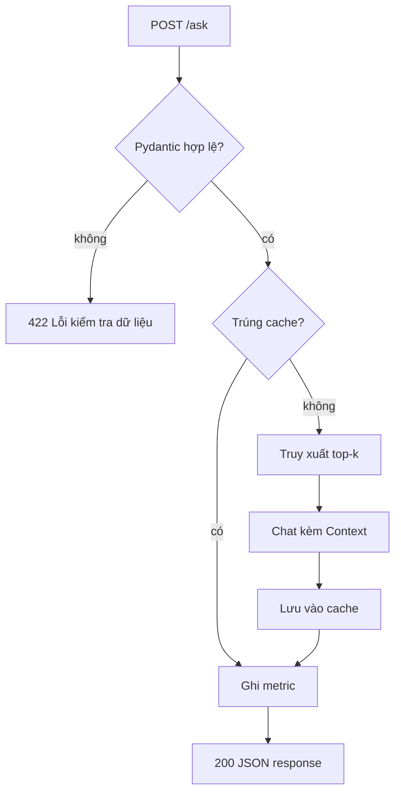

Ở bài `p7-09-mini-project-rag`, bot RAG của bạn mới chỉ chạy trong một script Python đơn lẻ. Sang Phase 8, bạn đã học cách đưa hàm lên HTTP với FastAPI (`p8-01`), đóng gói bằng Docker (`p8-02`), giảm gọi LLM lặp lại bằng cache (`p8-03`) và theo dõi độ trễ, chi phí cùng cảnh báo (`p8-04`). Giờ bạn ghép toàn bộ các mảnh đó thành một dịch vụ RAG chạy được và kiểm thử được—để đồng đội gọi qua HTTP, rẻ hơn nhờ cache, và tự cảnh báo khi chậm hay tốn tiền.

## 1. Kế hoạch

Mỗi request `POST /ask` đi qua một pipeline thống nhất từ bước kiểm dữ liệu đến bước ghi metric:



Từng phần trong mini-project này nối trực tiếp với các bài bạn đã học:

| part | phần xây dựng | từ bài |
|---|---|---|
| Part 1: App factory & chỉ mục | `create_app(docs, client, clock)` embed tài liệu một lần và `GET /health` | `p7-09-mini-project-rag`, `p8-01-fastapi` |
| Part 2: Trích nguồn & từ chối | `POST /ask` với `AskRequest`, lọc `min_score`, prompt `[n]` và từ chối không gọi LLM | `p7-09-mini-project-rag`, `p8-01-fastapi` |
| Part 3: Cache phản hồi | TTL cache trong bộ nhớ dùng key gồm câu hỏi chuẩn hóa và `top_k` với `clock()` | `p8-03-caching` |
| Part 4: Metric & cảnh báo | Đo độ trễ/chi phí từng request, `GET /metrics` (`p50_ms`, `p95_ms`) và cảnh báo | `p8-04-monitoring` |
| Part 5: Kiểm thử dịch vụ | Các bài test tất định kiểu `pytest` với `TestClient`, `FakeClock` và `SpyClient` | `p8-01-fastapi`, `p8-03-caching` |
| Part 6: Đóng gói & chạy thật | File `main.py` một dòng, `uvicorn`, `curl` và `Dockerfile` chuẩn production | `p8-01-fastapi`, `p8-02-docker` |

Dịch vụ hoàn chỉnh cung cấp ba endpoint:
- `GET /health` → `{"status": "ok", "docs": <int>}`
- `POST /ask` → `{"answer": str, "sources": [id, ...], "usage": {...}, "cached": bool}`
- `GET /metrics` → `{"requests": int, "cache_hit_rate": float, "p50_ms": float, "p95_ms": float, "total_cost": float, "alerts": [...]}`

## 2. Part 1: app factory và chỉ mục

Viết `app = FastAPI()` ở cấp module làm các bài test dùng chung trạng thái và dễ làm hỏng nhau. Thay vào đó, hãy dùng **app factory** (hàm tạo app) `create_app(docs, client, clock)` trả về một `FastAPI()` mới mỗi lần gọi, giữ toàn bộ vector tài liệu, cache và danh sách metric bên trong closure. Việc truyền `client` và `clock` qua tham số chính là **dependency injection** (tiêm phụ thuộc) ở dạng đơn giản nhất: khi test ta truyền `FakeLLM` và `FakeClock`, còn ở production bạn truyền API client thật và `time.monotonic` (truyền hàm, không gọi).

Hãy embed toàn bộ tài liệu **một lần** ngay khi tạo app (nối lại bước nạp dữ liệu ở `p7-09-mini-project-rag`), thay vì embed lại ở mỗi request:

```python
from fastapi import FastAPI
from fastapi.testclient import TestClient
from pyai_llm import FakeLLM

DOCS = [
    {"id": "refunds", "text": "Refunds take 5 business days after approval. Keep your receipt."},
    {"id": "shipping", "text": "Express shipping costs 12 dollars and arrives next day. Free shipping starts at 50 dollars."},
    {"id": "warranty", "text": "Hardware warranty covers factory defects for 12 months. Water damage is excluded."},
    {"id": "support", "text": "Support agents work Monday to Friday from 9 AM to 6 PM. Urgent tickets get priority."},
    {"id": "security", "text": "Two-factor login protects your account. Password resets arrive by email."},
    {"id": "billing", "text": "Invoices are emailed right after checkout. Accepted cards include Visa."},
]


class FakeClock:
    def __init__(self, start: float = 0.0) -> None:
        self.now = start

    def __call__(self) -> float:
        return self.now

    def advance(self, seconds: float) -> None:
        self.now += seconds


class SpyClient:
    def __init__(self, inner: FakeLLM) -> None:
        self.inner = inner
        self.embed_calls = 0

    def embed(self, texts: list[str]) -> list[list[float]]:
        self.embed_calls += 1
        return self.inner.embed(texts)


def create_app(docs: list[dict], client: SpyClient, clock: FakeClock) -> FastAPI:
    app = FastAPI()
    doc_vecs = client.embed([d["text"] for d in docs])

    @app.get("/health")
    def health() -> dict[str, object]:
        return {"status": "ok", "docs": len(doc_vecs), "t": clock()}

    return app


spy = SpyClient(FakeLLM(embed_dim=256))
clock = FakeClock()
http = TestClient(create_app(DOCS, spy, clock))
for _ in range(3):
    r = http.get("/health")
print("health:", r.status_code, r.json())
# health: 200 {'status': 'ok', 'docs': 6, 't': 0.0}
print("embed_calls after 3 requests:", spy.embed_calls)
# embed_calls after 3 requests: 1

other = TestClient(create_app(DOCS[:2], SpyClient(FakeLLM(embed_dim=256)), FakeClock(10.0)))
print("other app:", other.get("/health").json())
# other app: {'status': 'ok', 'docs': 2, 't': 10.0}
```

Bạn thấy `embed_calls` vẫn là `1` sau 3 request, và `other` chạy với `docs=2`, `t=10.0` hoàn toàn tách biệt khỏi `http`.

Ở bước truy xuất, dịch vụ xếp hạng các vector đã embed sẵn theo độ tương đồng cosine với vector câu hỏi. Bấm **Visualize** ở khối code ngắn này (chỉ dùng vector viết tay, không dùng FastAPI) để xem `scored` được tạo trước khi cắt top 2:

```python
import math


def dot_cosine(a: list[float], b: list[float]) -> float:
    na = math.sqrt(sum(x * x for x in a))
    nb = math.sqrt(sum(y * y for y in b))
    return round(sum(x * y for x, y in zip(a, b)) / (na * nb), 3)


docs = [
    ("refunds", [0.9, 0.2, 0.0]),
    ("shipping", [0.5, 0.8, 0.1]),
    ("warranty", [0.1, 0.2, 0.9]),
    ("billing", [0.7, 0.1, 0.2]),
]
query = [0.85, 0.25, 0.0]

scored: list[tuple[float, str]] = []
for doc_id, vec in docs:
    score = dot_cosine(query, vec)
    scored.append((score, doc_id))

ranked = sorted(scored, key=lambda item: -item[0])[:2]
for rank, (score, doc_id) in enumerate(ranked, 1):
    print(f"rank {rank}: {doc_id} -> {score}")
# rank 1: refunds -> 0.998
# rank 2: billing -> 0.952
```

Bảng theo dõi dưới đây cho thấy điểm số của cả 4 tài liệu trước khi lấy `[:2]`:

| doc | score | rank |
|---|---|---|
| `refunds` | `0.998` | `1` |
| `billing` | `0.952` | `2` |
| `shipping` | `0.744` | `3` |
| `warranty` | `0.164` | `4` |

## 3. Part 2: `POST /ask` có trích nguồn và từ chối

Giờ thêm route `POST /ask` dùng `AskRequest(question: 1..300 ký tự, top_k: 1..5 mặc định 2)`. Hàm xử lý embed `body.question`, xếp tài liệu theo `cosine` giảm dần (hòa thì giữ thứ tự gốc), lấy `[:body.top_k]` rồi loại những tài liệu có `score < min_score`.

Nếu không còn tài liệu nào đạt ngưỡng, trả về `"I don't know based on the provided context."` cùng `sources: []` và usage `0/0`, **không gọi `client.chat`**. Ngược lại, dựng `Context:\n[1] <text>...`, gọi `client.chat(...)` rồi trả về `answer`, `sources` (danh sách ID theo thứ tự truy xuất) và `usage`:

```python
from fastapi import FastAPI
from fastapi.testclient import TestClient
from pyai_llm import FakeLLM, cosine
from pydantic import BaseModel, Field

DOCS = [
    {"id": "refunds", "text": "Refunds take 5 business days after approval. Keep your receipt."},
    {"id": "shipping", "text": "Express shipping costs 12 dollars and arrives next day. Free shipping starts at 50 dollars."},
    {"id": "warranty", "text": "Hardware warranty covers factory defects for 12 months. Water damage is excluded."},
    {"id": "support", "text": "Support agents work Monday to Friday from 9 AM to 6 PM. Urgent tickets get priority."},
    {"id": "security", "text": "Two-factor login protects your account. Password resets arrive by email."},
    {"id": "billing", "text": "Invoices are emailed right after checkout. Accepted cards include Visa."},
]


class SpyClient:
    def __init__(self, inner: FakeLLM) -> None:
        self.inner = inner
        self.chat_calls = 0

    def embed(self, texts: list[str]) -> list[list[float]]:
        return self.inner.embed(texts)

    def chat(self, messages: list[dict]) -> object:
        self.chat_calls += 1
        return self.inner.chat(messages)


class AskRequest(BaseModel):
    question: str = Field(min_length=1, max_length=300)
    top_k: int = Field(default=2, ge=1, le=5)


def create_app(docs: list[dict], client: SpyClient, min_score: float = 0.2) -> FastAPI:
    app = FastAPI()
    doc_vecs = client.embed([d["text"] for d in docs])

    @app.post("/ask")
    def ask(body: AskRequest) -> dict[str, object]:
        q_vec = client.embed([body.question])[0]
        scored = sorted(
            [(cosine(q_vec, dv), idx, d) for idx, (d, dv) in enumerate(zip(docs, doc_vecs))],
            key=lambda item: (-item[0], item[1]),
        )
        hits = [d for score, _, d in scored[: body.top_k] if score >= min_score]
        if not hits:
            return {
                "answer": "I don't know based on the provided context.",
                "sources": [],
                "usage": {"prompt_tokens": 0, "completion_tokens": 0},
            }
        ctx = "\n".join(f"[{n}] {d['text']}" for n, d in enumerate(hits, 1))
        resp = client.chat([
            {"role": "system", "content": "Answer from context only.\n\nContext:\n" + ctx},
            {"role": "user", "content": body.question},
        ])
        return {
            "answer": resp.content or "",
            "sources": [d["id"] for d in hits],
            "usage": {"prompt_tokens": resp.usage.prompt_tokens, "completion_tokens": resp.usage.completion_tokens},
        }

    return app


spy = SpyClient(FakeLLM(embed_dim=256))
http = TestClient(create_app(DOCS, spy))

r1 = http.post("/ask", json={"question": "How many days do refunds take?"})
print("ok :", r1.status_code, r1.json()["sources"])
# ok : 200 ['refunds']
print("ans:", r1.json()["answer"])
# ans: Refunds take 5 business days after approval. [1]
r2 = http.post("/ask", json={"question": "Can I pay with crypto?"})
print("ref:", r2.status_code, r2.json()["sources"], "chat_calls=", spy.chat_calls)
# ref: 200 [] chat_calls= 1
r3 = http.post("/ask", json={"question": ""})
errs = [(e["loc"], e["type"]) for e in r3.json()["detail"]]
print("422:", r3.status_code, errs)
# 422: 422 [(['body', 'question'], 'string_too_short')]
```

Để ý `r2` trả `sources: []` mà `chat_calls` vẫn là `1`—ngưỡng `min_score` đã chặn được một lượt gọi LLM thừa—còn `r3` bị Pydantic trả lỗi `422` ngay ở cửa vào.

## 4. Part 3: cache phản hồi

Tiếp theo, thêm một **TTL cache** (bộ nhớ đệm có thời hạn) trong `create_app` (nối với `p8-03-caching`). Chuẩn hóa câu hỏi bằng cách bỏ khoảng trắng đầu/cuối và gộp khoảng trắng liên tiếp (`" ".join(q.strip().split())`), rồi tạo cache key bằng mã băm SHA-256 của `json.dumps({"question": clean, "top_k": body.top_k}, sort_keys=True)`. Bạn cũng có thể thêm `index_version` vào key để vô hiệu hóa toàn bộ cache cũ ngay khi bộ tài liệu thay đổi.

Lần tra cứu trúng cache (**cache hit**) khi `now < expires_at`, trả về `cached: True` với usage `0/0`; khi `now >= expires_at`, mục cũ hết hạn và hệ thống truy xuất lại từ đầu:

```text
ttl = 300s
t=0   ask("How many days do refunds take?", top_k=2) -> MISS (store, exp=300)
t=10  ask("  How many days   do refunds take? ", top_k=2) -> HIT (10 < 300)
t=400 ask("How many days do refunds take?", top_k=2) -> MISS (expired, 400 >= 300)
```

Ở production bạn truyền `time.monotonic` làm `clock`; ở đây ta tiêm `FakeClock` để nhảy trước 380 giây ngay lập tức:

```python
import hashlib
import json
from fastapi import FastAPI
from fastapi.testclient import TestClient
from pyai_llm import FakeLLM, cosine
from pydantic import BaseModel, Field

DOCS = [
    {"id": "refunds", "text": "Refunds take 5 business days after approval. Keep your receipt."},
    {"id": "shipping", "text": "Express shipping costs 12 dollars and arrives next day. Free shipping starts at 50 dollars."},
    {"id": "warranty", "text": "Hardware warranty covers factory defects for 12 months. Water damage is excluded."},
    {"id": "support", "text": "Support agents work Monday to Friday from 9 AM to 6 PM. Urgent tickets get priority."},
    {"id": "security", "text": "Two-factor login protects your account. Password resets arrive by email."},
    {"id": "billing", "text": "Invoices are emailed right after checkout. Accepted cards include Visa."},
]


class FakeClock:
    def __init__(self, start: float = 0.0) -> None:
        self.now = start

    def __call__(self) -> float:
        return self.now

    def advance(self, seconds: float) -> None:
        self.now += seconds


class SpyClient:
    def __init__(self, inner: FakeLLM) -> None:
        self.inner = inner
        self.chat_calls = 0

    def embed(self, texts: list[str]) -> list[list[float]]:
        return self.inner.embed(texts)

    def chat(self, messages: list[dict]) -> object:
        self.chat_calls += 1
        return self.inner.chat(messages)


class AskRequest(BaseModel):
    question: str = Field(min_length=1, max_length=300)
    top_k: int = Field(default=2, ge=1, le=5)


def make_key(question: str, top_k: int) -> str:
    clean = " ".join(question.strip().split())
    raw = json.dumps({"question": clean, "top_k": top_k}, sort_keys=True)
    return hashlib.sha256(raw.encode("utf-8")).hexdigest()


def create_app(docs: list[dict], client: SpyClient, clock: FakeClock, ttl: float = 300.0) -> FastAPI:
    app = FastAPI()
    doc_vecs = client.embed([d["text"] for d in docs])
    cache: dict[str, tuple[dict, float]] = {}

    @app.post("/ask")
    def ask(body: AskRequest) -> dict[str, object]:
        now = clock()
        key = make_key(body.question, body.top_k)
        entry = cache.get(key)
        if entry is not None and now < entry[1]:
            return {**entry[0], "usage": {"prompt_tokens": 0, "completion_tokens": 0}, "cached": True}

        q_vec = client.embed([body.question])[0]
        scored = sorted(
            [(cosine(q_vec, dv), idx, d) for idx, (d, dv) in enumerate(zip(docs, doc_vecs))],
            key=lambda item: (-item[0], item[1]),
        )
        hits = [d for score, _, d in scored[: body.top_k] if score >= 0.2]
        if not hits:
            payload = {"answer": "I don't know based on the provided context.", "sources": []}
            usage = {"prompt_tokens": 0, "completion_tokens": 0}
        else:
            ctx = "\n".join(f"[{n}] {d['text']}" for n, d in enumerate(hits, 1))
            resp = client.chat([
                {"role": "system", "content": "Answer from context only.\n\nContext:\n" + ctx},
                {"role": "user", "content": body.question},
            ])
            payload = {"answer": resp.content or "", "sources": [d["id"] for d in hits]}
            usage = {"prompt_tokens": resp.usage.prompt_tokens, "completion_tokens": resp.usage.completion_tokens}
        cache[key] = (payload, clock() + ttl)
        return {**payload, "usage": usage, "cached": False}

    return app


clock = FakeClock()
spy = SpyClient(FakeLLM(embed_dim=256))
http = TestClient(create_app(DOCS, spy, clock, ttl=300.0))

for t, q, k in [
    (0, "How many days do refunds take?", 2),
    (10, "  How many days   do refunds take? ", 2),
    (20, "How many days do refunds take?", 1),
    (400, "How many days do refunds take?", 2),
]:
    clock.advance(t - clock())
    res = http.post("/ask", json={"question": q, "top_k": k}).json()
    print(f"t={int(clock()):<3} top_k={k} cached={str(res['cached']):<5} chat_calls={spy.chat_calls}")
# t=0   top_k=2 cached=False chat_calls=1
# t=10  top_k=2 cached=True  chat_calls=1
# t=20  top_k=1 cached=False chat_calls=2
# t=400 top_k=2 cached=False chat_calls=3
```

Bạn thấy ở `t=20`, việc đổi sang `top_k=1` gây trượt cache (`chat_calls=2`) vì `top_k` nằm trong cache key, và nhảy tới `t=400` làm mục lưu ở `t=0` hết hạn (`400 >= 300`).

## 5. Part 4: metric và `GET /metrics`

Giờ đo `t0 = clock()` trước và `clock()` sau mỗi request `/ask` hợp lệ, ghi lại bản ghi gồm `latency_ms`, số token, `cost`, `cached` và `status`. Lưu ý các request lỗi Pydantic (`422`) bị chặn trước khi vào hàm xử lý `/ask` nên không nằm trong `records`. Để mô phỏng độ trễ LLM tất định mà không cần ngủ thật, `SlowClient.chat` cộng thêm `0.2 + 0.002 * completion_tokens` giây vào `clock`, còn các lượt trúng cache bỏ qua `chat()` nên độ trễ là `0.0` ms và chi phí `$0.0000`.

Route `GET /metrics` tính `requests`, `cache_hit_rate`, `p50_ms` và `p95_ms` theo phương pháp **nearest-rank** (`p8-04-monitoring`), `total_cost` và danh sách `alerts`:

```python
import hashlib
import json
import math
from fastapi import FastAPI
from fastapi.testclient import TestClient
from pyai_llm import FakeLLM, cosine
from pydantic import BaseModel, Field

DOCS = [
    {"id": "refunds", "text": "Refunds take 5 business days after approval. Keep your receipt."},
    {"id": "shipping", "text": "Express shipping costs 12 dollars and arrives next day. Free shipping starts at 50 dollars."},
    {"id": "warranty", "text": "Hardware warranty covers factory defects for 12 months. Water damage is excluded."},
    {"id": "support", "text": "Support agents work Monday to Friday from 9 AM to 6 PM. Urgent tickets get priority."},
    {"id": "security", "text": "Two-factor login protects your account. Password resets arrive by email."},
    {"id": "billing", "text": "Invoices are emailed right after checkout. Accepted cards include Visa."},
]


class FakeClock:
    def __init__(self, start: float = 0.0) -> None:
        self.now = start

    def __call__(self) -> float:
        return self.now

    def advance(self, seconds: float) -> None:
        self.now += seconds


class SlowClient:
    def __init__(self, inner: FakeLLM, clock: FakeClock) -> None:
        self.inner = inner
        self.clock = clock

    def embed(self, texts: list[str]) -> list[list[float]]:
        return self.inner.embed(texts)

    def chat(self, messages: list[dict]) -> object:
        resp = self.inner.chat(messages)
        # Công thức độ trễ cố định: 0.2 giây nền + 0.002 giây mỗi token đầu ra
        self.clock.advance(0.2 + 0.002 * resp.usage.completion_tokens)
        return resp


class AskRequest(BaseModel):
    question: str = Field(min_length=1, max_length=300)
    top_k: int = Field(default=2, ge=1, le=5)


def percentile(values: list[float], p: float) -> float:
    ordered = sorted(values)
    return ordered[math.ceil(p / 100 * len(ordered)) - 1]


def create_app(docs: list[dict], client: SlowClient, clock: FakeClock, ttl: float = 300.0) -> FastAPI:
    app = FastAPI()
    doc_vecs = client.embed([d["text"] for d in docs])
    cache: dict[str, tuple[dict, float]] = {}
    records: list[dict] = []

    @app.post("/ask")
    def ask(body: AskRequest) -> dict[str, object]:
        t0 = clock()
        clean = " ".join(body.question.strip().split())
        key = hashlib.sha256(json.dumps({"question": clean, "top_k": body.top_k}, sort_keys=True).encode("utf-8")).hexdigest()
        entry = cache.get(key)
        if entry is not None and t0 < entry[1]:
            payload, cached, p_tok, c_tok = entry[0], True, 0, 0
        else:
            cached = False
            q_vec = client.embed([body.question])[0]
            scored = sorted(
                [(cosine(q_vec, dv), idx, d) for idx, (d, dv) in enumerate(zip(docs, doc_vecs))],
                key=lambda item: (-item[0], item[1]),
            )
            hits = [d for score, _, d in scored[: body.top_k] if score >= 0.2]
            if not hits:
                payload = {"answer": "I don't know based on the provided context.", "sources": []}
                p_tok, c_tok = 0, 0
            else:
                ctx = "\n".join(f"[{n}] {d['text']}" for n, d in enumerate(hits, 1))
                resp = client.chat([
                    {"role": "system", "content": "Answer from context only.\n\nContext:\n" + ctx},
                    {"role": "user", "content": body.question},
                ])
                payload = {"answer": resp.content or "", "sources": [d["id"] for d in hits]}
                p_tok, c_tok = resp.usage.prompt_tokens, resp.usage.completion_tokens
            cache[key] = (payload, clock() + ttl)

        latency_ms = round((clock() - t0) * 1000.0, 2)
        cost = (p_tok / 1000.0) * 0.0005 + (c_tok / 1000.0) * 0.0015
        records.append({"latency_ms": latency_ms, "cost": cost, "cached": cached, "status": "ok"})
        return {**payload, "usage": {"prompt_tokens": p_tok, "completion_tokens": c_tok}, "cached": cached}

    @app.get("/metrics")
    def metrics() -> dict[str, object]:
        total = len(records)
        if total == 0:
            return {"requests": 0, "cache_hit_rate": 0.0, "p50_ms": 0.0, "p95_ms": 0.0, "total_cost": 0.0, "alerts": []}
        lats = [r["latency_ms"] for r in records]
        hits = sum(1 for r in records if r["cached"])
        p50 = round(percentile(lats, 50), 2)
        p95 = round(percentile(lats, 95), 2)
        cost = round(sum(r["cost"] for r in records), 6)
        alerts: list[str] = []
        if p95 > 200.0:
            alerts.append(f"p95 latency {p95}ms > 200.0ms")
        if cost > 0.0001:
            alerts.append(f"daily cost ${cost:.6f} > $0.000100")
        return {"requests": total, "cache_hit_rate": round(hits / total, 4), "p50_ms": p50, "p95_ms": p95, "total_cost": cost, "alerts": alerts}

    return app


clock = FakeClock()
http = TestClient(create_app(DOCS, SlowClient(FakeLLM(embed_dim=256), clock), clock))
questions = [
    "How many days do refunds take?",
    "How much does express shipping cost?",
    "How many days do refunds take?",
    "How long is hardware warranty?",
    "How many days do refunds take?",
    "When do support agents work?",
    "How much does express shipping cost?",
    "How are invoices emailed?",
    "Can I pay with crypto?",
    "How long is hardware warranty?",
]
for q in questions:
    http.post("/ask", json={"question": q})
m = http.get("/metrics").json()
print(f"reqs={m['requests']} hit_rate={m['cache_hit_rate']} p50={m['p50_ms']} p95={m['p95_ms']} cost=${m['total_cost']:.6f}")
# reqs=10 hit_rate=0.4 p50=0.0 p95=232.0 cost=$0.000190
print("alerts:", m["alerts"])
# alerts: ['p95 latency 232.0ms > 200.0ms', 'daily cost $0.000190 > $0.000100']
```

Hãy nhìn sự khác biệt giữa `p50` (`0.0` ms nhờ 4 lượt trúng cache và 1 lượt từ chối không gọi LLM) và `p95` (`232.0` ms bắt được các lượt sinh câu trả lời chậm hơn).

> [!WARNING]
> Không bao giờ ghi câu hỏi gốc của người dùng, thông tin cá nhân hay API key vào bản ghi metric hay log. Log được lưu giữ nhiều tháng trên dashboard chung—chỉ lưu các trường an toàn như `latency_ms`, số token, `cached`, hoặc độ dài/mã băm câu hỏi.

## 6. Part 5: kiểm thử dịch vụ

Nhờ `create_app` không giữ trạng thái ở cấp module, mỗi bài test có thể dựng một `TestClient` mới tinh với `FakeClock` và spy client riêng nên test chạy theo thứ tự nào cũng đúng. Dưới đây là 5 hàm test kiểu `pytest` kiểm tra health, validation, từ chối, cache/TTL và metric:

```python
import hashlib
import json
import math
from fastapi import FastAPI
from fastapi.testclient import TestClient
from pyai_llm import FakeLLM, cosine
from pydantic import BaseModel, Field

DOCS = [
    {"id": "refunds", "text": "Refunds take 5 business days after approval. Keep your receipt."},
    {"id": "shipping", "text": "Express shipping costs 12 dollars and arrives next day. Free shipping starts at 50 dollars."},
    {"id": "warranty", "text": "Hardware warranty covers factory defects for 12 months. Water damage is excluded."},
]


class FakeClock:
    def __init__(self, start: float = 0.0) -> None:
        self.now = start

    def __call__(self) -> float:
        return self.now

    def advance(self, seconds: float) -> None:
        self.now += seconds


class SlowSpyClient:
    def __init__(self, inner: FakeLLM, clock: FakeClock) -> None:
        self.inner = inner
        self.clock = clock
        self.chat_calls = 0

    def embed(self, texts: list[str]) -> list[list[float]]:
        return self.inner.embed(texts)

    def chat(self, messages: list[dict]) -> object:
        self.chat_calls += 1
        resp = self.inner.chat(messages)
        self.clock.advance(0.2 + 0.002 * resp.usage.completion_tokens)
        return resp


class AskRequest(BaseModel):
    question: str = Field(min_length=1, max_length=300)
    top_k: int = Field(default=2, ge=1, le=5)


def create_app(docs: list[dict], client: SlowSpyClient, clock: FakeClock, ttl: float = 300.0) -> FastAPI:
    app = FastAPI()
    doc_vecs = client.embed([d["text"] for d in docs])
    cache: dict[str, tuple[dict, float]] = {}
    records: list[dict] = []

    @app.get("/health")
    def health() -> dict[str, object]:
        return {"status": "ok", "docs": len(docs)}

    @app.post("/ask")
    def ask(body: AskRequest) -> dict[str, object]:
        t0 = clock()
        clean = " ".join(body.question.strip().split())
        key = hashlib.sha256(json.dumps({"question": clean, "top_k": body.top_k}, sort_keys=True).encode("utf-8")).hexdigest()
        entry = cache.get(key)
        if entry is not None and t0 < entry[1]:
            payload, cached, p_tok, c_tok = entry[0], True, 0, 0
        else:
            cached = False
            q_vec = client.embed([body.question])[0]
            scored = sorted(
                [(cosine(q_vec, dv), idx, d) for idx, (d, dv) in enumerate(zip(docs, doc_vecs))],
                key=lambda item: (-item[0], item[1]),
            )
            hits = [d for score, _, d in scored[: body.top_k] if score >= 0.2]
            if not hits:
                payload, p_tok, c_tok = {"answer": "I don't know based on the provided context.", "sources": []}, 0, 0
            else:
                ctx = "\n".join(f"[{n}] {d['text']}" for n, d in enumerate(hits, 1))
                resp = client.chat([{"role": "system", "content": "Context:\n" + ctx}, {"role": "user", "content": body.question}])
                payload = {"answer": resp.content or "", "sources": [d["id"] for d in hits]}
                p_tok, c_tok = resp.usage.prompt_tokens, resp.usage.completion_tokens
            cache[key] = (payload, clock() + ttl)
        cost = (p_tok / 1000.0) * 0.0005 + (c_tok / 1000.0) * 0.0015
        records.append({"latency_ms": round((clock() - t0) * 1000.0, 2), "cost": cost, "cached": cached})
        return {**payload, "usage": {"prompt_tokens": p_tok, "completion_tokens": c_tok}, "cached": cached}

    @app.get("/metrics")
    def metrics() -> dict[str, object]:
        if not records:
            return {"requests": 0, "cache_hit_rate": 0.0, "p95_ms": 0.0, "total_cost": 0.0}
        lats = sorted(r["latency_ms"] for r in records)
        p95 = lats[math.ceil(0.95 * len(lats)) - 1]
        return {
            "requests": len(records),
            "cache_hit_rate": round(sum(r["cached"] for r in records) / len(records), 4),
            "p95_ms": p95,
            "total_cost": round(sum(r["cost"] for r in records), 6),
        }

    return app


def make_harness() -> tuple[TestClient, SlowSpyClient, FakeClock]:
    clock = FakeClock()
    spy = SlowSpyClient(FakeLLM(embed_dim=256), clock)
    return TestClient(create_app(DOCS, spy, clock, ttl=60.0)), spy, clock


def test_health_reports_doc_count() -> None:
    http, _, _ = make_harness()
    assert http.get("/health").json() == {"status": "ok", "docs": 3}


def test_invalid_payload_returns_422() -> None:
    http, _, _ = make_harness()
    assert http.post("/ask", json={"question": "", "top_k": 9}).status_code == 422


def test_refusal_skips_llm_call() -> None:
    http, spy, _ = make_harness()
    r = http.post("/ask", json={"question": "Can I pay with crypto?"})
    assert r.json()["sources"] == [] and spy.chat_calls == 0


def test_cache_hit_and_ttl_expiry() -> None:
    http, spy, clock = make_harness()
    assert http.post("/ask", json={"question": "How many days do refunds take?"}).json()["cached"] is False
    assert http.post("/ask", json={"question": "How many days do refunds take?"}).json()["cached"] is True
    assert spy.chat_calls == 1
    clock.advance(60.0)
    assert http.post("/ask", json={"question": "How many days do refunds take?"}).json()["cached"] is False
    assert spy.chat_calls == 2


def test_metrics_counts_and_cost() -> None:
    http, _, _ = make_harness()
    http.post("/ask", json={"question": "How many days do refunds take?"})
    http.post("/ask", json={"question": "How many days do refunds take?"})
    m = http.get("/metrics").json()
    assert m["requests"] == 2 and m["cache_hit_rate"] == 0.5 and m["total_cost"] > 0


for fn in (test_health_reports_doc_count, test_invalid_payload_returns_422, test_refusal_skips_llm_call, test_cache_hit_and_ttl_expiry, test_metrics_counts_and_cost):
    fn()
print("ok: 5 tests passed")
# ok: 5 tests passed
```

Bảng dưới đây cho thấy mỗi test bảo vệ điều gì:

| test | điều được bảo vệ |
|---|---|
| `health` | Bước index tài liệu lúc khởi động hoàn tất và `/health` báo đúng số doc |
| `422` | Pydantic chặn câu hỏi rỗng hoặc `top_k` ngoài ngưỡng trước khi truy xuất |
| `refusal skips LLM` | Câu hỏi điểm thấp trả `"I don't know..."` và `sources: []`, không tốn lượt gọi `chat` |
| `cache hit skips second LLM call` | Câu hỏi lặp lại sau chuẩn hóa dùng lại đáp án cache mà không gọi `chat` lần hai |
| `TTL expiry` | Mục quá hạn bị loại khi `clock() >= expires_at` thay vì trả dữ liệu cũ mãi mãi |
| `metrics count accurately` | `/metrics` cộng đúng tổng request, `cache_hit_rate`, `p95_ms` và `total_cost` |

> [!TIP]
> Hãy đặt bước khởi tạo `create_app(...)` vào một `@pytest.fixture` trong file `test_app.py` để mỗi bài test nhận một `TestClient` mới với cache rỗng và metric bằng 0, bất kể thứ tự chạy.

## 7. Part 6: đóng gói và chạy thật

Khi chạy thật ngoài bài test, file `main.py` chỉ cần một dòng nối dây: `app = create_app(DOCS, real_client, time.monotonic)`, truyền thẳng hàm `time.monotonic` mà không gọi nó. Trên terminal, bạn bật server với `uvicorn` và gọi thử `/ask` bằng `curl`:

```bash
# main.py wires: app = create_app(DOCS, real_client, time.monotonic)
uv run uvicorn main:app --reload
curl -X POST http://127.0.0.1:8000/ask -H "Content-Type: application/json" -d "{\"question\": \"How many days do refunds take?\"}"
```

Đi kèm `main.py` là một `Dockerfile` gọn tuân thủ đúng các quy tắc ở bài `p8-02-docker`—base image có tag cụ thể, cài `requirements.txt` trước `COPY . .`, không copy `.env` vào image, và `CMD` bind `0.0.0.0`:

```dockerfile
FROM python:3.13-slim
WORKDIR /app
COPY requirements.txt .
RUN pip install --no-cache-dir -r requirements.txt
COPY . .
EXPOSE 8000
CMD ["uvicorn", "main:app", "--host", "0.0.0.0", "--port", "8000"]
```

Khi chạy container, truyền bí mật qua `docker run --env-file .env -p 8000:8000 rag-service`, và nhớ loại `.env` cùng `.venv/` trong `.dockerignore`.

## 8. Lỗi thường gặp

**1. Đặt `app` và `cache` ở cấp module**

Khi `app` và `cache` nằm ở cấp module, test 1 ghi vào `cache` khiến test 2 thấy `cached: True` ngay ở request đầu tiên của nó. Cách sửa: tạo cả hai bên trong `create_app(...)`.

```python
from fastapi import FastAPI
from fastapi.testclient import TestClient

# Sai: app và cache ở cấp module làm test này làm hỏng test kia
bad_app = FastAPI()
bad_cache: dict[str, str] = {}


@bad_app.post("/ask")
def bad_ask(body: dict) -> dict[str, object]:
    q = body["question"]
    if q in bad_cache:
        return {"answer": bad_cache[q], "cached": True}
    bad_cache[q] = "Refunds take 5 days."
    return {"answer": bad_cache[q], "cached": False}


# Giả lập test 1 ghi vào bad_cache ở cấp module
TestClient(bad_app).post("/ask", json={"question": "Refunds?"})
# Giả lập "test 2 mới" bị dính trạng thái cũ từ test 1
r_bad = TestClient(bad_app).post("/ask", json={"question": "Refunds?"}).json()
print("module-level test 2 cached:", r_bad["cached"])
# module-level test 2 cached: True


# Sửa: app factory tạo app và cache cô lập cho từng test
def create_app() -> FastAPI:
    app = FastAPI()
    cache: dict[str, str] = {}

    @app.post("/ask")
    def ask(body: dict) -> dict[str, object]:
        q = body["question"]
        if q in cache:
            return {"answer": cache[q], "cached": True}
        cache[q] = "Refunds take 5 days."
        return {"answer": cache[q], "cached": False}

    return app


TestClient(create_app()).post("/ask", json={"question": "Refunds?"})
r_good = TestClient(create_app()).post("/ask", json={"question": "Refunds?"}).json()
print("app-factory test 2 cached:", r_good["cached"])
# app-factory test 2 cached: False
```

**2. Embed lại toàn bộ tài liệu trong mỗi request `/ask`**

Gọi `client.embed(DOCS)` bên trong hàm xử lý request khiến `embed_calls` tăng thêm 2 sau mỗi request (`2, 4, 6`) thay vì chỉ index kho tài liệu một lần lúc khởi động. Cách sửa: embed `DOCS` một lần trong `create_app`, và chỉ embed câu hỏi người dùng ở `/ask`.

```python
from fastapi import FastAPI
from fastapi.testclient import TestClient
from pyai_llm import FakeLLM

DOCS = ["Refunds take 5 days.", "Shipping costs 12 dollars.", "Warranty is 12 months."]


class CountingClient:
    def __init__(self, inner: FakeLLM) -> None:
        self.inner = inner
        self.embed_calls = 0

    def embed(self, texts: list[str]) -> list[list[float]]:
        self.embed_calls += 1
        return self.inner.embed(texts)


# Sai: embed lại toàn bộ DOCS trong mỗi request /ask
bad_client = CountingClient(FakeLLM(embed_dim=64))
bad_app = FastAPI()


@bad_app.post("/ask")
def bad_ask(body: dict) -> dict[str, int]:
    _ = bad_client.embed(DOCS)
    _ = bad_client.embed([body["question"]])
    return {"ok": 1}


http_bad = TestClient(bad_app)
for i in range(1, 4):
    http_bad.post("/ask", json={"question": "Refunds?"})
    print(f"wrong after req {i}: embed_calls={bad_client.embed_calls}")
# wrong after req 1: embed_calls=2
# wrong after req 2: embed_calls=4
# wrong after req 3: embed_calls=6


# Sửa: embed DOCS một lần trong create_app, chỉ embed câu hỏi ở mỗi request
def create_app(docs: list[str], client: CountingClient) -> FastAPI:
    app = FastAPI()
    _doc_vecs = client.embed(docs)

    @app.post("/ask")
    def ask(body: dict) -> dict[str, int]:
        _ = client.embed([body["question"]])
        return {"ok": len(_doc_vecs)}

    return app


good_client = CountingClient(FakeLLM(embed_dim=64))
http_good = TestClient(create_app(DOCS, good_client))
for i in range(1, 4):
    http_good.post("/ask", json={"question": "Refunds?"})
print(f"fixed after 3 reqs: embed_calls={good_client.embed_calls}")
# fixed after 3 reqs: embed_calls=4
```

**3. Key cache thiếu `top_k`**

Nếu key chỉ băm câu hỏi đã chuẩn hóa, request với `top_k=1` sẽ đụng nhầm mục đã lưu của `top_k=3` và trả về tới 3 nguồn. Cách sửa: đưa cả `top_k` vào JSON trước khi băm.

```python
import hashlib
import json


def bad_key(question: str) -> str:
    clean = " ".join(question.strip().split())
    return hashlib.sha256(clean.encode("utf-8")).hexdigest()


def good_key(question: str, top_k: int) -> str:
    clean = " ".join(question.strip().split())
    raw = json.dumps({"question": clean, "top_k": top_k}, sort_keys=True)
    return hashlib.sha256(raw.encode("utf-8")).hexdigest()


bad_cache: dict[str, list[str]] = {}
bad_cache[bad_key("Refunds?")] = ["refunds", "billing", "shipping"]
# Sai: top_k=1 đụng nhầm top_k=3 và trả về 3 nguồn
print("wrong top_k=1 sources:", bad_cache[bad_key("Refunds?")])
# wrong top_k=1 sources: ['refunds', 'billing', 'shipping']

good_cache: dict[str, list[str]] = {}
good_cache[good_key("Refunds?", 3)] = ["refunds", "billing", "shipping"]
print("fixed top_k=1 hit?:", good_key("Refunds?", 1) in good_cache)
# fixed top_k=1 hit?: False
```

**4. Bỏ qua request lỗi hoặc cache hit khi ghi metric**

Chỉ ghi metric sau khi gọi LLM thành công làm `hit_rate` tụt về `0.0` và làm `p95` bỏ sót hẳn các request lỗi chậm (`1500.0` ms). Cách sửa: ghi metric cho mọi request `/ask` được chấp nhận, kể cả cache hit và request lỗi.

```python
import math


def percentile(values: list[float], p: float) -> float:
    ordered = sorted(values)
    return ordered[math.ceil(p / 100 * len(ordered)) - 1]


events = [
    {"latency_ms": 230.0, "cached": False, "status": "ok"},
    {"latency_ms": 0.0, "cached": True, "status": "ok"},
    {"latency_ms": 0.0, "cached": True, "status": "ok"},
    {"latency_ms": 1500.0, "cached": False, "status": "error"},
]

# Sai: chỉ ghi request không trúng cache và thành công làm sai hit_rate lẫn p95
wrong = [e for e in events if not e["cached"] and e["status"] == "ok"]
wrong_hit = sum(1 for e in wrong if e["cached"]) / len(wrong)
wrong_p95 = percentile([e["latency_ms"] for e in wrong], 95)
print(f"wrong count={len(wrong)} hit_rate={wrong_hit} p95={wrong_p95}")
# wrong count=1 hit_rate=0.0 p95=230.0

# Sửa: ghi mọi request hợp lệ (trượt cache, trúng cache và lỗi)
fixed_hit = sum(1 for e in events if e["cached"]) / len(events)
fixed_p95 = percentile([e["latency_ms"] for e in events], 95)
print(f"fixed count={len(events)} hit_rate={fixed_hit} p95={fixed_p95}")
# fixed count=4 hit_rate=0.5 p95=1500.0
```

## Tóm tắt

- **App factory** (`create_app(docs, client, clock)`) giữ chỉ mục, cache và metric riêng cho từng instance, đồng thời tiêm LLM client và đồng hồ để test chạy tất định theo mọi thứ tự.
- Embed toàn bộ tài liệu **một lần** lúc khởi tạo, và chặn sớm câu hỏi có điểm thấp (`score < min_score`) bằng `"I don't know..."` cùng `sources: []` trước khi gọi `chat()`.
- Tạo cache key bằng `sha256` của JSON `sort_keys` gồm câu hỏi chuẩn hóa và `top_k` (thêm `index_version` khi dữ liệu đổi), cho hết hạn khi `clock() >= expires_at`.
- Ghi nhận độ trễ, chi phí token và `cached` cho mọi request `/ask` hợp lệ (không lưu câu hỏi gốc của người dùng) để `GET /metrics` tính đúng `cache_hit_rate`, `p50_ms`, `p95_ms`, `total_cost` và `alerts`.
- Đưa dịch vụ lên production bằng file `main.py` dùng `time.monotonic`, chạy qua `uvicorn` và đóng gói bằng `Dockerfile` không chứa file bí mật `.env`.

## Mở rộng thêm

Sau khi hoàn thành cả hai bài tập, bạn có thể nâng cấp dịch vụ RAG theo hướng thực tế:
- **Thay `FakeLLM` bằng API thật**: đọc API key từ `.env` qua `pydantic-settings` (không bao giờ commit hay in key) rồi tiêm client thật vào `create_app` trong `main.py`.
- **Chuyển TTL cache sang Redis**: khi chạy nhiều worker `uvicorn`, dictionary trong RAM nằm riêng ở từng tiến trình, còn Redis giúp mọi worker dùng chung kết quả cache.
- **Gửi metric tới OpenTelemetry**: thay list `records` trong bộ nhớ bằng counter và histogram của OpenTelemetry để giữ dữ liệu khi container khởi động lại và vẽ biểu đồ trên Grafana.
- **Thêm rate limit**: đặt giới hạn số request theo IP hoặc user trước `/ask` để một script lỗi không đốt sạch ngân sách token trong ngày.
